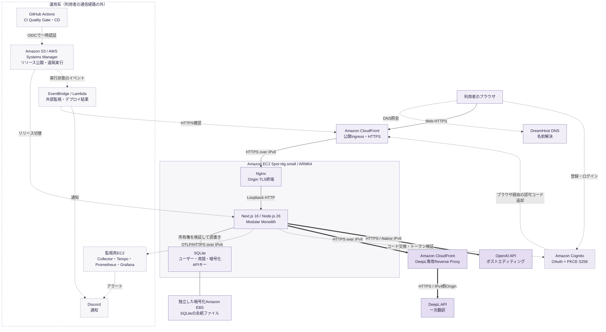
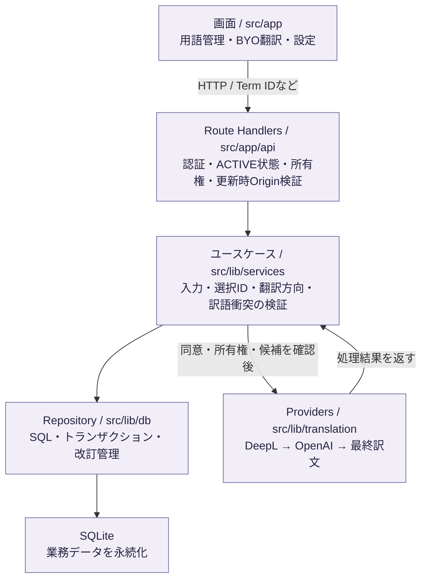
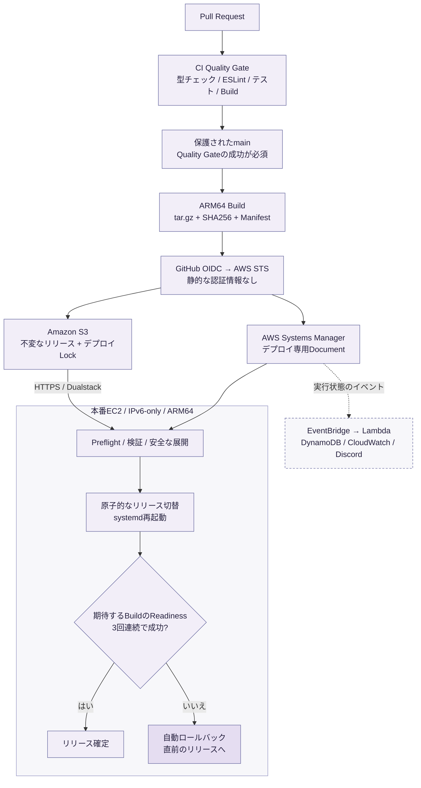

# GMS v5 — 専門用語管理と二段階翻訳

[English](README.md) | **日本語**

GMS v5は、自分の用語集を管理し、翻訳に使う用語を選んでDeepLによる一次翻訳とOpenAIによるポストエディティングを行うWebアプリケーションです。医薬・医学など、原語と訳語の対応を管理したい専門分野の翻訳作業を支援します。

用語集・用語・APIキーはユーザーごとに分離します。開発ではAI Unified Process（AIUP）に従い、要件・ユースケースを実装と検証の根拠にしています。

## 公開サイトと現在のリリース

- **公開サイト：** [sunlightjetrans.com](https://sunlightjetrans.com)
- **本番アプリケーション：** `main`へのMergeごとに自動デプロイされるため、このREADMEではコミットを固定して記載しません。節目の時点で記録したリリースは[Production State §3.1](docs/infrastructure/production-state.md#31-application-release)、各デプロイの証跡は[Continuous DeploymentのRun](https://github.com/1716964609/GMSv5/actions/workflows/cd.yml)にあります。手動でデプロイした最後のリリースは`364d0b7`（2026年11月14日）です。
- **CI/CD：** Pull RequestはCI Quality Gateの成功が必須です。保護された`main`へMergeすると、そのコミットをビルド・公開し、本番へ自動デプロイします。
- **復旧：** 自動ロールバックと再起動時の復旧（Boot Recovery）は、本番EC2で受入に合格しました。どちらも障害を制御して注入した試験です。
- **バックアップと災害復旧：** Amazon Data Lifecycle ManagerによるDB用EBSの日次スナップショット（2世代保持）を2026年11月20日に適用しました。初回の定期スナップショットと世代交代はまだ確認していません。スナップショットから隔離環境へ復元する演習では、機能の復旧（ログインと用語集の参照）まで7分58秒でした。使った復旧点は約267.5時間前のもので、暫定目標のRPO 24時間は**達成していません**。演習用の資源は削除済みです。詳細は[DR As-Built](docs/infrastructure/dr-as-built-2026-11-20.md)と[災害復旧Runbook](docs/infrastructure/disaster-recovery-runbook.md)にあります。
- **監視：** サーバー側のTraceとMetricsを本番で有効化し、確認済みです。翻訳遅延のSLOアラート、外部からの死活監視、デプロイ結果の監視が稼働しています。Browser RUMは実装済みですが本番では無効です。ログの集中管理とEdge監視は未完成で、SLOの7日間の達成実績はまだありません。
- **Baseline 1.2：** 紫系の公開LP刷新（CR-02）と、大量用語選択の制限付き並列取得（CR-01）を本番反映。
- **利用料金：** GMS自体は無料。DeepL・OpenAIのAPI利用料金は、利用者自身の契約条件に従います。

LPのガラス調パネルは機能を伝えるコンセプトビジュアルです。実製品のスクリーンショットや、実行済み翻訳結果ではありません。

以下の図は現行コードと既存の構築記録を要約しています。2026年11月19日の文書同期では、AWSへの再照会や本番試験は行っていません。実績と証拠の限界は[Production State](docs/infrastructure/production-state.md)と、そこから参照する日付付きAs-Builtを優先します。どの文書が何の根拠になるか、誰が責任を持つかは[Documentation Map](docs/README.md)にまとめています。

## 主な機能

- **用語集管理：** Glossary・Termの作成、検索、編集、削除。デスクトップの5パネルと一覧内スクロールで管理します。
- **JSONインポート：** 1回最大10,000用語ペア。検証と保存をトランザクションで扱い、一部だけ取り込むことを防ぎます。
- **翻訳用語の選択：** 複数Glossaryから個別選択・Select All。翻訳要求全体で最大10,000 Term IDを選択でき、同じIDは二重計上しません。
- **二段階翻訳：** DeepL → OpenAIの順に処理。同じ原語に異なる訳語がある場合は、翻訳前に利用者が候補を選びます。用語なし翻訳も可能です。
- **結果の利用：** 最終訳文を表示し、TXTとしてダウンロードできます。原文・中間訳・最終訳文は業務DBに永続保存しません。
- **アカウントと設定：** Cognito認証、プロフィール設定、ユーザー所有のAPIキーの登録・置換・削除に対応します。

## 技術スタック

| 領域 | 採用技術 |
|---|---|
| 画面 | Next.js 16 / React 19 / TypeScript / Tailwind CSS / LP専用CSS Modules |
| サーバー | Next.js App Router / Route Handlers / Node.js 26 |
| 構成 | 単一EC2上のModular Monolith / Next.js Standalone / systemd |
| 計算資源 | Amazon Linux 2023 / ARM64 / Amazon EC2 Spot `t4g.small` |
| 永続化 | Node.js `node:sqlite` / SQLite / 独立した暗号化Amazon EBS gp3 |
| 認証 | Amazon Cognito Classic Hosted UI / OAuth Authorization Code / PKCE S256 |
| 公開・外部接続 | DreamHost DNS / Amazon CloudFront / Nginx / IPv6-first |
| 構築 | Terraformと手動設定 |
| CI/CD | GitHub Actions（CI Quality Gate、ARM64 Build、CD）/ GitHub OIDC / Amazon S3（不変なリリース公開）/ AWS Systems Manager |
| リリース切替 | 原子的なSymbolic Link置換 / Release-aware Readiness / 自動ロールバック / Boot Recovery |
| 監視 | OpenTelemetry SDK / 別EC2上のOTLP Gateway・OpenTelemetry Collector・Tempo・Prometheus・Grafana |
| 外部監視・通知 | Amazon EventBridge / AWS Lambda / Amazon DynamoDB / Amazon CloudWatch / Discord |

## システム全体の構成

### Diagram A — Production System Architecture



実線の矢印は通常のWeb・内部処理、点線は名前解決・認証・運用系の経路（ラベルで区別）、太線は外部翻訳APIへの送信を示します。DNSは名前解決だけを行い、HTTPリクエストを中継しません。認証の返却はCognitoからブラウザを介したリダイレクトで、通常の公開Ingressを通ってCallbackへ届きます。

Diagram Aの上半分はWeb公開と翻訳の経路です。下の「運用系」は、デプロイと監視の経路を要約したものです。デプロイの詳細はDiagram Bと[Architecture §10](docs/architecture.md#10-ci--build--deployment)、監視の経路（Next.js → OTLP Gateway → Collector → Tempo / Prometheus → Grafana）と外部監視は[Architecture §14〜§15](docs/architecture.md#14-observability)の図を参照してください。

公開用CloudFrontとDeepL専用CloudFrontは別Distributionです。DeepL専用経路にはCloudFront FunctionsとKeyValueStoreによる共有トークン検証・API許可リストがあり、キャッシュは無効です。OpenAI通信はこのプロキシを経由しません。

## アプリケーション内部の処理

画面、HTTP境界、業務ロジック、永続化を同じアプリケーション内のモジュールとして分けています。サービスを分散させずに、入力検証・認可・外部API呼び出しの責務を追える構成です。



翻訳では、ブラウザが選んだTerm IDをサーバーで再検証し、現在の用語をDBから取得します。同意・APIキー・所有権・翻訳方向・訳語の衝突を確認してからDeepLを呼び、その中間訳と原文・用語をOpenAIへ渡します。DeepLだけの成功を全体の成功にはしません。サービスは結果をHTTP応答として返し、翻訳履歴をDBへ保存しません。処理の根拠は[UC-011・UC-012](docs/use-cases.md)と[翻訳サービス](src/lib/services/translation.ts)にあります。

### 10,000件のSelect Allと変更検出

初期表示ではGlossary一覧だけを取得し、展開で最初のTermページ、後続の閲覧で必要なページを取得します。Select Allだけは、全件選択を保証するための追加取得を行います。

1. 最初のページを新規取得し、その時点の`termSetVersion`を確定します。同じ版のページキャッシュだけを再利用します。
2. ワーカープールでページを取得します。暫定デフォルトは同時数2、設定候補は1・2・4。単一操作も同一タブの合計も最大4です。
3. 到着順に依存せずページ番号で結合し、件数・IDの重複や欠落・版の一致を検証します。
4. 全ページ取得後に版を再確認し、既存選択IDとの和集合が10,000件以内なら一度に選択を反映します。

SQLite migration v2は`glossary_term_revisions`を追加します。Glossaryごとのepochと単調増加revisionを保持し、Term作成・更新・削除・移動・JSONインポートなどをDBトリガーで捕捉します。本文と改訂の更新は同じ書込トランザクションです。APIの各ページは所有権・改訂・COUNT・本文を同じ読取トランザクションで揃え、期待した版と異なる場合は409 `TERM_SET_CHANGED`を返します。

取得失敗・変更検出・Abort・古い要求世代では、そのSelect Allによる選択変更は0件です。既存選択や他の成功操作を維持します。折りたたみ・離脱では不要な実行中/待機中要求を中止します。

応答の版にはサーバーの起動世代・Glossaryのepoch・revisionを含め、再起動前のキャッシュを保守的に無効化します。DB復元はアプリ停止・再起動を前提とします。

これは過去の版を読み続ける厳密snapshotではありません。最後の版確認後の変更は凍結できず、翻訳時に再検証します。また、タブ内上限4は複数タブ・全ユーザーを合わせたサーバー負荷上限ではありません。[CR-01技術設計](docs/design/cr-01-parallel-fetch-design.md)に保証範囲と測定計画を記録しています。

## Infrastructure / Networkingの設計判断

| 判断 | 理由とトレードオフ |
|---|---|
| IPv6-first・パブリックIPv4なし | IPv4の継続課金を避ける構成。宛先のIPv6対応が制約になるため、外部サービスごとに接続経路を確認します。 |
| DeepL専用CloudFront Proxy | 10月26日の記録ではEC2からDeepLへのIPv6直接接続が成立しませんでした。IPv6で到達できるCloudFrontを経由させ、DeepLのIPv4側Originへ接続します。NAT Gatewayは導入していません。 |
| 小型EC2上のModular Monolith | MVPの費用・運用の複雑性を抑え、画面からDBまで単一アプリケーションで扱います。単一ホスト障害やSpot中断の影響は残ります。水平分散、無停止デプロイ、インスタンスの自動再作成は実装していません。 |
| 既存構成を変えずにCI/CDを追加 | IPv6-only・ARM64・単一EC2のまま、GitHub OIDC・S3・SSMで配布します。GitHubに静的なAWS認証情報を置かず、EC2への受信ポートも増やしません。その代わり、デプロイのたびにサービスを再起動します。 |
| リリースを不変にし、切替をトランザクションにする | 公開済みリリースは上書きできず、切替の意図は切替前に永続化します。失敗時は直前のリリースへ自動で戻します。戻すのはコードだけで、DBは戻しません。スキーマが変わるリリースは自動デプロイが拒否します。 |
| SQLiteを独立EBSへ保存 | アプリケーションのリリースと永続データを分離します。暗号化gp3とTerraformの`prevent_destroy`を使いますが、これだけでバックアップや高可用性が保証されるわけではありません。 |
| 公開CloudFront → NginxをHTTPS化 | ViewerだけでなくOrigin接続もTLSで保護。構築記録ではOrigin側のネットワーク制限と専用認証ヘッダーを併用しています。 |
| 並列数を制限 | 往復待ちの短縮を狙いながら、小型EC2・SQLiteへの負荷を抑える設計です。同期SQLite処理そのものが並列数に比例して速くなるとは見込みません。 |
| 監視基盤を別EC2へ分離 | 本番EC2の資源を利用者の要求に優先させ、監視基盤の障害を本番から切り離します。監視基盤もSpot・単一のRoot EBSで動いており、バックアップと自動復旧は未整備です。 |

理由の詳細は[10月26日As-Builtの設計判断](docs/infrastructure/production-as-built-2026-10-26.md#11-design-decisions--rationale)と[Architecture](docs/architecture.md)を参照してください。ネットワーク構成の説明は構築当時の記録を継承し、今回のライブAWS監査結果ではありません。

## CI/CDとリリースの仕組み

本番へのデプロイは自動です。変更は、CI Quality Gateに合格したPull Requestを、保護された`main`へMergeすることでのみ本番に届きます。

### Diagram B — CI/CD and Release Flow



パイプラインが行うこと：

- **Quality Gate：** 型チェック、ESLint、アプリケーションのテスト、デプロイエンジンのテスト、死活監視のテスト、本番ビルド、Standalone出力の確認。自動テストは合計298件（アプリケーション125、デプロイエンジン140、死活監視33）です。Quality Gateは全件を実行し、リリース用のビルドは前の2つを実行します。
- **検証済みの成果物：** Linux ARM64上でビルドし、tar.gz、SHA256、リリースManifestを作ります。梱包したリリースを実際に起動し、Readinessを確認してから保存します。
- **一時的な認証：** GitHub ActionsはOIDCで、権限を絞ったIAM Roleを引き受けます。GitHubに静的なAWS認証情報はありません。
- **不変な公開：** リリースは条件付き書き込みでS3へ公開します。公開済みのリリースを、デプロイ用のRoleで上書き・削除することはできません。
- **直列化：** S3上のLockとホスト上のLockで、デプロイの重複を防ぎます。
- **トランザクションとしての切替：** EC2上のRoot所有のデプロイエンジンが、成果物を検証し、安全に展開し、切替の意図を永続化してから`current`のSymbolic Linkを原子的に置き換え、サービスを再起動します。
- **Release-aware Readiness：** `/api/health/ready`が、期待するBuild、DBへの到達、必須テーブル、適用済みMigrationを3回連続で返すことを確認します。
- **自動ロールバック：** 新しいリリースが準備完了にならなければ、直前のリリースへ戻し、そのReadinessを確認します。
- **Boot Recovery：** デプロイの途中でインスタンスが再起動した場合、systemdのUnitがアプリケーションの起動前に直前のリリースを選び、起動後に確認します。
- **デプロイの監視：** デプロイの実行状態をDynamoDBとCloudWatchに記録し、Discordへ通知します。死活監視やSpot中断のイベントとは区別して記録します。

これらは2026年11月19日に本番EC2で受入に合格しました。証跡、計測した所要時間とその限界は[CI/CD As-Built](docs/infrastructure/cicd-as-built-2026-11-19.md)、設計と状態遷移の図は[Architecture §10](docs/architecture.md#10-ci--build--deployment)、運用は[CI/CD Operations Runbook](docs/infrastructure/cicd-operations-runbook.md)にあります。

2026年11月18日までは、必要なときに手動でビルドを起動し、手作業でデプロイしていました。10月26日にはReadiness確認が早すぎて一度切り戻し、Retryを導入して再デプロイした記録があります。手動リリース時代の記録（11月8日のRun `42481781676`、11月13日のRun `43435258778`）は[Architecture §10.8](docs/architecture.md#108-履歴--2026年11月18日までの手動release)と各As-Builtに残しています。

### 実装していないこと・確認していないこと

- 無停止デプロイ。本番は単一インスタンスで、切替のたびにサービスを再起動します。
- DBの自動ロールバック。戻すのはアプリケーションのコードだけです。Migrationの定義が変わるリリースは、切替前に拒否します。
- リリースの自動削除、CDによるデプロイエンジンの更新。エンジンの導入と更新は運用者が行います。
- 結果が不明なデプロイからの自動復旧。運用者が状態を確認するまで、Lockを保持します。
- Spot停止時のインスタンスの自動再作成、ENI/EBSの再構成。Boot Recoveryは同じインスタンスの再起動を扱うもので、別の機能です。
- 実障害でのロールバックとBoot Recovery。受入では、Readinessの失敗を制御して注入しました。Boot Recoveryは、中断したトランザクションを模擬したうえでの実際のOS再起動で確認しており、実際のSpot容量回収では確認していません。
- 失敗したデプロイのDiscord通知の着信。開始と成功の通知は本番で確認済みで、失敗系は単体テストでの確認です。通知はBest-effortです。
- Grafanaのデプロイ用パネル。CloudWatchのMetricはあります。
- CI/CD受入での、認証を伴うE2Eと翻訳機能の再確認。
- DLMの定期スナップショットの実行と世代交代の確認、バックアップ失敗の通知。
- RPO 24時間の達成、本番への災害復旧の切替、別リージョン・別アカウントへの復旧。演習は隔離環境への復元までで、その所要時間は1回の測定値です。
- 公開ドメインで遠方のCloudFront Edgeが選ばれる問題の修正（原因は仮説の段階で、DNSは変更していません）。
- 本番での同時数1・2・4の正式な性能受入。暫定目標の達成は隔離環境のBenchmarkだけで、同時数4は本番に適用していません。

CI/CDの記録にある所要時間（ロールバック処理が約11秒など）は処理の所要時間です。外部から測った停止時間、確立したRTO、保証されたSLOではありません。

## セキュリティ・データ管理

CognitoのAuthorization Code FlowをPKCE S256とOAuth stateで保護し、返却トークンの署名・Issuer・Audience等を検証します。認証後もアプリケーション側で`ACTIVE`状態とデータ所有権を確認します。本番セッションCookieはSecure / HttpOnly / SameSite=Laxで、更新系APIにはOrigin検証があります。

ユーザー所有のDeepL・OpenAI APIキーは、サーバー側でAES-256-GCMにより暗号化して保存し、登録後に平文を返しません。暗号鍵とCookie署名用の秘密情報はDB・ソースと分離したサーバー設定です。DeepLプロキシの共有トークンはユーザーAPIキーと別物で、プロキシで検証してDeepLへ転送する前に削除します。

原文・中間訳・最終訳文はGMS業務DBに保存しません。一方、翻訳時にはDeepLへ原文・選択用語、OpenAIへ原文・中間訳・選択用語を送信します。送信前に利用者の同意を必要とし、外部事業者側の保持方針をGMS側の非保存と同一視しません。選択用語を使うDeepL処理では一時用語集を作り、処理後に削除要求を行います。削除要求の実装と本番での削除完了確認は区別します。

アカウント削除の確定後は通常利用を停止し、APIキーを直ちに削除します。用語集などの30暦日の内部保持は復旧猶予ではなく、バックアップの保存期間とも別です。[Requirements](docs/requirements.md)と[Use Cases](docs/use-cases.md)にデータの扱いを定義しています。

## 本番検証の実績と未検証の範囲

| 区分 | 記録と限界 |
|---|---|
| Baseline 1.2本番ブラウザ | Product OwnerがLavender Edition LP表示と10,000 Term選択成功を確認。網羅的なE2E成功とは扱いません。 |
| Select All所要時間 | 旧版約40秒 → 新版約27秒、参考短縮率約32.5%。同条件の反復測定・正式なp95比較ではありません。 |
| 性能受入 | p95≤20秒・逐次比50%以上短縮は暫定目標。上記観測から達成済みとはしません。2026年11月20日の隔離環境のBenchmarkでは、同時数4が両方の目標を満たしました（[CR-01 §13](docs/design/cr-01-parallel-fetch-design.md#13-隔離環境benchmark2026-11-20)）。この設定は本番に適用しておらず、本番での正式な受入は未実施です。 |
| 公開経路（2026年11月20日） | 独自ドメイン経由で遠方のCloudFront Edgeが選ばれていることを観測。原因は仮説の段階で、DNSは変更していません（[DR As-Built §8](docs/infrastructure/dr-as-built-2026-11-20.md#8-production-latency-investigation--dns--cdn)）。 |
| 監視 Phase 1（2026年11月14日） | 本番の実リクエストのTraceをGrafanaで確認。翻訳1件は約6.87秒、うちDeepL約3.22秒、OpenAI約3.64秒。Prometheusの監視対象は4/4が稼働。1回の観測であり、基準値やSLOではありません。 |
| 開発検証 | 2026年11月19日に、`main`（`53ece4d`）と同じコードで3つのテストスイートをローカル実行し、298件すべて成功（アプリケーション125、デプロイエンジン140、死活監視33）。Lintはエラー0件・警告4件。過去の記録は、Baseline 1.2で83件、Observability実装後（`75d5b17`）で114件です。 |
| CI/CD（2026年11月19日） | Quality Gate、OIDC認証、S3への不変な公開、`main`へのPushによる自動デプロイ、自動ロールバック、Boot Recovery、デプロイ結果の記録と開始・成功の通知を本番で確認。GitHub側の記録は再照合済み、AWS側の結果は運用者が提示した受入証跡によります。 |
| 過去のBuild | Run `43435258778`（Release #11、`364d0b7`）とRun `42481781676`（Release #10、`9783463`）の成功とHead SHAの一致を確認済み。SHA256 Verifiedは運用者の報告によります。 |
| バックアップ・移行準備 | オンラインバックアップ整合性OK、EBS snapshot completed、隔離DB v1→v2と整合性検証PASSとの報告。本番移行後の実測値には置き換えません。 |
| 災害復旧演習（2026年11月20日） | スナップショットから隔離環境へ復元し、DBの整合性検査、Migration、期待するリリースのReadiness、ログインと用語集の参照を確認。アプリケーションの復旧5分08秒、機能の復旧7分58秒。1回の隔離環境での測定で、本番の切替を含まず、保証されたRTOではありません。 |
| 要確認 | 本番Migration適用時のログ（適用済みであることはReadinessの成功から間接的に確認できます）、DLMの定期スナップショットの実行と世代交代、本番への災害復旧の切替、失敗系デプロイ通知の着信、変更409・Abort等の網羅的E2E、端末幅・支援技術・SEOの総合評価。 |

### 資料とコードの差異・確認事項

| 対象 | 照合結果 |
|---|---|
| 認証サービスの選定 | RequirementsのOD-03とUse Casesの継続レビュー事項には選定が残っていますが、コードとAs-BuiltではCognitoを採用済みです。 |
| EBSのマウント確認 | Architectureの「EBS未マウント時に起動しない」に対し、`src/lib/db/sqlite.ts`の直接の検査は絶対パスと親ディレクトリの存在です。アプリケーションのコード単体ではマウント先デバイスまでは検証しません。2026年11月19日からは、起動前のGuardとデプロイのPreflightが、データ用ファイルシステムのUUIDを確認します。 |
| IaCの網羅性 | Terraformは手動で設定した公開経路・Origin制限の全てを表しません。構築記録との併読が必要です。 |
| ローカル認証のポート | `.env.example`は3000、CognitoのTerraform定義は3100を許可しています。下記手順では3100に揃えますが、実際に利用するCognitoの許可URLは設定担当者に確認してください。 |

これらは文書作業で仕様や設定を変更せず、確認事項として明示しています。以前ここに挙げていたSSMの操作手段の記載差（Run CommandかSession Managerか）は、手動リリース時代の記録についてのものです。現在のデプロイはSSMの専用DocumentによるRun Commandで行います。

## リポジトリ構成と責任範囲

1つのリポジトリの中で、DevelopmentとInfrastructureをパスで分けています。将来Infrastructureを別リポジトリへ移せるようにするためです。

| 領域 | コード | 文書 | 責任 |
|---|---|---|---|
| Development | `src/`、`test/`、`e2e/`、`scripts/`、ビルド設定 | [docs/development/](docs/development/README.md)、仕様の文書、`docs/design/` | Development |
| Infrastructure | `infra/` | [docs/infrastructure/](docs/infrastructure/README.md) | Infrastructure / SRE |

アプリケーションの変更は`infra/`に触れず、インフラの変更は`src/`・`test/`・`e2e/`に触れません。両者が接するのは、リリース成果物、`.env.example`の環境変数名、Telemetryの仕様だけです。詳しくは[Documentation Map](docs/README.md)を参照してください。

## ローカル開発

前提はNode.js 26とnpmです。以下は開発者向けの操作例です。

```bash
npm ci
cp .env.example .env.local
```

`.env.example`のDBパスとDeepL接続先は本番向けの例なので、起動前に`.env.local`をローカル用へ変更してください。

```dotenv
GMS_DATABASE_PATH=.data/gmsv5-local.sqlite
DEEPL_API_URL=https://api-free.deepl.com/v2/translate
DEEPL_PROXY_TOKEN=
COGNITO_REDIRECT_URI=http://localhost:3100/api/auth/callback
COGNITO_LOGOUT_URI=http://localhost:3100/
NEXT_PUBLIC_GMS_TERM_FETCH_CONCURRENCY=2
```

既存DBを上書きしない新しいローカルDBパスを使います。セッション秘密情報と32バイトの暗号鍵、ローカルCallbackを許可したCognito設定は別途用意します。テンプレートのプレースホルダーでは認証・APIキー保存は動作しません。実キーや`.env.local`をGitへ追加しないでください。公開LPの閲覧と、実認証・外部翻訳の動作確認は別工程です。

```bash
npm run db:migrate
npm run dev -- --port 3100
```

開発時の検査コマンドは次のとおりです。プロバイダーの自動テストはローカルモックを使用します。実サービス翻訳は別途の設定・同意・API利用料金を伴います。

```bash
npm run typecheck
npm run lint
npm test
```

Pull Requestでは、CI Quality Gateが同じ検査に加えてデプロイエンジンと死活監視のテスト、本番ビルドを実行します。`main`へMergeすると本番へ自動デプロイされます。

`NEXT_PUBLIC_GMS_TERM_FETCH_CONCURRENCY`はビルド時の公開設定です。本番での1・2・4比較はPlatform Teamの測定計画に従います。本番DB・AWSの操作手順はこのREADMEでは展開しません。

## 詳細設計と構築記録

| 資料 | 説明 |
|---|---|
| [Product Vision](docs/vision.md) | 製品の目的と対象範囲 |
| [Requirements](docs/requirements.md) / [Use Cases](docs/use-cases.md) | 要件、操作フロー、受入条件 |
| [Entity Model](docs/entity-model.md) | 業務エンティティと所有関係 |
| [Documentation Map](docs/README.md) | 問いごとの正となる文書、文書の優先順位、責任分担、AI Agent向けの読み順 |
| [Production Architecture](docs/architecture.md) | ネットワーク・認証・永続化・CI/CD・監視の構成（As-Is）。状態遷移、ロールバック、Boot Recovery、デプロイ監視の図を含む |
| [Production State](docs/infrastructure/production-state.md) | 現在の本番状態。実測、Terraformの管理範囲、手動構築、未実装を区別 |
| [CI/CD As-Built 2026-11-19](docs/infrastructure/cicd-as-built-2026-11-19.md) / [CI/CD Operations Runbook](docs/infrastructure/cicd-operations-runbook.md) | CI/CD・自動ロールバック・Boot Recovery・デプロイ監視の本番受入の証跡と、運用手順 |
| [DR As-Built 2026-11-20](docs/infrastructure/dr-as-built-2026-11-20.md) / [災害復旧Runbook](docs/infrastructure/disaster-recovery-runbook.md) | DLMのバックアップ設定、隔離環境での復元演習（RPO / RTO）、CR-01のBenchmark、DNS / CDN調査の証跡と、スナップショットからの復旧手順 |
| [Development文書](docs/development/README.md) / [Telemetry Schema v1](docs/development/observability/application-instrumentation.md) | アプリケーションの範囲、Span・Metric・設定・Redactionの定義 |
| [Infrastructure文書](docs/infrastructure/README.md) / [Observability As-Built 2026-11-13](docs/infrastructure/observability-as-built-2026-11-13.md) | インフラの範囲と記録の規則、監視基盤の証跡（§12が11月14日の本番受入） |
| [Observability As-Built 2026-11-16](docs/infrastructure/observability-as-built-2026-11-16.md) / [Availability As-Built 2026-11-17](docs/infrastructure/availability-external-as-built-2026-11-17.md) | 翻訳SLOとDiscord通知、外部からの死活監視とSpot中断の監視 |
| [Architecture As-To-Be — Add Observability](docs/architecture-as-to-be-add-observability.md) | 監視の目標構成。未実装の項目を含む |
| [Production As-Built 2026-11-08](docs/infrastructure/production-as-built-2026-11-08.md) | Baseline 1.2（`9783463`）の実績、根拠と未確認事項（履歴） |
| [Production As-Built 2026-10-26](docs/infrastructure/production-as-built-2026-10-26.md) | 初期構築とDeepL接続障害への対応履歴 |
| [CR-01技術設計](docs/design/cr-01-parallel-fetch-design.md) | 制限付き並列取得・改訂管理・性能測定計画 |
| [Baseline 1.2デザイン記録](docs/design/baseline-1.2-proposal.md) | 公開LPの承認済み方針と変更履歴 |
| [Terraform（本番）](infra/terraform/v5/main.tf) / [Terraform（監視）](infra/terraform/observability/main.tf) / [Terraform（CI/CD）](infra/terraform/v5/cicd.tf) | コード化された構築範囲 |
| [CI workflow](.github/workflows/ci.yml) / [ARM64 workflow](.github/workflows/build-arm64.yml) / [CD workflow](.github/workflows/cd.yml) / [デプロイエンジン](infra/deployment/) | コード化された検査・ビルド・デプロイ |

図はGitHubが標準対応するMermaid fenced code blockで管理しています。構文の参照先は[GitHubの図の作成方法](https://docs.github.com/en/get-started/writing-on-github/working-with-advanced-formatting/creating-diagrams)と[Mermaid flowchart仕様](https://mermaid.js.org/syntax/flowchart.html)です。GitHub側の描画バージョンや画面幅による最終的な見え方は、Product Ownerのリポジトリレビューで確認してください。
