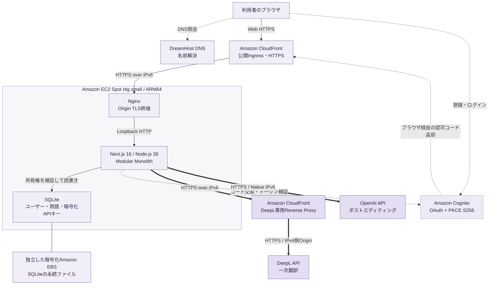
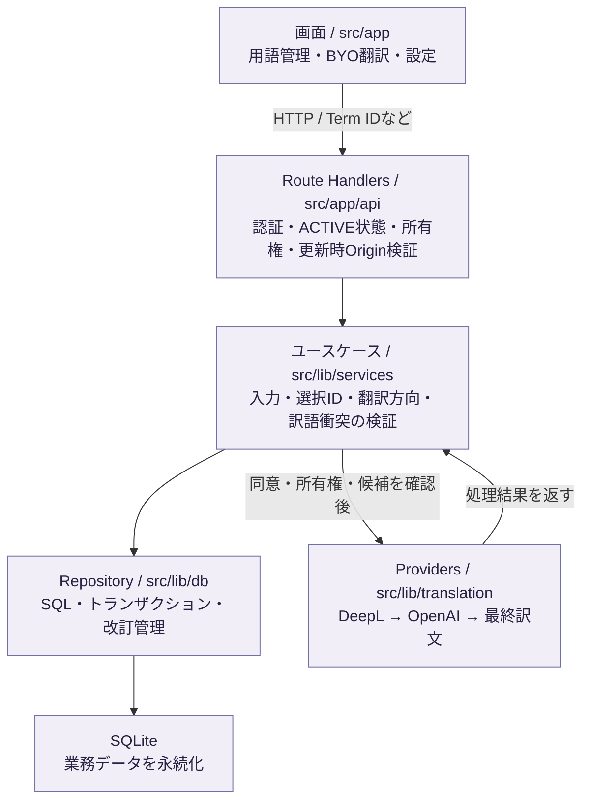
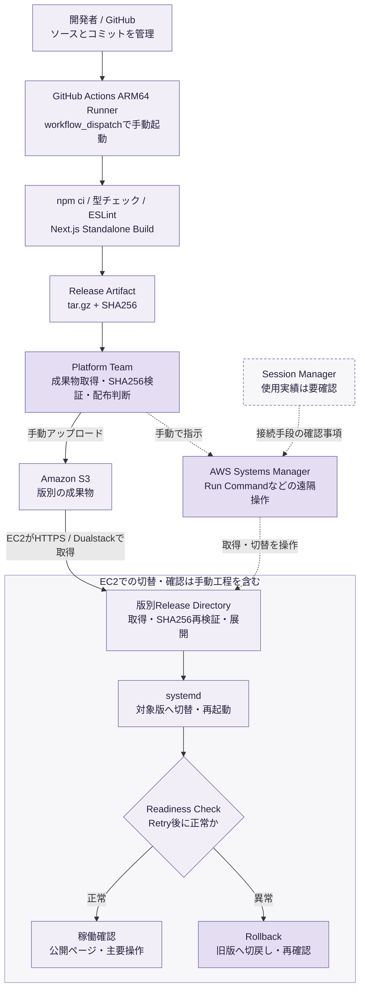

# GMS v5 — 専門用語管理と二段階翻訳

[English](README.md) | **日本語**

GMS v5は、自分の用語集を管理し、翻訳に使う用語を選んでDeepLによる一次翻訳とOpenAIによるポストエディティングを行うWebアプリケーションです。医薬・医学など、原語と訳語の対応を管理したい専門分野の翻訳作業を支援します。

用語集・用語・APIキーはユーザーごとに分離します。開発ではAI Unified Process（AIUP）に従い、要件・ユースケースを実装と検証の根拠にしています。

## 公開サイトと現在のリリース

- **公開サイト：** [sunlightjetrans.com](https://sunlightjetrans.com)
- **本番アプリケーション：** `364d0b7ebd4868f6d54b271ce9144b001bd380ca`（2026年11月14日に本番で確認）。直前のリリースは`9783463dcdd3f3b10f743ab3e1488978b842b4be`（2026年11月8日）で、切り戻し用に保持しています。
- **監視：** サーバー側のTraceとMetricsを本番で有効化し、確認済みです。Browser RUMは実装済みですが本番では無効です。ログの集中管理、Edge監視、アラート、SLO、自動復旧は未完成です。
- **Baseline 1.2：** 紫系の公開LP刷新（CR-02）と、大量用語選択の制限付き並列取得（CR-01）を本番反映。
- **利用料金：** GMS自体は無料。DeepL・OpenAIのAPI利用料金は、利用者自身の契約条件に従います。

LPのガラス調パネルは機能を伝えるコンセプトビジュアルです。実製品のスクリーンショットや、実行済み翻訳結果ではありません。

以下の図は現行コードと既存の構築記録を要約しています。AWSへの再照会や本番試験は今回行っていません。実績と証拠の限界は[Production State](docs/infrastructure/production-state.md)と、そこから参照する日付付きAs-Builtを優先します。どの文書が何の根拠になるか、誰が責任を持つかは[Documentation Map](docs/README.md)にまとめています。

## 主な機能

- **用語集管理：** Glossary・Termの作成、検索、編集、削除。デスクトップの5パネルと一覧内スクロールで管理します。
- **JSONインポート：** 1回最大10,000用語ペア。検証と保存をトランザクションで扱い、一部だけ取り込むことを防ぎます。
- **翻訳用語の選択：** 複数Glossaryから個別選択・Select All。翻訳要求全体で最大10,000 Term IDを選択でき、同じIDは二重計上しません。
- **二段階翻訳：** DeepL → OpenAIの順に処理。同じ原語に異なる訳語がある場合は、翻訳前に利用者が候補を選びます。用語なし翻訳も可能です。
- **結果の利用：** 最終訳文を表示し、TXTとしてダウンロードできます。原文・中間訳・最終訳文は業務DBに永続保存しません。
- **アカウントと設定：** Cognito認証、プロフィール設定、ユーザー所有のAPIキーの登録・置換・削除に対応します。

## 技術スタック

| 領域 | 採用技術 |
|---|---|
| 画面 | Next.js 16 / React 19 / TypeScript / Tailwind CSS / LP専用CSS Modules |
| サーバー | Next.js App Router / Route Handlers / Node.js 26 |
| 構成 | 単一EC2上のModular Monolith / Next.js Standalone / systemd |
| 計算資源 | Amazon Linux 2023 / ARM64 / Amazon EC2 Spot `t4g.small` |
| 永続化 | Node.js `node:sqlite` / SQLite / 独立した暗号化Amazon EBS gp3 |
| 認証 | Amazon Cognito Classic Hosted UI / OAuth Authorization Code / PKCE S256 |
| 公開・外部接続 | DreamHost DNS / Amazon CloudFront / Nginx / IPv6-first |
| 構築・配布 | Terraformと手動設定 / GitHub Actions ARM64 / Amazon S3 / AWS Systems Manager |
| 監視 | OpenTelemetry SDK / 別EC2上のOTLP Gateway・OpenTelemetry Collector・Tempo・Prometheus・Grafana（Phase 1） |

## システム全体の構成

### Diagram A — Production System Architecture



実線の矢印は通常のWeb・内部処理、点線は名前解決または認証（ラベルで区別）、太線は外部翻訳APIへの送信を示します。DNSは名前解決だけを行い、HTTPリクエストを中継しません。認証の返却はCognitoからブラウザを介したリダイレクトで、通常の公開Ingressを通ってCallbackへ届きます。

Diagram AはWeb公開と翻訳の経路を示します。リリース`364d0b7`で加わった監視の経路（Next.js → OTLP Gateway → Collector → Tempo / Prometheus → Grafana）は、[Architecture §14](docs/architecture.md)の図を参照してください。

公開用CloudFrontとDeepL専用CloudFrontは別Distributionです。DeepL専用経路にはCloudFront FunctionsとKeyValueStoreによる共有トークン検証・API許可リストがあり、キャッシュは無効です。OpenAI通信はこのプロキシを経由しません。

## アプリケーション内部の処理

画面、HTTP境界、業務ロジック、永続化を同じアプリケーション内のモジュールとして分けています。サービスを分散させずに、入力検証・認可・外部API呼び出しの責務を追える構成です。



翻訳では、ブラウザが選んだTerm IDをサーバーで再検証し、現在の用語をDBから取得します。同意・APIキー・所有権・翻訳方向・訳語の衝突を確認してからDeepLを呼び、その中間訳と原文・用語をOpenAIへ渡します。DeepLだけの成功を全体の成功にはしません。サービスは結果をHTTP応答として返し、翻訳履歴をDBへ保存しません。処理の根拠は[UC-011・UC-012](docs/use-cases.md)と[翻訳サービス](src/lib/services/translation.ts)にあります。

### 10,000件のSelect Allと変更検出

初期表示ではGlossary一覧だけを取得し、展開で最初のTermページ、後続の閲覧で必要なページを取得します。Select Allだけは、全件選択を保証するための追加取得を行います。

1. 最初のページを新規取得し、その時点の`termSetVersion`を確定します。同じ版のページキャッシュだけを再利用します。
2. ワーカープールでページを取得します。暫定デフォルトは同時数2、設定候補は1・2・4。単一操作も同一タブの合計も最大4です。
3. 到着順に依存せずページ番号で結合し、件数・IDの重複や欠落・版の一致を検証します。
4. 全ページ取得後に版を再確認し、既存選択IDとの和集合が10,000件以内なら一度に選択を反映します。

SQLite migration v2は`glossary_term_revisions`を追加します。Glossaryごとのepochと単調増加revisionを保持し、Term作成・更新・削除・移動・JSONインポートなどをDBトリガーで捕捉します。本文と改訂の更新は同じ書込トランザクションです。APIの各ページは所有権・改訂・COUNT・本文を同じ読取トランザクションで揃え、期待した版と異なる場合は409 `TERM_SET_CHANGED`を返します。

取得失敗・変更検出・Abort・古い要求世代では、そのSelect Allによる選択変更は0件です。既存選択や他の成功操作を維持します。折りたたみ・離脱では不要な実行中/待機中要求を中止します。

応答の版にはサーバーの起動世代・Glossaryのepoch・revisionを含め、再起動前のキャッシュを保守的に無効化します。DB復元はアプリ停止・再起動を前提とします。

これは過去の版を読み続ける厳密snapshotではありません。最後の版確認後の変更は凍結できず、翻訳時に再検証します。また、タブ内上限4は複数タブ・全ユーザーを合わせたサーバー負荷上限ではありません。[CR-01技術設計](docs/design/cr-01-parallel-fetch-design.md)に保証範囲と測定計画を記録しています。

## Infrastructure / Networkingの設計判断

| 判断 | 理由とトレードオフ |
|---|---|
| IPv6-first・パブリックIPv4なし | IPv4の継続課金を避ける構成。宛先のIPv6対応が制約になるため、外部サービスごとに接続経路を確認します。 |
| DeepL専用CloudFront Proxy | 10月26日の記録ではEC2からDeepLへのIPv6直接接続が成立しませんでした。IPv6で到達できるCloudFrontを経由させ、DeepLのIPv4側Originへ接続します。NAT Gatewayは導入していません。 |
| 小型EC2上のModular Monolith | MVPの費用・運用の複雑性を抑え、画面からDBまで単一アプリケーションで扱います。単一ホスト障害やSpot中断の影響は残り、水平分散や自動復旧を実装済みとはしません。 |
| SQLiteを独立EBSへ保存 | アプリケーションのリリースと永続データを分離します。暗号化gp3とTerraformの`prevent_destroy`を使いますが、これだけでバックアップや高可用性が保証されるわけではありません。 |
| 公開CloudFront → NginxをHTTPS化 | ViewerだけでなくOrigin接続もTLSで保護。構築記録ではOrigin側のネットワーク制限と専用認証ヘッダーを併用しています。 |
| 並列数を制限 | 往復待ちの短縮を狙いながら、小型EC2・SQLiteへの負荷を抑える設計です。同期SQLite処理そのものが並列数に比例して速くなるとは見込みません。 |
| 監視基盤を別EC2へ分離 | 本番EC2の資源を利用者の要求に優先させ、監視基盤の障害を本番から切り離します。監視基盤もSpot・単一のRoot EBSで動いており、バックアップと自動復旧は未整備です。 |

理由の詳細は[10月26日As-Builtの設計判断](docs/infrastructure/production-as-built-2026-10-26.md#11-design-decisions--rationale)と[Architecture](docs/architecture.md)を参照してください。ネットワーク構成の説明は構築当時の記録を継承し、今回のライブAWS監査結果ではありません。

## CI/CDとリリースの仕組み

### Diagram B — Build & Release Flow



[ARM64 workflow](.github/workflows/build-arm64.yml)が自動化するのは、手動起動後の検査・ビルド・梱包・Artifact保存までです。以降はPlatform Teamがチェックサムを確認し、S3への配布とSSM経由のEC2切替を行います。Git pushだけで本番更新する完全自動CDではありません。現行workflowには単体・結合テストの実行ステップがないため、開発テスト（`75d5b17`時点で114件）をCIでの実行件数には数えません。

10月26日にはReadiness確認が早すぎて一度切り戻し、その後Retryを導入して再デプロイした記録があります。11月8日はActions Run `42481781676`の成功、SHA256照合済み・S3→SSM→systemdでの配布が報告されています。11月8日のsystemd最終出力や切戻し資産の現存確認は別途必要です。

現行リリース`364d0b7`は、11月13日の[Build ARM64 Release #11 / Run 43435258778](https://github.com/1716964609/GMSv5/actions/runs/43435258778)（成功、Head SHA一致）の成果物です。SHA256照合済みは運用者の報告によります。本番での起動とReadiness 200は[Observability As-Built §12](docs/infrastructure/observability-as-built-2026-11-13.md#12-production-phase-1-acceptance)に記録されています。切替時のSSM Command IDとsystemdの最終出力は記録されていません。

**SSMの記載差：** ArchitectureはRun Command、10月26日の手順は「SSMで接続」、11月8日の報告は「SSM経由」と記載しています。Session ManagerとRun Commandは異なる操作手段であり、Session Managerの使用実績まではこれらの記録から確定しません。図にも要確認として示し、推測で使用済みとは扱いません。

## セキュリティ・データ管理

CognitoのAuthorization Code FlowをPKCE S256とOAuth stateで保護し、返却トークンの署名・Issuer・Audience等を検証します。認証後もアプリケーション側で`ACTIVE`状態とデータ所有権を確認します。本番セッションCookieはSecure / HttpOnly / SameSite=Laxで、更新系APIにはOrigin検証があります。

ユーザー所有のDeepL・OpenAI APIキーは、サーバー側でAES-256-GCMにより暗号化して保存し、登録後に平文を返しません。暗号鍵とCookie署名用の秘密情報はDB・ソースと分離したサーバー設定です。DeepLプロキシの共有トークンはユーザーAPIキーと別物で、プロキシで検証してDeepLへ転送する前に削除します。

原文・中間訳・最終訳文はGMS業務DBに保存しません。一方、翻訳時にはDeepLへ原文・選択用語、OpenAIへ原文・中間訳・選択用語を送信します。送信前に利用者の同意を必要とし、外部事業者側の保持方針をGMS側の非保存と同一視しません。選択用語を使うDeepL処理では一時用語集を作り、処理後に削除要求を行います。削除要求の実装と本番での削除完了確認は区別します。

アカウント削除の確定後は通常利用を停止し、APIキーを直ちに削除します。用語集などの30暦日の内部保持は復旧猶予ではなく、バックアップの保存期間とも別です。[Requirements](docs/requirements.md)と[Use Cases](docs/use-cases.md)にデータの扱いを定義しています。

## 本番検証の実績と未検証の範囲

| 区分 | 記録と限界 |
|---|---|
| Baseline 1.2本番ブラウザ | Product OwnerがLavender Edition LP表示と10,000 Term選択成功を確認。網羅的なE2E成功とは扱いません。 |
| Select All所要時間 | 旧版約40秒 → 新版約27秒、参考短縮率約32.5%。同条件の反復測定・正式なp95比較ではありません。 |
| 性能受入 | p95≤20秒・逐次比50%以上短縮は暫定目標。上記観測から達成済みとはしません。同時数1・2・4の正式比較は未実施です。 |
| 監視 Phase 1（2026年11月14日） | 本番の実リクエストのTraceをGrafanaで確認。翻訳1件は約6.87秒、うちDeepL約3.22秒、OpenAI約3.64秒。Prometheusの監視対象は4/4が稼働。1回の観測であり、基準値やSLOではありません。 |
| 開発検証 | Baseline 1.2の記録では単体・結合83件成功・失敗0件。Observability実装後（`75d5b17`）の記録では114件成功、型チェック成功、Lintエラー0件・既存警告2件。今回の文書作業では再実行していません。 |
| Build | Run `43435258778`（Release #11、`364d0b7`）とRun `42481781676`（Release #10、`9783463`）の成功とHead SHAの一致を確認済み。SHA256 Verifiedは運用者の報告によります。 |
| バックアップ・移行準備 | オンラインバックアップ整合性OK、EBS snapshot completed、隔離DB v1→v2と整合性検証PASSとの報告。本番移行後の実測値には置き換えません。 |
| 要確認 | 本番Migration適用ログ、systemd最終状態、Rollback資産と復元試験、変更409・Abort等の網羅的E2E、端末幅・支援技術・SEOの総合評価。 |

### 資料とコードの差異・確認事項

| 対象 | 照合結果 |
|---|---|
| 認証サービスの選定 | RequirementsのOD-03とUse Casesの継続レビュー事項には選定が残っていますが、コードとAs-BuiltではCognitoを採用済みです。 |
| EBSのマウント確認 | Architectureの「EBS未マウント時に起動しない」に対し、`src/lib/db/sqlite.ts`の直接の検査は絶対パスと親ディレクトリの存在です。コード単体でマウント先デバイスまでは検証しません。 |
| IaCの網羅性 | Terraformは手動で設定した公開経路・Origin制限の全てを表しません。構築記録との併読が必要です。 |
| ローカル認証のポート | `.env.example`は3000、CognitoのTerraform定義は3100を許可しています。下記手順では3100に揃えますが、実際に利用するCognitoの許可URLは設定担当者に確認してください。 |

これらは今回の文書作業で仕様や設定を変更せず、確認事項として明示しています。SSMの操作手段の記載差も前節のとおりです。

## リポジトリ構成と責任範囲

1つのリポジトリの中で、DevelopmentとInfrastructureをパスで分けています。将来Infrastructureを別リポジトリへ移せるようにするためです。

| 領域 | コード | 文書 | 責任 |
|---|---|---|---|
| Development | `src/`、`test/`、`e2e/`、`scripts/`、ビルド設定 | [docs/development/](docs/development/README.md)、仕様の文書、`docs/design/` | Development |
| Infrastructure | `infra/` | [docs/infrastructure/](docs/infrastructure/README.md) | Infrastructure / SRE |

アプリケーションの変更は`infra/`に触れず、インフラの変更は`src/`・`test/`・`e2e/`に触れません。両者が接するのは、リリース成果物、`.env.example`の環境変数名、Telemetryの仕様だけです。詳しくは[Documentation Map](docs/README.md)を参照してください。

## ローカル開発

前提はNode.js 26とnpmです。以下は開発者向けの操作例であり、今回の文書作業で実行したものではありません。

```bash
npm ci
cp .env.example .env.local
```

`.env.example`のDBパスとDeepL接続先は本番向けの例なので、起動前に`.env.local`をローカル用へ変更してください。

```dotenv
GMS_DATABASE_PATH=.data/gmsv5-local.sqlite
DEEPL_API_URL=https://api-free.deepl.com/v2/translate
DEEPL_PROXY_TOKEN=
COGNITO_REDIRECT_URI=http://localhost:3100/api/auth/callback
COGNITO_LOGOUT_URI=http://localhost:3100/
NEXT_PUBLIC_GMS_TERM_FETCH_CONCURRENCY=2
```

既存DBを上書きしない新しいローカルDBパスを使います。セッション秘密情報と32バイトの暗号鍵、ローカルCallbackを許可したCognito設定は別途用意します。テンプレートのプレースホルダーでは認証・APIキー保存は動作しません。実キーや`.env.local`をGitへ追加しないでください。公開LPの閲覧と、実認証・外部翻訳の動作確認は別工程です。

```bash
npm run db:migrate
npm run dev -- --port 3100
```

開発時の検査コマンドは次のとおりです。プロバイダーの自動テストはローカルモックを使用します。実サービス翻訳は別途の設定・同意・API利用料金を伴います。

```bash
npm run typecheck
npm run lint
node --experimental-strip-types --test test/*.test.ts
```

`NEXT_PUBLIC_GMS_TERM_FETCH_CONCURRENCY`はビルド時の公開設定です。本番での1・2・4比較はPlatform Teamの測定計画に従います。本番DB・AWSの操作手順はこのREADMEでは展開しません。

## 詳細設計と構築記録

| 資料 | 説明 |
|---|---|
| [Product Vision](docs/vision.md) | 製品の目的と対象範囲 |
| [Requirements](docs/requirements.md) / [Use Cases](docs/use-cases.md) | 要件、操作フロー、受入条件 |
| [Entity Model](docs/entity-model.md) | 業務エンティティと所有関係 |
| [Documentation Map](docs/README.md) | 問いごとの正となる文書、文書の優先順位、責任分担、AI Agent向けの読み順 |
| [Production Architecture](docs/architecture.md) | ネットワーク・認証・永続化・監視の構成（As-Is） |
| [Production State](docs/infrastructure/production-state.md) | 現在の本番状態。実測、Terraformの管理範囲、手動構築、未実装を区別 |
| [Development文書](docs/development/README.md) / [Telemetry Schema v1](docs/development/observability/application-instrumentation.md) | アプリケーションの範囲、Span・Metric・設定・Redactionの定義 |
| [Infrastructure文書](docs/infrastructure/README.md) / [Observability As-Built 2026-11-13](docs/infrastructure/observability-as-built-2026-11-13.md) | インフラの範囲と記録の規則、監視基盤の証跡（§12が11月14日の本番受入） |
| [Architecture As-To-Be — Add Observability](docs/architecture-as-to-be-add-observability.md) | 監視の目標構成。未実装の項目を含む |
| [Production As-Built 2026-11-08](docs/infrastructure/production-as-built-2026-11-08.md) | Baseline 1.2（`9783463`）の実績、根拠と未確認事項（履歴） |
| [Production As-Built 2026-10-26](docs/infrastructure/production-as-built-2026-10-26.md) | 初期構築とDeepL接続障害への対応履歴 |
| [CR-01技術設計](docs/design/cr-01-parallel-fetch-design.md) | 制限付き並列取得・改訂管理・性能測定計画 |
| [Baseline 1.2デザイン記録](docs/design/baseline-1.2-proposal.md) | 公開LPの承認済み方針と変更履歴 |
| [Terraform（本番）](infra/terraform/v5/main.tf) / [Terraform（監視）](infra/terraform/observability/main.tf) / [ARM64 workflow](.github/workflows/build-arm64.yml) | コード化された構築・ビルド範囲 |

図はGitHubが標準対応するMermaid fenced code blockで管理しています。構文の参照先は[GitHubの図の作成方法](https://docs.github.com/en/get-started/writing-on-github/working-with-advanced-formatting/creating-diagrams)と[Mermaid flowchart仕様](https://mermaid.js.org/syntax/flowchart.html)です。GitHub側の描画バージョンや画面幅による最終的な見え方は、Product Ownerのリポジトリレビューで確認してください。
