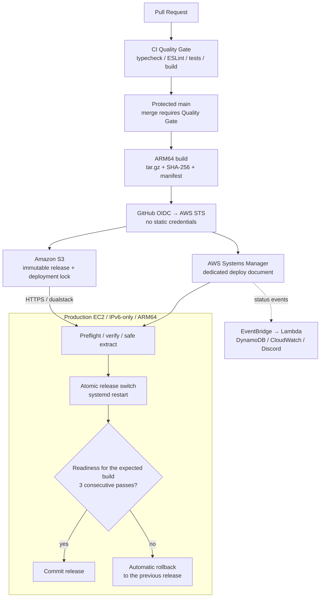

# GMS v5 — Glossary Management System

**English** | [日本語](README.ja.md)

GMS v5 is a multilingual glossary management and AI-assisted translation web application. Users manage their own terminology, select terms for a translation request, and use a two-stage DeepL → OpenAI translation flow with their own API keys.

This repository follows Spec-Driven Development and Simon Martinelli's AI Unified Process (AIUP). The status below reflects the verified state as of 2026-11-19 JST. It distinguishes measured evidence, operator reports, and unverified items; the evidence is indexed in [Production State](docs/infrastructure/production-state.md). Infrastructure descriptions inherited from the October record have not been re-audited against AWS.

To find which document is the source of truth for a given question, and who owns it, start with the [Documentation Map](docs/README.md).

## Production Status

- Public URL: <https://sunlightjetrans.com>
- Current application release: `53ece4d8809cdf439cf9c182ce1f41c0b017e3af`, deployed on 2026-11-19 by a push to `main` ([Run 44353371110](https://github.com/1716964609/GMSv5/actions/runs/44353371110)). Later merges replace it automatically
- Delivery: pull requests must pass the CI Quality Gate; a merge into the protected `main` branch builds, publishes and deploys the exact commit to production
- Recovery: automatic rollback and boot recovery passed acceptance on the production EC2 instance, using controlled failure injection
- Observability: server traces and metrics are enabled and verified in production; a translation latency SLO alert, external availability monitoring and deployment outcome monitoring are running; Browser RUM is implemented but disabled
- Previous releases: `364d0b7` (2026-11-14, the last manually deployed release), `9783463` (2026-11-08), `5f0c6e7`; initial production release `f5fb681` on 2026-10-25
- Runtime: Amazon Linux 2023 / ARM64 / Node.js 26 / Next.js Standalone
- Process: `gmsv5.service`
- Database: SQLite on an independent encrypted EBS volume

The DeepL IPv4 reachability issue was addressed in release `51cba4a` by adding a dedicated CloudFront Reverse Proxy. OpenAI continues to use the EC2 native IPv6 path.

The Product Owner confirmed the new Lavender LP and successful selection of 10,000 Terms in production. Select All was observed at approximately 27 seconds versus 40 seconds previously (about 32.5% reduction). This is not a controlled p95 comparison; the provisional ≤20-second / ≥50% improvement targets are not met by these observations and formal performance acceptance remains pending. See the [2026-11-08 As-Built](docs/infrastructure/production-as-built-2026-11-08.md).

Release `364d0b7` added OpenTelemetry instrumentation to the application. The application sends server traces and metrics over authenticated OTLP/HTTPS to a separate observability EC2 instance running an OTLP gateway, OpenTelemetry Collector, Tempo, Prometheus and Grafana. In the [Phase 1 acceptance record](docs/infrastructure/observability-as-built-2026-11-13.md#12-production-phase-1-acceptance), a production translation request was observed at about 6.87 seconds, with DeepL at about 3.22 seconds and OpenAI post-editing at about 3.64 seconds. That is a single observation, not a baseline or an SLO. Since then a pilot SLO alert (95% of successful translations within 10 seconds over a rolling 7 days) and Discord notification have been verified, but seven days of attainment have not been established. Centralized logs, edge monitoring and backup of the observability host are not complete, and that host is only partly reproducible from Terraform.

The release of 2026-11-19 added liveness and readiness endpoints and automated deployment. It contains no schema change. Authenticated end-to-end behavior and translation were not revalidated as part of the CI/CD acceptance.

## Core Features

- Purple/Lavender public landing page with existing registration and login entry points
- Lazy Term pages and revision-aware bounded parallel Select All (default 2, operation/tab maximum 4), with atomic selection and a 10,000 unique Term ID limit
- Cognito-based registration, email verification, login, logout, and password recovery
- User-owned Glossary and Term CRUD
- Strict JSON glossary import with transactional All-or-Nothing behavior
- Owner-scoped terminology search and pagination
- Translation-time terminology conflict resolution without changing persistent Terms
- DeepL primary translation followed by OpenAI post-editing
- Encrypted Bring Your Own API Keys (BYOK)
- TXT export of the final translation
- Account deletion with immediate API-key deletion and 30-calendar-day internal retention

## Technology Stack

| Layer | Technology |
|---|---|
| Frontend | Next.js 16 / React / TypeScript |
| UI | Tailwind CSS |
| Backend | Next.js App Router / Route Handlers |
| Runtime | Node.js 26 / Linux ARM64 |
| Architecture | Modular Monolith |
| Database | SQLite / independent encrypted EBS gp3 |
| Authentication | Amazon Cognito Lite / Classic Hosted UI |
| Public ingress | DreamHost DNS / CloudFront / Nginx |
| DeepL egress | Dedicated CloudFront Reverse Proxy |
| OpenAI egress | Native IPv6 from EC2 |
| IaC | Terraform and documented manual operations |
| CI | GitHub Actions Quality Gate on pull requests; protected `main` |
| Build | GitHub Actions ARM64 runner; standalone artifact, SHA-256, release manifest |
| CD | GitHub Actions on push to `main`; GitHub OIDC / AWS STS, no static AWS credentials |
| Release transfer | Immutable S3 publication (regional dualstack endpoint) / dedicated AWS Systems Manager document |
| Release switching | Atomic symlink replacement, release-aware readiness, automatic rollback, boot recovery |
| Process manager | systemd |
| Telemetry | OpenTelemetry SDK (server traces and metrics) |
| Observability | Separate EC2: OTLP gateway, OpenTelemetry Collector, Tempo, Prometheus, Grafana |
| External monitoring | EventBridge / Lambda / DynamoDB / CloudWatch for availability, Spot lifecycle and deployment outcomes; Discord notification |

For an interview-oriented walkthrough in Japanese, see the [production system diagram](README.ja.md#diagram-a--production-system-architecture), [application flow](README.ja.md#アプリケーション内部の処理), and [CI/CD diagram](README.ja.md#diagram-b--cicd-and-release-flow).

## Production Infrastructure Summary

### Web ingress

```text
Browser
  -> DreamHost DNS: sunlightjetrans.com
  -> Existing CloudFront: E1EF0DWDYA2XH8
  -> HTTPS / IPv6: origin-v5.sunlightjetrans.com
  -> EC2 Nginx: 443
  -> Next.js: 127.0.0.1:3000
  -> SQLite: /mnt/gms-data/gmsv5.sqlite on independent EBS
```

The existing public CloudFront distribution uses ACM for viewer TLS and connects to the EC2 origin over HTTPS/IPv6. Nginx uses the Let's Encrypt origin certificate. The EC2 instance has no public IPv4.

### DeepL-only egress

```text
Next.js / EC2
  -> HTTPS / IPv6
  -> Dedicated CloudFront: E3L3D4LI8CKI2M
     d7xjhnc06nb75.cloudfront.net
  -> HTTPS
  -> api-free.deepl.com
```

The dedicated distribution uses a CloudFront Functions runtime 2.0 function and CloudFront KeyValueStore. The function authenticates `x-gms-proxy-token`, removes that proxy token before forwarding, and allows only:

| Method | Path |
|---|---|
| POST | `/v2/translate` |
| POST | `/v2/glossaries` |
| DELETE | `/v2/glossaries/{id}` |

Caching is disabled and HTTPS is forced. The proxy token is not the user's DeepL API key. The user's key remains the DeepL `Authorization: DeepL-Auth-Key ...` credential.

### OpenAI egress

OpenAI is called directly over the EC2 native IPv6 path. It does not use the DeepL CloudFront proxy.

### Secrets and IAM

- systemd service: `gmsv5.service`
- environment file: `/etc/gmsv5/gmsv5.env`
- environment file permissions: `root:root 600`
- DeepL proxy token: SSM Parameter Store SecureString
- Parameter: `/gmsv5/deepl/proxy-token`
- access: EC2 IAM role with parameter read permission
- SSM: IPv6-capable endpoint

Secret values, API keys, Cognito client secrets, and encryption keys are never stored in this repository or its documentation.

## CI/CD and Release

Production deployment is automatic. A change reaches production only through a pull request that passes the CI Quality Gate and is merged into the protected `main` branch.



What the pipeline does:

- **Quality Gate.** Type checking, ESLint, application tests, deployment engine tests, availability monitoring tests, a production build and a check of the standalone output. The combined inventory is 298 automated tests (application 125, deployment engine 140, availability monitoring 33). The Quality Gate runs all of them; the release build runs the first two suites.
- **Verified artifact.** A native Linux ARM64 build produces the standalone tarball, its SHA-256 checksum and a release manifest. The packaged release is started and its readiness checked before it is uploaded.
- **Short-lived credentials.** GitHub Actions assumes a scoped IAM role through OIDC. No static AWS credentials are stored in GitHub.
- **Immutable publication.** Releases are published to S3 with conditional writes. A published release cannot be overwritten or deleted by the deployment role.
- **Serialized deployment.** A persistent S3 lock and a host-level lock prevent overlapping deployments.
- **Transactional switch.** On the EC2 instance a root-owned deployment engine verifies the artifact, extracts it safely, records its intent durably, replaces the `current` symlink atomically and restarts the service.
- **Release-aware readiness.** `/api/health/ready` must report the expected build, a reachable database, the required tables and the applied migrations three times in a row.
- **Automatic rollback.** If the new release does not become ready, the previous release is restored and its readiness verified.
- **Boot recovery.** If the instance restarts in the middle of a deployment, systemd units select the previous release before the application starts and verify it afterwards.
- **Deployment monitoring.** Deployment status events are recorded in DynamoDB and CloudWatch and sent to Discord, separately from availability and Spot events.

All of this was accepted on the production instance on 2026-11-19. The evidence, measured durations and their limits are in the [CI/CD As-Built](docs/infrastructure/cicd-as-built-2026-11-19.md); the design and state diagrams are in [Architecture §10](docs/architecture.md#10-ci--build--deployment); operations are in the [CI/CD Operations Runbook](docs/infrastructure/cicd-operations-runbook.md).

Until 2026-11-18 releases were built on demand and deployed by hand. The first `51cba4a` cutover in October rolled back because the readiness check ran too early, and a readiness retry was then introduced. The records of the manual releases are kept in [Architecture §10.8](docs/architecture.md#108-履歴--2026年11月18日までの手動release) and the dated As-Built documents.

## Local Development

```bash
npm install
cp .env.example .env.local
npm run dev
```

Static checks and tests:

```bash
npm run typecheck
npm run lint
npm test
npm run test:db
npm run test:usecases
npm run test:browserless
npm run test:observability
npm run test:e2e
```

Production build:

```bash
npm run build
npm start
```

Local migration:

```bash
npm run db:migrate
```

The local default database is `.data/gmsv5.sqlite`. Production must set `GMS_DATABASE_PATH` to an absolute path under the independently mounted data volume.

For local direct DeepL access, use `DEEPL_API_URL=https://api-free.deepl.com/v2/translate`. Production uses the dedicated CloudFront endpoint and requires the server-side `DEEPL_PROXY_TOKEN`; never expose it through a `NEXT_PUBLIC_*` variable.

Do not call paid external APIs from local tests unless explicitly intended. The automated provider tests use local mocks.

## Repository Structure and Ownership

This is a monorepo. Development and Infrastructure are separated by path so that Infrastructure can later move to its own repository.

| Area | Code | Documentation | Owner |
|---|---|---|---|
| Development | `src/`, `test/`, `e2e/`, `scripts/`, build configuration | [docs/development/](docs/development/README.md), specifications and `docs/design/` | Development |
| Infrastructure | `infra/` | [docs/infrastructure/](docs/infrastructure/README.md) | Infrastructure / SRE |

A change to application code does not touch `infra/`, and an infrastructure change does not touch `src/`, `test/` or `e2e/`. The two areas meet only at the release artifact, the environment variable names in `.env.example`, and the telemetry schema. The full boundary is in the [Documentation Map](docs/README.md).

## Documentation

| Document | Description |
|---|---|
| [Documentation Map](docs/README.md) | Source of truth per question, document precedence, ownership, reading order for AI agents |
| [Product Vision](docs/vision.md) | Product goals and scope |
| [Requirements](docs/requirements.md) | Functional and non-functional requirements |
| [Entity Model](docs/entity-model.md) | Domain entities and business constraints |
| [Use Cases](docs/use-cases.md) | System behavior and acceptance criteria |
| [Use Case Diagram](docs/use-case-diagram.puml) | PlantUML use case model |
| [Production Architecture](docs/architecture.md) | Current production architecture (As-Is), including CI/CD, rollback, boot recovery and monitoring diagrams |
| [Production State](docs/infrastructure/production-state.md) | Current production state: measured results, Terraform scope, manual configuration, unimplemented items |
| [CI/CD As-Built 2026-11-19](docs/infrastructure/cicd-as-built-2026-11-19.md) | Production acceptance evidence for CI/CD, automatic rollback, boot recovery and deployment monitoring |
| [CI/CD Operations Runbook](docs/infrastructure/cicd-operations-runbook.md) | Deployment operations, outcome codes, lock handling |
| [Development documentation](docs/development/README.md) | Application scope, design records, application observability |
| [Telemetry Schema v1](docs/development/observability/application-instrumentation.md) | Spans, metrics, attributes, configuration and redaction |
| [Infrastructure documentation](docs/infrastructure/README.md) | Infrastructure scope, evidence rules, As-Built index |
| [Observability As-Built 2026-11-13](docs/infrastructure/observability-as-built-2026-11-13.md) | Observability platform evidence; §12 is the 2026-11-14 production acceptance |
| [Observability As-Built 2026-11-16](docs/infrastructure/observability-as-built-2026-11-16.md) | Translation SLO, Discord alerting, Spot interruption record |
| [Availability As-Built 2026-11-17](docs/infrastructure/availability-external-as-built-2026-11-17.md) | External availability and Spot lifecycle monitoring |
| [Production As-Built 2026-11-08](docs/infrastructure/production-as-built-2026-11-08.md) | Historical: Baseline 1.2 release `9783463` |
| [Production As-Built 2026-10-26](docs/infrastructure/production-as-built-2026-10-26.md) | Historical: initial build; still the latest evidence for ingress and TLS |
| [Architecture As-To-Be — Add Observability](docs/architecture-as-to-be-add-observability.md) | Target observability architecture, including items not yet implemented |

## Explicit Boundaries

The following are not represented as implemented or verified production capabilities.

Deployment and recovery:

- Zero-downtime deployment. Production is a single instance and the service restarts on every switch
- Automatic database rollback. Rollback restores application code only, and a release with a changed migration fingerprint is rejected before switching
- Automatic release garbage collection
- Deployment engine updates through CD. Installing and updating the engine remains an operator task
- Automatic recovery from an unknown deployment outcome. The deployment lock is retained until an operator reconciles the state
- Automatic Spot replacement and ENI/EBS reconstruction. Boot recovery handles a restart of the same instance, which is a different capability
- Rollback and boot recovery under real failures. The acceptance injected a controlled readiness failure, and used a real OS reboot with a simulated interrupted transaction rather than an actual Spot capacity reclamation
- Discord delivery for failed deployments. Delivery was verified for started and succeeded deployments; failure outcomes are covered by unit tests. Notification is best-effort
- A deployment panel in Grafana. Deployment metrics exist in CloudWatch

Observability:

- Browser RUM in production
- Centralized logs, edge monitoring (CloudFront, Nginx, DNS) and production host metrics
- Seven days of measured SLO attainment, and separate alerts for failure rate or missing telemetry
- Backups of the observability host and full Terraform reproducibility of it (containers, configuration and certificates were set up manually)

Application acceptance:

- Formal 1/2/4 concurrency performance comparison and achievement of the provisional p95 targets
- Comprehensive production E2E, zero-term translation and confirmed temporary glossary cleanup. Authenticated E2E and translation were also not revalidated during the CI/CD acceptance
- Execution logs of the production schema migration. That the migrations are applied is confirmed indirectly, because the readiness check compares them and passes in production

The measured durations in the CI/CD record (for example about 11 seconds for rollback processing) are process durations. They are not externally measured downtime, an established RTO or a guaranteed SLO.

The documentation refreshes record release status without changing functional requirements or acceptance criteria. Baseline 1.1 approval/release history and the earlier As-Built records are preserved. The 2026-11-19 documentation synchronization changed documentation only: no application code, Terraform, workflow, deployment script, systemd unit, secret or database was modified. Like any other merge into `main`, merging it starts a production deployment.
