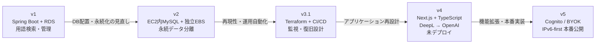
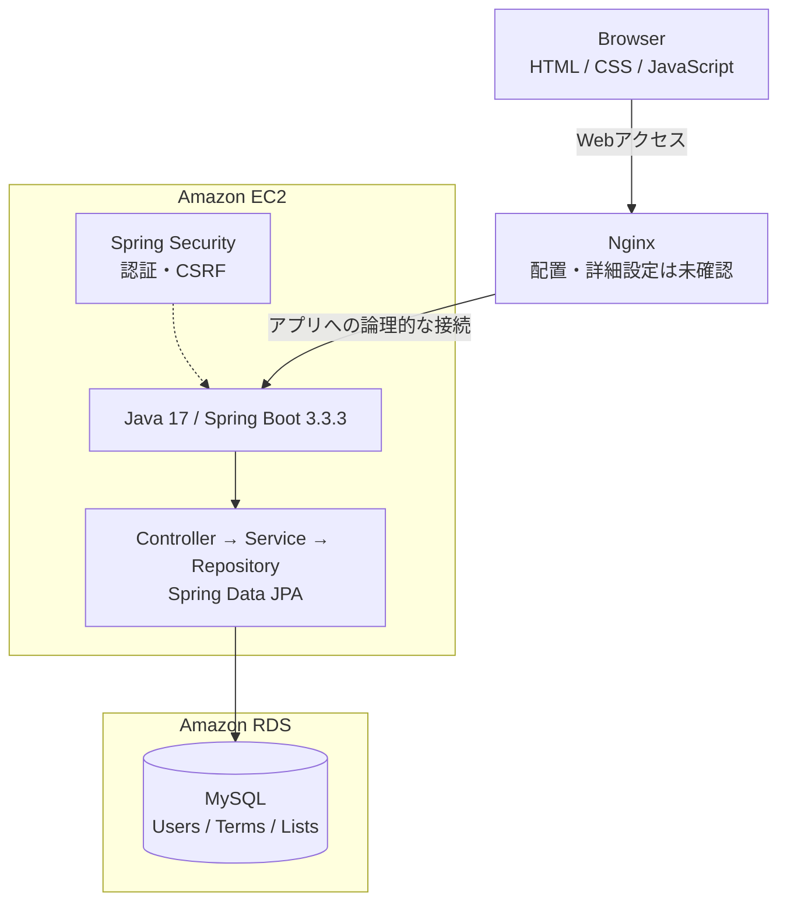
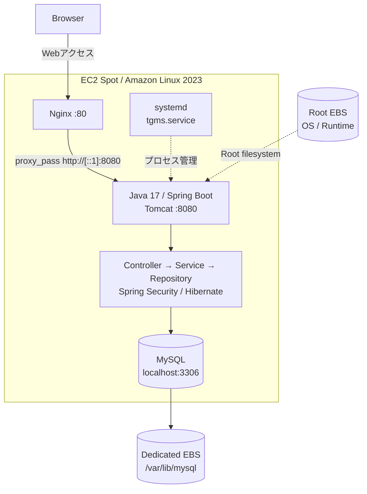
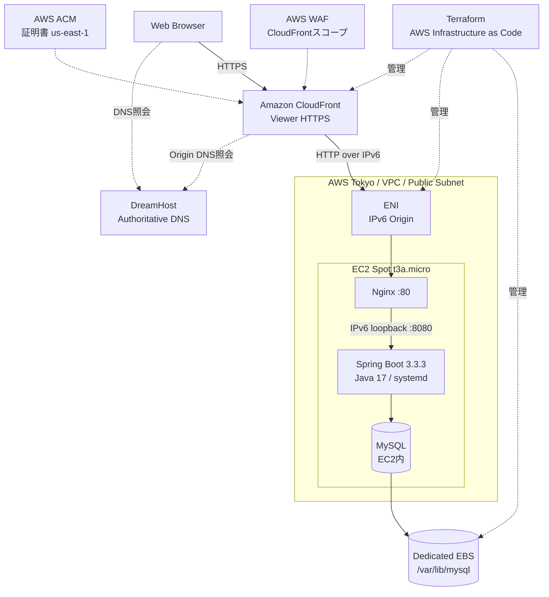
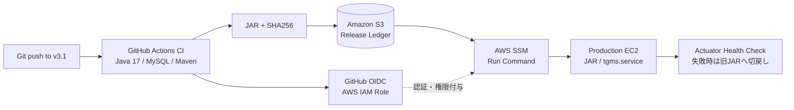
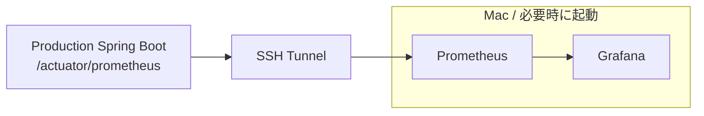
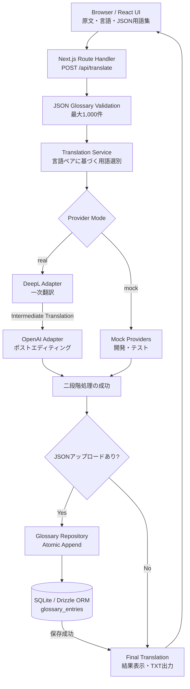
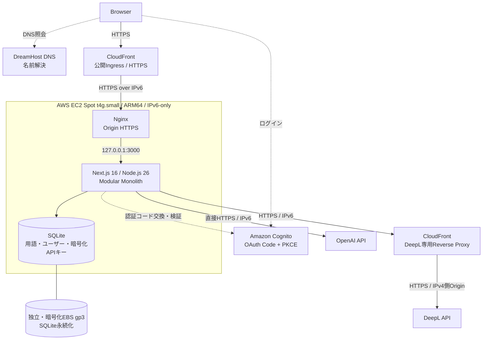
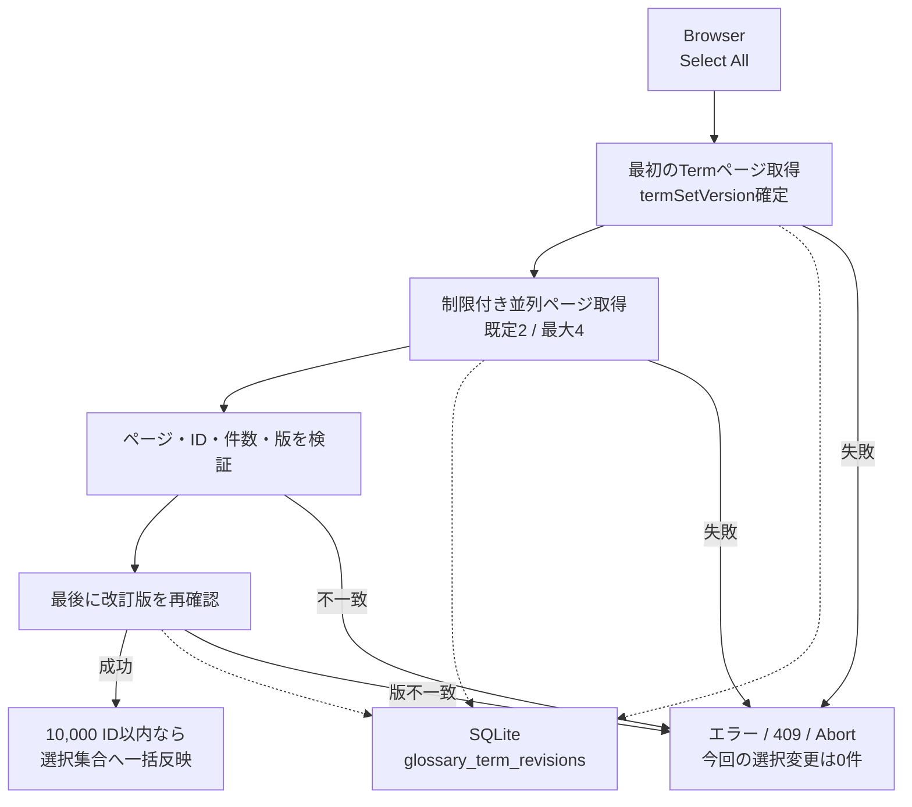
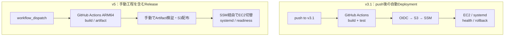

# GMS — Architecture Evolution (v1 → v5)

**用語管理システムから、AI翻訳Webアプリケーションへ。設計とインフラの変遷をMermaidで振り返る。**

[日本語README](../README.ja.md) · [English README](../README.md) · [v5の現在のArchitecture](../README.ja.md#diagram-a--production-system-architecture)

この資料は、GMS v1・v2・v3.1・v4・v5の**当時の実装・構築記録**を、面接などで説明しやすい粒度で比較するものです。すべての図はGitHubが表示できるMermaid形式で、コードから編集できます。

> **情報の根拠と制約**
> - **v1：** 当時のREADMEとソースコードに基づく論理構成。過去のAWS実環境は今回再確認していません。
> - **v2：** `v2-reconstructed` ブランチに保存されたREADME・Nginx・systemd・fstabによる再構成Baseline。元の全ソースと完全一致するという意味ではありません。
> - **v3.1：** Terraform・GitHub Actionsと、当時の最終統合試験の記録による構成。現在のAWS実状態は再監査していません。
> - **v4：** ソースコード上のアプリケーション構成。**本番未デプロイ**です。
> - **v5：** 2026年11月8日のリリース記録と現行のREADME・コードによる構成。本番の網羅的E2E・正式な性能受入が全て完了したという意味ではありません。

## 1. 全体像 — 5世代の変遷

バージョン番号が上がったことは、全機能が単純に上位互換で引き継がれたことを意味しません。特に**v4は、用語管理アプリから二段階AI翻訳を中心とした製品へ転換した実装検証段階**です。

## 2. GMS v1 — Spring BootとAmazon RDS

**目的：** 専門用語の検索・閲覧と、管理者による用語・用語リストのCRUD。

READMEには**EC2、RDS、Nginx、Let's Encrypt**が記載されています。ただし、当時の**Nginx配置先・TLS終端位置・具体的な通信ポート・VPC構成は確認できない**ため図では断定していません。前回、利用者の指定で追加したDreamHost DNSも、v1の公開README単体から確認できないためこの図には入れていません。

**根拠：** [v1 README](https://github.com/1716964609/GMS-v1/blob/master/README.md) · [pom.xml](https://github.com/1716964609/GMS-v1/blob/master/pom.xml) · [SecurityConfig.java](https://github.com/1716964609/GMS-v1/blob/master/src/main/java/com/example/GMS_v1/Config/SecurityConfig.java)

## 3. GMS v2 — EC2上のMySQLと独立EBS

**設計の変化：** Javaの主要業務ロジックを継承しつつ、MySQLをEC2上に移動。データ用EBSをRoot Volumeから分離し、OS・アプリケーションとDBデータのライフサイクルを分けました。

Nginx設定にはIPv6 loopback **`[::1]:8080`** へのproxy_pass、Spring Bootの設定には8080番ポートが記載されています。これは保存された**設定上の経路**であり、今回のライブ疎通検証ではありません。systemdの`tgms.service`でアプリケーションを管理し、v2固定時にはRoot EBSとMySQL Data EBSのSnapshotを取得したとREADMEに記録されています。

このv2の本番DBとしてRDSは描いていません。また、**当時のMySQL Data EBSが暗号化されていたとは記録から確認していない**ため、暗号化EBSとは表記していません。

**根拠：** [v2 README](https://github.com/1716964609/GMS-v1/blob/v2-reconstructed/README.md) · [Nginx](https://github.com/1716964609/GMS-v1/blob/v2-reconstructed/infra/legacy-v2/nginx/default.conf) · [systemd](https://github.com/1716964609/GMS-v1/blob/v2-reconstructed/infra/legacy-v2/systemd/tgms.service) · [fstab](https://github.com/1716964609/GMS-v1/blob/v2-reconstructed/infra/legacy-v2/fstab)

## 4. GMS v3.1 — IaC、CI/CD、Observabilityと復旧

**設計の変化：** v2のSpring Boot・MySQL・EBSを基本に、TerraformによるAWS構成管理、CloudFront/WAFによる公開入口、自動デプロイ、Actuatorの可観測性、復旧方針を組み込みました。

### 4.1 Production Infrastructure

**DNSはHTTPリクエストを中継しません。** DreamHostは公開ドメインとOriginホスト名の名前解決を担います。v3.1ではCloudFrontがViewer HTTPSを扱い、**Origin側はHTTP / IPv6**で接続していました。この点はv5のHTTPS Originと異なります。

Terraformの対象はVPC/Subnet/ENI/EC2/EBS、CloudFront/ACM/WAF、IAM/OIDC、S3等です。DreamHost DNSはTerraform管理の範囲外でした。

**根拠：** [v3.1 README](https://github.com/1716964609/GMS-v1/blob/v3.1/README.md) · [Architecture](https://github.com/1716964609/GMS-v1/blob/v3.1/infra/docs/architecture.md) · [CloudFront Terraform](https://github.com/1716964609/GMS-v1/blob/v3.1/infra/terraform/cloudfront.tf) · [EC2定義](https://github.com/1716964609/GMS-v1/blob/v3.1/infra/terraform/instance.tf)

### 4.2 GitHub Actions CI/CD

### 4.3 Observability — ローカル監視環境

v3.1ブランチへのpushでは、CI成功後のJARを**GitHub OIDC → S3 → SSM**で本番配布するWorkflowが実装されています。失敗時の旧JAR切戻し処理も記述されています。対してPrometheus/Grafanaは**Mac上で必要に応じて稼働**する想定であり、本番で24時間稼働する監視サービスではありません。

**根拠：** [CI/CD workflow](https://github.com/1716964609/GMS-v1/blob/v3.1/.github/workflows/ci.yml) · [Prometheus設定](https://github.com/1716964609/GMS-v1/blob/v3.1/infra/monitoring/prometheus/prometheus.yml) · [v3.1 README](https://github.com/1716964609/GMS-v1/blob/v3.1/README.md)

## 5. GMS v4 — Next.js Modular Monolithと二段階AI翻訳

**設計の変化：** Java/Spring Boot中心の構成から、Next.js、React、TypeScript、SQLite/Drizzle ORMへ。ユーザーがアップロードした用語を使い、DeepLの一次翻訳をOpenAIがポストエディットする新ワークフローを実装しました。

**v4は本番未デプロイのため、以下はApplication Architectureです。**

real modeではDeepLとOpenAIを逐次呼び、defaultのmock modeでは実際の外部APIへアクセスしません。**その要求でアップロードしたJSONの用語だけ**を翻訳に使い、以前の保存済みGlossaryは新たな翻訳に自動適用しません。JSONがある場合は両翻訳成功後にDBへ一括追記し、その保存が失敗すれば成功結果を返しません。原文・中間訳・最終訳・翻訳履歴は永続化しません。

v3.1で使用したAWS/Terraform/CloudFront/監視構成がv4にデプロイされた、という主張はしません。

**根拠：** [v4 README](https://github.com/1716964609/GMSv4/blob/main/README.md) · [Translation Service](https://github.com/1716964609/GMSv4/blob/main/src/modules/translation/service.ts) · [Provider切替](https://github.com/1716964609/GMSv4/blob/main/src/modules/translation/runtime.ts) · [SQLite Schema](https://github.com/1716964609/GMSv4/blob/main/src/db/schema.ts)

## 6. GMS v5 — ユーザー別用語集とIPv6-first Production

**設計の変化：** v4の二段階翻訳を発展させ、Cognito認証、ユーザー別Glossary/Term CRUD、暗号化BYOK、用語の選択、AWS本番運用、公開LPを統合。詳細な最新図は[日本語README](../README.ja.md)にあります。

### 6.1 Production System Architecture

v5ではCloudFrontからNginxへのOrigin接続も**HTTPS over IPv6**です。EC2はパブリックIPv4を持ちません。DeepL向けには専用CloudFront Reverse Proxyを使い、OpenAIへはEC2からネイティブIPv6で接続します。公開用CloudFrontとDeepL用CloudFrontは**別Distribution**です。

v4と異なり、v5では**ユーザーが永続GlossaryからTerm IDを選択**し、バックエンドで所有権・現在の用語を再検証したうえで翻訳へ渡します。

### 6.2 Revision-aware Select All

改訂版は取得中の変更を**検出**するもので、過去版を固定して読む厳密snapshotではありません。2026年11月8日の本番ブラウザで10,000件選択を確認したとの記録があり、所要時間は約27秒（旧版約40秒）でした。ただし**正式なp95性能受入は未完了**です。本番migration v2適用ログ・systemd最終状態についても[As-Built](infrastructure/production-as-built-2026-11-08.md)の確認範囲を優先してください。

**根拠：** [v5日本語README](../README.ja.md) · [Production Architecture](architecture.md) · [CR-01設計](design/cr-01-parallel-fetch-design.md) · [2026-11-08 As-Built](infrastructure/production-as-built-2026-11-08.md)

## 7. Deployment Evolution — v3.1とv5のCI/CDは異なる

v3.1の自動CD、v4の未デプロイ、v5の手動リリースを混同しないことが重要です。v5のGitHub Actions Buildには、開発段階の単体・結合テストを自動実行するステップがないことも、現行READMEで区別しています。

## 8. バージョン比較

| 観点 | v1 | v2 | v3.1 | v4 | v5 |
|---|---|---|---|---|---|
| 主な目的 | 用語検索・管理 | データ分離・Baseline | IaC・CI/CD・観測・復旧 | 二段階AI翻訳 | 用語管理と翻訳の公開製品 |
| Runtime | Spring Boot | Spring Boot | Spring Boot | Next.js / Node.js | Next.js / Node.js |
| DB | RDS MySQL | EC2内MySQL | EC2内MySQL | SQLite / Drizzle | SQLite / node:sqlite |
| 永続データ | RDS | 専用EBS | 専用EBS + Snapshot | ローカルSQLite | 暗号化独立EBS |
| 公開入口 | EC2・Nginx（詳細未確認） | EC2・Nginx | CloudFront / HTTP IPv6 Origin | **未デプロイ** | CloudFront / HTTPS IPv6 Origin |
| 構築・配布 | 記録不足 | systemd / 手動 | Terraform / 自動CI/CD | ローカル開発・テスト | Terraform＋手動設定 / ARM64 Build＋手動Release |
| Observability | 確認資料なし | 確認資料なし | Actuator＋Mac上Prometheus/Grafana | 自動テスト中心 | As-Built・検証記録 |
| 翻訳 | 用語検索・管理 | 用語検索・管理 | 用語検索・管理 | DeepL → OpenAI | DeepL → OpenAI＋永続Glossary選択 |

「確認資料なし」は、その時代に該当機能が絶対存在しなかったという意味ではありません。旧バージョンの記述は、それぞれの指定ブランチと保存された資料の範囲に限定しています。

## 9. 設計判断の変遷をどう説明するか

**v1 → v2：Computeとデータのライフサイクル分離。** DBをRDSからEC2内へ移したことは、単純な性能・可用性向上ではありません。運用責任が増える一方、専用EBSとSnapshotによるデータ保護・復旧方針を明確にしました。

**v2 → v3.1：再現性と運用自動化。** Terraform、CI/CD、Observability、復旧手順を導入し、システムを「動く状態」だけでなく「再構築・監視・配布できる状態」へ近づけました。

**v3.1 → v4：アプリケーションそのものの目的と境界を再設計。** Spring Boot用語管理からNext.jsの二段階翻訳へ。ただしv4の成果は実装・テストであり、AWS本番運用の継続を意味しません。

**v4 → v5：実際の利用者と本番運用に向けた拡張。** Cognito認証、ユーザー別用語集、BYOK、IPv6-first Networking、DeepLの接続制約への対応を追加。一方、単一EC2、Spot中断、手動リリースなどのトレードオフは残っています。

---

**現行v5の正確な設計と確認済み実績は** [README.ja.md](../README.ja.md)、[Production Architecture](architecture.md)、[2026-11-08 As-Built](infrastructure/production-as-built-2026-11-08.md) **を優先してください。** この資料は世代間の比較であり、旧AWS環境を再稼働して確認した記録ではありません。
