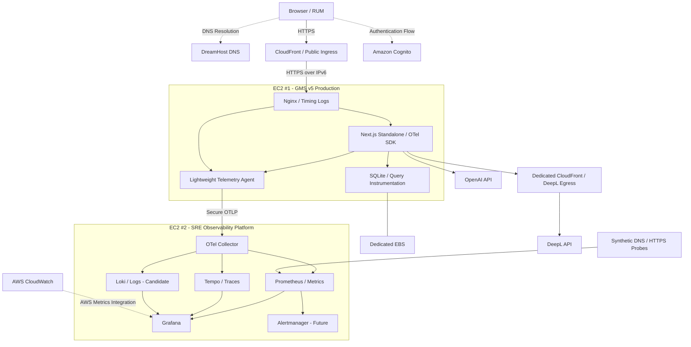
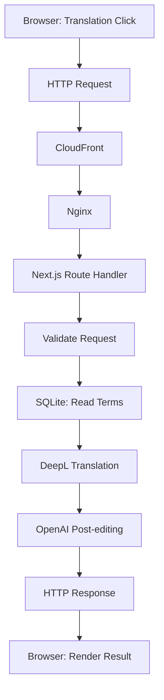

# GMS v5 — The Rest Part of Architecture As-To-Be
## Add Observability

**Document Type:** Architecture Design / Target State  
**Status:** Target Architecture — Phase 0・Phase 1は実装済み、Phase 2〜4は未実装（2026-11-14更新。下記「Implementation Status」を参照）\
**Created:** 2026-11-12  
**System:** GMS v5 — Glossary Management System  
**Scope:** Observability / SRE Operations Infrastructure  
**Baseline:** Production Release `9783463` (2026-11-08)

**文書の位置付け:** [Documentation Map](README.md)。現在の本番状態は[production-state.md](infrastructure/production-state.md)を参照する。

---

# Implementation Status — 2026-11-14

本書は目標構成（As-To-Be）を定義する。設計本文は2026-11-12の作成時のままであり、**実装済みの範囲はこの節だけが示す**。現在の本番状態の根拠は本書ではなく、[production-state.md](infrastructure/production-state.md)と[Observability As-Built](infrastructure/observability-as-built-2026-11-13.md)である。

## Phase別の状態

| Phase | 状態 | 根拠 |
|---|---|---|
| Phase 0 — Design and Local PoC | 完了（ローカル検証） | [Telemetry Schema §10](development/observability/application-instrumentation.md)、[ローカル検証記録](development/observability/application-instrumentation-verification-2026-11-13.md) |
| Phase 1 — Observability Infrastructure | Application Traces / Metricsについて本番受入PASS。Acceptance Criteriaのうち「Observability EC2停止時もGMSは利用可能」の本番試験と「追加AWSコスト」の記録は無い。Terraformによる定義は部分的 | [Observability As-Built §11〜§12](infrastructure/observability-as-built-2026-11-13.md#12-production-phase-1-acceptance)、[production-state.md §4〜§5](infrastructure/production-state.md) |
| Phase 2 — Full-Stack Observability | 一部のみ。SQLite MetricsとNode.js Runtime Metricsは本番で確認済み。Browser RUMはコードのみで本番無効。CloudFront Server-Timing、Nginx Timing Log、Production Host Metrics、CloudWatch連携、Synthetic Monitoring、Logs集中管理、Dashboard A〜Dは未実装 | [production-state.md §6](infrastructure/production-state.md) |
| Phase 3 — SRE Operations Readiness | 未着手（SLI / SLO、Alert、Runbook、Incident Simulation） | 同上 |
| Phase 4 — Performance and Automation | 対象外（後続計画） | 本書§12 |

## Componentの状態

| Component（§3.3） | 状態 |
|---|---|
| OpenTelemetry SDK（Application） | 本番で有効（Release `364d0b7`） |
| OpenTelemetry Collector | 稼働 |
| Prometheus | 稼働。Targets 4/4 UP |
| Grafana Tempo | 稼働 |
| Grafana | 稼働。SSM Port Forwardingで閲覧 |
| OTLP Gateway（Nginx、TLSとToken認証） | 稼働。§3.3の表には無いComponentで、§9.3とOD-06の実装として追加された |
| Grafana Loki | 未導入 |
| Alertmanager | 未導入 |
| CloudWatch連携 | 未実装 |
| Browser RUM | コードはあるが本番無効 |
| Synthetic Monitoring（DNS / HTTPS） | 未実装 |

---

# 1. Purpose

本書は、GMS v5の既存Production Architecture（Architecture As-Is）を基準として、Observabilityおよび将来のSRE運用基盤を構築するためのArchitecture As-To-Beを定義する。

GMS v5は現在、Next.js Standalone、SQLite、Amazon EC2 Spot、CloudFront、Cognito、DeepLおよびOpenAI APIを利用するModular Monolithとして構成されている。

本計画の目的は、GMS v5を単に動作するWebアプリケーションとして維持することではなく、**ユーザー体験・システム内部処理・インフラストラクチャの状態を継続的に観測し、信頼性改善に利用できるSRE運用基盤を構築すること**である。

## 1.1 Design Objectives

1. ユーザー操作から最終的な画面応答までのEnd-to-End Latencyを計測する。
2. CloudFront、Nginx、Next.js、SQLite、外部API間の遅延と失敗を可視化する。
3. Metrics、Traces、Logsを統合し、障害の原因を調査可能にする。
4. Google SREのFour Golden Signalsを基礎とするSLI/SLO設計を可能にする。
5. ProductionとObservabilityの実行基盤を分離する。
6. 将来的なIncident Response、Performance Tuning、Automation、AI-driven SREの基盤とする。
7. セキュリティ、運用コスト、計測オーバーヘッドを制御する。

## 1.2 Scope

本書で設計対象とする領域：

- Browser Real User Monitoring（RUM）
- HTTPおよびApplication Tracing
- SQLite Observability
- External API Observability
- CloudFront / Nginx / DNS Monitoring
- EC2 / EBS / Node.js Runtime Metrics
- OpenTelemetry Pipeline
- Grafana Dashboards
- Telemetry Storage and Retention
- Observability Infrastructure as Code
- 将来のAlertingおよびAI-driven SREへの接続境界

今回の主目的は**観測可能なシステムを作ること**であり、既存アプリケーションの性能改善そのものは後続フェーズとする。

---

# 2. Architecture As-Is — Baseline

既存の本番構成は以下の文書をSource of Truthとする。

- [Production Architecture](architecture.md)
- [Production As-Built — 2026-11-08](infrastructure/production-as-built-2026-11-08.md)
- [Requirements](requirements.md)
- [Use Cases](use-cases.md)

> **2026-11-14 注記：** この章は本書作成時（2026-11-12、Release `9783463`）のBaselineである。現在の本番状態は[production-state.md](infrastructure/production-state.md)を参照する。

## 2.1 Current Production Components

| Layer | Existing Implementation |
|---|---|
| DNS | DreamHost |
| Public Ingress | Amazon CloudFront |
| Origin Transport | HTTPS over IPv6 |
| Reverse Proxy | Nginx |
| Application | Next.js 16 Standalone / Node.js 26 |
| Architecture | Modular Monolith |
| Compute | EC2 Spot `t4g.small` / ARM64 |
| Database | `node:sqlite` / SQLite |
| Persistent Storage | Dedicated encrypted EBS gp3 |
| Authentication | Amazon Cognito Lite |
| DeepL Connectivity | Dedicated CloudFront Reverse Proxy |
| OpenAI Connectivity | Native IPv6 HTTPS |
| Deployment | GitHub Actions / S3 / SSM / systemd |
| Infrastructure Management | Terraform + Manual Configuration |

現行構成では、専用のPrometheus、Tempo、Grafanaなどの本番Observability Platformは実装済みとして扱わない。

> **Superseded（2026-11-14）：** 上の一文は2026-11-12時点の記述である。Phase 1でObservability EC2上にCollector、Prometheus、Tempo、Grafana、OTLP Gatewayが構築され、稼働している（[Observability As-Built §11〜§12](infrastructure/observability-as-built-2026-11-13.md)）。

## 2.2 Existing Constraints

- Productionは単一EC2上のModular Monolithである。
- SQLiteは外部DBサーバーではなく、アプリケーションプロセス内で利用する。
- Production EC2はIPv6-firstであり、パブリックIPv4を持たない。
- ユーザー所有の翻訳本文・認証情報をTelemetryへ流出させてはならない。
- 既存の認証・データベース・翻訳API処理の仕様を維持する。
- 現行の手動操作を含むDeploymentを、完全自動CDとして扱わない。

---

# 3. Target Architecture — As-To-Be

## 3.1 Architectural Decision

Observabilityのために、既存Production EC2とは別に**専用の2台目EC2**を設置する。

Production EC2はユーザーリクエストの実行を優先し、Observability EC2はTelemetryの収集・保存・可視化を担当する。

論理的に次の2つのPlaneを分離する。

**Production / Data Plane**

- HTTP Request Processing
- Authentication and Authorization
- Application Business Logic
- SQLite
- External Translation API Calls
- Lightweight Instrumentation and Telemetry Export

**Observability / Operations Plane**

- Telemetry Ingestion
- Metrics Storage
- Distributed Trace Storage
- Centralized Logs
- Dashboards
- Future Alerting and Incident Investigation

## 3.2 Proposed Architecture Diagram

**重要：** 上図はTarget Architectureであり、現時点の本番実装を表すものではない。

CollectorからPrometheusへの接続は概念的なMetrics Pipelineである。具体的な取り込み方式（Scrape、OTLP Receiverなど）はPoCで確定する。

## 3.3 Technology Candidates

| Component | Technology | Responsibility | Decision |
|---|---|---|---|
| Application Instrumentation | OpenTelemetry SDK | Traces / Metrics | Proposed |
| Telemetry Collection | OpenTelemetry Collector | Ingestion / Processing / Export | Proposed |
| Metrics Backend | Prometheus | Time-Series Storage | Proposed |
| Tracing Backend | Grafana Tempo | Distributed Trace Storage | Proposed |
| Log Backend | Grafana Loki | Centralized Logs | Candidate |
| Visualization | Grafana | Dashboards | Proposed |
| Alert Management | Alertmanager | Routing / Notification | Future |
| AWS Metrics | CloudWatch | EC2 / EBS / CloudFront | Existing AWS service; integration pending |
| User Monitoring | Browser Performance API / RUM | End-to-End UX | Proposed |
| Synthetic Monitoring | DNS / HTTPS Probes | External Availability | Proposed |

各Componentの正式バージョン、EC2 Instance Type、保存期間、必要ストレージ容量はPoC後に決定する。

> **2026-11-14 注記：** 表の「Decision」列は設計時点の区分である。実際に導入されたComponentとVersionは冒頭の「Implementation Status」と[production-state.md §3.5](infrastructure/production-state.md)を参照する。

---

# 4. Observability Model

## 4.1 Four Golden Signals

本プロジェクトでは以下を基本観測軸とする。

| Signal | Definition | Example |
|---|---|---|
| Latency | リクエスト・ユーザー操作の処理時間 | Translation p95 |
| Traffic | システムへの要求量 | Requests / minute |
| Errors | 期待した処理の失敗率 | Translation failure rate |
| Saturation | 利用可能な資源の逼迫度 | Memory / Event Loop / Disk |

Four Golden Signalsはサービス監視の基本分類である。

DORA Four Keysはソフトウェアデリバリー性能の指標であり、本書では混同しない。

## 4.2 Observability Data Types

**Metrics**

時系列の数値データ。傾向、異常、SLO計算、Alertingに使用する。

**Traces**

リクエスト内の処理の親子関係と時間を可視化する。ボトルネック分析に使用する。

**Logs**

イベント、エラー、プロセス状態、処理結果を記録する。障害時の詳細調査に使用する。

Metricsで異常を発見し、Tracesで遅延箇所を特定し、Logsで詳細原因を調査できることを目指す。

---

# 5. Measurement Design

## 5.1 Browser / User Experience

**Objective:** ユーザーが実際に体験する処理時間を観測する。

| Metric | Definition |
|---|---|
| `user_action_duration` | 操作開始から結果表示までの時間 |
| `translation_completion_duration` | 翻訳開始から結果表示まで |
| `select_all_completion_duration` | Select All開始から選択確定まで |
| `client_http_duration` | Browser Fetchの所要時間 |
| `client_operation_error_total` | ユーザー操作の失敗件数 |
| Web Vitals | INP / LCP / CLSなど |

名称は計測項目を表す**論理名**であり、正式なOpenTelemetry Metric Nameは実装設計時にSemantic Conventionsと命名規則に合わせて確定する。

特に次の2操作を重点計測対象とする。

1. Translation
2. Select All（最大10,000 Term IDs）

サーバーがHTTP 200を返すことと、ユーザーが操作を正常に完了できたことは区別する。

RUMにはブラウザ側の計測が必要であり、バックエンドのOpenTelemetry SDKだけでは完結しない。

## 5.2 DNS

**Objective:** DNS名前解決の可用性・遅延・レコード整合性を監視する。

- 権威DNSの応答時間
- DNS Resolution Success Rate
- Timeout / SERVFAIL / NXDOMAIN
- 期待レコードとの一致
- 必要に応じた複数観測地点からの検証

DreamHostのDNS管理APIから、個別ユーザーの名前解決時間を直接取得できるとは前提しない。

DNSのObservabilityはSynthetic Probeを中心に設計する。

なお、DNSの名前解決とHTTP Requestは別の処理であり、DreamHostはWeb通信を中継しない。

## 5.3 CloudFront

**Objective:** Viewer、Edge、Origin間の遅延およびエラーを観測する。

Target Metrics:

- Request Count
- 4xx / 5xx Error Rate
- Cache Hit / Miss
- Origin Latency
- Origin Connection Timing
- First Byte Latency

CloudFrontの`Server-Timing`を主要な測定候補とする。

対象となるTiming例：

- `cdn-upstream-dns`
- `cdn-upstream-connect`
- `cdn-upstream-fbl`
- `cdn-downstream-fbl`

これらはそれぞれ異なる時間区間を示す。

**制約：** Origin First Byte LatencyにはOrigin側の処理時間が含まれるため、CloudFront → EC2間の純粋なネットワーク遅延と同一視しない。

また、公開Ingress用CloudFrontとDeepL専用Egress CloudFrontは別Distributionとして扱い、Metricsを混同しない。

Server-Timing、追加Metrics、標準ログ、Real-Time Logsは、必要性と料金を個別に評価する。

## 5.4 Nginx

**Objective:** Reverse Proxyの処理時間とUpstream遅延を把握する。

Measurement Candidates:

- `$request_time`
- `$upstream_connect_time`
- `$upstream_header_time`
- `$upstream_response_time`
- HTTP Status
- Upstream Status
- Request / Trace Correlation ID

既存のNginx Access Logに計測用フィールドを追加する方針とする。

ログは構造化形式を検討する。

Nginx TimingとNext.js Spanを対応付けることで、Reverse ProxyとApplication Runtimeの境界を調査できるようにする。

## 5.5 Next.js Application

**Objective:** アプリケーション内部の処理を可視化する。

Primary Instrumentation Points:

- `src/instrumentation.ts` — OpenTelemetry initialization（新規候補）
- `src/app/api/translate/route.ts` — Request boundary
- `src/lib/services/translation.ts` — Business operations
- `src/lib/db/repository.ts` — SQLite operations
- `src/lib/translation/providers.ts` — External API calls

Candidate Spans:

- `translation.request`
- `translation.validate`
- `translation.terms.load`
- `translation.deepl`
- `translation.openai`
- `translation.complete`
- `sqlite.query`

これらも暫定的な論理名称とする。

既存のNext.js Automatic Instrumentationを優先して利用し、取得できない業務処理のみManual Instrumentationを追加する。

> 正式なSpan / Metric名称と属性は [Telemetry Schema v1](development/observability/application-instrumentation.md) で定義した（2026-11-13）。Server Traces / MetricsはRelease `364d0b7`で本番に適用済み（2026-11-14検証）。Browser RUMは本番無効。

## 5.6 SQLite

**Objective:** Databaseの性能・エラー・容量を観測する。

SQLiteは`node:sqlite`を利用しているため、一般的なMySQL/PostgreSQL向けInstrumentationが自動的に適用されるとは前提しない。

Measurement Candidates:

| Category | Metrics |
|---|---|
| Query Performance | Query Duration / Operation Type |
| Database Errors | SQLite Error Count / Busy or Lock Errors |
| Database Size | DB File Size |
| WAL | WAL File Size / Growth |
| Storage | Filesystem Available Space |
| Runtime | Event Loop Delay |
| EBS | IOPS / Throughput / Queue / I/O Latency-related metrics |

SQLクエリ時間はApplication側で計測する。

DBファイルサイズ・WALサイズ・SQLite PRAGMAは、低頻度の状態収集で取得することを検討する。

`node:sqlite`は同期APIを利用するため、Event Loop Delayとの相関も調査対象とする。

本番DBに対して負荷や状態変更を伴う検査処理を安易に実行しない。

## 5.7 External APIs

**Objective:** 翻訳を構成する外部サービスの遅延・失敗を分離する。

対象：

- DeepL API
- DeepL専用CloudFront Reverse Proxy
- OpenAI API

Measurement Candidates:

- Request Duration
- p50 / p95 / p99 Latency
- Timeout Count
- Error Rate
- HTTP 429 Count
- Retry Count（実装される場合）
- Translation Workflow Failure Rate

**Important:** DeepL側の処理が成功しても、OpenAIによるPost-editingが失敗した場合、GMSの二段階翻訳操作全体は成功として扱わない。

DeepL専用CloudFrontを経由する時間とDeepL API内部の処理時間を、計測上区別できる範囲を検証する。

外部サービス内部のSpanは取得できないため、GMSから見たClient-Side Latencyを中心に扱う。

## 5.8 Cognito

Cognitoの内部処理をGMSのOpenTelemetry SDKで直接追跡できるとは前提しない。

観測範囲は主に以下とする。

- ユーザーのLogin / Registration体験時間
- OAuth Callback Success / Failure
- Cognitoへのバックエンド通信時間
- AWS側から取得可能な認証関連Metrics / Logs

認証処理の細部は、取得可能なAWSマネージドサービスのTelemetryに依存する。

## 5.9 EC2 / EBS / Runtime

監視対象：

- CPU Utilization
- Memory Utilization
- Disk Available / Utilization
- Disk Read / Write
- EBS I/O関連Metrics
- Node.js Event Loop Delay
- Process Restarts
- `gmsv5.service` Health
- EC2 Spot Interruption Events

Spot停止時に自動復旧できることは、現時点のAs-Isに含まれない。

Observability導入だけで可用性が改善されたと評価しない。

---

# 6. End-to-End Trace Design

## 6.1 Primary Trace Scenario

対象：ユーザーがTranslationボタンを押してから、最終翻訳結果を画面に表示するまで。

上図は論理的な業務経路であり、すべてのComponentが自動的に同一Traceへ参加することを意味しない。

## 6.2 Trace Correlation

Trace ContextはW3Cの`traceparent`などを採用候補とする。

Correlation対象：

- Browser User Action
- HTTP Request
- Nginx Access Log
- Next.js Application Span
- SQLite Operation Span
- External API Client Span

CloudFront Timingは同一HTTP Requestとの対応付けを検討する。

必要に応じてRequest IDを併用する。

ただし、**全レイヤーの開始時刻・終了時刻を単純に減算するだけで、純粋なネットワーク片道遅延が得られるとは限らない。**

- 各Componentの計測区間は一部重複する。
- Connection Reuseにより接続時間が0になる場合がある。
- Browser、CloudFront、EC2で時間計測の基準が異なる。
- CDNの内部経路すべてに独自Spanを挿入できるわけではない。

まず同一要求に対応する複数のTiming情報を収集し、**実測可能な内訳と推定値を区別する**。

## 6.3 Sampling

- 初期段階はテストトラフィックを高いサンプリング率で観測する。
- ProductionではTelemetry量とコストを測定してSampling Rateを決定する。
- Trace SamplingとMetrics集計は別に扱う。
- 失敗Traceの保持方針はCollectorの能力・運用コストを考慮して決定する。
- Samplingによって失われたTraceは復元できないことを前提とする。

---

# 7. Dashboards

初期Dashboardは4種類とする。

## Dashboard A — User Experience

- Translation Duration
- Select All Duration
- User Action Success Rate
- HTTP Error Rate
- Web Vitals
- Request Volume

## Dashboard B — Application Tracing

- End-to-End Trace Waterfall
- Slow Spans
- DeepL / OpenAI Latency
- SQLite Query Latency
- Application Errors
- Trace Correlation

## Dashboard C — Infrastructure & Database

- EC2 CPU / Memory
- Node.js Event Loop Delay
- Process Health / Restarts
- SQLite Errors
- DB / WAL Size
- EBS Metrics
- Disk Available Space

## Dashboard D — Edge & External Dependencies

- CloudFront Request / Error Metrics
- CloudFront Server-Timing
- Nginx Upstream Timing
- DNS Synthetic Probe
- DeepL / OpenAI Errors and Latency
- Cognito-related Available Metrics

各Dashboardには少なくとも以下を表示する。

- Time Range
- Environment
- Service
- Software Release Version
- Request Count / Sample Count

低トラフィック時にp95/p99が不安定となる場合は、その数値だけで性能改善・悪化を断定しない。

---

# 8. SLI / SLO and Alerting

## 8.1 Initial SLI Candidates

| SLI | Measurement |
|---|---|
| Translation Success Rate | 正常完了した翻訳操作 / 有効な翻訳操作 |
| Translation Latency | 翻訳開始から結果表示まで |
| Select All Success Rate | 正常に確定した全件選択操作 / 有効な操作 |
| Select All Latency | 開始から選択確定まで |
| HTTP Availability | 対象となる有効要求に対する正常応答 |
| External Dependency Health | DeepL / OpenAI Client-Side Failure Rate |

4xxをすべて障害として数えることはしない。

認証失敗、ユーザー入力エラー、外部APIキーの利用制限、サービス内部障害を区別する。

## 8.2 SLO Policy

初期段階で正式なSLO値を確定しない。

最初にBaselineを収集し、ユーザー数・操作数・Latency分布・失敗件数を確認する。

その後、以下を決定する。

- SLIの正式な分母と分子
- Measurement Window
- Target SLO
- Error Budget
- Alert Threshold
- Alert Severity

既存CR-01のp95性能目標は、正式な反復測定・受入が未完了であり、達成済みのSLOとは扱わない。

## 8.3 Future Alerting

将来のアラート候補：

- Public HTTPS Endpointの継続的な到達失敗
- Translation Failure Rateの継続的悪化
- Disk Available Spaceの危険域到達
- SQLiteの継続的な書込み障害
- 外部APIの継続的な障害
- Observability EC2自体の停止

本フェーズではAlertingの設計・準備を行う。

通知ルール、Incident Severity、Runbook、Escalationは後続のIncident Response設計で正式に定義する。

監視専用EC2自身の停止を、同EC2内のAlertmanagerだけに依存して検知する構成は避ける。

---

# 9. Security, Privacy and Operational Boundaries

## 9.1 Telemetry Data Protection

Telemetryへの収集を禁止するデータ：

- 翻訳原文
- DeepL中間訳
- OpenAI最終訳
- API Keys
- OAuth Tokens
- Cookies / Session Secrets
- Credential Encryption Keys
- SQL Parameters containing user data

Log、Span Attributes、Metric Labelsのいずれにも上記を記録しない。

URL Query Parameters、HTTP Headers、Exception Messagesにも機密情報が混入する可能性があるため、収集時のRedaction / Filteringを設計する。

## 9.2 Cardinality Control

以下をMetric Labelへ無制限に使用しない。

- User ID
- Glossary ID
- Term ID
- Request ID
- Trace ID
- Raw URL / Query
- Arbitrary Error Message

これらはMetric Cardinalityを増大させ、メモリ使用量・Storage Cost・Query Performanceへ悪影響を与える可能性がある。

## 9.3 Network and IAM

- Observability Endpointを原則インターネットへ公開しない。
- Production → ObservabilityのTelemetry通信を許可した経路に限定する。
- Security Group、IAM、必要に応じてTLS / mTLSを適用する。
- Grafanaへの管理アクセスを認証・認可する。
- SSM等による管理接続を優先的に検討する。
- Observability EC2にProductionのAdministratorAccessを与えない。
- MonitoringとProduction DeploymentのIAM Roleを分離する。

同一VPC内であっても、認証なしの広範なTelemetry受信口は作成しない。

## 9.4 Failure Isolation

Observability基盤が停止しても、GMS v5の主要機能が停止しないことを要求する。

Telemetry Exportの失敗は、翻訳処理やSQLiteへのアクセスを失敗させてはならない。

Collector側ではBatch、Queue、Memory Limit、Retryなどを検討し、無制限のTelemetry蓄積を防止する。

---

# 10. Cost and Capacity

Observability Infrastructureは既存のGMS v5運用費に追加される。

追加コストの主な対象：

- EC2 #2 Compute
- EC2 #2 EBS
- Trace / Metrics / Log Storage
- CloudWatch関連利用
- CloudFront Logging / Additional Monitoring
- Data Transfer
- Snapshot / Backup

**コスト方針：**

1. 初期検証はLocal PoCを優先する。
2. 2台目EC2構築前に月額予算を作成する。
3. EC2 Instance Typeを測定結果なしに確定しない。
4. Metrics / Traces / Logsの保持期間を制限する。
5. 高コストなCloudFront Real-Time Logs等は必要性を確認してから採用する。
6. Productionの信頼性に影響するほど監視コストを削減しない。

監視EC2のSpot利用は中断リスクを伴う。On-Demandを基本候補として費用と可用性を比較し、採用方式を決定する。

Tempo、Prometheus、Lokiを同一小型EC2上で運用できることは、測定前には保証しない。

---

# 11. CI/CD and Platform Engineering Integration

Observabilityは、個別の手作業による導入だけでなく、将来の標準的なBuild / Deployment Pipelineへ統合できる構成とする。

## 11.1 Application Requirements

- OTel Dependenciesを明示的に管理する。
- Next.js Instrumentationの初期化を定義する。
- Environment / Service / Release Versionを付与する。
- Business Spansの命名規則を定義する。
- 実行時のOTLP Endpointを構成可能にする。
- Telemetryが利用不能な場合でもアプリを実行可能にする。

Next.js Standalone Build後もInstrumentationsが正常に初期化されることを、実行時に検証する。

## 11.2 CI Validation

追加候補：

- Typecheck
- Lint
- Unit / Integration Tests
- Telemetry Schema Validation
- Sensitive Data Redaction Tests
- Standalone Build
- Standalone Runtime Smoke Test
- Trace Export Smoke Test
- Collector Configuration Validation

**As-Isとの差分：** 現行ARM64 Build Workflowは、`npm ci`、Typecheck、Lint、Build、Artifact Packagingを実施するが、単体・結合テスト全体をCI内で実行する構成にはなっていない。追加テストを実装済みとして扱わない。

## 11.3 Responsibility Model

| Responsibility | Conceptual Owner |
|---|---|
| Telemetry Platform | Platform Engineering |
| Instrumentation Standards | Platform / SRE |
| Domain-specific Spans | Application Engineering |
| User-facing SLI | Application / Product / SRE |
| SLO and Incident Policy | SRE / Service Owner |
| IaC / Deployment Guardrails | Platform Engineering |

GMS v5では一人が複数の役割を実施するが、設計上は責任境界を分ける。

将来、他のアプリケーションへ共通のObservability Platformを提供する際にも、この分離を維持する。

---

# 12. Implementation Roadmap

## Phase 0 — Design and Local Proof of Concept

**Status（2026-11-14）：** 完了（ローカル検証）。

**Goal:** Productionへ変更を加える前にTelemetry Pipelineを検証する。

Tasks:

- SLI / Span Inventory作成
- OTel SDK選定
- Local Collector起動
- Local Tempo / GrafanaによるTrace表示
- Translation / SQLiteのSample Span作成
- Sensitive Data Redaction確認

**Acceptance Criteria:**

- Translationの親子Spanが確認できる。
- SQLiteの計測時間が取得できる。
- DeepL / OpenAIのClient-Side Spanを区別できる。
- 翻訳文やAPIキーがTelemetryに含まれない。
- SDKとStandalone Runtimeの互換性が確認できる。

## Phase 1 — Observability Infrastructure

**Status（2026-11-14）：** Application Traces / Metricsについて本番受入PASS。未確認の受入条件とTerraform化の残りは冒頭の「Implementation Status」を参照。

**Goal:** Productionとは分離されたObservability EC2を構築する。

Tasks:

- TerraformによるInfrastructure定義
- EC2 / EBS / Security Group構築
- Collector設置
- Prometheus / Tempo / Grafana設置
- Storage Retention定義
- Private Telemetry Transport構成
- Monitoring StackのHealth Check

**Acceptance Criteria:**

- GMSからTelemetryを安全に送信できる。
- GrafanaでMetricsとTracesを閲覧できる。
- Productionへの不必要なInbound Accessが増えない。
- Observability EC2停止時もGMSは利用可能。
- 追加AWSコストを確認できる。

## Phase 2 — Full-Stack Observability

**Status（2026-11-14）：** 一部のみ実装。大半は未実装。

**Goal:** BrowserからDatabaseおよび外部APIまでを統合する。

Tasks:

- Browser RUM
- CloudFront Server-Timing
- Nginx Timing Logs
- SQLite Metrics
- Runtime / Host Metrics
- CloudWatch Metrics Integration
- Synthetic DNS / HTTPS Monitoring
- Centralized Logs
- Dashboard A / B / C / D

**Acceptance Criteria:**

- TranslationのEnd-to-End Latencyを測定できる。
- CloudFront、Nginx、Next.js、SQLite、外部APIのTimingを区別できる。
- Traceと関連Logを対応付けられる。
- 主要エラーの発生箇所を調査できる。
- 収集できない区間は「推定」「測定不可」と明記できる。

## Phase 3 — SRE Operations Readiness

**Status（2026-11-14）：** 未着手。

**Goal:** 観測データを信頼性運用へ利用する。

Tasks:

- Baseline Performance Measurement
- SLI / SLO正式化
- Alert Rules
- External Health Monitoring
- Incident Severity設計
- Runbook作成
- Incident Simulation
- Postmortem Template作成

**Acceptance Criteria:**

- システムの代表的な障害を検知できる。
- アラートから調査までの手順が再現できる。
- シミュレーション障害の原因をTelemetryに基づいて説明できる。
- 監視基盤自身の障害を別経路で検知できる。

## Phase 4 — Performance and Automation

後続計画で定義する。

- Observabilityに基づくPerformance Tuning
- Bottleneck Investigation
- Infrastructure Automation
- Alert / Runbook Automation
- AI-assisted Incident Diagnosis
- Controlled Remediation

Phase 4は本書の実装対象外とする。

---

# 13. Future AI-driven SRE — Guardrail Boundary

GMS v5のObservability Platformは、将来のAI-driven SRE AgentへTelemetryを提供できる構成とする。

ただし、AI Agentを無制限のProduction Operatorとして扱わない。

## 13.1 Initial Allowed Capabilities

- Metricsの読み取り
- Tracesの読み取り
- Sanitized Logsの分析
- 異常の要約
- 根本原因の仮説生成
- Runbookの検索
- 改善案・Pull Requestの提案

## 13.2 Prohibited Autonomous Actions

初期段階のAI Agentに以下の権限を与えない。

- Production EBS削除
- Production Database Migration
- IAM / Security Group変更
- 本番への無承認Deployment
- Production Secretsへの無制限アクセス
- 任意のProduction Shell Command実行
- 自身のPolicy / Approval Boundary変更

実行ポリシーはSystem Promptだけに依存せず、IAM、独立した承認ゲート、実行環境分離などで強制する。

## 13.3 Source of Truth for AI Operations

AI Agentが参照する情報を分類する。

| Source | Purpose |
|---|---|
| Architecture As-Is | 現在の構成と実装状態 |
| Architecture As-To-Be | 承認待ちのTarget Architecture |
| Requirements / Use Cases | 業務上の成功条件 |
| Observability Schema | Metrics / Spans / Logsの意味 |
| SLI / SLO Specification | 信頼性目標 |
| Runbooks | 許可された調査・復旧手順 |
| Terraform / CI Configuration | 実際に適用されるInfrastructure・Pipeline定義 |
| Production Telemetry | 現在の観測データ |

As-To-BeをAs-Isと誤認して操作してはならない。

また、AIに渡すドキュメント、Telemetry、Logsはすべて同じ信頼レベルではない。外部から入力されたログ内容を運用命令として扱わない。

---

# 14. Open Decisions

以下は本書作成時点で未決定である。

| ID | Decision | Status |
|---|---|---|
| OD-01 | Observability EC2 Instance Type | Open |
| OD-02 | EC2 On-Demand / Spot | Open |
| OD-03 | Local EBS / Object Storage for Trace Retention | Open |
| OD-04 | Prometheus Metrics Ingestion Method | Open |
| OD-05 | Lokiの初期導入範囲 | Open |
| OD-06 | Telemetry Transport / Authentication | Open |
| OD-07 | Trace Sampling Rate | Open |
| OD-08 | Metrics / Logs / Traces Retention | Open |
| OD-09 | CloudFront Logsの収集方式 | Open |
| OD-10 | RUM Sampling / Privacy Policy | Open |
| OD-11 | Initial SLI / SLO Targets | Open |
| OD-12 | Incident Alert Destinations | Deferred |
| OD-13 | AI-driven SRE Permission Model | Deferred |

これらは推測で確定しない。

PoC・性能測定・コスト試算・Security Reviewの証跡に基づいて更新する。

> **2026-11-14 注記：** 上の表の「Status」は本書作成時のままである。Phase 1で実際に採用された構成を下に記す。これはAs-Builtの事実であり、DecisionとしてCloseするかどうかはOwnerが別途判断する。

| ID | Phase 1で実際に採用された構成 | 根拠 |
|---|---|---|
| OD-01 | `t4g.small` | Observability As-Built §2 |
| OD-02 | Persistent Spot、中断時Stop | Observability As-Built §2 |
| OD-03 | Root EBS（10 GiB gp3）上のLocal Backend。Object Storageは不使用 | Observability As-Built §11.1 |
| OD-04 | CollectorのPrometheus Exporter（`:8889`）をPrometheusがScrape | Observability As-Built §4.1、§4.2 |
| OD-05 | Lokiは未導入 | Observability As-Built §8 |
| OD-06 | IPv6のOTLP/HTTPS（8443）。Nginx GatewayでTLS終端、Private CA、Header `X-OTLP-Token`、Security GroupでProduction EC2のみ許可 | Observability As-Built §11.3、§11.4 |
| OD-07 | 本番の設定値は記録なし。Applicationの既定は`parentbased_always_on` | [Telemetry Schema §7](development/observability/application-instrumentation.md) |
| OD-08 | Prometheusは3日または512MB、Tempoは24時間。Logsは対象なし | Observability As-Built §4.2、§11.1 |
| OD-09〜OD-13 | 変更なし（未決定または保留） | — |

---

# 15. Definition of Done

Observability Architectureの導入完了は、ツールのインストールだけでは判定しない。

次の条件を満たしたとき、初期Observability Platformの完成とする。

- [ ] ProductionとObservabilityの実行基盤が分離されている。
- [ ] OpenTelemetryによるApplication Tracingが動作する。
- [ ] Browser User Actionの所要時間を測定できる。
- [ ] Nginx / Next.js / SQLiteの処理時間を区別できる。
- [ ] DeepLとOpenAIの外部API遅延を観測できる。
- [ ] CloudFrontとOriginのTimingを取得できる。
- [ ] SQLite・EC2・EBSの主要Metricsを確認できる。
- [ ] DNS / HTTPS Synthetic Monitoringが動作する。
- [ ] Grafana Dashboardが4種類整備されている。
- [ ] Telemetryの機密情報保護が検証されている。
- [ ] Observability障害がProductionを停止させない。
- [ ] Telemetry Storage・Retention・Monthly Costが把握されている。
- [ ] 主要な障害を観測データから説明できる。
- [ ] 実装結果がArchitecture As-Builtへ反映されている。

> **2026-11-14 注記：** 上のChecklistは受入時にOwnerが確認するためのもので、今回は変更していない。現時点の充足状況を下に記す。

| 条件 | 状況（2026-11-14） |
|---|---|
| ProductionとObservabilityの実行基盤の分離 | 充足。Observability EC2が別Instanceで稼働 |
| OpenTelemetryによるApplication Tracing | 充足。本番で確認済み |
| Browser User Actionの所要時間 | 未充足。RUMは本番無効 |
| Nginx / Next.js / SQLiteの処理時間の区別 | 一部。Next.jsとSQLiteは可、Nginxは未実装 |
| DeepLとOpenAIの外部API遅延 | 充足。本番で確認済み |
| CloudFrontとOriginのTiming | 未充足 |
| SQLite・EC2・EBSの主要Metrics | 一部。SQLiteのファイルサイズとFilesystem空き容量は可。Production EC2のHost Metricsは未収集 |
| DNS / HTTPS Synthetic Monitoring | 未充足 |
| Grafana Dashboard 4種類 | 未充足。記録にあるのは監視基盤自身のDashboard 1つ |
| Telemetryの機密情報保護の検証 | 一部。ローカルとSREのローカル経路で検証済み。本番Traceでの確認記録は無い |
| Observability障害がProductionを停止させない | 一部。ローカルで検証済み。本番での試験記録は無い |
| Storage・Retention・Monthly Cost | 一部。保存期間は設定済み。月額コストの記録は無い |
| 主要な障害を観測データから説明できる | 未充足 |
| 実装結果のAs-Built反映 | 充足（Phase 1の範囲） |

根拠は[production-state.md](infrastructure/production-state.md)にまとめてある。

---

# 16. Architecture Governance

本書はImplementation Planであり、実装の完了を宣言するものではない。

将来の変更は次の順序で管理する。

1. Requirements / Objectives
2. Architecture As-To-Be
3. Design Decision / ADR
4. Implementation
5. Verification and Evidence
6. Architecture As-Built更新
7. Operational Runbook更新

Architecture As-Isは現在の実態を記録し、Architecture As-To-Beは将来の設計方針を記録する。

両者を混在させないことを、本プロジェクトのDocumentation Principleとする。

---

# 17. References

**Project Source of Truth**

- [GMS v5 Repository](https://github.com/1716964609/GMSv5)
- [Documentation Map / Source of Truth](README.md)
- [Production Architecture](architecture.md)
- [Production State（現在の本番状態）](infrastructure/production-state.md)
- [Production As-Built — 2026-11-08](infrastructure/production-as-built-2026-11-08.md)

**Design Decisions / Evidence（本書から派生）**

- [Application Instrumentation Design / Telemetry Schema v1](development/observability/application-instrumentation.md) — §5.1, §5.5–5.7, §6, §9 のApplication側設計（Server Traces / Metricsは本番適用済み、Browser RUMは本番無効）
- [Application Instrumentation — Local Verification and SRE Handoff (2026-11-13)](development/observability/application-instrumentation-verification-2026-11-13.md) — ローカル検証の記録（Historical）
- [Application Observability — Production Release Readiness (2026-11-13)](development/observability/application-release-readiness-2026-11-13.md) — Release前の判定と手順（Historical。対象Releaseは本番稼働中）
- [Observability Infrastructure As-Built (2026-11-13)](infrastructure/observability-as-built-2026-11-13.md) — §12が2026-11-14の本番受入記録

**Technical References**

- [OpenTelemetry Documentation](https://opentelemetry.io/docs/)
- [Next.js OpenTelemetry](https://nextjs.org/docs/app/guides/open-telemetry)
- [CloudFront Server-Timing](https://docs.aws.amazon.com/AmazonCloudFront/latest/DeveloperGuide/understanding-response-headers-policies.html)
- [Google SRE Book — Monitoring Distributed Systems](https://sre.google/sre-book/monitoring-distributed-systems/)
- [Google SRE Workbook](https://sre.google/workbook/)

---

**End of Document**

**Status: Architecture As-To-Be / Target Architecture — Phase 0・Phase 1実装済み、Phase 2〜4未実装（2026-11-14）**

実装開始前に未決定事項を解消し、各Phaseの受入条件を確認すること。