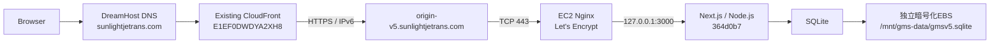
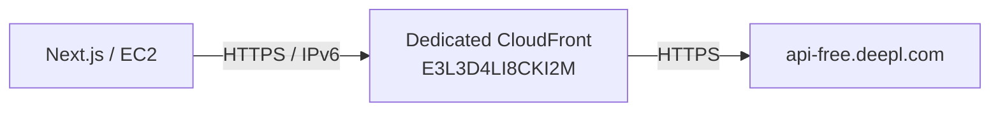
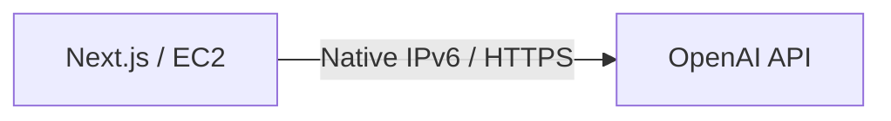
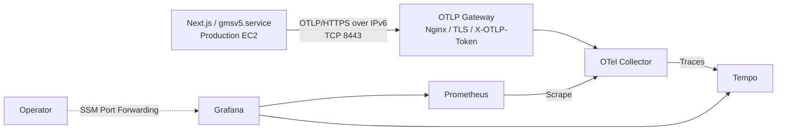

# GMS v5 — Production Architecture

**基準日:** 2026-11-14（JST）
**状態:** Production Architecture / Implementation Baseline（Architecture As-Is）
**対象リリース:** `364d0b7ebd4868f6d54b271ce9144b001bd380ca`（直前のRelease：`9783463dcdd3f3b10f743ab3e1488978b842b4be`）
**公開URL:** `https://sunlightjetrans.com`
**文書の位置付け:** [Documentation Map](README.md)。現在の本番状態の根拠は[production-state.md](infrastructure/production-state.md)

## 1. 文書の位置付け

本書は本番構成の設計上の説明（Architecture As-Is）である。2026年11月14日時点のRelease `364d0b7`と、Observability Phase 1の本番受入までを反映する。§2〜§13は2026年11月8日のBaseline 1.2（Release `9783463`）の内容を引き継ぎ、Release `364d0b7`で加わったApplicationの計装と監視基盤は§14に記載する。ネットワーク・AWS構成は10月26日の記録を継承し、ライブ環境での再監査は行っていない。本番Migration適用ログとsystemd最終状態は未提示で要確認。

本書は要約であり、証跡ではない。記載と日付付きAs-Builtが食い違う場合はAs-Builtを正とする。

GMS v5は、ユーザー所有の用語集を管理し、DeepLによる一次翻訳とOpenAIによるポストエディティングを行う、単一EC2上のModular Monolithである。DeepL専用CloudFront Reverse Proxyは既存構成として維持する。Baseline 1.2の変更は紫系公開LPと改訂番号付き制限並列取得、Release `364d0b7`の変更はApplicationのOpenTelemetry計装である。

機能要件、エンティティ、ユースケースは次の文書をSource of Truthとする。

- [Requirements](requirements.md)
- [Entity Model](entity-model.md)
- [Use Cases](use-cases.md)
- [Use Case Diagram](use-case-diagram.puml)
- [Production As-Built 2026-11-08](infrastructure/production-as-built-2026-11-08.md)
- [Historical As-Built 2026-10-26](infrastructure/production-as-built-2026-10-26.md)

現在の本番状態と監視基盤は次の文書を正とする。

- [Production State](infrastructure/production-state.md) — 実測、Terraformの管理範囲、手動構築、未実装の区分
- [Observability As-Built 2026-11-13](infrastructure/observability-as-built-2026-11-13.md) — 監視基盤とPhase 1本番受入の証跡
- [Telemetry Schema v1](development/observability/application-instrumentation.md) — Span、Metric、設定、Redactionの定義
- [Architecture As-To-Be — Add Observability](architecture-as-to-be-add-observability.md) — 目標構成。未実装の項目を含む

## 2. Architecture Principles

- アプリケーションはNext.js Standaloneを直接実行するModular Monolithとする。
- フロントエンド、Route Handlers、業務サービス、SQLiteはProduction EC2上で動作する。
- EC2にはパブリックIPv4を割り当てず、IPv6-firstで外部通信を行う。
- SQLiteのデータファイルはアプリケーションコードと分離した暗号化独立EBSへ保存する。
- ユーザー固有データはバックエンドで認証状態と所有権を検証する。
- 翻訳本文、中間訳、最終訳は業務データベースへ永続化しない。
- DeepLのIPv4到達性問題はDeepL専用CloudFront経路で解決し、他の外部通信をその経路へリダイレクトしない。
- Kubernetes、コンテナオーケストレーション、NAT Gateway、DNS64、NAT64は使用しない。
- Telemetryの収集・保存・可視化はProduction EC2とは別のObservability EC2で行う。Applicationは送信に失敗しても処理を続ける設計とする（本番での停止試験は未実施）。

## 3. Technology Stack

| Layer | Production implementation |
|---|---|
| Frontend | Next.js 16 / React / TypeScript |
| UI | Tailwind CSS |
| Backend | Next.js App Router / Route Handlers |
| Architecture | Modular Monolith |
| Runtime | Node.js 26 / Linux ARM64 |
| Compute | Amazon EC2 Spot `t4g.small` |
| Process | `systemd` / `gmsv5.service` |
| Database | SQLite |
| Persistent storage | 暗号化された独立EBS gp3 |
| Public ingress | DreamHost DNS / existing CloudFront / Nginx |
| DeepL egress | Dedicated CloudFront Reverse Proxy |
| OpenAI egress | EC2 native IPv6 |
| Authentication | Amazon Cognito Lite / Classic Hosted UI |
| Viewer TLS | AWS Certificate Manager |
| Origin TLS | Let's Encrypt / Nginx |
| IaC | Terraformと手動設定の併用 |
| Build | GitHub Actions ARM64 runner |
| Release transfer | S3 Dualstack / AWS SSM |
| Telemetry | OpenTelemetry SDK（Server Traces / Metrics）。Browser RUMは本番無効 |
| Observability | 別EC2上のOTLP Gateway / OTel Collector / Tempo / Prometheus / Grafana（Phase 1） |

Spot停止時の自動復旧、Git pushだけで本番更新する完全自動CD、Alerting、Logs集中管理は、現在のProduction Architectureに実装済みの構成として扱わない。Prometheus / GrafanaはPhase 1の範囲（ApplicationのTraces / Metricsと、監視基盤自身のHost Metrics）で稼働している（§14）。

## 4. Ingress — 既存Web公開経路

### 4.1 公開経路

- 公開ドメイン：`sunlightjetrans.com`
- DNS：DreamHost
- 既存CloudFront Distribution：`E1EF0DWDYA2XH8`
- Origin：`origin-v5.sunlightjetrans.com`
- Viewer → CloudFront：ACMによるHTTPS
- CloudFront → EC2：HTTPS over IPv6
- EC2 Nginx：443番
- Next.js：`127.0.0.1:3000`
- Node.jsの3000番とNginxの8080番は外部公開しない。

CloudFrontからEC2へのOrigin接続は、IPv6 Prefix ListによるSecurity Group制限と、Nginxの専用Origin認証ヘッダーを併用する。HTTPレスポンスのCloudFrontキャッシュは無効化している。

### 4.2 IPv6-first制約

- EC2にパブリックIPv4を付与しない。
- NAT Gatewayを追加していない。
- DNS64/NAT64を追加していない。
- EC2から外部サービスへは、宛先が提供するIPv6経路を優先する。
- DeepLのようにIPv4しか返さない／IPv6接続できないサービスは、専用Egress経路を使用する。

## 5. Egress — DeepL API専用経路

### 5.1 経路と目的

- CloudFront Distribution：`E3L3D4LI8CKI2M`
- Domain：`d7xjhnc06nb75.cloudfront.net`
- Origin：`api-free.deepl.com`
- EC2 → Dedicated CloudFront：HTTPS over IPv6
- Dedicated CloudFront → DeepL：HTTPS
- 料金方式：CloudFront従量課金

このDistributionはDeepL専用であり、OpenAI、Cognito、S3、公開Web経路などのアプリケーション通信をリダイレクトしない。

### 5.2 CloudFront Functionによる制御

- Runtime：CloudFront Functions runtime 2.0
- 共有トークン：CloudFront KeyValueStoreの`shared-token`
- クライアントヘッダー：`x-gms-proxy-token`
- Functionはトークンを検証し、Origin転送前にこのヘッダーを削除する。
- `Authorization: DeepL-Auth-Key ...`はユーザーのDeepL APIキーをDeepLへ渡すための認証であり、プロキシ共有トークンとは別物である。
- Viewer Protocol PolicyはHTTPS強制。
- Cache PolicyはCachingDisabled。

Functionが許可するAPIパスとメソッドは以下に限定する。

| Method | Path |
|---|---|
| POST | `/v2/translate` |
| POST | `/v2/glossaries` |
| DELETE | `/v2/glossaries/{id}` |

上記以外のメソッド、パス、トークンなし、トークン不一致は原則拒否する。TerraformのDistributionで広いHTTPメソッドを受け付ける設定があっても、Viewer-Request FunctionがAPI許可リストを強制する。

### 5.3 アプリケーション側のEndpoint選択

`src/lib/translation/providers.ts`は、`DEEPL_API_URL`が本番CloudFrontドメインの場合に次を検証する。

- HTTPSであること
- パスが`/v2/translate`であること
- `DEEPL_PROXY_TOKEN`が設定されていること
- `x-gms-proxy-token`をDeepLリクエストへ付与すること

ローカルでDeepLへ直接接続する場合は、`DEEPL_API_URL=https://api-free.deepl.com/v2/translate`を使用し、プロキシ共有トークンを設定しない。本番のユーザー所有DeepL APIキーは、どちらの経路でも`Authorization`に使用する。

## 6. Egress — OpenAI API

OpenAIは既存のネイティブIPv6経路を使用する。DeepL専用CloudFrontをOpenAI通信に使用しない。OpenAI API URLは`OPENAI_API_URL`で設定し、ユーザーのOpenAI APIキーはDeepLキーとは別に暗号化管理する。

## 7. Secret Management / IAM

### 7.1 EC2アプリケーション

- systemdサービス：`gmsv5.service`
- 環境変数ファイル：`/etc/gmsv5/gmsv5.env`
- ファイル所有者・権限：`root:root 600`
- 実際のSession Secret、Cognito Client Secret、暗号鍵、APIキーはリポジトリや文書へ記載しない。

### 7.2 DeepLプロキシトークン

- 保管先：AWS Systems Manager Parameter Store
- 種別：SecureString
- Parameter名：`/gmsv5/deepl/proxy-token`
- EC2 IAMロールに対象Parameterの`ssm:GetParameter`権限を付与する。
- SSM APIにはIPv6対応エンドポイントを使用する。

DeepL APIキーはユーザーが登録するBYO API Keyであり、CloudFront Functionの共有プロキシトークンとは異なる。共有トークンをユーザーAPIキーとして扱わない。

### 7.3 OTLP TokenとCA証明書

- OTLP Gatewayの認証Header：`X-OTLP-Token`
- Tokenの保管先：AWS Systems Manager Parameter StoreのSecureString
- EC2 IAMロールに`/gmsv5/prod/observability/otlp-token`の`ssm:GetParameter`を許可している（Terraform `ssm-otlp-read.tf`）。Production EC2からの取得は確認済み。
- GatewayのServer証明書を検証するCA公開証明書：`/etc/ssl/certs/gmsv5-otel-ca.pem`
- Token、CAの秘密鍵、Server証明書の秘密鍵はリポジトリや文書へ記載しない。

## 8. Authentication and Application Runtime

Amazon Cognito LiteのClassic Hosted UIを使用する。

- OAuth Authorization Code Flow
- PKCE S256
- OAuth State検証
- JWTの署名、Issuer、Audience等の検証
- Secure / HttpOnly / SameSite Cookie
- GMS側で`ACTIVE`状態とリソース所有権を検証
- 本番Callback：`https://sunlightjetrans.com/api/auth/callback`
- 本番Logout：`https://sunlightjetrans.com/`

アカウント、Glossary、Term、API認証情報はユーザー所有範囲に限定する。PENDING_DELETIONアカウントは通常利用を停止し、30暦日後に内部処理で恒久削除する。

### 8.1 Baseline 1.2のLP・Term取得構成

公開LPはHTML/CSS/SVGの紫系グラデーションとコンセプトパネルを採用し、既存登録・ログイン導線を維持する。Glossary/Term管理の5パネル構成は変更しない。

BYO初期表示はGlossary一覧、展開は最初のTermページ、以後は閲覧時に追加取得する。Select Allは版を新規確定したページから開始し、同版の取得済みページのみ再利用する。ワーカープールは暫定デフォルト2、設定1/2/4、単一操作と同一タブの上限は各4。通常ページ・最終版確認も共有スケジューラを通す。公開設定はビルド時に確定し、本番実効同時数のNetwork証跡は未提示。

既存Term GETに`termSetVersion`、`expectedVersion`、`validateOnly`を追加する。所有権・版・COUNT・本文を同一読取トランザクションで揃え、版不一致は409 `TERM_SET_CHANGED`。全ページをページ番号で結合・検証し、最終版確認後に最新選択IDとの和集合を判定し、10,000件以内だけ原子的に反映する。変更・失敗・Abort・古い世代では当該操作の選択変更0件。GETはprivate/no-store。

厳密snapshotではなく、最終確認後の変更は後続翻訳で再検証する。詳細は[CR-01技術設計](design/cr-01-parallel-fetch-design.md)を参照する。

## 9. Persistence and Process Management

- Production Database：`/mnt/gms-data/gmsv5.sqlite`
- SQLite、WAL、関連ファイルは独立EBS gp3へ保存する。
- EBS未マウント時にルートボリュームへ新しいDBを作成して起動しない。
- `gmsv5.service`がNext.js Standaloneを`127.0.0.1:3000`で起動する。
- Nginxが443番でTLSを終端し、Next.jsへLoopback接続する。
- 旧リリースディレクトリと環境変数バックアップを保持し、手動切り戻し可能な構成とする。

migration v2は`glossary_term_revisions`（Glossary単位epoch/revision）を追加し、既存Glossaryをbackfillする。Glossary作成/更新、Term作成/更新/削除の5トリガーで本文更新と改訂を同じ書込トランザクションに含め、JSON importにも適用する。移動は旧/新Glossaryを更新する。応答版はサーバー起動世代・epoch・revisionから成る。DB復元は停止・再起動を前提とする。隔離DB v1→v2成功と本番適用結果を区別し、本番移行ログは要確認。

## 10. CI / Build / Deployment

GitHub Actionsの`.github/workflows/build-arm64.yml`を`workflow_dispatch`で実行する。

```mermaid
flowchart LR
    DEV[Manual workflow_dispatch] --> GA[GitHub Actions\nubuntu-24.04-arm]
    GA --> CHECK[npm ci\nTypecheck / Lint / Build]
    CHECK --> ART[gmsv5-linux-arm64.tar.gz\nSHA-256]
    ART --> S3[S3 release path]
    S3 --> SSM[AWS SSM Run Command]
    SSM --> EC2[EC2 release directory]
    EC2 --> READY[Readiness Retry\nHTTP health check]
    READY --> SERVICE[gmsv5.service]
```

Build成果物はARM64用tar.gzとSHA-256ファイルである。デプロイでは、成果物をS3へ配置し、EC2がS3 Dualstack Endpointから取得してチェックサムを再検証する。その後、リリースディレクトリを切り替え、systemdを再起動してHTTPヘルスチェックを行う。

2026-10-26の切り替えでは、起動直後のReadinessが早すぎたため一度ロールバックし、その後Readiness Retryを導入して再デプロイに成功した。これは当時の手動デプロイ手順の改善であり、完全自動CDの完成を意味しない。

2026年11月8日の[Run 42481781676](https://github.com/1716964609/GMSv5/actions/runs/42481781676)はbuild job成功、artifact head SHAは現行releaseと一致。SHA256 Verified、S3→SSM→systemdの配布はリリース報告による。切替/readinessログ・systemd最終状態は要確認。workflowには単体/結合テストの実行ステップがなく、開発83件の結果と区別する。バックアップ・隔離DB・ロールバック資産の確認状態は[2026年11月8日のAs-Built](infrastructure/production-as-built-2026-11-08.md)に記録する。

2026年11月13日の[Run 43435258778](https://github.com/1716964609/GMSv5/actions/runs/43435258778)（Build ARM64 Release #11）はSuccessで、Head SHAは現行Release `364d0b7`と一致する。Branchは`feat/gmsv5-otel`。SHA256検証済みはOperatorの報告による。本番での起動とHTTP Readiness 200は[Observability As-Built §12](infrastructure/observability-as-built-2026-11-13.md#12-production-phase-1-acceptance)に記録されている。切替のSSM Command IDとsystemdの最終出力は未記録。Release `9783463`はRollback用に保持している。

## 11. TLS and Periodic Operations

- Viewer TLS：ACM、CloudFront
- Origin TLS：Let's Encrypt、Nginx
- Let's Encrypt検証：HTTP-01 / IPv6 / TCP 80
- 更新：Amazon Linuxのsystemd timer
- 更新後：Nginx構文検証とreload hook
- アカウント恒久削除：期限超過分を冪等に処理する内部定期処理

証明書更新、アカウント削除、Spot停止後の復旧について、実装済みの自動化範囲を超えて成功を保証しない。

## 12. Production Boundaries and Open Items

次の項目は本Production Architectureに実装済みとは記載しない。

- Browser RUMの本番有効化
- Logs集中管理、CloudFront / Nginx / DNSのEdge監視、Production EC2のHost Metrics
- Alerting、SLI / SLO、監視基盤の自動復旧とBackup
- 監視基盤のホスト構成（Container、設定、証明書）のTerraform化
- Git pushだけで本番更新する完全自動CD
- Spot停止時の自動インスタンス補充・ENI/EBS再接続
- 正式な1/2/4性能比較とp95≤20秒・逐次比50%以上短縮の達成
- 網羅的E2E、今回の用語なし翻訳・一時用語集削除完了の本番再検証
- 実行ログによる本番Migration完了・systemd最終状態・切戻し資産の確認

Product Ownerは新LPと10,000件選択成功を本番ブラウザで確認した。約40秒→約27秒（参考約32.5%短縮）は正式p95比較ではなく、暫定性能目標の達成は未確認・受入未完了。上記項目は追加検証を要する。

## 13. Related Record

現行releaseの証跡と未確認事項は[Production As-Built 2026-11-08](infrastructure/production-as-built-2026-11-08.md)を参照する。過去の本番構築・検証の時系列記録は[Production As-Built 2026-10-26](infrastructure/production-as-built-2026-10-26.md)に記載する。過去の初回公開リリース`f5fb681`と、その時点の検証結果は履歴として同文書に保持する。

Release `364d0b7`と監視基盤の証跡は[Observability As-Built 2026-11-13](infrastructure/observability-as-built-2026-11-13.md)の§11〜§12、現在の状態の要約は[Production State](infrastructure/production-state.md)を参照する。

## 14. Observability — Phase 1（2026-11-14）

Release `364d0b7`でApplicationにOpenTelemetry計装を加え、Production EC2とは別のObservability EC2へTelemetryを送る。目標構成の全体は[As-To-Be](architecture-as-to-be-add-observability.md)にある。ここには、実際に構築され本番で確認された範囲だけを書く。

### 14.1 Application側

- `GMS_OTEL_ENABLED=true`のときだけSDKを読み込む。無効時は計装なしで従来どおり動作する。
- Server TracesはOTLP/HTTP protobuf、MetricsはOTLP/HTTP JSONで送る。Endpoint、認証Header、CAは環境変数で受け取る。
- 送信直前にRedactionを行う。原文、訳文、用語、API Key、Cookie、Query StringをTelemetryに含めない。
- DeepL、OpenAI、Cognitoなど外部へは`traceparent`を伝播しない。
- Browser RUMは実装済みだが、本番では無効である。
- Span名、Metric名、属性、設定項目は[Telemetry Schema v1](development/observability/application-instrumentation.md)で定義する。

### 14.2 Observability EC2

- Production EC2とは別のInstance（`t4g.small`、Persistent Spot、Public IPv4なし）。Docker上でOTLP Gateway、OTel Collector、Tempo、Prometheus、Grafana、Node Exporterを動かす。
- 外部から到達できる受信口はIPv6 TCP 8443のOTLP Gatewayのみ。Security GroupでProduction EC2のIPv6アドレスに限定する。CollectorとTempoのポートはホストへ公開しない。
- GatewayはPrivate CAの証明書でTLSを終端し、`X-OTLP-Token`を検証してからCollectorへ中継する。
- GrafanaとPrometheusはLoopbackで待ち受け、OperatorはSSM Port Forwardingで接続する。
- データはRoot EBS（10 GiB）に保存する。保存期間の設定はPrometheusが3日または512MB、Tempoが24時間。

### 14.3 確認済みの範囲と限界

- 確認済み：本番の実リクエストのTraceがGrafanaで見えること、Application MetricsがPrometheusに入ること、Tokenなしの送信が401で拒否されること。
- Terraformが定義するのはEC2、Security Group、IAMまでである。Container、各設定、証明書、Token、Dashboardはホスト上で手動構築しており、リポジトリに定義が無い。
- 監視基盤停止時の本番継続、本番Traceの機密情報確認、計測オーバーヘッドは、本番での確認記録が無い。
- 未実装の項目と未確認の項目は[Production State §6〜§7](infrastructure/production-state.md)にまとめてある。
