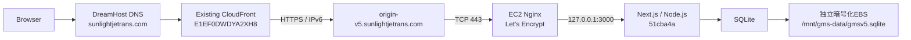
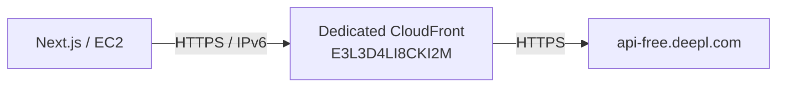
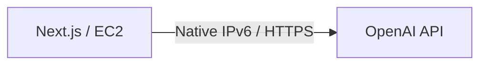

# GMS v5 — Production Architecture

**基準日:** 2026-10-26（JST）
**状態:** Production Architecture / Implementation Baseline
**対象リリース:** `51cba4a`
**公開URL:** `https://sunlightjetrans.com`

## 1. 文書の位置付け

本書は、2026年10月26日時点で稼働しているGMS v5のProduction Architectureを記録する。実装前のArchitecture Draftではなく、検証済みのTerraform、アプリケーション実装、デプロイ記録を優先する。

GMS v5は、ユーザー所有の用語集を管理し、DeepLによる一次翻訳とOpenAIによるポストエディティングを行う、単一EC2上のModular Monolithである。今回の基準更新では、DeepLのIPv4接続障害を解決する専用CloudFront Reverse Proxyを追加した。

機能要件、エンティティ、ユースケースは次の文書をSource of Truthとする。

- [Requirements](requirements.md)
- [Entity Model](entity-model.md)
- [Use Cases](use-cases.md)
- [Use Case Diagram](use-case-diagram.puml)
- [Production As-Built](infrastructure/production-as-built-2026-10-26.md)

## 2. Architecture Principles

- アプリケーションはNext.js Standaloneを直接実行するModular Monolithとする。
- フロントエンド、Route Handlers、業務サービス、SQLiteはProduction EC2上で動作する。
- EC2にはパブリックIPv4を割り当てず、IPv6-firstで外部通信を行う。
- SQLiteのデータファイルはアプリケーションコードと分離した暗号化独立EBSへ保存する。
- ユーザー固有データはバックエンドで認証状態と所有権を検証する。
- 翻訳本文、中間訳、最終訳は業務データベースへ永続化しない。
- DeepLのIPv4到達性問題はDeepL専用CloudFront経路で解決し、他の外部通信をその経路へリダイレクトしない。
- Kubernetes、コンテナオーケストレーション、NAT Gateway、DNS64、NAT64は使用しない。

## 3. Technology Stack

| Layer | Production implementation |
|---|---|
| Frontend | Next.js 16 / React / TypeScript |
| UI | Tailwind CSS |
| Backend | Next.js App Router / Route Handlers |
| Architecture | Modular Monolith |
| Runtime | Node.js 26 / Linux ARM64 |
| Compute | Amazon EC2 Spot `t4g.small` |
| Process | `systemd` / `gmsv5.service` |
| Database | SQLite |
| Persistent storage | 暗号化された独立EBS gp3 |
| Public ingress | DreamHost DNS / existing CloudFront / Nginx |
| DeepL egress | Dedicated CloudFront Reverse Proxy |
| OpenAI egress | EC2 native IPv6 |
| Authentication | Amazon Cognito Lite / Classic Hosted UI |
| Viewer TLS | AWS Certificate Manager |
| Origin TLS | Let's Encrypt / Nginx |
| IaC | Terraformと手動設定の併用 |
| Build | GitHub Actions ARM64 runner |
| Release transfer | S3 Dualstack / AWS SSM |

Prometheus/Grafana、Spot停止時の自動復旧、Git pushだけで本番更新する完全自動CDは、現在のProduction Architectureに実装済みの構成として扱わない。

## 4. Ingress — 既存Web公開経路

### 4.1 公開経路

- 公開ドメイン：`sunlightjetrans.com`
- DNS：DreamHost
- 既存CloudFront Distribution：`E1EF0DWDYA2XH8`
- Origin：`origin-v5.sunlightjetrans.com`
- Viewer → CloudFront：ACMによるHTTPS
- CloudFront → EC2：HTTPS over IPv6
- EC2 Nginx：443番
- Next.js：`127.0.0.1:3000`
- Node.jsの3000番とNginxの8080番は外部公開しない。

CloudFrontからEC2へのOrigin接続は、IPv6 Prefix ListによるSecurity Group制限と、Nginxの専用Origin認証ヘッダーを併用する。HTTPレスポンスのCloudFrontキャッシュは無効化している。

### 4.2 IPv6-first制約

- EC2にパブリックIPv4を付与しない。
- NAT Gatewayを追加していない。
- DNS64/NAT64を追加していない。
- EC2から外部サービスへは、宛先が提供するIPv6経路を優先する。
- DeepLのようにIPv4しか返さない／IPv6接続できないサービスは、専用Egress経路を使用する。

## 5. Egress — DeepL API専用経路

### 5.1 経路と目的

- CloudFront Distribution：`E3L3D4LI8CKI2M`
- Domain：`d7xjhnc06nb75.cloudfront.net`
- Origin：`api-free.deepl.com`
- EC2 → Dedicated CloudFront：HTTPS over IPv6
- Dedicated CloudFront → DeepL：HTTPS
- 料金方式：CloudFront従量課金

このDistributionはDeepL専用であり、OpenAI、Cognito、S3、公開Web経路などのアプリケーション通信をリダイレクトしない。

### 5.2 CloudFront Functionによる制御

- Runtime：CloudFront Functions runtime 2.0
- 共有トークン：CloudFront KeyValueStoreの`shared-token`
- クライアントヘッダー：`x-gms-proxy-token`
- Functionはトークンを検証し、Origin転送前にこのヘッダーを削除する。
- `Authorization: DeepL-Auth-Key ...`はユーザーのDeepL APIキーをDeepLへ渡すための認証であり、プロキシ共有トークンとは別物である。
- Viewer Protocol PolicyはHTTPS強制。
- Cache PolicyはCachingDisabled。

Functionが許可するAPIパスとメソッドは以下に限定する。

| Method | Path |
|---|---|
| POST | `/v2/translate` |
| POST | `/v2/glossaries` |
| DELETE | `/v2/glossaries/{id}` |

上記以外のメソッド、パス、トークンなし、トークン不一致は原則拒否する。TerraformのDistributionで広いHTTPメソッドを受け付ける設定があっても、Viewer-Request FunctionがAPI許可リストを強制する。

### 5.3 アプリケーション側のEndpoint選択

`src/lib/translation/providers.ts`は、`DEEPL_API_URL`が本番CloudFrontドメインの場合に次を検証する。

- HTTPSであること
- パスが`/v2/translate`であること
- `DEEPL_PROXY_TOKEN`が設定されていること
- `x-gms-proxy-token`をDeepLリクエストへ付与すること

ローカルでDeepLへ直接接続する場合は、`DEEPL_API_URL=https://api-free.deepl.com/v2/translate`を使用し、プロキシ共有トークンを設定しない。本番のユーザー所有DeepL APIキーは、どちらの経路でも`Authorization`に使用する。

## 6. Egress — OpenAI API

OpenAIは既存のネイティブIPv6経路を使用する。DeepL専用CloudFrontをOpenAI通信に使用しない。OpenAI API URLは`OPENAI_API_URL`で設定し、ユーザーのOpenAI APIキーはDeepLキーとは別に暗号化管理する。

## 7. Secret Management / IAM

### 7.1 EC2アプリケーション

- systemdサービス：`gmsv5.service`
- 環境変数ファイル：`/etc/gmsv5/gmsv5.env`
- ファイル所有者・権限：`root:root 600`
- 実際のSession Secret、Cognito Client Secret、暗号鍵、APIキーはリポジトリや文書へ記載しない。

### 7.2 DeepLプロキシトークン

- 保管先：AWS Systems Manager Parameter Store
- 種別：SecureString
- Parameter名：`/gmsv5/deepl/proxy-token`
- EC2 IAMロールに対象Parameterの`ssm:GetParameter`権限を付与する。
- SSM APIにはIPv6対応エンドポイントを使用する。

DeepL APIキーはユーザーが登録するBYO API Keyであり、CloudFront Functionの共有プロキシトークンとは異なる。共有トークンをユーザーAPIキーとして扱わない。

## 8. Authentication and Application Runtime

Amazon Cognito LiteのClassic Hosted UIを使用する。

- OAuth Authorization Code Flow
- PKCE S256
- OAuth State検証
- JWTの署名、Issuer、Audience等の検証
- Secure / HttpOnly / SameSite Cookie
- GMS側で`ACTIVE`状態とリソース所有権を検証
- 本番Callback：`https://sunlightjetrans.com/api/auth/callback`
- 本番Logout：`https://sunlightjetrans.com/`

アカウント、Glossary、Term、API認証情報はユーザー所有範囲に限定する。PENDING_DELETIONアカウントは通常利用を停止し、30暦日後に内部処理で恒久削除する。

## 9. Persistence and Process Management

- Production Database：`/mnt/gms-data/gmsv5.sqlite`
- SQLite、WAL、関連ファイルは独立EBS gp3へ保存する。
- EBS未マウント時にルートボリュームへ新しいDBを作成して起動しない。
- `gmsv5.service`がNext.js Standaloneを`127.0.0.1:3000`で起動する。
- Nginxが443番でTLSを終端し、Next.jsへLoopback接続する。
- 旧リリースディレクトリと環境変数バックアップを保持し、手動切り戻し可能な構成とする。

## 10. CI / Build / Deployment

GitHub Actionsの`.github/workflows/build-arm64.yml`を`workflow_dispatch`で実行する。

```mermaid
flowchart LR
    DEV[Manual workflow_dispatch] --> GA[GitHub Actions\nubuntu-24.04-arm]
    GA --> CHECK[npm ci\nTypecheck / Lint / Build]
    CHECK --> ART[gmsv5-linux-arm64.tar.gz\nSHA-256]
    ART --> S3[S3 release path]
    S3 --> SSM[AWS SSM Run Command]
    SSM --> EC2[EC2 release directory]
    EC2 --> READY[Readiness Retry\nHTTP health check]
    READY --> SERVICE[gmsv5.service]
```

Build成果物はARM64用tar.gzとSHA-256ファイルである。デプロイでは、成果物をS3へ配置し、EC2がS3 Dualstack Endpointから取得してチェックサムを再検証する。その後、リリースディレクトリを切り替え、systemdを再起動してHTTPヘルスチェックを行う。

2026-10-26の切り替えでは、起動直後のReadinessが早すぎたため一度ロールバックし、その後Readiness Retryを導入して再デプロイに成功した。これは今回の手動デプロイ手順の改善であり、完全自動CDの完成を意味しない。

## 11. TLS and Periodic Operations

- Viewer TLS：ACM、CloudFront
- Origin TLS：Let's Encrypt、Nginx
- Let's Encrypt検証：HTTP-01 / IPv6 / TCP 80
- 更新：Amazon Linuxのsystemd timer
- 更新後：Nginx構文検証とreload hook
- アカウント恒久削除：期限超過分を冪等に処理する内部定期処理

証明書更新、アカウント削除、Spot停止後の復旧について、実装済みの自動化範囲を超えて成功を保証しない。

## 12. Production Boundaries and Open Items

次の項目は本Production Architectureに実装済みとは記載しない。

- Prometheus/Grafanaの本番監視基盤
- Git pushだけで本番更新する完全自動CD
- Spot停止時の自動インスタンス補充・ENI/EBS再接続
- 大量用語の一括ロード問題の解決
- 用語なし翻訳、最大10,000件選択、一時用語集削除完了など、今回のDeepL Egress修正で実行していない動作の本番成功

これらは別途検証・設計・実装が必要な事項であり、今回のDocumentation Baseline Refreshの対象外とする。

## 13. Related Record

本番構築・検証の時系列記録は[Production As-Built 2026-10-26](infrastructure/production-as-built-2026-10-26.md)に記載する。過去の初回公開リリース`f5fb681`と、その時点の検証結果は履歴として同文書に保持する。
