# GMS v5 — Production Architecture

**基準日:** 2026-11-20（JST）
**状態:** Production Architecture / Implementation Baseline（Architecture As-Is）
**対象リリース:** `53ece4d8809cdf439cf9c182ce1f41c0b017e3af`（2026-11-19のCI/CD受入時点）。2026-11-20のDR演習時点の本番は`57b914136fcea70247336e7bf65160300e47781c`（文書のみのMerge）。以後も`main`へのMergeごとに自動で更新される
**公開URL:** `https://sunlightjetrans.com`
**文書の位置付け:** [Documentation Map](README.md)。現在の本番状態の根拠は[production-state.md](infrastructure/production-state.md)

## 1. 文書の位置付け

本書は本番構成の設計上の説明（Architecture As-Is）である。2026年11月20日のBackup Automation（DLM）の適用までを反映する。§2〜§9、§11は2026年11月8日のBaseline 1.2（Release `9783463`）の内容を引き継ぐ。§10はCI/CD、Automatic Rollback、Boot Recovery（2026-11-19）、§14はApplicationの計装と監視基盤（2026-11-14〜11-17）、§15はDeploymentの監視（2026-11-19）、§16はData EBSのBackupと復旧（2026-11-20）を扱う。ネットワーク・AWS構成は10月26日の記録を継承し、ライブ環境での再監査は行っていない。

本書は要約であり、証跡ではない。記載と日付付きAs-Builtが食い違う場合はAs-Builtを正とする。

GMS v5は、ユーザー所有の用語集を管理し、DeepLによる一次翻訳とOpenAIによるポストエディティングを行う、単一EC2上のModular Monolithである。DeepL専用CloudFront Reverse Proxyは既存構成として維持する。Baseline 1.2の変更は紫系公開LPと改訂番号付き制限並列取得、Release `364d0b7`の変更はApplicationのOpenTelemetry計装、2026年11月19日の変更はHealth Endpointと自動Deploymentである。CI/CDの導入は、IPv6-only・ARM64・単一EC2という既存の構成を変えていない。

機能要件、エンティティ、ユースケースは次の文書をSource of Truthとする。

- [Requirements](requirements.md)
- [Entity Model](entity-model.md)
- [Use Cases](use-cases.md)
- [Use Case Diagram](use-case-diagram.puml)
- [Historical As-Built 2026-11-08](infrastructure/production-as-built-2026-11-08.md)
- [Historical As-Built 2026-10-26](infrastructure/production-as-built-2026-10-26.md)

現在の本番状態、CI/CD、監視基盤は次の文書を正とする。

- [Production State](infrastructure/production-state.md) — 実測、Terraformの管理範囲、手動構築、未実装の区分
- [CI/CD As-Built 2026-11-19](infrastructure/cicd-as-built-2026-11-19.md) — CI/CD、Automatic Rollback、Boot Recoveryの本番受入の証跡
- [CI/CD Operations Runbook](infrastructure/cicd-operations-runbook.md) — Deploymentの運用、結果コード、Lockの扱い
- [Observability As-Built 2026-11-13](infrastructure/observability-as-built-2026-11-13.md) — 監視基盤とPhase 1本番受入の証跡
- [Observability As-Built 2026-11-16](infrastructure/observability-as-built-2026-11-16.md) — Translation SLO、Discord通知
- [Availability As-Built 2026-11-17](infrastructure/availability-external-as-built-2026-11-17.md) — 外部Availability監視、Spot Lifecycle監視
- [DR As-Built 2026-11-20](infrastructure/dr-as-built-2026-11-20.md) — DLMの適用、隔離DR演習のRPO / RTO、CR-01 Benchmark、DNS / CDN調査の証跡
- [Disaster Recovery Runbook](infrastructure/disaster-recovery-runbook.md) — Snapshotからの復旧手順、DLMの確認
- [Telemetry Schema v1](development/observability/application-instrumentation.md) — Span、Metric、設定、Redactionの定義
- [Architecture As-To-Be — Add Observability](architecture-as-to-be-add-observability.md) — 目標構成。未実装の項目を含む

## 2. Architecture Principles

- アプリケーションはNext.js Standaloneを直接実行するModular Monolithとする。
- フロントエンド、Route Handlers、業務サービス、SQLiteはProduction EC2上で動作する。
- EC2にはパブリックIPv4を割り当てず、IPv6-firstで外部通信を行う。
- SQLiteのデータファイルはアプリケーションコードと分離した暗号化独立EBSへ保存する。
- ユーザー固有データはバックエンドで認証状態と所有権を検証する。
- 翻訳本文、中間訳、最終訳は業務データベースへ永続化しない。
- DeepLのIPv4到達性問題はDeepL専用CloudFront経路で解決し、他の外部通信をその経路へリダイレクトしない。
- Kubernetes、コンテナオーケストレーション、NAT Gateway、DNS64、NAT64は使用しない。
- Telemetryの収集・保存・可視化はProduction EC2とは別のObservability EC2で行う。Applicationは送信に失敗しても処理を続ける設計とする（本番での停止試験は未実施）。

## 3. Technology Stack

| Layer | Production implementation |
|---|---|
| Frontend | Next.js 16 / React / TypeScript |
| UI | Tailwind CSS |
| Backend | Next.js App Router / Route Handlers |
| Architecture | Modular Monolith |
| Runtime | Node.js 26 / Linux ARM64 |
| Compute | Amazon EC2 Spot `t4g.small` |
| Process | `systemd` / `gmsv5.service`（`/opt/gmsv5/current`から起動） |
| Database | SQLite |
| Persistent storage | 暗号化された独立EBS gp3 |
| Backup | Amazon Data Lifecycle Manager（Data EBSの日次Snapshot、2世代保持。§16） |
| Public ingress | DreamHost DNS / existing CloudFront / Nginx |
| DeepL egress | Dedicated CloudFront Reverse Proxy |
| OpenAI egress | EC2 native IPv6 |
| Authentication | Amazon Cognito Lite / Classic Hosted UI |
| Viewer TLS | AWS Certificate Manager |
| Origin TLS | Let's Encrypt / Nginx |
| IaC | Terraformと手動設定の併用 |
| CI | GitHub Actions `CI Quality Gate`（Pull Request、ARM64 Runner）。`main`へのMergeに必須 |
| Build | GitHub Actions ARM64 Runner。Next.js StandaloneのArtifact、SHA256、Release Manifest |
| CD | GitHub Actions `Continuous Deployment`（`main`へのPush）。GitHub OIDC / AWS STS |
| Release transfer | S3 Regional Dualstack Endpoint（不変な公開）/ AWS SSM専用Document |
| Release切替 | Root所有のDeployment Engine。原子的なSymbolic Link置換、Release-aware Readiness、Automatic Rollback、Boot Recovery |
| Telemetry | OpenTelemetry SDK（Server Traces / Metrics）。Browser RUMは本番無効 |
| Observability | 別EC2上のOTLP Gateway / OTel Collector / Tempo / Prometheus / Grafana |
| 外部監視 | EventBridge / Lambda / DynamoDB / CloudWatch（Availability、Spot Lifecycle、Deployment） |
| 通知 | Discord（Grafana Alert、および外部監視のLambda） |

`main`へのPushで本番を更新する自動CD、Automatic Rollback、Boot Recoveryは2026年11月19日に本番で受入済みである（§10）。翻訳SLOのAlert、外部Availability監視も稼働している（§14）。Data EBSの日次Snapshot（DLM）は2026年11月20日に適用した（§16。初回の実行は未確認）。一方、Instanceの自動再作成とENI/EBSの再構成、無停止Deployment、DBの自動Rollback、本番の災害復旧Cutover、Logs集中管理は、現在のProduction Architectureに実装済みの構成として扱わない（§12）。

## 4. Ingress — 既存Web公開経路

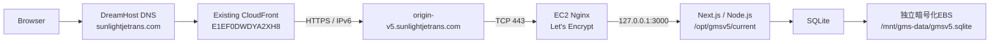

### 4.1 公開経路

- 公開ドメイン：`sunlightjetrans.com`
- DNS：DreamHost
- 既存CloudFront Distribution：`E1EF0DWDYA2XH8`
- Origin：`origin-v5.sunlightjetrans.com`
- Viewer → CloudFront：ACMによるHTTPS
- CloudFront → EC2：HTTPS over IPv6
- EC2 Nginx：443番
- Next.js：`127.0.0.1:3000`
- Node.jsの3000番とNginxの8080番は外部公開しない。

CloudFrontからEC2へのOrigin接続は、IPv6 Prefix ListによるSecurity Group制限と、Nginxの専用Origin認証ヘッダーを併用する。HTTPレスポンスのCloudFrontキャッシュは無効化している。

DreamHostのApex RecordはCloudFront標準DomainへのALIASである。2026-11-20の調査では、独自Domain経由で米国のEdge（`HIO52-P2`）が選ばれ、東京のEdgeより外部から見たTTFBが大きかった。原因はDreamHostのALIAS flatteningによるという仮説の段階で、DNS移行などの修正は行っていない。本節の構成は変わっていない。状態は[Production State §3.10](infrastructure/production-state.md#310-公開経路の性能dns--cdn2026-11-20)、証跡は[DR As-Built §8](infrastructure/dr-as-built-2026-11-20.md#8-production-latency-investigation--dns--cdn)にある。

### 4.2 IPv6-first制約

- EC2にパブリックIPv4を付与しない。
- NAT Gatewayを追加していない。
- DNS64/NAT64を追加していない。
- EC2から外部サービスへは、宛先が提供するIPv6経路を優先する。
- DeepLのようにIPv4しか返さない／IPv6接続できないサービスは、専用Egress経路を使用する。

## 5. Egress — DeepL API専用経路

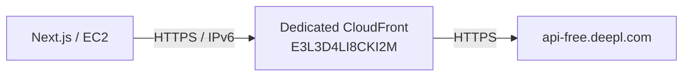

### 5.1 経路と目的

- CloudFront Distribution：`E3L3D4LI8CKI2M`
- Domain：`d7xjhnc06nb75.cloudfront.net`
- Origin：`api-free.deepl.com`
- EC2 → Dedicated CloudFront：HTTPS over IPv6
- Dedicated CloudFront → DeepL：HTTPS
- 料金方式：CloudFront従量課金

このDistributionはDeepL専用であり、OpenAI、Cognito、S3、公開Web経路などのアプリケーション通信をリダイレクトしない。

### 5.2 CloudFront Functionによる制御

- Runtime：CloudFront Functions runtime 2.0
- 共有トークン：CloudFront KeyValueStoreの`shared-token`
- クライアントヘッダー：`x-gms-proxy-token`
- Functionはトークンを検証し、Origin転送前にこのヘッダーを削除する。
- `Authorization: DeepL-Auth-Key ...`はユーザーのDeepL APIキーをDeepLへ渡すための認証であり、プロキシ共有トークンとは別物である。
- Viewer Protocol PolicyはHTTPS強制。
- Cache PolicyはCachingDisabled。

Functionが許可するAPIパスとメソッドは以下に限定する。

| Method | Path |
|---|---|
| POST | `/v2/translate` |
| POST | `/v2/glossaries` |
| DELETE | `/v2/glossaries/{id}` |

上記以外のメソッド、パス、トークンなし、トークン不一致は原則拒否する。TerraformのDistributionで広いHTTPメソッドを受け付ける設定があっても、Viewer-Request FunctionがAPI許可リストを強制する。

### 5.3 アプリケーション側のEndpoint選択

`src/lib/translation/providers.ts`は、`DEEPL_API_URL`が本番CloudFrontドメインの場合に次を検証する。

- HTTPSであること
- パスが`/v2/translate`であること
- `DEEPL_PROXY_TOKEN`が設定されていること
- `x-gms-proxy-token`をDeepLリクエストへ付与すること

ローカルでDeepLへ直接接続する場合は、`DEEPL_API_URL=https://api-free.deepl.com/v2/translate`を使用し、プロキシ共有トークンを設定しない。本番のユーザー所有DeepL APIキーは、どちらの経路でも`Authorization`に使用する。

## 6. Egress — OpenAI API

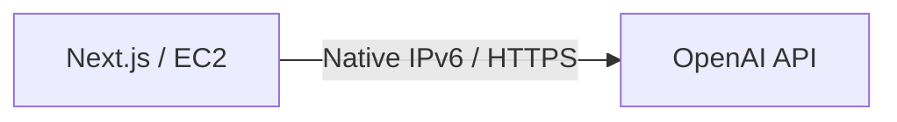

OpenAIは既存のネイティブIPv6経路を使用する。DeepL専用CloudFrontをOpenAI通信に使用しない。OpenAI API URLは`OPENAI_API_URL`で設定し、ユーザーのOpenAI APIキーはDeepLキーとは別に暗号化管理する。

## 7. Secret Management / IAM

### 7.1 EC2アプリケーション

- systemdサービス：`gmsv5.service`
- 環境変数ファイル：`/etc/gmsv5/gmsv5.env`
- ファイル所有者・権限：`root:root 600`
- 実際のSession Secret、Cognito Client Secret、暗号鍵、APIキーはリポジトリや文書へ記載しない。

### 7.2 DeepLプロキシトークン

- 保管先：AWS Systems Manager Parameter Store
- 種別：SecureString
- Parameter名：`/gmsv5/deepl/proxy-token`
- EC2 IAMロールに対象Parameterの`ssm:GetParameter`権限を付与する。
- SSM APIにはIPv6対応エンドポイントを使用する。

DeepL APIキーはユーザーが登録するBYO API Keyであり、CloudFront Functionの共有プロキシトークンとは異なる。共有トークンをユーザーAPIキーとして扱わない。

### 7.3 OTLP TokenとCA証明書

- OTLP Gatewayの認証Header：`X-OTLP-Token`
- Tokenの保管先：AWS Systems Manager Parameter StoreのSecureString
- EC2 IAMロールに`/gmsv5/prod/observability/otlp-token`の`ssm:GetParameter`を許可している（Terraform `ssm-otlp-read.tf`）。Production EC2からの取得は確認済み。
- GatewayのServer証明書を検証するCA公開証明書：`/etc/ssl/certs/gmsv5-otel-ca.pem`
- Token、CAの秘密鍵、Server証明書の秘密鍵はリポジトリや文書へ記載しない。

## 8. Authentication and Application Runtime

Amazon Cognito LiteのClassic Hosted UIを使用する。

- OAuth Authorization Code Flow
- PKCE S256
- OAuth State検証
- JWTの署名、Issuer、Audience等の検証
- Secure / HttpOnly / SameSite Cookie
- GMS側で`ACTIVE`状態とリソース所有権を検証
- 本番Callback：`https://sunlightjetrans.com/api/auth/callback`
- 本番Logout：`https://sunlightjetrans.com/`

アカウント、Glossary、Term、API認証情報はユーザー所有範囲に限定する。PENDING_DELETIONアカウントは通常利用を停止し、30暦日後に内部処理で恒久削除する。

### 8.1 Baseline 1.2のLP・Term取得構成

公開LPはHTML/CSS/SVGの紫系グラデーションとコンセプトパネルを採用し、既存登録・ログイン導線を維持する。Glossary/Term管理の5パネル構成は変更しない。

BYO初期表示はGlossary一覧、展開は最初のTermページ、以後は閲覧時に追加取得する。Select Allは版を新規確定したページから開始し、同版の取得済みページのみ再利用する。ワーカープールは暫定デフォルト2、設定1/2/4、単一操作と同一タブの上限は各4。通常ページ・最終版確認も共有スケジューラを通す。公開設定はビルド時に確定し、本番実効同時数のNetwork証跡は未提示。

既存Term GETに`termSetVersion`、`expectedVersion`、`validateOnly`を追加する。所有権・版・COUNT・本文を同一読取トランザクションで揃え、版不一致は409 `TERM_SET_CHANGED`。全ページをページ番号で結合・検証し、最終版確認後に最新選択IDとの和集合を判定し、10,000件以内だけ原子的に反映する。変更・失敗・Abort・古い世代では当該操作の選択変更0件。GETはprivate/no-store。

厳密snapshotではなく、最終確認後の変更は後続翻訳で再検証する。詳細は[CR-01技術設計](design/cr-01-parallel-fetch-design.md)を参照する。

## 9. Persistence and Process Management

- Production Database：`/mnt/gms-data/gmsv5.sqlite`
- SQLiteのDBと関連ファイル（Journal。WALを使う場合はWAL / SHM）は独立EBS gp3へ保存する。2026-11-20の読み取り調査では、本番のjournal modeは`delete`だった（WALではない）。
- Data EBSはDLMで日次Snapshotを取得する（§16）。
- EBS未マウント時にルートボリュームへ新しいDBを作成して起動しない。
- `gmsv5.service`がNext.js Standaloneを`127.0.0.1:3000`で起動する。作業Directoryは`/opt/gmsv5/current`で、Deployment Engineが管理するReleaseを指す（§10.3）。
- 起動前に`gmsv5-boot-prepare.service`と起動Guardが、Data Volumeのマウント（Filesystem UUID）とReleaseの配置を確認する（§10.6）。
- Nginxが443番でTLSを終端し、Next.jsへLoopback接続する。
- 直前のReleaseを保持し、切替後の失敗時には自動で切り戻す（§10.5）。2026年11月18日までは、旧リリースディレクトリと環境変数バックアップによる手動切り戻しだった。
- DBはRelease切替の対象外である。Applicationを切り戻してもDBは戻らない。

migration v2は`glossary_term_revisions`（Glossary単位epoch/revision）を追加し、既存Glossaryをbackfillする。Glossary作成/更新、Term作成/更新/削除の5トリガーで本文更新と改訂を同じ書込トランザクションに含め、JSON importにも適用する。移動は旧/新Glossaryを更新する。応答版はサーバー起動世代・epoch・revisionから成る。DB復元は停止・再起動を前提とする。隔離DB v1→v2成功と本番適用結果を区別し、本番移行ログは要確認。

## 10. CI / Build / Deployment

2026年11月19日から、本番Deploymentは`main`へのPushで自動的に行われる。本節は構成の説明である。受入の証跡は[CI/CD As-Built 2026-11-19](infrastructure/cicd-as-built-2026-11-19.md)、運用手順は[CI/CD Operations Runbook](infrastructure/cicd-operations-runbook.md)にある。2026年11月18日までの手動Releaseは§10.8に履歴として残す。

全体の流れ：

```text
Pull Request → CI Quality Gate → mainへMerge → Linux ARM64 Build → Artifact検証
  → GitHub OIDC / AWS STS → S3への不変な公開 → S3分散Lock → SSM遠隔実行
  → EC2 Preflight → 安全な展開 → 原子的なRelease切替 → systemd再起動
  → Release-aware Readiness → 確定 または Automatic Rollback
```

Repository変数`GMSV5_CD_ENABLED`が`true`のときだけ、Pushによる本番Deploymentが起動する。現在は`true`である。CDのWorkflowにはPathによる絞り込みが無いため、文書だけのMergeでも本番Deploymentが起動する。

### 10.1 Pull RequestとCI Quality Gate

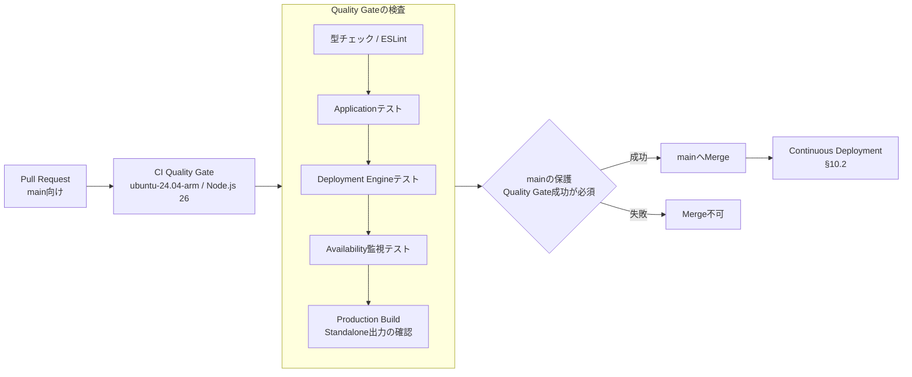

`main`はPull Requestと`Quality Gate`の成功を必須とし、この規則は管理者にも適用される（2026-11-19にGitHubから読み取り）。直接Pushはできない。

自動テストの在庫（2026-11-19）：

| Suite | 件数 | 実行するWorkflow |
|---|---:|---|
| Application（`test/*.test.ts`） | 125 | CI Quality Gate、Build ARM64 Release |
| Deployment Engine（`infra/deployment/tests/`） | 140 | CI Quality Gate、Build ARM64 Release |
| Availability監視（`infra/terraform/availability/tests/`） | 33 | CI Quality Gate |
| 合計 | 298 | — |

298件はQuality Gate全体の在庫である。CI Quality Gateは3 Suiteすべてを実行する。CDが再利用するBuild Workflowは2 Suite（265件）を実行し、Availability監視のSuiteは実行しない。ブラウザE2E（`e2e/`）はどのWorkflowも実行しない。

### 10.2 CD — GitHub Actions → OIDC → S3 → SSM → EC2

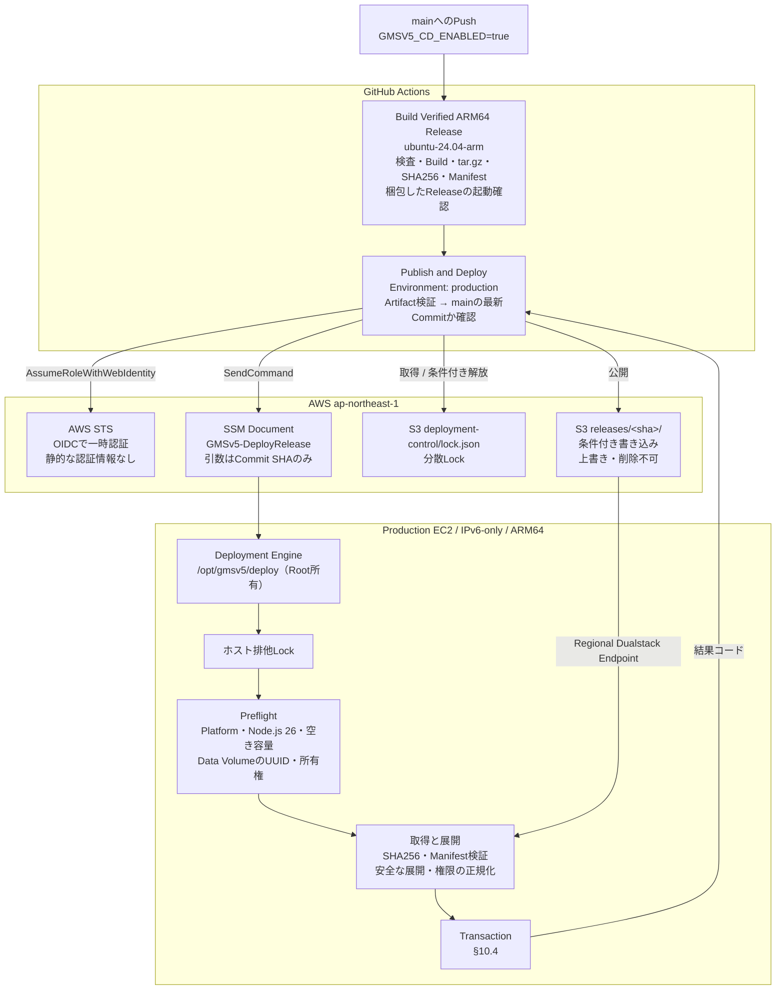

要点：

- **認証：** GitHub OIDCでIAM Roleを引き受ける。Roleの信頼条件は、このRepositoryの`production` Environmentに限定している。GitHub Actionsに静的なAWS認証情報は無い。
- **権限：** Deploy Roleに許可するのは、Release Objectの新規書き込みと読み取り、分散Lockの取得・読み取り・条件付き解放、専用SSM Documentの対象Instanceへの送信、Command結果の読み取りである。Release Objectの上書きと削除は明示的に拒否する。
- **不変性：** Releaseは`If-None-Match`付きの条件付き書き込みで公開する。同じCommit SHAのReleaseを作り直して上書きすることはできない。
- **同一性：** Workflowは、公開前とDeployment直前の2回、対象Commitが`main`の最新であることを確認する。Release ManifestはCommit SHA、Artifact SHA256、OS、Architecture、Node.jsのVersion、DB Schema Fingerprint、Build元のRunを記録する。
- **排他：** S3上の分散LockがWorkflow間の重複を、ホスト上の排他LockがEC2上の重複を防ぐ。
- **遠隔実行：** SSM Documentが受け取る引数は40桁のCommit SHAだけである。任意のCommandは実行できない。
- **Engineの分離：** Deployment EngineはApplicationのArtifactに含まれない。Engineの導入と更新はOperatorが行う。

Workflowには手動起動のMode（`build`、`publish`、`deploy`、`deploy-published`）もある。使い分けはRunbookを参照する。

### 10.3 管理下のRelease配置

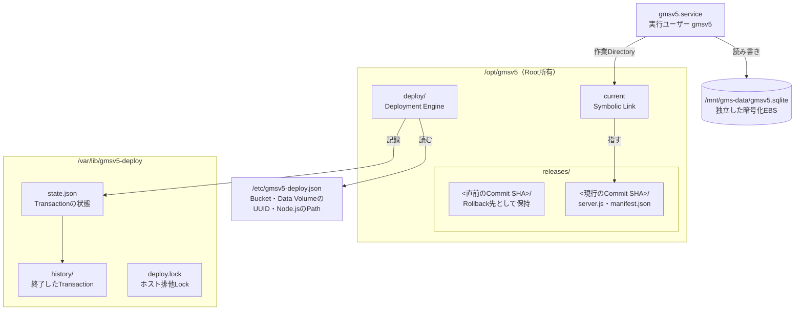

| Path | 役割 |
|---|---|
| `/opt/gmsv5/releases/<full-commit-sha>` | Releaseの本体。Root所有で、Directoryは755に正規化する |
| `/opt/gmsv5/current` | 稼働中のReleaseを指すSymbolic Link。一時Linkを作って`rename`で置き換える |
| `/opt/gmsv5/deploy` | Deployment Engine |
| `/etc/gmsv5-deploy.json` | Engineの設定 |
| `/var/lib/gmsv5-deploy/state.json`、`history`、`deploy.lock` | Transactionの状態、履歴、ホスト排他Lock |
| `/mnt/gms-data/gmsv5.sqlite` | DB。Releaseの切替では変更しない |
| S3 `deployment-control/lock.json` | 分散Lock |

実行ユーザー`gmsv5`は、Releaseの内容も`current`も書き換えられない。古いReleaseを自動で削除する仕組みは無い。

### 10.4 Deployment Transactionの状態遷移

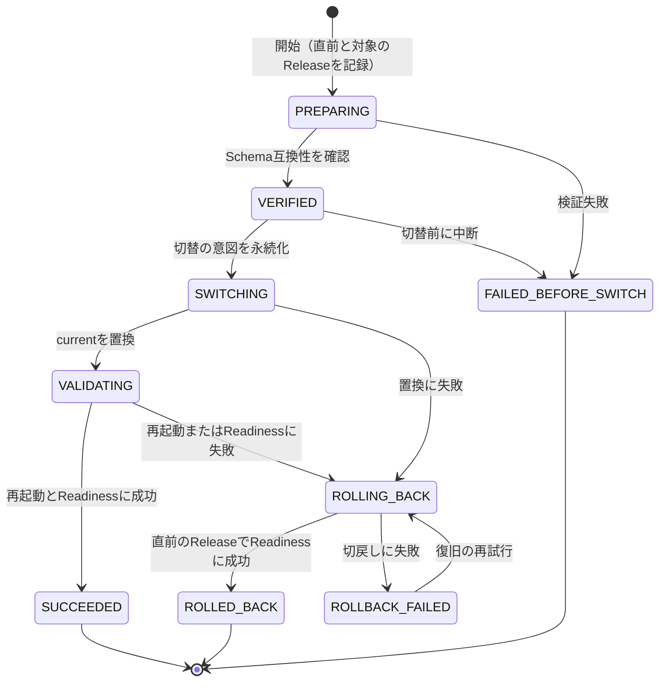

状態は`state.json`に、一時File・`fsync`・`rename`で書く。`current`を置き換える前に`SWITCHING`を永続化するため、途中で電源が落ちても、どこまで進んだかを再起動後に判断できる。終了状態は`SUCCEEDED`、`ROLLED_BACK`、`FAILED_BEFORE_SWITCH`の3つで、未終了のTransactionが残っている間は新しいDeploymentを受け付けない。

**Schema互換性：** 直前と対象のRelease ManifestにあるDB Schema Fingerprint（Migration定義のSHA256）が一致しない場合、切替前に拒否する。自動DeploymentはDB Migrationを実行しない。

**Readiness：** `/api/health/ready`は、期待するBuild SHA、DBへの到達、必須Table、適用済みMigrationのVersionと名前を照合する。`/api/health/live`はProcessの生存だけを返す。Deploymentの受入には、対象のBuild SHAを返すReadinessが3回連続で成功することを要する。

結果コード：

| Code | 結果 | 分散Lock |
|---:|---|---|
| 0 | `SUCCEEDED`（Deployment成功、または既に同じReleaseが稼働中） | 解放 |
| 10 | `FAILED_BEFORE_SWITCH`（切替前に失敗。稼働中のReleaseは変わらない） | 解放 |
| 20 | `ROLLED_BACK`（切替後に失敗し、直前のReleaseへ戻した） | 解放 |
| 21 | `ROLLBACK_FAILED`（切戻しに失敗） | 保持 |
| 22 | `RECOVERY_REQUIRED`、または結果が不明 | 保持 |

上の表に無い終了コード、Timeout、取消しは、不明な結果として扱う。実装上、Transaction開始前のPreflight・取得・展開の失敗もこの扱いになる（コードの読み取りによる。本番での発生は記録が無い）。分散Lockが残った場合は、Operatorが状態を確認してから解除する。

### 10.5 Automatic Rollback

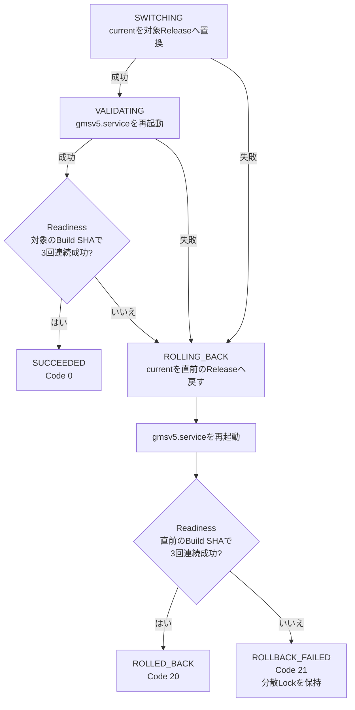

Rollbackが成功と判定されるのは、直前のReleaseがReadinessに合格したときだけである。戻すのはApplicationのコードであり、DBの内容は戻さない。

本番EC2での受入（2026-11-19 01:50 JST）は、Readinessの失敗を制御して注入した試験である。実際の不具合Releaseでの動作は確認していない。

### 10.6 Boot Recovery

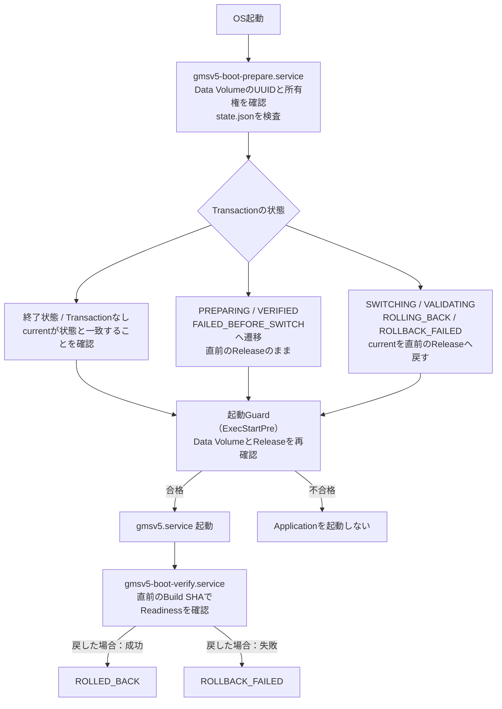

`gmsv5.service`はDrop-inにより`gmsv5-boot-prepare.service`を必須とし、その後に起動する。Deploymentの途中でInstanceが停止しても、再起動時に直前のReleaseを選び、起動後にそのReadinessを確認する。

Boot Recoveryは、**同じInstanceが再起動したとき**のApplicationの復旧である。Instanceの再作成、ENIやEBSの再構成は行わない。それらは実装していない（§12）。

本番EC2での受入（2026-11-19 01:53 JST）は、中断したTransactionを模擬したうえで、実際にOSを再起動した試験である。AWSによる実際のSpot容量回収での動作は確認していない。

### 10.7 受入の範囲と限界

受入で確認した項目、SSM Command ID、所要時間は[CI/CD As-Built](infrastructure/cicd-as-built-2026-11-19.md)にある。計測された所要時間は処理の所要時間であり、外部から測ったサービス停止時間、統計的に確立したRTO、保証されたSLOではない。

- 単一Instanceであり、切替時に`gmsv5.service`を再起動する。無停止Deploymentは保証しない。
- DBの自動Rollbackは無い。
- Releaseの自動削除は無い。
- Deployment Engineの導入と更新はOperatorが行う。
- 結果が不明なDeploymentは、Operatorによる確認を要する。
- 認証を伴うE2Eと翻訳機能は、CI/CD受入では再検証していない。

### 10.8 履歴 — 2026年11月18日までの手動Release

以下は当時の事実であり、現在の手順ではない。

- Buildは`build-arm64.yml`を`workflow_dispatch`で手動起動していた。当時のWorkflowは型チェック・Lint・Buildのみで、単体・結合テストを実行しなかった。
- Artifactの取得、SHA256の照合、S3への配置、SSM経由のEC2切替は手作業だった。
- 2026-10-26の切替では、起動直後のReadinessが早すぎたため一度ロールバックし、その後Readiness Retryを導入して再デプロイに成功した。
- 2026-11-08の[Run 42481781676](https://github.com/1716964609/GMSv5/actions/runs/42481781676)（Release `9783463`）と、2026-11-13の[Run 43435258778](https://github.com/1716964609/GMSv5/actions/runs/43435258778)（Release `364d0b7`、Branch `feat/gmsv5-otel`）は、Build成功とHead SHAの一致を確認済みである。SHA256検証済みはOperatorの報告による。切替のSSM Command IDとsystemdの最終出力は記録されていない。

詳細は[As-Built 2026-10-26](infrastructure/production-as-built-2026-10-26.md)、[As-Built 2026-11-08](infrastructure/production-as-built-2026-11-08.md)、[Observability As-Built §12](infrastructure/observability-as-built-2026-11-13.md#12-production-phase-1-acceptance)にある。

## 11. TLS and Periodic Operations

- Viewer TLS：ACM、CloudFront
- Origin TLS：Let's Encrypt、Nginx
- Let's Encrypt検証：HTTP-01 / IPv6 / TCP 80
- 更新：Amazon Linuxのsystemd timer
- 更新後：Nginx構文検証とreload hook
- アカウント恒久削除：期限超過分を冪等に処理する内部定期処理
- Data EBSのSnapshot：DLMが毎日19:00 UTC（04:00 JST）を基準に作成し、Policy管理分を2世代保持（§16）

証明書更新、アカウント削除、DLMのSnapshot、Spot停止後の復旧について、実装済みの自動化範囲を超えて成功を保証しない。Spot停止後の復旧のうち実装済みなのは、同じInstanceの再起動時のBoot Recovery（§10.6）までである。

## 12. Production Boundaries and Open Items

次の項目は本Production Architectureに実装済みとは記載しない。

Deployment・復旧：

- 無停止Deployment（単一Instanceで、切替時に再起動する）
- DBの自動Rollback、自動DeploymentによるDB Migrationの適用
- Releaseの自動削除
- CDによるDeployment Engineの更新
- Spot停止時のInstanceの自動再作成、ENI/EBSの再構成（Boot Recoveryとは別の機能）
- 実際のSpot容量回収中に中断したDeploymentの復旧確認、実際の不具合ReleaseでのRollback確認
- 失敗系Deploymentの通知の本番着信確認（単体テストのみ）、Deployment用のGrafana Panel

Backup・災害復旧：

- DLMによる初回Snapshotの作成・Retentionの確認、DLM失敗の監視、定期的なRestore Drill
- 24h RPOの達成（2026-11-20の演習ではFAIL）。SQLite Online Backupの独立した保管
- 本番の災害復旧Cutover、旧本番のFencing、復旧環境のIaC化、別Region / 別Accountへの復旧

監視：

- Browser RUMの本番有効化
- Logs集中管理、CloudFront / Nginx / DNSのEdge監視、Production EC2のHost Metrics
- 公開DomainのEdge選択の修正（DNS移行など。2026-11-20に課題を観測、未実施）
- 翻訳SLOの7日間達成実績、失敗率・Telemetry欠損の独立したAlert
- 監視基盤のBackup、Spot再作成からの復元
- 監視基盤のホスト構成（Container、設定、証明書）のTerraform化

Application・受入：

- 本番条件での1/2/4性能比較とFR-734（p95≤20秒・逐次比50%以上短縮）の正式受入。2026-11-20に隔離環境のBenchmarkでWorker 4が目標を満たした（[CR-01 §13](design/cr-01-parallel-fetch-design.md#13-隔離環境benchmark2026-11-20)）が、Worker 4は本番に適用していない
- 網羅的E2E、用語なし翻訳・一時用語集削除完了の本番再検証。CI/CD受入でも、認証を伴うE2Eと翻訳機能は再検証していない
- 本番Migration適用時の実行ログ（適用済みであることは、Readinessの成功から間接的に確認できる）

2026年11月19日に実装済みとなり、上の一覧から外した項目：`main`へのPushで本番更新する自動CD、Automatic Rollback。2026年11月16日〜17日に一部実装済みとなった項目：翻訳SLOのAlert、外部Availability監視（§14.4）。2026年11月20日に追加した項目：Data EBSの日次Snapshot（DLM、§16）。

Product Ownerは新LPと10,000件選択成功を本番ブラウザで確認した（2026-11-08）。約40秒→約27秒（参考約32.5%短縮）は正式p95比較ではなく、本番での暫定性能目標の達成は未確認・受入未完了。上記項目は追加検証を要する。

## 13. Related Record

自動Deploymentの受入の証跡は[CI/CD As-Built 2026-11-19](infrastructure/cicd-as-built-2026-11-19.md)、Backupの適用と隔離DR演習の証跡は[DR As-Built 2026-11-20](infrastructure/dr-as-built-2026-11-20.md)、現在の状態の要約は[Production State](infrastructure/production-state.md)を参照する。

Baseline 1.2（Release `9783463`）の証跡と未確認事項は[Production As-Built 2026-11-08](infrastructure/production-as-built-2026-11-08.md)を参照する。過去の本番構築・検証の時系列記録は[Production As-Built 2026-10-26](infrastructure/production-as-built-2026-10-26.md)に記載する。過去の初回公開リリース`f5fb681`と、その時点の検証結果は履歴として同文書に保持する。

Release `364d0b7`と監視基盤の証跡は[Observability As-Built 2026-11-13](infrastructure/observability-as-built-2026-11-13.md)の§11〜§12、SLOと通知は[Observability As-Built 2026-11-16](infrastructure/observability-as-built-2026-11-16.md)、外部監視は[Availability As-Built 2026-11-17](infrastructure/availability-external-as-built-2026-11-17.md)を参照する。

## 14. Observability

Release `364d0b7`でApplicationにOpenTelemetry計装を加え、Production EC2とは別のObservability EC2へTelemetryを送る。目標構成の全体は[As-To-Be](architecture-as-to-be-add-observability.md)にある。ここには、実際に構築され本番で確認された範囲だけを書く。§14.1〜§14.3はPhase 1（2026-11-14）、§14.4はその後の追加（2026-11-16〜11-17）である。Deploymentの監視は§15に分ける。

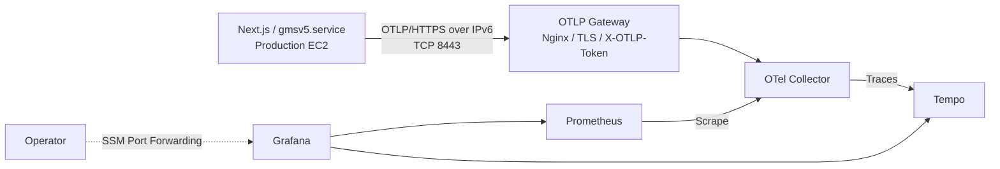

### 14.1 Application側

- `GMS_OTEL_ENABLED=true`のときだけSDKを読み込む。無効時は計装なしで従来どおり動作する。
- Server TracesはOTLP/HTTP protobuf、MetricsはOTLP/HTTP JSONで送る。Endpoint、認証Header、CAは環境変数で受け取る。
- 送信直前にRedactionを行う。原文、訳文、用語、API Key、Cookie、Query StringをTelemetryに含めない。
- DeepL、OpenAI、Cognitoなど外部へは`traceparent`を伝播しない。
- Browser RUMは実装済みだが、本番では無効である。
- Span名、Metric名、属性、設定項目は[Telemetry Schema v1](development/observability/application-instrumentation.md)で定義する。

### 14.2 Observability EC2

- Production EC2とは別のInstance（`t4g.small`、Persistent Spot、Public IPv4なし）。Docker上でOTLP Gateway、OTel Collector、Tempo、Prometheus、Grafana、Node Exporterを動かす。
- 外部から到達できる受信口はIPv6 TCP 8443のOTLP Gatewayのみ。Security GroupでProduction EC2のIPv6アドレスに限定する。CollectorとTempoのポートはホストへ公開しない。
- GatewayはPrivate CAの証明書でTLSを終端し、`X-OTLP-Token`を検証してからCollectorへ中継する。
- GrafanaとPrometheusはLoopbackで待ち受け、OperatorはSSM Port Forwardingで接続する。
- データはRoot EBS（10 GiB）に保存する。保存期間の実効値はPrometheusが10日または1GiB（2026-11-16に変更。当初は3日または512MB）、Tempoが24時間。

### 14.3 確認済みの範囲と限界

- 確認済み：本番の実リクエストのTraceがGrafanaで見えること、Application MetricsがPrometheusに入ること、Tokenなしの送信が401で拒否されること。
- Terraformが定義するのはEC2、Security Group、IAMまでである。Container、各設定、証明書、Token、Dashboardはホスト上で手動構築しており、リポジトリに定義が無い。
- 監視基盤停止時の本番継続、本番Traceの機密情報確認、計測オーバーヘッドは、本番での確認記録が無い。
- 未実装の項目と未確認の項目は[Production State §6〜§7](infrastructure/production-state.md)にまとめてある。

### 14.4 SLO Alertと外部監視（2026-11-16〜11-17）

監視の完成度は領域ごとに異なる。領域別の状態は[Production State §3.8](infrastructure/production-state.md)を正とする。

| 領域 | 構成 | 状態 |
|---|---|---|
| Translation SLO | 成功したサーバー側翻訳の95%以上が10秒以内 / Rolling 7d。Grafana-managed Alert Rule | Ruleと通知のFiring / Resolvedは確認済み。7日間の達成実績は未判定 |
| Grafanaからの通知 | Grafana → Observability EC2上のNginx Relay → Discord通知専用CloudFront → Discord | 確認済み。Observability EC2が停止すると届かない |
| 外部Availability監視 | EventBridge（1分間隔）→ Lambda → 公開URLへのHTTPS確認 → DynamoDB / CloudWatch `GMS/Availability` | 稼働。Ingressの到達確認であり、翻訳機能の確認ではない |
| Spot Lifecycle監視 | EC2状態変化・Spot警告 → EventBridge → 同じLambda → DynamoDB / CloudWatch / Discord | 稼働。2026-11-17の実際のSpot中断で通知と復旧時間を観測（報告） |
| Grafanaでの閲覧 | Grafana → Squid（CloudWatchへのCONNECTのみ許可）→ CloudWatch | 3 Panelを確認済み |

LambdaはVPCに接続せず、Observability EC2にも依存しない。そのため、Observability EC2が停止していても、AvailabilityとSpotの通知は届く。

証跡は[Observability As-Built 2026-11-16](infrastructure/observability-as-built-2026-11-16.md)と[Availability As-Built 2026-11-17](infrastructure/availability-external-as-built-2026-11-17.md)、手順は[SLO Runbook](infrastructure/observability/translation-slo-alerting-runbook.md)、[Availability Runbook](infrastructure/availability-external-runbook.md)、[Spot Runbook](infrastructure/spot-interruption-runbook.md)にある。

## 15. Deployment Observability（2026-11-19）

Deploymentの結果は、外部Availability監視と同じLambda・DynamoDB・CloudWatch Namespaceを使って記録する。記録のKeyとMetricは別にしてあり、EC2の可用性イベントやSpot中断とは区別できる。

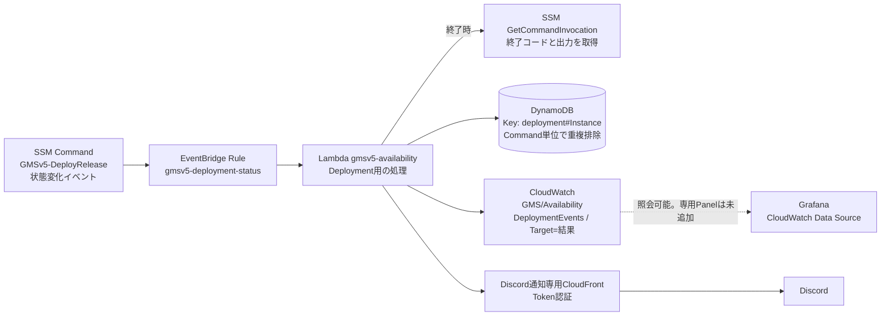

- **入力：** 専用SSM Documentの、対象InstanceでのCommand状態変化（`InProgress`、`Success`、`Failed`、`TimedOut`、`Canceled`）。
- **分類：** 開始は`IN_PROGRESS`。終了時は終了コードと出力から`SUCCEEDED`、`FAILED_BEFORE_SWITCH`、`ROLLED_BACK`、`ROLLBACK_FAILED`、`RECOVERY_REQUIRED`、`OUTCOME_UNKNOWN`に分類する。
- **Metric：** Namespace `GMS/Availability`、Metric `DeploymentEvents`、Dimension `Target`（値は結果）。
- **重複：** 同じCommandの同じ段階は1回だけ記録する。

確認済みの範囲と限界：

- 開始と成功のイベントは、DynamoDBとCloudWatchで確認済みである。Discordへの開始・成功通知は、本番Deployment 2回について着信を確認した。
- 失敗系の結果の分類と通知は単体テストで確認している。実際の本番失敗でのDiscord着信は確認していない。
- Discordへの配信はBest-effortで、厳密な1回配信を保証しない。
- Deployment専用のGrafana Panelは追加も確認もしていない。

## 16. Backup and Recovery

2026年11月20日から、本番Data EBSのSnapshotはAmazon Data Lifecycle Manager（DLM）が定期的に作成する。本節は恒久構成の説明である。宣言は`infra/terraform/v5/backup.tf`、適用と検証の結果は[DR As-Built 2026-11-20](infrastructure/dr-as-built-2026-11-20.md)、現在の状態は[Production State §3.9](infrastructure/production-state.md#39-backup--disaster-recovery2026-11-20)、復旧手順は[Disaster Recovery Runbook](infrastructure/disaster-recovery-runbook.md)を正とする。

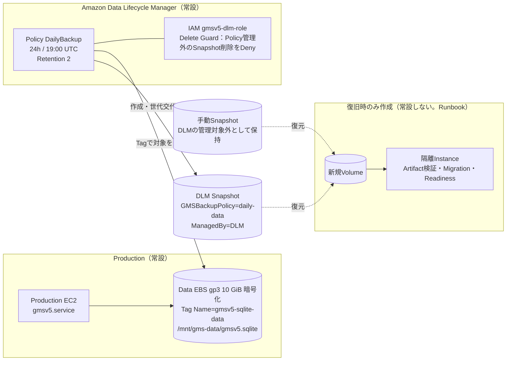

| 要素 | 設計 |
|---|---|
| 対象 | Tag `Name=gmsv5-sqlite-data`のData EBS。Root EBSとObservability EC2は対象外 |
| 周期と保持 | 24時間周期、19:00 UTC（04:00 JST）を基準。Policyが作成したSnapshotを最新2世代保持する。手動Snapshotは数に含めない |
| Tag | 作成したSnapshotに`Name=gmsv5-daily-data-backup`、`ManagedBy=DLM`、`GMSBackupPolicy=daily-data`を付ける。`CopyTags`はfalse |
| 削除の制限 | DLM RoleのInline Policyが、`GMSBackupPolicy=daily-data`でないSnapshotの削除を拒否する。DLM Roleへの制約であり、管理者の削除を禁止する機能ではない |
| 整合性 | EBS Snapshotは稼働中のVolumeの物理的な複製で、SQLiteの整合性を自動では保証しない。復元後に整合性検査を行う |
| 復旧の形 | 新しいVolumeへ復元し、本番とは別の環境で検証する。元のVolumeとSnapshotは上書きしない。復旧用の資源は常設しない |

限界：

- 24時間周期は24h RPOの達成を保証しない。初回の作成、世代交代、失敗の検知は未確認・未実装である（Production State §3.9）。
- 同一Region・同一Accountの中の保護である。Region / Accountの喪失、KMS・Secret・Cognitoの復旧は対象外。
- 2026-11-20の隔離演習で使った一時Instanceと資源は削除済みで、本構成には含まれない。本番へのCutover手順は設計上のGateであり、実行していない（[DR Runbook §8](infrastructure/disaster-recovery-runbook.md#8-production-cutover--separate-change-approval-required)）。
