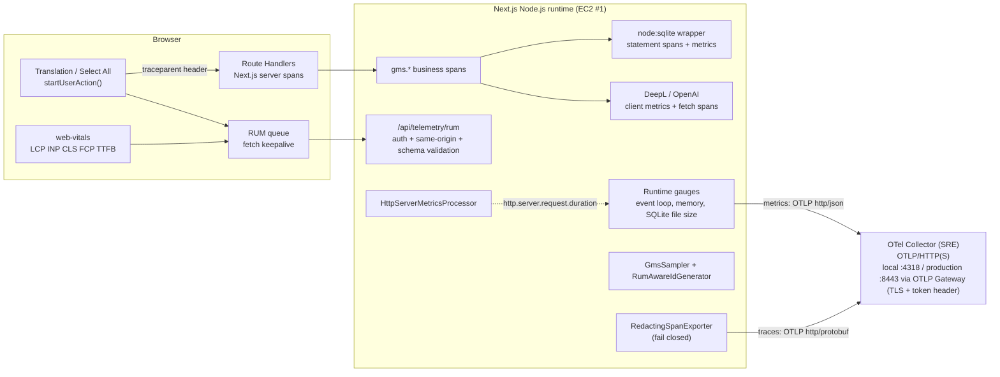

# GMS v5 — Application Instrumentation Design / Telemetry Schema v1

**Document Type:** Design Decision / Telemetry Schema (Application Engineering)
**Status:** Implemented. Server Traces / Metrics are **enabled in Production** since release `364d0b7` (verified 2026-11-14). Browser RUM is implemented but **disabled in Production**
**Created:** 2026-11-13
**Schema Version:** `1`（Resource attribute `gms.telemetry.schema_version`）
**Owner:** Application Engineering（外部Observability InfrastructureはSRE担当）
**Parent Design:** [Architecture As-To-Be — Add Observability](../../architecture-as-to-be-add-observability.md)（§5.1, §5.5–5.7, §6, §9, §11）
**Infra Baseline:** [Observability Infrastructure As-Built — 2026-11-13](../../infrastructure/observability-as-built-2026-11-13.md) / **Production state:** [production-state.md](../../infrastructure/production-state.md)
**Verification / SRE Handoff:** [application-instrumentation-verification-2026-11-13.md](./application-instrumentation-verification-2026-11-13.md)
**Release Readiness / Deployment / Rollback:** [application-release-readiness-2026-11-13.md](./application-release-readiness-2026-11-13.md)

> 本書はアプリケーション内部Instrumentationの設計とTelemetry Schemaを定義する。本番への適用状況は本書では管理せず、Infrastructureの[production-state.md](../../infrastructure/production-state.md)を正とする（As-To-Be §16 Documentation Principle）。2026-11-14時点で、Server Traces / MetricsはRelease `364d0b7`で本番有効、Browser RUMは本番無効である。
>
> **Superseded（2026-11-14）：** 本書の2026-11-13版にあった「Production環境への適用・EC2 #1→EC2 #2のOTLP接続は未実施」という記述は、[Observability As-Built §12](../../infrastructure/observability-as-built-2026-11-13.md#12-production-phase-1-acceptance)の本番受入により置き換えられた。

---

## 1. Scope and Responsibility Boundary

| Area | Application Engineering（本書） | SRE / Platform |
|---|---|---|
| OTel SDK初期化（`src/instrumentation.ts`） | ✅ | 実行時環境変数の設定 |
| HTTP / Business / SQLite / DeepL / OpenAI Span・Metrics | ✅ | — |
| Browser RUM（収集・検証・再送出） | ✅ | RUM Endpointのレート制限（Nginx） |
| Telemetry Redaction（アプリ内） | ✅ | Collector側の多層防御 |
| OTLP Collector / Prometheus / Tempo / Grafana | — | ✅ |
| Production→Observability通信路・認証・TLS（OD-06） | — | ✅ |
| Nginx Timing Log / CloudFront Server-Timing / DNS Probe / Node Exporter on EC2 #1 | — | ✅ |
| Sampling Rate / Retention / SLO値（OD-07, OD-08, OD-11） | 仕組みを提供 | 値を決定 |

## 2. Runtime Architecture

- BrowserはCollectorへ直接送信しない。Observability Endpointを公開しない（As-To-Be §9.3）。
- Trace Exportは `BatchSpanProcessor(RedactingSpanExporter(OTLPTraceExporter))` の**1経路のみ**（`@opentelemetry/exporter-trace-otlp-proto`）。
- Metricsは `PeriodicExportingMetricReader(OTLPMetricExporter)`、既定30秒（Prometheus scrape間隔30秒と整合）。
- 両Exporterは同一のNode.js HTTP Transport（`@opentelemetry/otlp-exporter-base`、`node:https`）を使い、OTLPヘッダ・TLS信頼・mTLS・圧縮の環境変数を同一仕様で解釈する（DD-12、`src/lib/observability/exporters.ts`）。

## 3. Design Decisions

| ID | Decision | Rationale |
|---|---|---|
| DD-01 | 既存PoCの`@vercel/otel`を継続利用し、`spanProcessors`を**明示指定**する | `spanProcessors`が`"auto"`の場合、`@vercel/otel`は`OTEL_EXPORTER_OTLP_ENDPOINT`があると**Redactionを経由しないOTLP Exporterを自動追加**する（2.3.0 `sdk.ts`で確認）。この経路を作らない。 |
| DD-02 | `GMS_OTEL_ENABLED=true`のOpt-in、`NEXT_RUNTIME=nodejs`のみ。初期化失敗はログ（エラー名のみ）に留めアプリ継続。`node-sdk`のDynamic Importは**`if (process.env.NEXT_RUNTIME === "nodejs") { … }`の内側に置く**（Early Return後に置かない） | As-To-Be §9.4 / §11.1。無効時はOTel APIがNo-opとなり挙動不変。Next.jsは`instrumentation.ts`をEdge向けにもコンパイルし、Webpackは畳み込んだ`if`の非成立分岐しか除去しない。Early Return後の`import()`はEdgeビルドで解析され、`runtime-metrics.ts`の`node:fs`で`UnhandledSchemeError`となる（`next dev --webpack`で発生、検証記録§7）。 |
| DD-03 | Export直前にRedactionを行い、失敗時はSpanを破棄（Fail Closed）。`gms.*`属性はSchema宣言済みキーのみ許可 | Next.js 16.4は`http.target`にQuery付き`req.url`を記録し、例外時に`exception.message`とStatus Messageを付与する。`@vercel/otel`のfetch計装は完全URLをSpan名と`http.url`に入れる。 |
| DD-04 | Propagatorは W3C `tracecontext` のみ。外部（DeepL/OpenAI/Cognito等）へは`traceparent`を伝播しない | 外部入力の`baggage`を受け取らない／第三者へTrace IDを渡さない。 |
| DD-05 | Sampler = `GmsSampler(base)`。baseは`OTEL_TRACES_SAMPLER`（既定`parentbased_always_on`）。base が落としたSERVER Spanは`RECORD`（記録のみ・非Export） | HTTP MetricsをSampling Rateから独立させる（OD-07の決定値に依存しない）。`/api/telemetry/*`のServer SpanはExportしない（Beacon毎のTraceを作らない）。 |
| DD-06 | SQLiteは`src/lib/db/client.ts`で開いた`DatabaseSync`インスタンスをラップ。SQL本文・パラメータは記録せず`db.query.summary`（例 `SELECT terms`）のみ。親Spanがある場合のみSpan化し、**1 Trace当たり100 Span上限**。Metricsは上限なし | `node:sqlite`向け汎用計装が無い（As-To-Be §5.6）。Import等で数千INSERTが1リクエストに発生し得る。 |
| DD-07 | 外部APIは①業務Span（`gms.deepl.translate` / `gms.openai.post_edit`）②自動fetch Span ③HTTP呼出単位のMetric（Body読込完了まで）で観測。`server.address`でDeepL専用CloudFrontと直接接続を区別 | As-To-Be §5.7。外部サービス内部Spanは取得不能なのでClient-Side Latencyを扱う。 |
| DD-08 | `http.server.request.duration`はNext.jsのRoot Server Span（`next.span_type=BaseServer.handleRequest`）から導出。`http.route`はRoute Template以外を`unmatched`に丸める | Next.jsはHTTP Metricsを出さない。Raw URLをLabelにしない（§9.2）。 |
| DD-09 | Browser RUMはOTel Web SDKを使わず軽量実装。認証済み・同一Originの`/api/telemetry/rum`へ送信し、サーバー側で厳格に検証後Metrics化。Sampled actionは**ブラウザが送った`traceparent`と同一のTrace ID / Span ID**でRoot Spanを再生成（`RumAwareIdGenerator`） | Collectorを公開しない。Server SpanをBrowser操作Spanの子として1 Traceに結合（As-To-Be §6.1, §6.2）。 |
| DD-10 | Runtime Metricsは低頻度Observable（Export時のみ）。SQLite DB/WAL/SHMサイズとFS空き容量は`stat`/`statfs`で取得し、本番DBへPRAGMA等の問い合わせはしない | As-To-Be §5.6「本番DBに対して負荷や状態変更を伴う検査処理を安易に実行しない」。 |
| DD-11 | 命名：業務Spanは`gms.<component>.<operation>`（PoCの`gms.sqlite.read_translation_terms`・`gms.deepl.translate`を継承）、ライブラリ層はOTel Semantic Conventions（`http.*`, `db.*`, `server.address`, `error.type`） | As-To-Be §5.5の候補名は暫定。既存PoC命名を正式化。 |
| DD-12 | Trace Exporterは`@opentelemetry/exporter-trace-otlp-proto`の`OTLPTraceExporter`、Metricsは`OTLPMetricExporter`。ヘッダは明示指定せずExporterに環境変数を読ませる | `@vercel/otel`の`OTLPHttpProtoTraceExporter`はGlobal `fetch`で送信し、証明書関連の環境変数を読まない。`OTEL_EXPORTER_OTLP_CERTIFICATE`のみ設定した場合、Metricsは届きTraceは全件TLS検証失敗で**無通知に欠落**した（Release Readiness検証、2026-11-13）。両Signalを同一Transportに揃え、Signal別ヘッダの優先順位もOTel仕様どおりにする。`registerOTel`・Sampler・Propagator・計装は`@vercel/otel`を継続（DD-01） |

## 4. Span Inventory

| Span | Kind | Source | 主な属性 |
|---|---|---|---|
| `gms.rum.translation` / `gms.rum.select_all` | INTERNAL (root) | Browser → RUM ingest | `gms.action.name`, `gms.action.outcome`, `gms.page.route`, `gms.telemetry.source=browser`, `gms.rum.timing_basis`, `http.response.status_code` |
| `{METHOD} {route}`（例 `POST /api/translate`） | SERVER | Next.js自動 | `http.method`, `http.target`（Query除去）, `http.route`, `http.status_code` |
| `executing api route (app) …` 等 | INTERNAL | Next.js自動 | `next.route` |
| `gms.translation.request` | INTERNAL | `translateUseCase` | `gms.translation.outcome`, `gms.translation.selected_term_count`, `gms.translation.effective_term_count`, `gms.translation.source_text_length`, `error.type`, `gms.error.class`, `gms.error.code` |
| `gms.translation.validate` | INTERNAL | 入力・同意検証 | `error.type`（失敗時） |
| `gms.sqlite.read_translation_terms` | INTERNAL | 既存PoC | `gms.translation.selected_term_count` |
| `gms.translation.resolve_terms` | INTERNAL | 競合解決 | `gms.translation.effective_term_count`, `gms.translation.conflict_count` |
| `gms.credentials.load` | INTERNAL | API Key取得・復号 | （Keyは記録しない） |
| `gms.deepl.translate` | INTERNAL | 既存PoC | `gms.provider=deepl`, `gms.translation.effective_term_count` |
| `gms.openai.post_edit` | INTERNAL | Post-editing | `gms.provider=openai`, `gms.translation.effective_term_count` |
| `fetch {METHOD} {url}` | CLIENT | `@vercel/otel` fetch計装 | `http.url`（Query除去）, `http.status_code` |
| `{OPERATION} {table}`（例 `SELECT terms`） | CLIENT | SQLite wrapper | `db.system.name=sqlite`, `db.operation.name`, `db.collection.name`, `db.query.summary`, `error.type`, `db.response.status_code` |

**エラー分類：** `AppError` 4xx → `gms.error.class=client`（Span StatusはUNSET）、502/503/504 → `dependency`、その他 → `server`（Status ERROR）。Status Messageはエラーコードのみ。

## 5. Metric Inventory

すべての属性は有界の列挙値。User / Glossary / Term / Request / Trace ID、Raw URL、任意のエラーメッセージは使用しない（§9.2）。

| Metric | Type | Unit | Attributes | Golden Signal / 用途 |
|---|---|---|---|---|
| `http.server.request.duration` | Histogram | s | `http.request.method`, `http.route`, `http.response.status_code`, `error.type` | Latency / Traffic / Errors |
| `gms.translation.duration` | Histogram | s | `gms.translation.outcome`, `error.type` | Translation Latency・Success Rate（サーバー側） |
| `gms.translation.selected_terms` | Histogram | {term} | `gms.translation.outcome` | 10,000件上限に対する負荷分布 |
| `gms.external.request.duration` | Histogram | s | `gms.provider`, `gms.external.operation`, `http.request.method`, `server.address`, `http.response.status_code`, `error.type` | DeepL / OpenAI Latency・429・Timeout |
| `db.client.operation.duration` | Histogram | s | `db.system.name`, `db.operation.name`, `db.collection.name`, `error.type` | SQLite Latency / Busy・Locked・Constraint |
| `gms.rum.user_action.duration` | Histogram | s | `gms.action.name`, `gms.action.outcome`, `gms.page.route` | Translation / Select All の Click→Render（SLI候補） |
| `gms.rum.web_vital.{lcp,inp,fcp,ttfb}` | Histogram | s | `gms.page.route`, `gms.rum.rating` | Web Vitals |
| `gms.rum.web_vital.cls` | Histogram | 1 | `gms.page.route`, `gms.rum.rating` | Web Vitals |
| `gms.rum.events.rejected` | Counter | {event} | `reason` | RUM入力品質・不正送信の検知 |
| `nodejs.eventloop.delay.{p50,p99,max}` | Gauge | s | — | Saturation（同期SQLiteとの相関）。サンプリング分解能20msを差し引いた値 |
| `process.memory.usage` / `v8js.memory.heap.used` | UpDownCounter | By | — | Saturation |
| `process.uptime` | Gauge | s | — | 再起動検知（値のリセット） |
| `gms.sqlite.file.size` | Gauge | By | `gms.sqlite.file` = `db` / `wal` / `shm` | DB / WAL Size |
| `gms.sqlite.filesystem.available` | Gauge | By | — | Disk Available |

**Outcome列挙値：**

- `gms.translation.outcome`: `success` / `conflict` / `client_error` / `dependency_error` / `server_error`
- `gms.action.outcome`（translation）: `success` / `conflict` / `error`
- `gms.action.outcome`（select_all）: `success` / `limit_exceeded` / `cancelled` / `error`
- `gms.page.route`: `/`, `/glossary`, `/translation`, `/settings`, `/login`, `/register`, `other`

As-To-Be §5.1の論理名との対応：`user_action_duration` / `translation_completion_duration` / `select_all_completion_duration` → `gms.rum.user_action.duration{gms.action.name}`、`client_operation_error_total` → 同Histogramの`_count`を`gms.action.outcome="error"`で集計。`client_http_duration`は未実装（§11）。

## 6. Data Protection（As-To-Be §9.1 対応表）

| 禁止データ | 防止策 | 自動テスト |
|---|---|---|
| 翻訳原文 / DeepL中間訳 / OpenAI最終訳 | 業務Spanは件数・文字数・結果コードのみ。Provider応答本文・エラーメッセージを記録しない | Canary文字列が生Span・Export後Span・Metricsのいずれにも出ないこと |
| 用語（Source/Target Term） | 同上。SQL本文・パラメータを記録しない | 同上 |
| API Keys / Proxy Token | Header属性を記録しない。`Authorization`等のキーを破棄、`Bearer`/`DeepL-Auth-Key`/`sk-`パターンを置換 | 同上＋パターン単体テスト |
| OAuth Code / State / Tokens | URL系属性・Span名からQuery/Fragmentを除去。JWTパターン置換 | `/api/auth/callback?code=…` を含むNext.js風Spanのテスト |
| Cookies / Session | `cookie`/`session`キー破棄、`gms_session=`等の値を置換 | パターン単体テスト |
| 検索語（`/api/search?q=`） | Query除去 | URL除去テスト |
| Exception Message | `exception.message`を`[REDACTED]`、Stacktraceは`at …`フレーム行のみ、Status Messageはコード形式のみ | 例外イベントテスト |
| 未宣言の`gms.*`属性 | Schema allowlist外は破棄 | allowlistテスト |
| Redaction処理自体の失敗 | Batch全体を破棄（Fail Closed） | Fail-closedテスト |

RUMはサーバー側で厳格なSchema検証（未知フィールド・範囲外数値・未定義の名前/結果/Route・不正`traceparent`は拒否）。

## 7. Configuration

| Variable | Default | Scope | Description |
|---|---|---|---|
| `GMS_OTEL_ENABLED` | （未設定=無効） | Server runtime | `true`でSDK登録 |
| `OTEL_SERVICE_NAME` | `gms-v5` | Server runtime | `service.name` |
| `GMS_RELEASE_VERSION` | `unknown` | Server runtime | `service.version`（Git SHA推奨） |
| `GMS_DEPLOYMENT_ENVIRONMENT` | `NODE_ENV` | Server runtime | `deployment.environment.name` |
| `OTEL_EXPORTER_OTLP_ENDPOINT` | `http://localhost:4318` | Server runtime | `/v1/traces`, `/v1/metrics`を付与 |
| `OTEL_EXPORTER_OTLP_TRACES_ENDPOINT` / `…_METRICS_ENDPOINT` | — | Server runtime | Signal別上書き |
| `OTEL_EXPORTER_OTLP_HEADERS` | — | Server runtime | 認証ヘッダ（`k=v,k2=v2`、値はURLエンコード。例 `authorization=Bearer%20<token>`）。**秘密情報としてsystemd EnvironmentFile等で管理**。Exporterが直接読み取る。Header名はApplicationに固定されておらず、本番のOTLP Gatewayが要求するHeaderは`X-OTLP-Token`である（Observability As-Built §11.3） |
| `OTEL_EXPORTER_OTLP_TRACES_HEADERS` / `…_METRICS_HEADERS` | — | Server runtime | Signal別ヘッダ。同一キーは`OTEL_EXPORTER_OTLP_HEADERS`より優先（OTel仕様） |
| `OTEL_EXPORTER_OTLP_CERTIFICATE` | （未設定=Node.js同梱CA） | Server runtime | Collector証明書を検証するCA（PEMファイルパス）。**Traces・Metrics両方に適用**。実行ユーザー`gmsv5`が読める権限が必要。Signal別`…_TRACES_CERTIFICATE` / `…_METRICS_CERTIFICATE`も可 |
| `OTEL_EXPORTER_OTLP_CLIENT_CERTIFICATE` / `…_CLIENT_KEY` | — | Server runtime | mTLSを採用する場合のClient証明書・秘密鍵（PEMファイルパス） |
| `OTEL_EXPORTER_OTLP_COMPRESSION` | （なし） | Server runtime | `gzip`で送信圧縮 |
| `NODE_EXTRA_CA_CERTS` | — | Process start | 代替手段。**プロセス全体（DeepL / OpenAI / Cognito通信を含む）の信頼を拡張する**ため、`OTEL_EXPORTER_OTLP_CERTIFICATE`を優先する |
| `OTEL_EXPORTER_OTLP_TIMEOUT` | `10000` | Server runtime | Export Timeout（最大30000ms） |
| `OTEL_TRACES_SAMPLER` / `_ARG` | `parentbased_always_on` / `1` | Server runtime | OD-07で決定 |
| `GMS_OTEL_METRICS_ENABLED` | `true` | Server runtime | `false`でMetrics無効 |
| `GMS_OTEL_METRICS_EXPORT_INTERVAL_MS` | `30000` | Server runtime | Metrics Export間隔 |
| `OTEL_LOG_LEVEL` | （未設定=SDK内部ログなし） | Server runtime | 診断用。Collector停止時にExport失敗が毎回ログ出力される点に注意 |
| `GMS_RUM_ENABLED` | （未設定=無効） | Server runtime | `true`かつ`GMS_OTEL_ENABLED=true`でRUM受信。無効時はDBに触れず204 |
| `NEXT_PUBLIC_GMS_RUM_ENABLED` | （未設定=無効） | **Build time** | Browser側RUM・`traceparent`付与 |
| `NEXT_PUBLIC_GMS_RUM_SAMPLE_RATE` | `1` | **Build time** | ページロード単位のSampling（OD-10） |

## 8. Failure Isolation and Overhead

- Export は非同期・有界（Span Queue 2048、Batch 512、Timeout 10s）。Queue溢れ時は破棄。
- OTLP送信は`429/502/503/504`・通信エラーのみTimeout内で再試行し、`401`等は再試行せず破棄する。TLS検証失敗（未信頼CA・SAN不一致）も破棄のみで業務リクエストに影響しない（Release Readiness検証）。
- Metrics記録は`safeRecord`で例外を握り潰し、業務処理へ伝播しない。SQLiteラップも計装失敗時は未計装で継続。
- Browser RUMの全処理はtry/catchで保護。無効時はNo-opで追加Renderなし。
- SDK初期化失敗時もアプリは起動する（`src/instrumentation.ts`）。
- 計測オーバーヘッド（CPU/メモリ）の定量評価は未実施（§11）。

## 9. Tests

| File | Coverage |
|---|---|
| `test/observability.test.ts`（`npm run test:observability`） | Redaction（URL/Query、機密キー、秘密パターン、例外、Fail Closed）、Translation Use CaseのSpan親子関係・Canary漏洩検査・Metrics、DeepL失敗時の分類、Client Error分類、Metrics障害時の継続、Provider契約不変、SQLite要約・エラー分類・Root Span非生成・Span上限、Sampler、HTTP Metrics、RUM Schema検証・ID再生成・Chunk重複時の共有、設定解析、Event Loop補正、OTLP Exporter契約（Traces=protobuf / Metrics=JSON、ヘッダ優先順位、401時に例外を出さず失敗扱い）、`instrumentation.ts`のRuntime Guard（Dynamic Importが`NEXT_RUNTIME === "nodejs"`分岐内にあることのAST検査、Edge／Runtime不明／無効時にSDKを読み込まないこと） |

既存テストはTelemetry無効の状態で従来どおり実行される。

## 10. As-To-Be Phase 0 Acceptance Criteria — Application Side

| Criterion | Status | Evidence |
|---|---|---|
| Translationの親子Spanが確認できる | ✅ Local verified | Verification §3.1 |
| SQLiteの計測時間が取得できる | ✅ Local verified | Verification §3.1, §3.3 |
| DeepL / OpenAIのClient-Side Spanを区別できる | ✅ Local verified（Mock provider） | Verification §3.1, §3.3 |
| 翻訳文やAPIキーがTelemetryに含まれない | ✅ Unit test + Local collector scan | Verification §3.4 |
| SDKとStandalone Runtimeの互換性 | ✅ Local standalone build | Verification §3 |

> **2026-11-14：** 上の表はローカル検証の結果である。本番でのTraceとMetricsの確認は[Observability As-Built §12](../../infrastructure/observability-as-built-2026-11-13.md#12-production-phase-1-acceptance)に記録されている。

## 11. Known Limitations / Open Items

1. **RUMのタイミング基準：** Span開始・終了はサーバー受信時刻基準の推定（`gms.rum.timing_basis=server_receive_relative`）。Durationはブラウザ単調時計で正確。
2. **"Render"の定義：** Reactのコミット後、`requestAnimationFrame`→`setTimeout(0)`で次のPaint後を近似。実Paint時刻の厳密測定ではない。
3. **RUMは認証済み画面のみ：** Landing / Login / RegisterのWeb Vitalsは送信されない（Endpointが認証必須のため）。
4. **クライアントが`traceparent`のsampledフラグを制御可能：** ParentBased採用のため。悪用時はTrace量増加のみ（データ漏洩なし）。Collector側Tail SamplingまたはRate Limitで制御（SRE）。
5. **`client_http_duration`（ブラウザfetch単体の時間）は未実装：** Server Spanと`gms.rum.*` Spanの差分で代替。
6. **Timeout Count：** 既存Provider実装にTimeoutが無いため`error.type=timeout`は現状発生しない（機能変更は本作業の範囲外）。
7. **Logs（Loki, OD-05）：** アプリログへのTrace ID付与・OTLP Logsは未実装。
8. **Cognito：** `/api/auth/*`のServer Span・fetch Spanのみ。Cognito内部は対象外（As-To-Be §5.8）。
9. **観測で判明した既存挙動：** 全APIリクエストで`runMigrations`が`CREATE/SELECT schema_migrations`を実行している（Span上で可視化）。性能改善は後続フェーズの候補。
10. **オーバーヘッド計測・Production Baseline・SLO値：** 未実施（Phase 2/3）。
