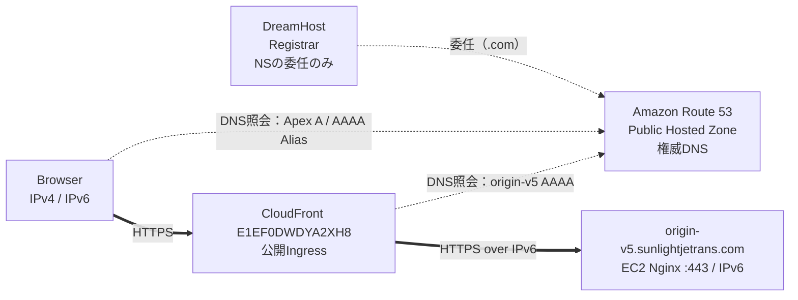

# GMS v5 — Route 53 DNS Migration, CloudFront Edge Routing and Free Plan As-Built

- **Evidence date:** 2026-11-20 JST
- **Status:** 権威DNSをDreamHostからAmazon Route 53へ移行済み。Route 53とCloudFront Free PlanのSubscriptionをTerraformへImport済み（No changes）。安定化期間中（DreamHostのZoneは保持）。
- **Observed production release:** `3f088ea69f957ae2ceb84dc9dc050c84ebf6fe13`（移行の前後で不変）
- **IaC commit:** `6494d3b`（Branch `feat/gmsv5-route53-dns`。Base `main`は`3f088ea`）
- **Owner:** Infrastructure / SRE
- **Related:** [Production State](./production-state.md)、[Architecture §4](../architecture.md#4-ingress--既存web公開経路)、[DR As-Built §8（移行前の調査）](./dr-as-built-2026-11-20.md#8-production-latency-investigation--dns--cdn)、[DR Runbook §8.1](./disaster-recovery-runbook.md#81-origin-dns-changes--route-53-and-terraform)、[CR-01 §14](../design/cr-01-parallel-fetch-design.md#14-追加最適化のclose2026-11-20)

本書は当日の実測と適用結果の記録である。現在状態の要約は[Production State](./production-state.md)、恒久構成は[Architecture](../architecture.md)を正とする。以下のPASSは、明記した試験条件と観測地点に限る。

> **Follow-up（2026-11-23 JST）:** 移行後のLet's Encrypt証明書（`origin-v5`）の模擬更新（`certbot renew --dry-run`）がPASSした（§13.1）。本番証明書の実際の更新は未実施で、ACM管理証明書の更新は引き続き未確認である。

## 1. Acceptance summary

| 項目 | 実測・確認結果 | 判定 |
|---|---|---|
| 権威DNSの切替 | RegistrarのNameserverをRoute 53の4台へ変更。親`.com`の委任と主要Resolverが新NSを返した | PASS：観測したResolverの範囲 |
| Record | Route 53のPublic Hosted Zoneに8 Record Set（自動生成のNS / SOAを含む） | PASS |
| 本番HTTPS | 切替後、IPv4 / IPv6とも通常のRequestでHTTP 200、`status: ready`、Release不変 | PASS |
| Edge選択 | 移行後の計測20回すべてで`NRT12-P5`（東京）。18:39に1回だけ`HIO52-P2`を観測（§8.3） | PASS：観測範囲。恒久的な東京Edgeは保証しない |
| Health API warm TTFB median | IPv4 303.691→36.352ms（88.0%短縮）、IPv6 297.809→30.912ms（89.6%短縮） | Measured：Health APIのみ |
| Browser smoke test | LP、ログイン、Cognito Hosted UI、認証後画面、Glossary / Term取得、9,999件のSelect All成功 | PASS：観測範囲。翻訳とLogoutは未確認 |
| CloudFront Free Plan | 既存Subscriptionへ新Hosted Zoneを追加。ETagは5のまま | Configured：実際の請求は未確認 |
| Terraform | 8 imported, 0 added, 0 changed, 0 destroyed。最終PlanはNo changes | PASS |
| DNSSEC | 親ZoneにDS Recordなし | 対象外（未導入） |

## 2. Scope and unchanged components

変更したのは**権威DNSの提供者**だけである。次のものは変更していない。

- Registrar（DreamHost）、公開Domain `sunlightjetrans.com`
- 公開CloudFront Distribution `E1EF0DWDYA2XH8`と既存のCloudFront WAF Web ACL
- Origin `origin-v5.sunlightjetrans.com`、CloudFront→OriginのHTTPS / IPv6
- EC2、EBS、Security Group、Cognito、TLS証明書と設定、Application Code、DB

公開IngressはIPv4とIPv6のViewerを受け付ける。ApplicationのOriginは、公開Ingressの経路としてはIPv6-onlyのままである。

DNSはHTTPのData Planeに入らない。ブラウザとCloudFrontは名前解決の結果を使って接続先を決めるだけで、HTTPSの通信はRoute 53を経由しない。



点線はDNSの照会と委任、太線はHTTPSの通信を示す。

## 3. Before state

| 項目 | 移行前 |
|---|---|
| Registrar / 権威DNS | DreamHost / DreamHost |
| Apex | DreamHostのALIAS → `d2yxdtkikux26e.cloudfront.net` |
| 独自DomainのEdge | `HIO52-P2`（米国オレゴン）を観測 |
| CloudFront標準Hostname | `NRT12-P5`（東京）を観測 |

原因の有力な仮説は、DreamHostのALIAS flatteningによって利用者側の位置が反映されないことである。DreamHost内部のResolverの実装・設置場所・ECSの扱い、AWS内部の経路は確認していない。移行によってEdge選択が改善したことは仮説と整合するが、内部の仕組みを証明するものではない。移行前の測定条件は[DR As-Built §8](./dr-as-built-2026-11-20.md#8-production-latency-investigation--dns--cdn)にある。

## 4. CNAME comparison

移行前に、CNAMEでCloudFront標準Hostnameを指す一時Record `edge-test.sunlightjetrans.com`をDreamHostに作成した。

- 2026-11-19夜〜20日未明に観測した権威応答の不整合（[DR As-Built §8.2](./dr-as-built-2026-11-20.md#82-dns-evidence-and-root-cause-hypothesis)）は、11月20日朝までに解消した。DreamHostの権威NS 3台すべてが期待どおりのCNAMEを返した。
- 本番HostnameとTLS SNIを保ったままCNAMEの接続先へ接続した試験は、`NRT12-P5`へ到達した。
- この実験は比較のためのもので、新しい公開Application Hostnameの導入ではない。Recordは移行後もRoute 53に一時的に残している（§5.2）。

## 5. Target configuration

### 5.1 Hosted Zone and nameservers

| 項目 | 値 |
|---|---|
| Hosted Zone | Public、`Z05363321CQMGUZ68L65V` |
| Nameserver | `ns-2022.awsdns-60.co.uk`、`ns-154.awsdns-19.com`、`ns-1361.awsdns-42.org`、`ns-552.awsdns-05.net` |
| 親`.com`の委任TTL | 172800秒（48時間） |
| DS Record | 親Zoneに無い（DNSSECは未導入） |

### 5.2 Record sets

| Record | Type | 内容 | Terraform |
|---|---|---|---|
| `sunlightjetrans.com` | A（Alias） | CloudFront（公開Distribution） | `aws_route53_record.apex_ipv4` |
| `sunlightjetrans.com` | AAAA（Alias） | CloudFront（公開Distribution） | `aws_route53_record.apex_ipv6` |
| `origin-v5` | AAAA | 本番ENIのIPv6。値は`aws_network_interface.v5.ipv6_addresses`を参照 | `aws_route53_record.origin_v5` |
| `origin` | AAAA | 旧Origin。安定化期間中だけ一時的に保持 | `aws_route53_record.legacy_origin` |
| ACMのDNS検証 | CNAME | ACM管理証明書の更新に必要なため保持 | `aws_route53_record.acm_validation` |
| `edge-test` | CNAME | CloudFront標準Hostname。比較用に一時的に保持 | `aws_route53_record.edge_test` |
| `sunlightjetrans.com` | NS | Route 53が自動生成 | 個別には管理しない |
| `sunlightjetrans.com` | SOA | Route 53が自動生成 | 個別には管理しない |

合計8 Record Set。`origin-v5`、`origin`、ACM検証、`edge-test`のTTLは60秒。Recordの値（IPv6アドレス、検証用の名前）は[`dns.tf`](../../infra/terraform/v5/dns.tf)を正とし、本書には転記しない。

## 6. Migration timeline

全時刻JST（2026-11-20）。

| 時刻 | 事象 |
|---|---|
| 朝 | CNAME比較が成功（§4） |
| 17:04 | Route 53へRecord作成を送信。Change ID `C0183120K7DR8VLZFZY`、状態`INSYNC` |
| 17:33 | Route 53の権威NS 4台すべての応答を確認 |
| 17:33 | 切替前に、Route 53のAAAAを`curl --resolve`で指定したHTTPS接続がHTTP 200、`status: ready`、POP `NRT12-P5` |
| 17:49 | 既存のCloudFront Free PlanへのRoute 53 Hosted Zoneの追加を確認 |
| 17:58 | DreamHostでRegistrarのNameserver切替を確認 |
| 18:00–18:01 | 親`.com`の委任、ローカルResolver、Cloudflare、Google、Quad9が新しいRoute 53 NSを返した |
| 18:01 | 通常の本番HTTPS（IPv4 / IPv6）がHTTP 200、`NRT12-P5` |
| 18:09頃 | Keep-AliveのBenchmarkとBrowser smoke testが完了（§8、§9） |
| 18:36 | Route 53のTerraform ImportとNo changesのPlanを確認 |
| 18:39 | IPv6のHTTPS 1回が`HIO52-P2`へ到達（HTTP 200）（§8.3） |
| 18:39–18:40 | Pricing PlanのTerraform Importと最終のNo changesのPlanを確認 |
| 18:42 | 設定変更なしのDNS / IPv6追試3回がすべて東京POP |
| 18:43–18:44 | Terraformの変更を`6494d3b`としてCommit（Git author date 18:43:39 JST） |

## 7. Delegation and propagation

親Zoneの委任TTLは48時間である。18:00–18:01に観測した5つのResolverは新NSを返したが、これは観測地点と時点の結果であり、世界中のResolverへの伝播完了を意味しない。旧NSの応答をCacheしたResolverは、TTLの範囲で旧DreamHost Zoneを参照し得る。安定化期間中はDreamHostのZoneを保持し、2026-11-22 18:00 JST以降に再確認する（§12）。

## 8. Production performance evidence

### 8.1 Method

- Endpoint：`https://sunlightjetrans.com/api/health/ready`
- IPv4とIPv6それぞれ10回の逐次HTTPS Request。接続を再利用し、各系列の初回を除いた9回をwarm標本とする。
- 20回すべてHTTP 200、POP `NRT12-P5`。

### 8.2 Results

| 指標 | IPv4 | IPv6 |
|---|---:|---:|
| 移行前 median（DreamHost） | 303.691 ms | 297.809 ms |
| 移行後 median（Route 53） | 36.352 ms | 30.912 ms |
| 短縮率 | 88.0% | 89.6% |
| 倍率 | 8.35x | 9.63x |
| warm標本 | 9 | 9 |
| HTTP成功 | 10/10 | 10/10 |

移行後のwarm TTFB標本（ms）：

- IPv4：39.621、34.462、27.136、85.391、29.846、36.352、31.490、37.389、40.931
- IPv6：50.364、30.800、34.928、33.304、64.288、30.912、28.560、29.710、30.496

方法上の限界：

- 移行前と移行後は異なる時刻に測った。時間帯、経路、CloudFront側の状態の違いを排除していない。
- 移行前のIPv6は2系列あり、比較にはmedianの大きい系列2（297.809ms）を使った。系列1（258.424ms）を基準にすると短縮率は約88.0%である（[DR As-Built §8.1](./dr-as-built-2026-11-20.md#81-findings-and-measured-evidence)）。
- 1地点・少数標本の逐次測定である。全利用者の性能、Application全体のThroughput、Select Allのp95、Application SLOを示すものではない。

### 8.3 Transient IPv6 observation

18:39 JSTの単発Request：

| IP | POP | HTTP | TTFB |
|---|---|---|---:|
| IPv4 | `NRT12-P5` | 200 | 285.134 ms |
| IPv6 | `HIO52-P2` | 200 | 952.332 ms |

Releaseは不変だった。このIPv6 RequestのRemote IPは記録していない。

18:42頃、独立したIPv6 HTTPS Request 3回はすべて`NRT12-P5`、HTTP 200で、TTFBは113.217 / 124.676 / 122.259ms（median 122.259ms）だった。ローカルDNS、macOSのSystem Resolver、Route 53への直接照会、Cloudflare、Googleは、以前に東京Edgeと対応して観測したIPv6アドレス帯を返した。Quad9は`2600:9000:2218:...`を返したが、そのPOPは試験していない。

オレゴンを観測した原因は不明である。移行中のDNS Cache、CloudFrontの動的なRouting、どちらの可能性も残る。追加の設定変更は行っていない。東京Edgeが常に選ばれることは保証しない。

## 9. Application smoke test

本番ブラウザで次を確認した。

- LP、ログイン画面、Cognito Hosted UIでの認証、認証後の画面
- GlossaryとTermの取得、9,999 TermのSelect All成功

DevToolsでは個別のTerm APIの所要時間が大きく下がり、表示された多くのRequestが約55–91msだった。Select AllのEnd-to-End所要時間は計測しておらず、本番の統制されたp95でもない。翻訳とLogoutは、この移行のSmoke testでは明示的に確認していない。観測した本番Releaseは`3f088ea`で不変だった。

## 10. CloudFront Free Plan

| 項目 | 値 |
|---|---|
| Plan Family / Tier | `CloudFront` / `FREE` |
| Status | `ACTIVE` |
| Subscription ID | `sub_389BDNiLNPwkYONibzOjsYDgjLs` |
| ETag | `5`（Terraform Importの前後で不変） |
| Scheduled change | 返されなかった |
| 対象資源 | 本番CloudFront Distribution、既存のCloudFront WAF Web ACL、新しいRoute 53 Public Hosted Zone |

Route 53 Hosted Zoneは既存のFree Planに含まれ、Planの定額基本料の増分は$0/月である。実際の請求は未確認。関連するすべてのAWS資源や、DNS Queryの量に関係なく無料であるとは主張しない。

## 11. Terraform management

### 11.1 Files and versions

| File | 内容 |
|---|---|
| [`infra/terraform/v5/dns.tf`](../../infra/terraform/v5/dns.tf) | Hosted Zone（`prevent_destroy`）と6つのRecord |
| [`infra/terraform/v5/dns-import.tf`](../../infra/terraform/v5/dns-import.tf) | 既存のHosted ZoneとRecordの`import` Block |
| [`infra/terraform/v5/pricing-plan.tf`](../../infra/terraform/v5/pricing-plan.tf) | CloudFront Free PlanのSubscription（`prevent_destroy`）とその`import` |

Terraform v1.17.2、AWS Provider v6.70.0。いずれも既存の`infra/terraform/v5/` Root Module（Local State）に含まれる。

### 11.2 Import and verification

| 操作 | 結果 |
|---|---|
| Route 53のImport | 7 imported, 0 added, 0 changed, 0 destroyed |
| Pricing PlanのImport | 1 imported, 0 added, 0 changed, 0 destroyed |
| 合計 | 8 imported, 0 added, 0 changed, 0 destroyed |
| `terraform fmt -check` | PASS |
| `terraform validate` | PASS |
| `terraform plan` | No changes、`-detailed-exitcode`は0 |
| 本番Readiness | HTTP 200 |

### 11.3 Ownership boundaries

| 対象 | 管理 |
|---|---|
| Hosted Zone、6つのRecord | Terraform（`dns.tf`） |
| `origin-v5` AAAAの値 | Terraformが`aws_network_interface.v5.ipv6_addresses`から決める。ENIのIPv6が変われば、Planに差分として現れる |
| 自動生成のNS / SOA | Route 53。Terraformでは個別に管理しない |
| Free PlanのSubscriptionと対象資源の関連付け | Terraform（`pricing-plan.tf`） |
| 公開CloudFront Distribution、WAF Web ACLそのもの | Terraform外（従来どおり） |
| RegistrarのNameserver委任 | DreamHost（Terraform外） |

既存の`network_interface`に関する非推奨の警告は変わらず残っている。本作業の対象外である。

## 12. Rollback conditions (not executed)

本節は判断の目安であり、実行も演習もしていない。

| 条件 | 対応の候補 |
|---|---|
| 主要Resolverで`SERVFAIL`・`NXDOMAIN`・誤った応答が続く、または公開HTTPSが広く失敗し、Route 53側の修正で解消しない | DreamHostでRegistrarのNameserverをDreamHostへ戻す |
| ACM証明書の更新、Let's EncryptのHTTP-01更新が`origin-v5`の名前解決で失敗する | まずRoute 53のRecordを確認し、Terraformで修正する |
| 一時的・局所的に遠方Edgeが選ばれる | 切り戻しの条件にしない。観測を記録して継続確認する |

切り戻しの前提と注意：

- DreamHostのZoneは安定化期間中は保持しており、Apex ALIAS、`origin-v5` AAAA、ACM検証、`edge-test`を含む。切り戻す前に、`origin-v5`のAAAAが現在のENIのIPv6と一致することを確認する。
- 親Zoneの委任TTLは48時間で、切り戻しにも同程度の伝播時間がかかり得る。
- Route 53のHosted ZoneとFree PlanのSubscriptionは`prevent_destroy`で保護している。切り戻しでZoneを削除しない。
- 切り戻した場合、移行前の遠方Edgeの問題が戻ると想定する。

## 13. Outstanding operations

本書の作成時には、次のいずれも実施していない。

- 2026-11-22 18:00 JST以降にDNSの安定性を再確認する。
- 安定化期間中はDreamHostのDNS設定を保持する。
- AWSの実際の請求を確認する。
- 旧`origin` Recordを削除する前に依存関係を確認する（CloudFrontに旧Origin定義が残っている。[As-Built 2026-10-26 §3.2](./production-as-built-2026-10-26.md#32-dreamhost-dns)）。
- `edge-test`の一時Recordは、別途承認された整理作業でのみ削除する。
- CloudFrontのOrigin認証SecretのRotationを別に検討する。
- CloudFront EdgeのObservabilityとBackup失敗の通知は、別の改善候補として残る。

あわせて、次は本書の作成時（2026-11-20）には移行後に確認していなかった。Origin証明書（Let's Encrypt、HTTP-01 / IPv6、`origin-v5`。[As-Built 2026-10-26 §5.2](./production-as-built-2026-10-26.md#52-lets-encrypt)）の更新は、公開DNSでの`origin-v5`の名前解決に依存し、現在はRoute 53が応答する。ACM管理証明書の更新はACM検証Recordに依存する。どちらのRecordもRoute 53に移したが、移行後の`certbot renew --dry-run`とACMの更新は実施・観測していなかった。このうちLet's Encryptの模擬更新は2026-11-23に検証した（§13.1）。

### 13.1 Follow-up — Let's Encrypt renewal dry run（2026-11-23）

| 項目 | 内容 |
|---|---|
| 検証日 | 2026-11-23 JST |
| 実行場所 | 本番EC2（SSM Session Managerで接続） |
| 実行コマンド | `sudo certbot renew --dry-run` |
| 対象 | `origin-v5.sunlightjetrans.com`（Let's Encrypt） |
| 認証方式 | HTTP-01 / IPv6 |
| 結果 | 模擬更新成功 |
| 判定 | **PASS** |
| 本番証明書の更新 | 未実施 |

実行結果：

```text
Simulating renewal of an existing certificate for origin-v5.sunlightjetrans.com

Congratulations, all simulated renewals succeeded:
  /etc/letsencrypt/live/origin-v5.sunlightjetrans.com/fullchain.pem (success)
```

DNS移行後の環境で、証明書の模擬更新が成功した。これはDry Runの結果であり、本番証明書の更新完了ではない。ACM管理証明書の更新は今回検証しておらず、未確認のままである。

## 14. Evidence handling

当日のTerminal出力、DevTools、DreamHostとAWSの画面を証跡とした。公開RepositoryにはAccount ID、Cookie、Session Token、未加工のHAR、Terraform State、Planの出力ファイル、Credentialを入れていない。Recordの値はTerraformの定義を正とし、本書では資源の識別子と結果だけを記録する。
