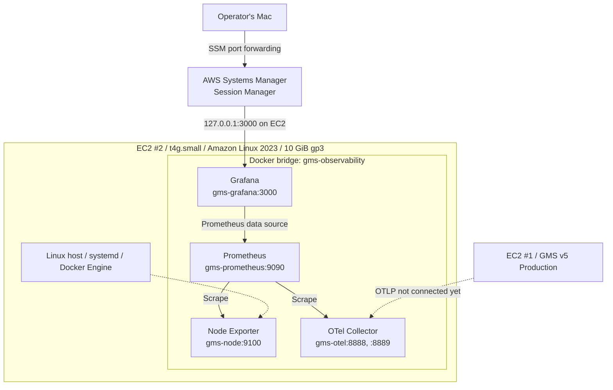

# GMS v5 — Observability Infrastructure As-Built

**Document type:** Infrastructure As-Built / Implementation Evidence  
**Recorded:** 2026-11-13 (JST)  
**Status:** AWS Metrics, Traces, and authenticated production-to-observability transport verified; Production Application SDK not deployed  
**Scope:** EC2 #2 / monitoring platform only  
**Intended repository path:** `docs/infrastructure/observability-as-built-2026-11-13.md`  
**Related target design:** [`../architecture-as-to-be-add-observability.md`](../architecture-as-to-be-add-observability.md)  
**Existing production design:** [`../architecture.md`](../architecture.md)

> **Evidence policy:** This record is based on the command outputs and Grafana screenshots supplied by the operator on 2026-11-12 to 2026-11-13 JST, plus the Terraform configuration generated during setup. It is not an independent live AWS audit. **Confirmed operating state**, **declared configuration**, and **unimplemented plans** are distinguished below. Nothing here certifies that the production GMS v5 application is already instrumented.


> **2026-11-13 evening update:** Sections 1–10 preserve the initial deployment snapshot. Section 11 supersedes their outdated runtime and network status. The Production Application SDK is not deployed.

## 1. Purpose and scope

The newly provisioned Observability EC2 is an independent *Operations Plane* for GMS v5. Its first milestone is to run OpenTelemetry Collector, Prometheus, Grafana, and Node Exporter and monitor **the Observability EC2 itself**. It does **not** yet receive application traces, application metrics, production Nginx logs, SQLite metrics, or production EC2 host metrics.

This document records **what has actually been installed and tested**. Desired future instrumentation, alerting, security extensions, and architecture changes belong in the linked *Architecture As-To-Be* and subsequent ADRs.

## 2. Infrastructure inventory

| Item | As deployed / configured | Verification status |
|---|---|---|
| Purpose | GMS v5 Observability / Operations Plane | Operator's setup and dashboard |
| AWS Region | `ap-northeast-1` (Tokyo) | Terraform configuration / CLI session |
| EC2 Instance ID | `i-021170e56849c597b` | `terraform output instance_id`, successful SSM session |
| EC2 type | `t4g.small` — 2 vCPU, 2 GiB nominal RAM | Terraform configuration; observed 1.8 GiB usable RAM and `aarch64` |
| OS | Amazon Linux 2023, ARM64 | `dnf`, kernel and Docker logs; `uname -m` = `aarch64` |
| Purchasing option | Persistent Spot Request; interruption behavior `stop` | Terraform configuration; interruption behavior **not yet exercised** |
| Subnet | Existing subnet `subnet-0661039664bcdb978` | Terraform configuration; not separately live-audited |
| Networking | No public IPv4; IPv6 address requested | Terraform configuration; SSM access successful |
| Root volume | **10 GiB** gp3, encrypted, `delete_on_termination = true` | `lsblk`, `df`; encryption/deletion settings from Terraform |
| Separate telemetry EBS | **None** | Operator's deployment design |
| SSH | No inbound SSH rule defined | Terraform configuration, not independently audited |
| Instance management | AWS Systems Manager Session Manager | Successful SSH-less SSM session and local port forwarding |
| IaC scope | Independent `infra/terraform/observability/` directory / state | Local terminal outputs; **not verified committed to GitHub main** |

### 2.1 Spot and storage semantics

- Interruption action is **Stop**, not Terminate, when AWS honors this Spot configuration. Recovery/resumption and future Spot capacity are not guaranteed.
- The Root EBS remains during an ordinary stop. **Termination deletes the root volume** because `delete_on_termination = true`; monitoring history on that root volume would be lost without backup.
- `prevent_destroy = true` in the proposed Terraform protects against certain Terraform-driven destructive plans, **not** EC2 Console/API termination or every Spot termination path.
- Changing an existing Spot instance's type is not assumed to be possible by stopping it. Reprovisioning/migration is the planned resize route if necessary.
- No independent EBS data volume or snapshots of this monitoring server have been evidenced.

## 3. Runtime and network topology



**Networking currently verified:**

- Grafana host port `127.0.0.1:3000` → container port `3000`.
- Prometheus host port `127.0.0.1:9090` → container port `9090`.
- Node Exporter and OTel Collector are reachable by service names **inside the Docker network**, not published as host OTLP/Exporter endpoints.
- OTel Collector currently listens on container ports `4317` (gRPC) and `4318` (HTTP); these ports are **not** exposed from Docker to the EC2 host for production traffic.
- Existing Terraform Security Group defines no inbound access. Its egress is IPv6 `::/0`. Production → Observability network ingress, authentication, and TLS are **not implemented**.

## 4. Installed software (verified from Docker runs and logs)

| Container | Image / tag | Docker memory cap | Measured usage (2026-11-13) | Function |
|---|---|---:|---:|---|
| `gms-otel` | `otel/opentelemetry-collector:0.165.0` | 192 MiB | 43.75 MiB | OTLP receiver; metrics exporter; traces currently debug-only |
| `gms-prometheus` | `prom/prometheus:v3.16.0` | 640 MiB | 42.56 MiB | Scrape / store metrics |
| `gms-grafana` | `grafana/grafana:13.3.1` | 512 MiB | 350.8 MiB | Dashboards; Prometheus data source |
| `gms-node` | `prom/node-exporter:v1.12.1` | 128 MiB | 7.438 MiB | Host CPU / memory / filesystem metrics |

All four containers were running during the submitted verification. Docker uses network `gms-observability`. Named volumes `gms-prometheus-data` and `gms-grafana-data` store Prometheus and Grafana data on the **same root EBS**; these are Docker volumes, **not separate EBS volumes**. Container restart policy is `unless-stopped`.

### 4.1 Collector pipeline — actual behavior

- **Metrics:** OTLP receiver → memory limiter → batch → Prometheus exporter on `:8889`.
- **Traces:** OTLP receiver → memory limiter → batch → **debug exporter**. **No durable trace storage yet**; production user content must not be sent to this debug exporter.
- Collector's self-metrics are exposed on `:8888`.
- A successful scrape of the `:8889` exporter means the endpoint responds; **it does not prove any GMS production application metric has arrived**.
- Collector memory limiter is configured at 120 MiB, with a 24 MiB spike allowance and 1-second check interval.

### 4.2 Prometheus scrape jobs — actual configuration

| `job_name` | Target | Observed `up` |
|---|---|---:|
| `prometheus` | `gms-prometheus:9090` | 1 |
| `otel-collector` | `gms-otel:8888` | 1 |
| `otel-application-metrics` | `gms-otel:8889` | 1 |
| `observability-host` | `gms-node:9100` | 1 |

The configured scrape interval is **30 seconds**. Prometheus TSDB arguments:

```text
--storage.tsdb.retention.time=3d
--storage.tsdb.retention.size=512MB
```

The retention-size setting does **not** strictly cap total root filesystem usage, such as WAL, temporary files, image layers, and logs.

### 4.3 Grafana

- Access: Mac browser → local port `3000` → SSM port forwarding → EC2 `127.0.0.1:3000` → Grafana.
- Prometheus data source provisioned as `http://gms-prometheus:9090`.
- Admin password generated into `/opt/gmsv5-observability/grafana.env` on the EC2, restricted by file permissions. **Never commit this file or reveal the password in documentation.**
- Dashboard name: **`GMS v5 — Observability Infrastructure`**.
- Four panels visible in operator screenshot: **EC2 CPU Usage (%)**, **Available Memory (GiB)**, **Root Disk Usage (%)**, **Exporter Availability**.
- Screenshot shows the dashboard in **edit mode** (`Save`, `Exit edit` present); the operator reported completion. Final persistence after clicking Save has **not** been independently verified.
- Grafana initially logged errors querying `grafana.com` for plugin/update metadata. The core server, data source, and dashboard continued working; outbound IPv4 reachability may be a contributing factor but was not fully diagnosed.

## 5. Verification results (observations, not SLOs)

### 5.1 Host and container resources

| Metric | Observation |
|---|---:|
| Root filesystem total | 10 GiB |
| Root filesystem used | 3.9 GiB |
| Root filesystem available | 6.1 GiB |
| Root filesystem usage | ~39–40% |
| Host memory total (reported) | 1.8 GiB |
| Host memory used | 640 MiB |
| Host memory available | ~1.0 GiB |
| Swap | 0 |
| CPU utilization shown on dashboard | ~1–2% in steady observation; a short initial spike is visible |
| Docker container memory total (sum of one `docker stats` sample) | ~445 MiB |
| Docker image storage (earlier sample) | ~1.789 GB |
| Root filesystem type | XFS |
| Architecture | `aarch64` |

These are point-in-time figures from setup, **not** capacity forecasts or validated long-term stability. The CPU spike around dashboard startup is not enough to diagnose an incident.

### 5.2 Positive checks

- `docker run --rm hello-world` completed successfully on ARM64.
- `docker ps` listed Collector, Prometheus, Grafana, and later Node Exporter.
- Prometheus readiness endpoint returned `Prometheus Server is Ready.`
- Grafana `/api/health` returned database status `ok` and version `13.3.1`.
- Prometheus query `up` showed all initially configured jobs healthy; after Node Exporter addition, `up{job="observability-host"}` returned `1`.
- Grafana showed CPU, available memory, root disk usage, and Node Exporter availability from Prometheus.
- `aws ssm start-session` succeeded with actual instance ID `i-021170e56849c597b`; SSM localhost port forwarding connected.

### 5.3 Example verification queries

```promql
up{job="observability-host"}
```

```promql
100 * (1 - avg(rate(node_cpu_seconds_total{job="observability-host",mode="idle"}[5m])))
```

```promql
node_memory_MemAvailable_bytes{job="observability-host"} / 1024^3
```

```promql
100 * (1 - node_filesystem_avail_bytes{job="observability-host",mountpoint="/"} / node_filesystem_size_bytes{job="observability-host",mountpoint="/"})
```

> The last two values were approximately **1.01 GiB available** and **39.1% root disk usage** on the dashboard. These metrics describe **EC2 #2**, not the GMS v5 production EC2.

## 6. Operator access and basic health checks

From a Mac terminal with AWS CLI and Session Manager support:

```bash
cd /path/to/GMSv5/infra/terraform/observability
terraform output -raw instance_id
aws ssm start-session \
  --target "$(terraform output -raw instance_id)" \
  --document-name AWS-StartPortForwardingSession \
  --parameters '{"portNumber":["3000"],"localPortNumber":["3000"]}' \
  --region ap-northeast-1
```

Then visit `http://localhost:3000`. SSM port forwarding is the intended access route; no public Grafana endpoint was configured.

From the EC2 Session Manager shell:

```bash
sudo docker ps
sudo docker stats --no-stream
curl -fsS http://127.0.0.1:9090/-/ready
curl -fsS http://127.0.0.1:3000/api/health
free -h
df -hT /
```

## 7. Current security / failure boundaries

**Configured and observed:** private-only Grafana/Prometheus host bindings, no inbound Security Group rule in generated Terraform, SSM instead of SSH, encrypted root EBS setting, restricted EC2 role intended for SSM core actions, and no application secrets recorded in the submitted dashboard.

**Not yet validated:** full live Security Group/IAM audit; independent monitoring of the monitoring server; telemetry authentication/TLS across hosts; backup/restore of Prometheus and Grafana data; recovery behavior after Spot interruption; end-to-end privacy redaction of future application spans.

**Operational risks:**

- This observability server itself is a **Spot instance**. During interruption, dashboards and local alerts will be unavailable.
- All monitoring data currently resides on its **10 GiB root EBS**; termination or an unplanned loss of the root volume can destroy metrics, dashboard state, and traces/logs if future storage is added.
- **No swap** is configured. Grafana had used ~350–403 MiB within a 512 MiB container limit in the provided samples. Adding Tempo/Loki may exceed the instance's memory budget.
- Observability outages should not block the production app. This failure isolation must be tested once the production telemetry agent is connected.

## 8. Not implemented / not verified

| Capability | Status |
|---|---|
| GMS v5 production OTel SDK | **Not yet connected / no proof of installation** |
| Production Nginx timing log forwarding | Not implemented |
| Production SQLite query instrumentation | Not implemented |
| Production EC2 Node Exporter integration | Not implemented |
| DeepL / OpenAI client spans | Not implemented |
| Browser RUM / click-to-render traces | Not implemented |
| CloudFront Server-Timing correlation | Not implemented |
| DNS synthetic probing | Not implemented |
| Tempo persistent trace backend | Not installed |
| Loki central log storage | Not installed |
| Alertmanager / operational alert rules | Not configured |
| Automated Spot restore / telemetry backup | Not demonstrated |
| Formal SLI/SLO, retention cost and capacity test | Not completed |

## 9. Next steps — design intent, not As-Built

1. Confirm and save the four-panel Grafana dashboard, then export the dashboard JSON for configuration-as-code.
2. Confirm EC2 #2's inbound and outbound paths, IAM permissions, data retention/backup and interruption recovery policy before connecting production.
3. Define production application instrumentation scope (HTTP request, business use cases, SQLite, DeepL/OpenAI, browser action) and secrets-redaction tests.
4. Establish authenticated, restricted, private OTLP transport between the two EC2 instances; do not simply expose ports 4317/4318 to the Internet.
5. Add a trace backend before transmitting real translation requests; debug-exported traces may leak sensitive span attributes if the application is not sanitized.
6. Update this document based on actual command output when each new component is verified. Record design decisions in the As-To-Be document separately.

## 10. Evidence and source references

**Operator evidence (2026-11-12/13 JST):**

- Terraform Output: `i-021170e56849c597b`.
- Terminal outputs for `df -hT /`, `free -h`, `lsblk`, `uname -m`.
- `docker ps`, `docker stats`, `docker system df`, Prometheus/Grafana readiness checks.
- Prometheus `up` queries and Grafana Explore screenshot (four successful targets).
- Grafana four-panel dashboard screenshot (CPU, available memory, root disk, exporter availability).
- SSM Session Manager port-forwarding connection logs.

**Repository / design:**

- [`GMSv5/docs/architecture.md`](https://github.com/1716964609/GMSv5/blob/main/docs/architecture.md)
- [`GMSv5/docs/architecture-as-to-be-add-observability.md`](https://github.com/1716964609/GMSv5/blob/main/docs/architecture-as-to-be-add-observability.md)
- [`GMSv5/infra/terraform/v5/main.tf`](https://github.com/1716964609/GMSv5/blob/main/infra/terraform/v5/main.tf) — existing **production** Terraform; **not** the new EC2 #2 state.

**Documentation rule:** A Terraform declaration is not proof that every AWS setting was live-audited. A successful `up` probe is not proof of incoming production telemetry. Changes to the As-To-Be are not silently treated as applied production state.

## 11. Verified AWS Integration Update

**Evidence date:** 2026-11-13 JST  
**Status:** SRE transport and storage integration passed; application production rollout pending.

### 11.1 Trace storage

- `gms-tempo`: `grafana/tempo:3.1.1`
- Monolithic deployment on `gms-observability` Docker bridge
- Memory cap: 384 MiB; initial observation: 16.41 MiB
- Local backend at `/opt/gmsv5-observability/tempo-data`
- Config: `/opt/gmsv5-observability/tempo/tempo.yaml`
- Configured block retention: 24 hours
- No Tempo ports published on the EC2 host
- Readiness returned `ready`
- Grafana Tempo data source URL: `http://gms-tempo:3200`

Trace retention is not a hard filesystem-size limit.
The backend uses the 10 GiB root EBS and has no independently
verified backup or Spot recovery procedure.

### 11.2 Collector integration

- `gms-otel`: `otel/opentelemetry-collector:0.165.0`
- Metrics: OTLP receiver -> memory_limiter -> batch -> Prometheus exporter
- Traces: OTLP receiver -> memory_limiter -> batch -> OTLP/gRPC Tempo exporter
- Trace destination: `gms-tempo:4317`
- Collector OTLP ports 4317/4318 remain unpublished on the host
- Config backup: `/opt/gmsv5-observability/otel/config.yaml.bak-20261113`
- New configuration validated; restart logs reported `Everything is ready`

### 11.3 Authenticated OTLP ingress

- Container: `gms-otlp-gateway`
- Image: `nginx:1.30.6-alpine-slim`
- Memory cap: 128 MiB
- Host listener: IPv6 TCP 8443
- Internal upstream: `http://gms-otel:4318`
- HTTPS with a private CA and IPv6 address SAN
- Application authentication header: `X-OTLP-Token`
- Accepted paths: POST `/v1/traces` and `/v1/metrics`
- Gateway configuration: `/opt/gmsv5-observability/otlp-gateway/`
- CA certificate lifetime: 365 days at issuance
- Server certificate lifetime: 90 days at issuance

Tokenless OTLP test returned 401.
Authenticated OTLP test returned 200.

The active Nginx configuration currently contains the token.
This is an operational secret; it must not be committed to Git.
Certificate renewal, rotation, and bootstrapping remain manual.

### 11.4 AWS network security

Production EC2:
`i-0decf6bc205e273d9`

Observability EC2:
`i-021170e56849c597b`

Both instances are in VPC `vpc-0a798b79427124107`
and subnet `subnet-0661039664bcdb978`.

Observability SG: `sg-07daa1cdcf79d6c93`

Added Terraform-managed ingress:
- Protocol: TCP
- Port: 8443
- Source: `2406:da14:190f:d655:3b6:c3da:aeb4:17c7/128`
- Rule ID: `sgr-0d1314a10664f19e6`

Terraform apply result: 1 added, 0 changed, 0 destroyed.

No changes to the existing CloudFront origin ingress were required.

### 11.5 Verified end-to-end traces

Internal Observability EC2 smoke test:
- Service: `gms-sre-smoke`
- Span: `sre.smoke.trace`
- Grafana query returned the 50 ms span

Production EC2 to Observability EC2:
- Transport: IPv6 HTTPS with CA verification
- Authentication: `X-OTLP-Token`
- Service: `gms-production-connectivity-test`
- Operation: `production.to.observability.smoke`
- Trace ID: `9c5e82bd22e6b9a808dcf53f1402dfba`
- Grafana displayed one service, one span, 50 ms

The 50 ms duration is the synthetic span duration,
not measured inter-EC2 network latency.

### 11.6 Release and operations boundaries

Verified:
- Collector -> Tempo -> Grafana
- Production EC2 -> TLS Gateway -> Collector -> Tempo -> Grafana
- Authentication rejection and acceptance

Not yet verified or completed:
- Production GMS v5 Application SDK deployment
- Linux ARM64 systemd-based SDK export in production
- Production Application Metrics ingestion
- Browser RUM approval and production rollout
- Parameter Store IAM access and service startup integration
- Automatic gateway restoration after EC2 replacement
- Server certificate renewal and secret rotation
- Tempo long-running capacity and disk exhaustion testing
- Loki, production log centralization, alerting, and SLO operations

The Application release candidate is commit `75d5b17`
on branch `feat/gmsv5-otel`, committed but not pushed
or deployed at the time of this update.

The telemetry-disabled deployment is a separate release stage.
No production application release is asserted by this document.
