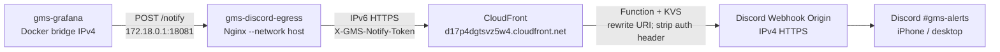

# GMS v5 — Observability / Translation SLO / Discord Alerting As-Built (2026-11-16)

- **Evidence date:** 2026-11-16 JST（作業・画面・コマンド出力はOperator提供）
- **Owner:** Infrastructure / SRE
- **Kind:** Date-scoped production As-Built / operational evidence
- **Supersedes (only for the areas updated below):** [2026-11-13 Observability As-Built](./observability-as-built-2026-11-13.md) および [Production State](./production-state.md) の旧Retention・Alerting / SLO状態
- **Does not supersede:** 2026-11-14のApplication ReleaseおよびServer Traces計装の証跡

> **Evidence policy:** `実測` = 当日提供されたCLI出力・画面で確認、`Operator報告` = 操作の完了は報告されているが設定全体の再照合なし、`宣言` = Terraformや構成ファイル、`未検証` = 今後要確認。この記録は実績の転記であり、記録作成自体でAWSまたはEC2の操作はしていない。Secret、Webhook URL、KVS値、Terraform State、個人の翻訳原文は収録しない。

## 1. Executive status

| Item | 2026-11-16 state | Evidence class |
|---|---|---|
| Application Release | `364d0b7`（前回確認の本番Release；本日の再デプロイ報告なし） | 継承 |
| Prometheus / Collector / Tempo / Grafana | 4/4 scrape jobs UP、主要Dockerコンテナ稼働 | 実測 |
| Metrics retention | **10d or 1GiB** — reload後のRuntimeおよびLive/Stored Retention Metricsで一致 | 実測 |
| Translation latency Histogram | `_bucket` / `_count` / `_sum` 存在。`le="10.0"`を確認 | 実測 |
| Translation SLO dashboard | Rolling 7dの4 Stat panelsを表示・エクスポート | 実測 |
| Discord alert egress | Grafana → EC2 Host Nginx → CloudFront (IPv6) → Discord、実POST 204 | 実測 |
| Grafana notification | Contact Point Test、実AlertのFiring/ResolvedともDiscordに着信 | 実測 |
| Production SLO rule | `GMS Translation SLO Breach — Rolling 7d` 作成、5m評価、10m pending、Normal | 実測 |
| 7-day compliance | **未判定**。累積成功翻訳2件、確認時にRolling 7d増分約1件 | 実測（少数） |
| Synthetic 7d run / chaos failure | 未実施 | 未検証 |
| Spot再起動・再作成からの完全復旧 | 未実施 | 未検証 |

## 2. Existing Observability host health

Observability EC2: Amazon Linux 2023 ARM64 `t4g.small`、Public IPv4なし、IPv6 outboundあり。Root EBS 10GiB（終了時削除）。Docker Engine `25.0.18`。

- `gms-otlp-gateway` (`nginx:1.30.6-alpine-slim`)、`gms-tempo` (`grafana/tempo:3.1.1`)、`gms-node` (`prom/node-exporter:v1.12.1`)、`gms-grafana` (`grafana/grafana:13.3.1`)、`gms-prometheus` (`prom/prometheus:v3.16.0`)、`gms-otel` (`otel/opentelemetry-collector:0.165.0`) を起動確認。
- `up` jobs: `prometheus=1`, `otel-application-metrics=1`, `otel-collector=1`, `observability-host=1`。
- `df -hT /`: XFS 10G、使用4.1G、空き5.9G、使用率42%。`du`: Prometheus 21M、Tempo 7.6M（測定時点）。Prometheus head series: 2016、head chunks: 4956。
- Prometheus data volume: `gms-prometheus-data:/prometheus`。Scrape config bind mount: `/opt/gmsv5-observability/prometheus/prometheus.yml` → `/etc/prometheus/prometheus.yml`（read-only）。`gms-prometheus` restart policy `unless-stopped`。Grafana は `127.0.0.1:3000` へバインドし、SSM port forwardingで閲覧。

### 2.1 Retention change

**Before:** 起動引数 `--storage.tsdb.retention.time=3d`, `--storage.tsdb.retention.size=512MB`。

2026-11-16、Prometheus設定ファイルのBackupを取得した上で、次の設定を追記し `promtool check config` PASS、PrometheusへHUPでreload。

```yaml
storage:
  tsdb:
    retention:
      time: 10d
      size: 1GB
```

**After:** `runtimeinfo.storageRetention = 10d or 1GiB`, `reloadConfigSuccess = true`。`/metrics` およびPromQL双方の `prometheus_tsdb_retention_limit_seconds=864000`、`prometheus_tsdb_retention_limit_bytes=1073741824` を確認。Scrape 4/4 UP、Readiness PASS。変更前のBackup例: `prometheus.yml.bak-20261116-022312`。

**Known risk:** 既存コンテナ起動引数は `3d / 512MB` のまま。本日の検証は**reload後の実効値**であり、Prometheusコンテナ再作成・Host再起動後も10d/1GiBが維持されることは**未検証**。永続化した起動定義の明文化、再起動試験、10GiB Root Disk容量監視が必要。また10日と1GiBの**いずれかが先に達すると消去**されるため、10日間の保存は無条件には保証されない。

## 3. Production translation histogram validation

実データに `gms_translation_duration_seconds_bucket`, `_count`, `_sum` を確認。成功翻訳の最初の測定値は `_count=1`, `_sum=6.570871813001111` 秒、`le="7.5"=1`, `le="10.0"=1`。2回目実翻訳後、累積成功Count=2、`increase(...[7d])≈1.000359649`、10秒以内達成率=100%。

**重要:** 1回目のCounterは初回Scrapeで既に `1` であったため、7日間の `increase()` は `0/0 = NaN`。2回目のScrape後に増分が観測され計算が成立。`count_over_time()` はScrapeサンプル数であり翻訳実行回数ではない。

`gms.translation.duration` は`translateUseCase()`全体（DeepL翻訳 + OpenAI post-editを含む）の**サーバー側所要時間**。ブラウザクリックから画面描画までのEnd-to-End時間ではない。Browser RUMは本番で無効のまま。Latency SLIは成功した翻訳に条件付けされているため、翻訳失敗率は別途監視する。

## 4. Rolling 7d Grafana Dashboard

Dashboard: `Translation SLO Attainment — Rolling 7d`（GrafanaローカルUI、SSM port forwarding）。以下の4つのStatを保存・確認。

| Panel | PromQL概略 | Unit / interpretation |
|---|---|---|
| SLO Attainment | `100 * sum(increase(gms_translation_duration_seconds_bucket{gms_translation_outcome="success",le="10.0"}[7d])) / sum(increase(gms_translation_duration_seconds_count{gms_translation_outcome="success"}[7d]))` | %, `>=95` を緑。No data時 `n/a` |
| p95 Latency | `histogram_quantile(0.95, sum by (le) (increase(gms_translation_duration_seconds_bucket{gms_translation_outcome="success"}[7d])))` | seconds, 10s以上は赤。Histogram補間推定 |
| Successful Volume | `sum(increase(gms_translation_duration_seconds_count{gms_translation_outcome="success"}[7d]))` | 件、表示は整数丸め。`increase()`は推定小数になる |
| Success Rate | `100 * sum(increase(gms_translation_duration_seconds_count{gms_translation_outcome="success"}[7d])) / sum(increase(gms_translation_duration_seconds_count[7d]))` | %, 正式目標は未確定 |

画面表示（小標本時）: Attainment 100%、p95 9.88s、Volume 1、Success Rate 100%。p95は1件近辺の10秒近くのBucket補間による値であり、実測の6.57秒とは異なる。**7日間の本番SLO合格判定には使わない。** Dashboard上部の`Last 5 minutes`とPromQL内`[7d]`は異なり、Instant Queryは直近7日分を評価する。

Dashboard exports: Grafana V2 Resource JSONおよび互換用Classic JSONをOperatorが取得。V2→Classic変換時は表現できないDashboard機能があるため、V2を主たるExport記録とする。

## 5. IPv6-only alert delivery architecture



### 5.1 Network evidence

- Observability EC2 `ens5` has globally routable IPv6; `ip -6 route get 2001:67c:4e8:f004::9` succeeded; host → Telegram IPv6 HTTPS returned `302` (alternative investigated, not used).
- `gms-observability` Docker bridge has IPv6 disabled, IPv4 subnet `172.18.0.0/16`, gateway `172.18.0.1`; Grafana recorded as `172.18.0.6`。GrafanaからネイティブIPv6への直接HTTPSは失敗。`systemd-networkd` active、kernel IPv6 forwarding=0（変更なし）。
- Grafana → host temporary HTTP listener on `172.18.0.1:18080` returned `200`。
- Temporary host-network Nginx → 既存DeepL CloudFront IPv6: `HTTP 403`（Functionによる未認証拒否、正常）、`X-Egress-Upstream: [2600:9000:295a:8800:b:d8f7:9c40:21]:443`、`RelayIP=172.18.0.1`。
- 専用Discord CloudFront `d17p4dgtsvz5w4.cloudfront.net`：POST `/notify` without token → `403`。認証TokenとWebhook pathをKVSへ登録（`ItemCount=2`, `Status=READY`）。Macから認証付きPOSTを送りDiscordチャンネルで実メッセージ受信。
- Permanent relay: `gms-discord-egress`、`nginx:1.30.6-alpine-slim`、`--network host`、`--restart unless-stopped`、Memory limit 96MiB、Gateway `172.18.0.1:18081`のみで待受。Nginx `nginx -t` PASS、コンテナ起動確認。Grafanaコンテナから実POST → `HTTP 204`、Discordチャンネルでも確認。

### 5.2 Managed / manual boundaries

| Component | Evidence and owner |
|---|---|
| CloudFront Distribution + Function + KVS + Origin Request Policy | `infra/terraform/discord-alert-egress/main.tf`, `auth.js`。Terraform `init` / `validate` / `plan`: **4 add, 0 change, 0 destroy**。Apply後のdomain outputと403により作成済みを確認。独立したLocal Terraform State（Git管理外） |
| KVS entries | `relay-token`, `discord-webhook-path` を**手動登録**。Terraform Stateの中にはキー値を表明・管理していない。KVSの2キー数のみを記録（値は記録しない） |
| Nginx egress relay | EC2上 `/opt/gmsv5-observability/discord-relay/default.conf`（Tokenを含む機密ファイル、0600）。ホスト上でDocker手動作成。Gitには実値を置かない |
| Grafana Contact Point | `GMS SRE Discord Alerts`、type Discord、URL `http://172.18.0.1:18081/notify`、Resolved通知有効。YAMLをOperatorがExport |
| Discord | `GMS v5 Operations` server の `#gms-alerts`。Webhook Tokenは非公開 |

Security design: 外向きRelayはCloudFrontのTLS証明書検証 (`proxy_ssl_server_name on`, `proxy_ssl_verify on`) を有効にし、CloudFront Functionは認証後に`/api/webhooks/{id}/{token}`へURIを書き換え、認証Headerを削除。KVSおよびNginx設定にはSecretが含まれる。**CloudFrontの書き換え後URI・CloudFrontログ・KVS読取権限の監査は未実施。** Root DiskとLocal Stateは消失・漏えいリスクとして扱う。

**Fragility:** Relay configはGrafanaの観測時IP `172.18.0.6`を`allow`で指定しているため、Grafana再作成でIPが変化すると通知失敗の可能性あり。コンテナDocker CLI定義がGit管理されておらず、Spot再作成時に自動復旧する保証がない。Nginx Host NetworkはHost側Namespaceを共有する。待受を`0.0.0.0`へ広げない。

## 6. Alerting lifecycle verification

1. Grafana Discord Contact Pointテスト：`Test notification sent successfully`、Discord側にGrafana `TestAlert` のFiringメッセージ受信。
2. 一時Grafana-managed rule `GMS Test — Discord Firing Resolved`、Query `vector(1)`、Threshold `>0.5`、1m評価、0 pendingで**実際のFiring**とDiscord通知を確認。
3. Queryを`vector(0)`に変更するとRuleが**Normal**に戻り、Discord `[RESOLVED]` を受信。これは**人工的なルール値変更による復旧**であり、翻訳系障害からの自然回復ではない。
4. 一時Rule削除を確認。テストEvaluation Groupの削除後、古いGroup詳細URLを開いて `404 rule group does not exist` が一度表示されたが、Alert一覧には本番Ruleのみが残存。異常なし。
5. Production Pilot Rule `GMS Translation SLO Breach — Rolling 7d` を `GMS v5` folder、`gms-slo-5m` groupに作成。Evaluation 5m、Pending 10m、Keep firing 0、Contact Point `GMS SRE Discord Alerts`。`Last evaluated: 24 seconds ago` と `Normal` を画面で確認。

### 6.1 Production rule: contract

- Success-only server-side translation latency `<= 10s` を7d rolling windowで集計。
- 達成率 `< 95%`、かつ`sum(increase(success_count[7d])) >= 20`の場合に数値`1`、その他は`0`を返すPromQL。Alert Threshold: `A > 0.5`。
- 実装は `increase(bucket{gms_translation_outcome="success",le="10.0"}[7d])` を分子に、`increase(count{gms_translation_outcome="success"}[7d])` を分母に使う。`or vector(0)` / `clamp_min(...,1)` / `bool`で初期の0除算による`NaN`をAlert判定から除外。
- 20件閾値はPilotの誤発火抑止に過ぎず、統計上の信頼区間や信頼性を保証しない。**失敗率、Telemetry停止、No DataはこのAlertで検知しない**（欠測時にも0/Normalになり得る）。
- `p95 <= 10s` は関連指標であって正式判定式ではない。Formal SLOは`<=10s`の割合`>=95%`。
- 今回のProduction Ruleの**実SLO違反によるFiringは未検証**。通知経路のFiring / Resolvedテストは別の一時Ruleで実施した。

## 7. Configuration backup and recovery status

OperatorがGrafanaから次のExportを取得：Dashboard V2 JSON、Dashboard Classic JSON、`gms-slo-5m.yaml`、Discord Contact Point YAML。Repo上の格納想定は `infra/observability/grafana/`。YAMLやJSONはSecretがないことを差分で再確認した上でコミットする。Terraform `.terraform.lock.hcl`はコミット対象、`.terraform/`・`*.tfstate*`・`*.tfvars`・Webhook URL・Relay Tokenは除外。

**Backup gap:** Grafana設定ExportだけではPrometheus TSDBデータ、GrafanaのDB/ユーザー、Tempo、CloudFront KVS値、Nginx実設定、TLS Key、Terraform Stateは戻らない。EC2 Root EBSは終了で削除されるため、構成が残っていてもメトリクスや履歴が失われればRolling 7d SLOが未判定になる。Backup/Restore drillは未実施。

## 8. Remaining items (not completed today)

| Priority | Gap | Acceptance evidence |
|---|---|---|
| P0 | Prometheus再作成後にも10d/1GiBが保たれるか | Container新規起動後の`runtimeinfo`/live metricsを確認し起動定義に反映 |
| P0 | Alert Relay再構築・Grafana IP固定または自動追随 | Restart/Spot Stop/再作成を含む通知試験、Tokenをログに露出させない |
| P0 | 設定と状態の安全なBackup | Terraform StateとSecretの安全な隔離保存、Grafana/Prometheus VolumeのBackup方針、復旧手順 |
| P1 | 成功率・データ欠損・監視基盤死活監視 | 別Alert Ruleと独立した通知経路で異常検知を実測 |
| P1 | 7d Synthetic Test | 控えめな負荷・コスト上限を設定し、7日後の実数と条件を記録 |
| P1 | 実翻訳SLO違反を使った制御試験 | Stage環境または費用制御した小規模試験でメトリクス→本番式を評価 |
| P2 | Browser RUM / Client paint・CloudFront/Edge | RUMのプライバシー方針承認後に実装。現状サーバー処理のみ |
| P2 | Trace privacy・Collector redaction | 本番のTrace値の検査、PII/Secret漏洩とログ露出の監査 |

継続試験の評価期間を固定した場合、2026-11-16に開始した7日間は2026-11-23に満了する。**現時点の100%表示を7日間のSLO達成と誤読しないこと。** 詳細な操作手順は[Translation SLO Alerting Runbook](./observability/translation-slo-alerting-runbook.md)。

## 9. Incident: Prometheus did not recover after EC2 restart (2026-11-16)

**Incident ID:** INC-20261116-PROM-RESTART

**Status:** Service restored; corrective configuration applied.
Automatic recovery after a future host reboot remains unverified.

### 9.1 Timeline (JST)

| Time | Event |
|---|---|
| 18:10:20 | CloudTrail recorded `StopInstances` |
| 18:10:23 | Prometheus received SIGTERM and exited normally |
| 18:12:28 | CloudTrail recorded `StartInstances` |
| 18:12:34 | New EC2 boot began |
| Approximately 18:27 | Grafana delivered `DatasourceError` to Discord |
| Approximately 18:35 | Operator manually started Prometheus |
| 18:48:08 | Prometheus configuration successfully reloaded |

### 9.2 Impact and evidence

- Prometheus remained stopped after the EC2 host restarted.
- Grafana could not resolve `gms-prometheus` through Docker DNS.
- Grafana generated a `DatasourceError` notification.
- Prometheus exit code was `0`; `OOMKilled=false`.
- Docker logs recorded `hasBeenManuallyStopped=true`
  for Prometheus and `false` for the other monitored containers.
- The preceding restart policy was `unless-stopped`.
- After manual recovery, Grafana connectivity and all four
  Prometheus scrape jobs were verified healthy.
- Metrics collected during the outage may be missing.

### 9.3 Root cause assessment

The immediate cause was Prometheus failing to restart automatically
after the EC2 stop/start cycle.

A strong contributing-cause hypothesis is the earlier use of
`docker kill --signal=HUP gms-prometheus`, which may have affected
Docker's manual-stop tracking under `unless-stopped`.

This hypothesis is supported by the observed Docker state,
but an isolated reproduction test has not been performed.

CloudTrail confirms EC2 lifecycle operations involving
`InstanceTermination` and `InstanceLaunch` identities.
The underlying AWS reason for those operations is not yet established.

### 9.4 Recovery and remediation

- Started the existing Prometheus container with `docker start`.
- Verified Grafana-to-Prometheus readiness.
- Verified all four scrape jobs returned `UP=1`.
- Updated Prometheus restart policy to `always`.
- Replaced Docker-mediated HUP with direct host-PID SIGHUP.
- Confirmed `reloadConfigSuccess=true`.
- Confirmed `lastConfigTime=2026-11-16T09:48:08Z`.
- Confirmed effective retention `10d or 1GiB`.
- Confirmed Prometheus remained `running` and `Ready`.

This later observation supersedes the earlier
`unless-stopped` status in Section 2 for Prometheus only.
It also confirms retention persistence across restarting the
existing container, but not across container recreation.

### 9.5 Follow-up

- Verify automatic recovery after a future controlled host reboot.
- Verify the Grafana `DatasourceError` Resolved notification.
- Quantify the metrics collection gap.
- Spot lifecycle actor confirmed for Application; see Section 10 for investigation evidence and remaining uncertainties.
- Preserve the restart policy and startup definition in infrastructure code.
- Test recovery from EC2 replacement separately from EC2 restart.

## 10. Spot lifecycle investigation and incident closure (2026-11-16)

**Reference:** INC-20261116-PROM-RESTART
**Investigation status:** Completed with an unresolved AWS internal trigger.
**Service restoration:** Verified.
**Long-term availability and disaster recovery:** Not yet verified.

### 10.1 Infrastructure and capacity pool

| Field | Application | Observability |
|---|---|---|
| Instance | `i-0decf6bc205e273d9` | `i-021170e56849c597b` |
| Spot Request | `sir-rmf7nbph` | `sir-r4gr2zqj` |
| Region / AZ | `ap-northeast-1a` | `ap-northeast-1a` |
| Type | `t4g.small` | `t4g.small` |
| Request type | Persistent | Persistent |
| Interruption behavior | Stop | Stop |
| Current request status at investigation | Active / fulfilled | Active / fulfilled |

Both instances belong to the same Spot capacity pool:
`ap-northeast-1a` + `t4g.small`.

The Spot Request API returned a SpotPrice field of
`0.021600 USD/hour` for both requests. This field must not be
interpreted as a user-configured maximum without examining the
request and Terraform configuration. The Terraform instance
definitions did not explicitly set a maximum Spot price.

### 10.2 CloudTrail lifecycle events

All timestamps below are Japan Standard Time (JST).

| Instance | StopInstances (running to stopping) | StartInstances | API event interval |
|---|---|---|---|
| Application #1 | 11:49:38 | 11:50:44 | 66 seconds |
| Application #2 | 13:36:25 | 13:41:45 | 320 seconds |
| Application #3 | 15:04:47 | 15:06:26 | 99 seconds |
| Observability | 18:10:20 | 18:12:28 | 128 seconds |

These are **CloudTrail event-to-event intervals**, not proven
end-user downtime or exact service-unavailability durations.

For the Application instance, the paired StopInstances calls
approximately 60 seconds apart did not represent two separate
interruptions. The second response reported
`previousState=stopped`, `currentState=stopped`.

All three Application stop/start cycles were initiated through
`spot.amazonaws.com`:
- CloudTrail `userIdentity.type=AssumedRole`
- `invokedBy=spot.amazonaws.com`
- `userAgent=spot.amazonaws.com`
- `sourceIPAddress=spot.amazonaws.com`
- `errorCode` absent

Stop requests used `force=false` and `skipOsShutdown=false`.
The OS reboot/shutdown history independently confirmed the
Application stop/start cycles.

For Observability, CloudTrail recorded lifecycle operations by
the `InstanceTermination` / `InstanceLaunch` identities, and
the OS journal confirmed an orderly shutdown at 18:10 JST.
The detailed `invokedBy` field for that instance was not
separately captured in this investigation.

### 10.3 Pricing and root-cause assessment

The queried Spot price history for `ap-northeast-1a`,
`t4g.small`, Linux/UNIX returned **0.008000 USD/hour**
at both 2026-11-15 20:00 UTC and 2026-11-16 04:00 UTC.
No Spot price increase was observed in the investigated period.

**Confirmed:** The Application EC2 stop/start operations were
initiated by AWS Spot service rather than a normal user action.

**Most likely explanation:** EC2 reclaimed spare capacity for
its capacity management needs. Increased On-Demand demand can
produce this behavior, but this customer's exact interruption
trigger was not identified.

**Not proven:** A specific On-Demand customer displaced these
instances; a specific capacity shortage or host maintenance
event caused each interruption.

Other AWS-managed causes, including host maintenance or hardware
decommissioning, cannot be excluded from the collected evidence.

Both Spot Requests had already returned to `fulfilled`.
Historical intermediate status codes such as
`instance-stopped-no-capacity` were not captured.
EventBridge Archive listing returned no archives, so
historical interruption warnings could not be retrieved.

### 10.4 Application recovery evidence

After the third interruption:
- EC2 OS boot: 2026-11-16 15:06:35 JST.
- `gmsv5.service` ActiveEnterTimestamp:
  2026-11-16 15:06:40 JST.
- `ActiveState=active`, `SubState=running`, `NRestarts=0`.
- `curl http://127.0.0.1:3000/` returned HTTP 200.

This verifies automatic systemd startup and subsequent
local HTTP readiness **after the final EC2 restart**.
Continuous external availability and readiness after each
earlier interruption were not measured.

The Application is a single Spot instance. During an interruption,
user-visible availability cannot be guaranteed.

### 10.5 Observability incident and remediation

- EC2 shutdown at approximately 18:10 JST.
- Prometheus received SIGTERM and exited with code 0.
- `OOMKilled=false`.
- Host boot began at 18:12:34 JST.
- Other observability containers restarted; Prometheus did not.
- Docker journal recorded `hasBeenManuallyStopped=true`
  for Prometheus, while the other examined containers were false.
- Grafana failed to resolve `gms-prometheus` via Docker DNS.
- Grafana generated a `DatasourceError` notification delivered
  to Discord at approximately 18:27 JST.
- Operator started the existing Prometheus container manually.
- Readiness and all four scrape jobs were verified healthy.
- Restart policy changed from `unless-stopped` to `always`.
- Configuration reloaded via direct host-PID SIGHUP.
- `reloadConfigSuccess=true`, with last reload
  `2026-11-16T09:48:08Z`.
- Effective retention remained `10d or 1GiB`.

Earlier `docker kill --signal=HUP` may have contributed to
Docker's manual-stop state. This remains a strong hypothesis,
not a fully reproduced or independently proven cause.

Automatic restoration with the new `always` policy after
a subsequent host restart is not yet verified.

### 10.6 Final assessment

**Incident operationally restored:** Application local HTTP 200;
Prometheus Ready; Grafana-to-Prometheus connectivity working;
all four scrape targets UP.

**RCA conclusion:** AWS Spot lifecycle interruption is confirmed
for the Application instance. Capacity reclamation is the leading
explanation, while the exact AWS internal trigger is unknown.
The Observability outage was prolonged by Prometheus not
automatically recovering under its former restart policy.

**Remaining risks:** The metrics collection gap is not quantified.
Grafana `DatasourceError` Resolved notification has not been
confirmed. The seven-day SLO remains unproven, and outages during
Spot interruptions are not covered by the success-only latency SLI.

This operational closure does not establish an availability SLO
or validated disaster recovery.

**Operational procedure:** [Spot Interruption Runbook](./spot-interruption-runbook.md).
