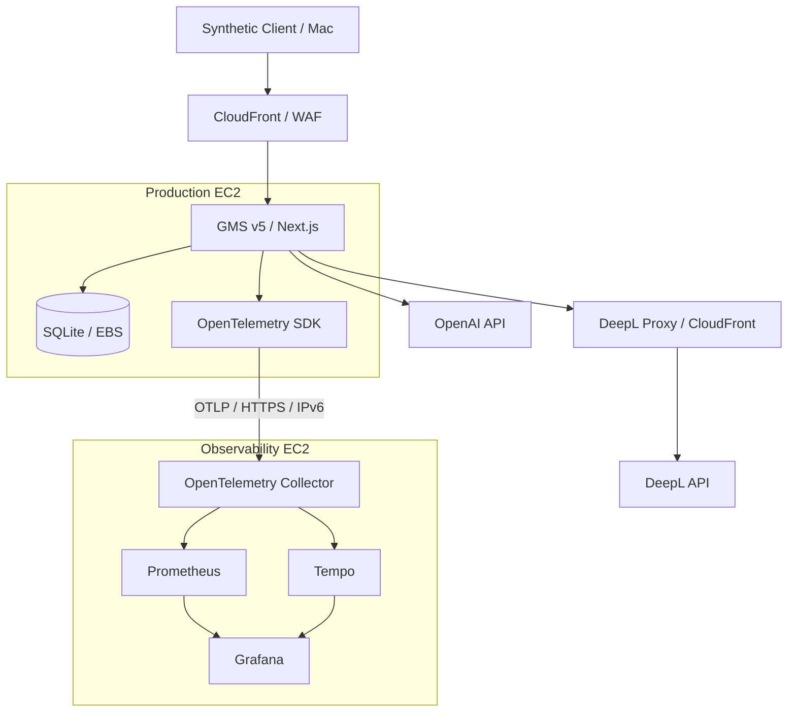

# GMS v5 — Synthetic Traffic and SLI Verification As-Built

**Experiment date:** 2026-11-26 JST
**Documentation date:** 2026-11-27 JST
**Status:** Experiment completed / Known issues open
**Environment:** Production
**Repository:** 1716964609/GMSv5

## 1. Objective

GMS v5の本番環境における翻訳機能の信頼性を定量的に評価する。

実利用が少ない環境では、SLIおよびSLOを評価するための十分な観測データが得られない。そのため、実際の医薬翻訳作業を模した合成トラフィックを生成し、以下を検証した。

- 翻訳処理の成功率とレイテンシ
- 現行Latency SLOに対する達成状況
- 外部APIと内部処理の所要時間
- クライアント側計測とサーバー側メトリクスの整合性
- 信頼性指標および監視範囲の妥当性
- 外部API利用量と一時リソースの後処理

本実験はシステムの最大処理能力を測定する負荷試験ではない。

## 2. Existing Architecture



既存の構成資料およびコードレビューに基づく構成。

翻訳メトリクスはアプリケーション内のOpenTelemetry SDKによって記録され、OTLP/HTTPで累積テンポラリティのメトリクスとしてCollectorに送信される。

PrometheusはCollectorのExporterを30秒間隔でスクレイプする構成として記録されている。

今回の実験では、既存の監視基盤を使用した。現在稼働しているCollectorの詳細設定については再検証していない。

## 3. Experiment Design

### 3.1 Workload

| 項目 | 条件 |
|---|---|
| 実行環境 | Production |
| 利用者 | 専用テストアカウント |
| 翻訳方向 | 日本語から英語 |
| 原文 | 医薬翻訳を模したテキスト |
| リクエスト数 | 246 |
| 実行方式 | 逐次実行 |
| 並列数 | 1 |
| リクエスト間隔 | 成功後30秒 |
| 自動リトライ | なし |
| 安全停止条件 | 連続3回失敗 |
| 1ラウンドの文字数上限 | 20,000字 |
| 最大原文長 | 352字 |

当初は複数日に分けて実行する予定だったが、外部API利用枠に余裕があったため、Product Ownerの判断により1日で完了する計画に変更した。

### 3.2 Execution

作業ディレクトリ：

`~/Projects/gms-synthetic-poc/`

主なファイル：

- `translate_run.py`
- `runs/translate.jsonl`
- `state/translate.json`

実行期間：

2026-11-26 10:36:20〜14:42:58 JST。

実行途中、19,945字を送信した時点で文字数上限による停止が発生した。その後、保存された実行位置から正常に再開し、全246件を完了した。

最終状態：

```json
{"next_id": 247}
```

### 3.3 Data Integrity

| 項目 | 結果 |
|---|---:|
| ログレコード数 | 246 |
| ユニークID | 246 |
| 欠番 | 0 |
| 重複 | 0 |
| 想定外ID | 0 |
| 原文総文字数 | 35,010 |
| 延べ選択用語数 | 357 |
| 用語あり | 178件 |
| 用語なし | 68件 |

## 4. SLI / SLO Results

### 4.1 Existing Translation Latency SLO

正式なLatency SLO：

直近7日間の成功したサーバー側翻訳処理の95%以上が10秒以内に完了すること。

失敗した翻訳はLatency SLIの分母に含めない。

本実験では、クライアント側のHTTP応答時間にも同じ基準を適用した。ただし、これは正式なサーバー側Rolling 7d SLOとは異なる。

### 4.2 Client-side Results

| 指標 | 実測値 |
|---|---:|
| 成功 | 246 |
| 失敗 | 0 |
| 成功率 | 100% |
| 10秒以内 | 245 |
| 10秒超過 | 1 |
| Latency SLI | 99.5935% |
| 試験判定 | PASS |
| 試験単体のError Budget消費率 | 8.1301% |
| 試験単体のError Budget残存率 | 91.8699% |

Error Budgetは今回の試験対象に限定した参考値であり、正式なRolling 7d Error Budgetではない。

### 4.3 Latency Distribution

| 指標 | 秒 |
|---|---:|
| Minimum | 3.153 |
| Mean | 5.733 |
| P50 | 5.708 |
| P90 | 6.843 |
| P95 | 7.646 |
| P99 | 8.750 |
| Maximum | 10.536 |
| Standard Deviation | 1.072 |

| 応答時間 | 件数 |
|---|---:|
| 0〜2秒 | 0 |
| 2〜4秒 | 13 |
| 4〜6秒 | 143 |
| 6〜8秒 | 84 |
| 8〜10秒 | 5 |
| 10〜12秒 | 1 |
| 12秒超 | 0 |

92.28%のリクエストが4秒超〜8秒以内に完了した。

## 5. Statistical Analysis

### 5.1 Terminology

| 指標 | 用語あり | 用語なし |
|---|---:|---:|
| 件数 | 178 | 68 |
| Mean | 6.145s | 4.655s |
| P50 | 5.998s | 4.707s |
| P95 | 7.779s | 5.696s |
| P99 | 9.072s | 6.181s |

観測された平均差は1.490秒、32.01%。

| 選択用語数 | 件数 | 平均 |
|---:|---:|---:|
| 0 | 68 | 4.655s |
| 1 | 74 | 6.023s |
| 2 | 60 | 6.156s |
| 3 | 28 | 6.199s |
| 4 | 9 | 6.473s |
| 5 | 4 | 6.768s |
| 6 | 1 | 6.073s |
| 7 | 1 | 7.008s |
| 10 | 1 | 6.744s |

0語から1語に増えた際の平均応答時間の差は1.368秒だった。

少数の範囲では、用語指定の有無による差が、用語数の増加による差より大きい傾向が確認された。

### 5.2 Text Length

| 原文文字数 | 件数 | Mean | P95 |
|---|---:|---:|---:|
| 1〜100 | 56 | 5.071s | 6.424s |
| 101〜200 | 160 | 5.767s | 6.966s |
| 201〜300 | 21 | 6.689s | 7.771s |
| 301以上 | 9 | 7.022s | 8.174s |

### 5.3 Pearson Correlation

| 変数 | 相関係数 |
|---|---:|
| 原文文字数と応答時間 | 0.5304 |
| 用語数と応答時間（全件） | 0.4895 |
| 用語数と応答時間（用語ありのみ） | 0.1661 |
| 原文文字数と用語数 | 0.4266 |

用語数と応答時間の相関は、用語指定ありのリクエストだけに限定すると弱くなった。

ただし、相関関係は因果関係を示すものではない。同一原文を使用した対照実験は行っていない。

## 6. Distributed Trace Analysis

### 6.1 Sampling

Tempoから遅延上位2件と通常リクエストの代表6件を抽出した。

- 遅延上位：#003、#056
- 用語あり中央値付近：#040、#240、#092
- 用語なし中央値付近：#042、#079、#161

全8件のWaterfallスクリーンショットをローカルに保存済み。

Trace生JSONのエクスポートは行っていない。一部のTraceは時刻と所要時間により照合しており、全件を属性によって厳密に一意照合したわけではない。

### 6.2 Dependency Latency

単位：秒。Serverは `gms.translation.request` のSpan時間。

| ID | 用語数 | Client | Server | DeepL | OpenAI |
|---|---:|---:|---:|---:|---:|
| #003 | 2 | 9.733 | 9.54 | 3.07 | 6.47 |
| #056 | 1 | 10.536 | 10.16 | 2.82 | 7.34 |
| #040 | 2 | 5.998 | 5.50 | 2.86 | 2.64 |
| #240 | 1 | 5.998 | 5.70 | 2.67 | 3.03 |
| #092 | 5 | 6.003 | 5.47 | 2.71 | 2.76 |
| #042 | 0 | 4.697 | 4.23 | 1.91 | 2.32 |
| #079 | 0 | 4.716 | 4.59 | 1.70 | 2.89 |
| #161 | 0 | 4.692 | 4.50 | 1.53 | 2.97 |

表示値はGrafanaの丸め精度に依存する。

唯一のクライアント側10秒超過であった#056は、サーバー側でも10.16秒を要した。

OpenAI Post-editは7.34秒であり、サーバー側翻訳時間の約72.2%を占めていた。

遅延上位2件の主要な時間消費箇所はOpenAI Post-editだった。ただし、OpenAI内部で処理が長引いた原因までは特定していない。

### 6.3 Glossary Processing

| ID | Create | Translation | Delete |
|---|---:|---:|---:|
| #003 | 1.610s | 1.040s | 0.413s |
| #056 | 1.570s | 0.859s | 0.383s |
| #040 | 1.480s | 1.010s | 0.371s |
| #240 | 1.470s | 0.824s | 0.376s |
| #092 | 1.520s | 0.797s | 0.384s |

通常リクエスト各3件の平均：

| 処理 | 用語あり | 用語なし | 差分 |
|---|---:|---:|---:|
| DeepL全体 | 2.747s | 1.713s | +1.034s |
| OpenAI Post-edit | 2.810s | 2.727s | +0.083s |
| Server全体 | 5.557s | 4.440s | +1.117s |

用語ありの通常3件では、Glossary作成と削除の合計が平均約1.867秒だった。

一方、用語なしのDeepL翻訳呼び出しは平均1.713秒、用語ありの場合の翻訳呼び出しは平均0.877秒だった。

したがって、作成・削除の所要時間をそのまま用語指定による純増時間とはみなさない。

今回観測されたDeepL処理全体の差は約1.0秒である。

**未検証の仮説：**

リクエスト内の最初のDeepL呼び出しにTCP/TLS接続確立などのコストが含まれ、後続の呼び出しでは接続が再利用されている可能性がある。

接続確立時間の直接計測や、同一原文による対照実験は行っていない。

### 6.4 Internal Processing

以下の計測済みSpanを比較した。

- `gms.translation.validate`
- `gms.translation.resolve_terms`
- `gms.sqlite.read_translation_terms`
- `gms.credentials.load`

親子Spanを二重計上せずに合計した結果、全8件で約0.395〜0.856msだった。

今回の逐次処理において、計測した内部処理は主要なレイテンシ要因ではなかった。

ただし、未計測の内部処理、並列負荷時のDBロック、イベントループのブロックなどは評価対象外である。

### 6.5 Evidence

| ID | Trace ID |
|---|---|
| #003 | `de7d30db886b0cb33d0e74d8a66bafe0` |
| #056 | `58c42f542227e63bed1b3a31b420c7aa` |
| #040 | `8a2d22c40d338605f356ab609d5b588e` |
| #240 | `f04b6cd2cb61678e69c726defc709eec` |
| #092 | `3b53c149aa89950dc6851e895aa8e07c` |
| #042 | `be5247117d093360898ab856af5882b` |
| #079 | `671179f75a226686646cfcf25df573a8` |
| #161 | `12dc7aa94453b5596f49da75ba70c724` |

## 7. Grafana Dashboard Extension

### 7.1 Implemented Changes

既存のRolling 7d固定窓を維持し、調査用の可変時間窓を追加した。

| 指標 | 固定窓 | 可変窓 |
|---|---|---|
| Latency SLI | 7d | Selected Range |
| P95 | 7d | Selected Range |
| Volume | 7d | Selected Range |
| Success Rate | 7d | Selected Range |

合計8パネル。

新規パネルには `$__range` を使用し、Query TypeはInstantとした。

既存の正式なSLO定義およびアラートルールは変更していない。

### 7.2 Selected Range Queries

Latency SLI：

```promql
100 *
sum(increase(gms_translation_duration_seconds_bucket{
  gms_translation_outcome="success",
  le="10.0"
}[$__range]))
/
sum(increase(gms_translation_duration_seconds_count{
  gms_translation_outcome="success"
}[$__range]))
```

P95：

```promql
histogram_quantile(
  0.95,
  sum by (le) (
    increase(gms_translation_duration_seconds_bucket{
      gms_translation_outcome="success"
    }[$__range])
  )
)
```

Volume：

```promql
sum(
  increase(gms_translation_duration_seconds_count[$__range])
)
```

Success Rate：

```promql
100 *
sum(increase(gms_translation_duration_seconds_count{
  gms_translation_outcome="success"
}[$__range]))
/
sum(increase(gms_translation_duration_seconds_count[$__range]))
```

### 7.3 Metric Reconciliation

観測範囲：2026-11-26 10:36:00〜14:44:00 JST。

| 指標 | Client Log | Grafana |
|---|---:|---:|
| Volume | 246 | 246.50 |
| Success Rate | 100% | 100.0% |
| Latency SLI | 99.5935% | 99.6% |
| P95 | 7.646s | 7.46s |

クライアント側とサーバー側の結果は概ね整合した。

Volumeの差は `increase()` の外挿と整合する。P95の差については、Histogram補間および計測範囲の違いが考えられる。

各要因の寄与量は未特定。

また、対象期間内の他のリクエストを完全に分離した集計ではない。

### 7.4 Configuration Management

新規4パネルはGrafana UI上で作成した。

ダッシュボードJSONのエクスポート、リポジトリへの反映、再構築時の復元検証は未実施。

既存As-BuiltにはObservability EC2の終了・再作成時にGrafana設定を復元できないBackup Gapが記録されている。

本件を既知の制約として残す。

## 8. Translation Failure Classification

### 8.1 Existing Outcomes

コードレビューにより、既存のOutcome分類を確認した。

| Outcome | 意味 |
|---|---|
| success | 正常終了 |
| conflict | 用語競合 |
| client_error | 利用者起因のエラー |
| dependency_error | 外部依存起因のエラー |
| server_error | 内部エラー |

現在の成功率パネルは、すべてのOutcomeを分母としている。

### 8.2 Conflict Verification

本番環境で、同一原語に異なる訳語を持つ2件の用語を選択し、翻訳を実行した。

GMSバックエンドは用語競合を検出し、訳語の選択を要求した。

競合解消後の翻訳は正常に完了した。

| リクエスト | Client Timing |
|---|---:|
| Conflict検出 | 125.25ms |
| 競合解消後の翻訳 | 4.42s |

Grafana Selected Rangeでは、Latency SLIが100%を維持する一方、Success Rateが約74〜75%に低下した。

正常なビジネスフローであっても、現行のSuccess Rateでは失敗として数えられることを確認した。

なお、後述する初回イベントの過少集計の可能性があるため、この成功率を厳密な実リクエスト比率とはみなさない。

### 8.3 Reliability Responsibility Boundary

Product Ownerは、以下の責任境界を決定した。

SLO対象外：

- 入力不正
- 用語競合
- 利用者のAPIキー無効
- 利用者の残高不足
- 利用者固有のAPI利用制限

SLO対象：

- 正常な翻訳処理
- DeepLおよびOpenAIのサービス障害
- 外部APIとの通信障害
- GMSアプリケーション障害
- SQLite障害
- GMS側ゲートウェイ障害

BYOモデルにおいても、サービス自体の依存先障害はGMSの信頼性評価に含める。

### 8.4 Future Success Rate SLI

暫定的な計算式：

```text
success /
(success + dependency_error + server_error)
× 100
```

ただし、現行のエラー分類では利用者固有の認証・クォータ問題と外部サービス障害を完全に区別できない。

また、翻訳Use Case到達前の障害は翻訳メトリクスに記録されない可能性がある。

上記の計算式は設計方針であり、正式なSuccess Rate SLOとしては未採用。

目標値、観測窓、アラート閾値も未決定。

## 9. Known Issue — Missing Latency Violation in Rolling 7d Aggregation

### 9.1 Observations

以下の事象を確認した。

- #056はクライアント側10.536秒、サーバー側10.16秒だった。
- Prometheusの累積超過件数は11:15頃に1となった。
- この値は21:20頃まで保持され、その後0に戻った。
- 22:17頃のRolling 7d SLOは100.0%だった。
- 22:45頃の7日間の超過推定件数は0.0016808869487だった。
- 成功翻訳Count系列の直近7日間の `resets()` は2だった。

実験期間を指定した場合には99.6%が得られていた。

現時点のRolling 7d集計値は、確認済みの超過イベントを十分に反映していない。

### 9.2 Investigation Queries

```promql
sum(
  increase(gms_translation_duration_seconds_count{
    gms_translation_outcome="success"
  }[7d])
)
-
sum(
  increase(gms_translation_duration_seconds_bucket{
    gms_translation_outcome="success",
    le="10.0"
  }[7d])
)
```

結果：0.0016808869487。

```promql
resets(
  gms_translation_duration_seconds_count{
    gms_translation_outcome="success"
  }[7d]
)
```

結果：2。

累積超過件数についてもRange Queryを実行し、過去の1件がPrometheus上に残っていることを確認した。

### 9.3 Interpretation

過去の観測データは参照可能であるため、単純なRetention期限切れでは説明できない。

また、Prometheusの `increase()` は通常、カウンターリセットを補正する。

したがって、リセットの発生だけでは今回の集計異常の原因を確定できない。

同日の夜にProduct OwnerがApplication EC2を手動停止し、Discord通知を確認している。

Application EC2の停止・再起動とカウンターの減少には関連がある可能性があるが、正確な時刻の突合は行っていない。

CountとBucketのリセット検出の違い、スクレイプ欠損、初期値、時系列の生成・消滅、OTelの累積メトリクス処理などが調査対象となる。

**Status: Observed / Root Cause Unknown / Not Fixed**

### 9.4 Follow-up

- Countおよび10秒Bucketの原始時系列を比較する。
- 両系列のリセット検出回数を確認する。
- EC2停止・起動時刻と照合する。
- 以前の長文翻訳が自然に7日間の窓から外れた影響と、#056の集計異常を区別する。
- Prometheusの現在のRetention実効値を確認する。

以前の構成資料には10日・1GiBという設定と、起動引数が旧設定の3日・512MBであることに関するリスクが記録されている。

現在の実効値は未確認。

## 10. Known Issue — Initial Event Accounting

Prometheusで以下を観測した。

| Outcome | Current Counter | Rolling 7d Increase |
|---|---:|---:|
| success | 4 | 約251 |
| conflict | 2 | 約1.05 |

Conflict系列の初回スクレイプ値がすでに1であった場合、`increase()` では0から1への増加を観測できない。

今回の数値はこの挙動と整合する。

ただし、原始時系列と正確なプロセス起動時刻による確認は未実施。

将来のSuccess Rateアラートでは、通常存在しないエラー系列の初回イベントを捕捉できない可能性がある。

Outcome別の専用Counterと起動時のゼロ初期化を対策候補とする。実装および動作検証は行っていない。

## 11. External API Consumption

### 11.1 DeepL

| 項目 | 値 |
|---|---:|
| 試験前累計 | 6,589字 |
| 試験後累計 | 42,299字 |
| 増加量 | 35,710字 |
| 合成翻訳原文 | 35,010字 |
| 差分 | 700字 |
| 利用期間内消費量 | 36,347字 |
| ライフタイム上限 | 1,000,000字 |
| 残存利用可能文字数 | 957,701字 |

最終利用量は送信文字数と概ね整合した。

700字の差分の厳密な帰属は未確認。

試験途中の管理画面における利用量の少なさは反映遅延によるものと考えられるが、確定はしていない。

以前の送信前用語置換仮説は取り下げる。

### 11.2 OpenAI

集計期間：2026-11-20〜2026-11-26。

| 項目 | 値 |
|---|---:|
| Total Requests | 252 |
| Total Tokens | 142,017 |
| Total Spend | $0.04 |
| 月間Spend表示 | $0.05 |
| Rate Limit Utilization | 0.1% |
| Cache-read Ratio | 0% |

$0.04は合成翻訳246件を含む期間集計であり、合成試験単体の厳密な費用ではない。

AWSインフラ費用なども含まない。

### 11.3 Temporary Glossary Cleanup

確認日時：2026-11-26 23:59頃 JST。

DeepLのv2 Glossary一覧取得APIを実行した。

```http
GET https://api-free.deepl.com/v2/glossaries
```

結果：

```json
{
  "glossaries": []
}
```

確認時点において、対象APIキーで取得可能なv2 Glossaryの残存は0件。

コードレビューでは、一時Glossaryをfinallyで削除し、削除時の失敗を無視する経路を確認している。

今回の確認は最終状態の検証であり、個別の削除リクエストすべての成功を証明するものではない。

## 12. Engineering Decisions

### 12.1 Performance Optimization

**Decision: No optimization at this stage.**

理由：

- 試験単体では95%・10秒の基準を達成した。
- 遅延上位の主要な時間消費箇所は外部APIだった。
- 計測済みの内部処理は主要なボトルネックではなかった。
- 信頼性指標の定義と集計精度に、より優先して検討すべき課題が見つかった。

現行のLatency SLO定義は維持する。

ただし、Rolling 7dの集計異常が解消されたことを意味しない。

### 12.2 Monitoring Coverage

今後は性能最適化よりも、以下の観測上の課題を優先して検討する。

- 正常なビジネスフローと障害の区別
- BYOモデルの責任境界に沿った失敗分類
- Success Rate SLOの設計
- 監視データの完全性

### 12.3 Scope

今回の実験を文書化して完結させる。

以下は実装していない。

- エラー分類の修正
- 新しい成功率SLO・アラート
- Rolling 7d集計異常の修正
- EC2バイタル監視
- 並列負荷試験
- 長文SLO
- DB移行・分離
- Synthetic Lambda

## 13. Known Limitations and Backlog

| 課題 | 状態 |
|---|---|
| Rolling 7dから10秒超過イベントが集計上消失 | 現象確認・原因未特定 |
| 初回Outcomeイベントの過少集計 | 数値が仮説と整合・原始時系列未確認 |
| 利用者固有エラーと依存先障害の分類 | コード上の課題確認 |
| DeepL/OpenAIの通信例外分類 | 不統一の可能性確認 |
| 翻訳Use Case開始前の障害 | 観測範囲の不足 |
| ユーザーへの結果返却の成功判定 | 未検証 |
| WAFの8KB制限 | 原因候補・WebACL未確認 |
| 長文・大量用語指定の処理限界 | 未検証 |
| TCP/TLS接続確立コスト | 仮説 |
| Grafanaダッシュボードの構成管理 | 未対応 |
| Prometheus Retentionの実効値 | 再確認待ち |
| 実利用と合成トラフィックの分離 | 未対応 |

WAFについては、8KBを超える用語インポート要求が403となり、7,000バイト以下への分割で成功したとの引き継ぎ記録がある。

AWS Managed RulesのSizeRestrictions_BODYが原因候補だが、現在のWebACLおよびWAFログは確認していない。

長文や約9,999用語を選択した際の過去の翻訳失敗との関連も未確定。

## 14. Final Assessment

今回の合成トラフィック実験では、単一利用者による短文・段落単位の逐次翻訳について、246件すべてが成功し、99.5935%が10秒以内に完了した。

分散トレーシングでは外部API処理がレイテンシの大半を占めていることを確認した。

一方、信頼性の測定を進める過程で、正常な用語競合による成功率低下、初回イベントの過少集計の可能性、Rolling 7dにおける超過イベントの集計異常を発見した。

この結果を踏まえ、現時点では性能最適化を行わず、信頼性指標と監視の妥当性を優先して検討する。

今回の実験は完了とする。

ただし、並列処理能力、長文翻訳、翻訳品質、実利用者の長期的な信頼性、外部API障害時の挙動については、本実験によって保証されたものではない。

**Experiment status: CLOSED**

**Known issues: OPEN**
