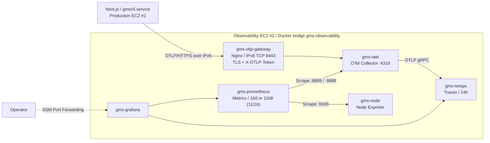

# GMS v5 — Production State（現在の本番状態）

- **基準日:** 2026-11-23（JST）
- **文書種別:** Current State Summary（一次証跡への索引。本書自体は証跡ではない）
- **Owner:** Infrastructure / SRE
- **対象:** Production EC2 #1（Application）とObservability EC2 #2（監視基盤）
- **入口:** [Infrastructure README](./README.md)、[文書全体の案内](../README.md)

> **Evidence policy:** 本書は、日付付きAs-Built記録、Gitで追跡しているTerraform・Workflow定義、GitHub Actionsの読み取り結果を要約したものである。本書の作成にあたり、AWS・EC2・本番DB・systemd・Secretへの照会や変更は行っていない。本書と一次証跡が食い違う場合は**一次証跡を正**とし、本書を修正する。
>
> **2026-11-19の更新について:** GitHubのRun・Pull Request・Branch保護・Repository変数は、2026-11-19にGitHubから読み取って照合した。SSM Command、DynamoDB、CloudWatch、Discord、公開HTTPSの結果は、Operatorが提示した受入証跡（[CI/CD As-Built](./cicd-as-built-2026-11-19.md)）による。AWSとEC2へは今回も照会していない。
>
> **2026-11-20の更新について:** DLMの適用、DR演習、性能試験、DNS / CDN調査、Cleanupの結果は、Operatorが実施・提示した証跡を記録した[DR As-Built 2026-11-20](./dr-as-built-2026-11-20.md)による。`57b9141`のDeployment Runは2026-11-20にGitHubから読み取って照合した。本書の更新にあたり、AWS・EC2・DNSへの照会や変更は行っていない。
>
> **2026-11-20（夕方）の更新について:** Route 53への移行、性能測定、Smoke test、Terraform Import、DLMの初回Snapshotの結果は、Operatorが実施・提示した証跡を記録した[DNS Migration As-Built 2026-11-20](./dns-migration-as-built-2026-11-20.md)と[DR As-Built §12](./dr-as-built-2026-11-20.md#12-addendum--first-automated-dlm-snapshot-2026-11-20)による。`3f088ea`のDeployment RunとTerraformのCommitは、2026-11-20にGitHubとGitから読み取って照合した。本書の更新にあたり、AWS・DNSへの照会や変更は行っていない。

## Update: 2026-11-23 — Security Baseline / IAM SSO

**一次証跡:** [Security Hardening As-Built](./security-hardening-as-built-2026-11-23.md)。

- GitHub Secret Protection / Push Protectionを設定。
- AWS Budget（USD 20、Actual 80% / Forecast 100% / Actual 150%）を設定。
- GitHub OIDC / IAM監査は3項目PASS。
- CIにTrivyのReport-only Scanを導入（PR #11）。
- IAM Identity Center SSOへOperator認証を移行。Terraform 4 RootでNo changesを確認。
- 旧IAM Access KeyはInactive。削除は未実施。
- Trivy検出事項のTriageは未完了。
- CloudFront Origin Secret Rotationは延期。実装していない。

## Update: 2026-11-20（夕方） — Route 53 DNS移行、DLM初回Snapshot、CR-01追加最適化のClose

この更新は、下にある「Update: 2026-11-20 — Backup Automation…」とそれ以前の記述のうち、**権威DNS、公開経路のEdge選択と性能、DLMの初回実行、Worker 4の扱い、現行Release**に関する部分に優先する。**一次証跡:** [DNS Migration As-Built 2026-11-20](./dns-migration-as-built-2026-11-20.md)、[DR As-Built §12](./dr-as-built-2026-11-20.md#12-addendum--first-automated-dlm-snapshot-2026-11-20)。**設計と図:** [Architecture §4](../architecture.md#4-ingress--既存web公開経路)。

- **実測（移行）:** 権威DNSをDreamHostからRoute 53 Public Hosted Zone `Z05363321CQMGUZ68L65V`へ移した。RegistrarはDreamHostのまま。2026-11-20 17:58 JSTにNameserverの切替を確認し、18:00–18:01に親`.com`と観測した主要Resolverが新NSを返した。公開Domain、CloudFront Distribution、Origin、EC2、Cognito、TLS、Application、DBは変更していない。
- **実測（性能）:** 移行後のHealth API warm TTFB medianはIPv4 36.352ms（移行前303.691ms、88.0%短縮）、IPv6 30.912ms（移行前297.809ms、89.6%短縮）。計測20回すべてHTTP 200、POP `NRT12-P5`（東京）。移行前後は別の時刻の少数標本で、Health APIだけの結果である。
- **観測（未解明）:** 18:39に1回、IPv6で`HIO52-P2`（オレゴン）へ到達した（HTTP 200）。18:42の追試3回はすべて東京。原因は不明で、東京Edgeが常に選ばれることは保証しない。世界中への伝播完了も主張しない（委任TTL 48時間）。
- **実測（IaC）:** Route 53のZoneとRecord、CloudFront Free PlanのSubscriptionを`dns.tf`、`dns-import.tf`、`pricing-plan.tf`でImportした（8 imported, 0 added, 0 changed, 0 destroyed）。最終PlanはNo changes。CommitはBranch `feat/gmsv5-route53-dns`の`6494d3b`。
- **実測（Backup）:** DLMの初回の自動Snapshot `snap-010d97887aba25463`が作成された（StartTime 2026-11-20 04:32:51 JST、completed、暗号化、DLMのTag付き）。成功は1回だけで、2世代保持の世代交代と継続的なRPO適合は未確認。このSnapshotのRestore試験はしていない。DR演習のRPO FAIL（約267.5h）は当時の観測として有効なままである。
- **Product Owner判断:** CR-01の追加最適化（Worker 4の本番適用と追加の並列化）は**Closed — No Production Rollout**。Worker 4は本番に適用されていない。FR-734の本番での正式な性能受入は測定しておらず、数値目標は本番で達成済みとしない（[CR-01 §14](../design/cr-01-parallel-fetch-design.md#14-追加最適化のclose2026-11-20)）。
- **残作業:** DNS安定性の再確認（2026-11-22 18:00 JST以降）、安定化期間中のDreamHost Zoneの保持、実際の請求の確認、旧`origin`と`edge-test`の整理（別途承認）、3回目のBackup後のRetention確認。詳細は[DNS Migration As-Built §13](./dns-migration-as-built-2026-11-20.md#13-outstanding-operations)。

## Update: 2026-11-20 — Backup Automation（DLM）、隔離DR演習、DNS / CDN調査

この更新は、下にある記述のうち、**Data EBSのBackup、EBS Snapshot、復旧手順、現行Release、公開経路の性能**に関する部分に優先する。**一次証跡:** [DR As-Built 2026-11-20](./dr-as-built-2026-11-20.md)。**運用:** [Disaster Recovery Runbook](./disaster-recovery-runbook.md)。**設計と図:** [Architecture §16](../architecture.md#16-backup-and-recovery)。

- **実測（適用）:** Amazon Data Lifecycle Manager（DLM）のPolicyを`infra/terraform/v5/backup.tf`で追加し、Applyは**4 added, 0 changed, 0 destroyed**。Policyは`ENABLED`。Data EBS（Tag `Name=gmsv5-sqlite-data`）を24時間周期（19:00 UTC = 04:00 JST）でSnapshotし、Policy管理分を**2世代**保持する。
- **未確認:** DLMによる初回Snapshotの作成・完了、3回目以降のRetention（世代交代）、Delete Guardの実動作。PolicyがENABLEDであることはBackup成功の証拠ではない。DLM失敗の監視は未実装。**（初回Snapshotの作成・完了は同日に確認済み。上の夕方の更新を参照）**
- **実測（DR演習）:** 本番Data EBSのSnapshot（2026-11-08取得）から、本番とは別の一時InstanceとVolumeに復元した。Application Recovery（期待SHAのReadiness 3連続成功）は**308秒**、Functional Recovery（Cognitoログインと用語集参照）は**478秒**。SQLiteの整合性検査・Migration 1→2・件数確認はPASS。いずれも隔離環境での単発演習の値で、障害検知・判断・本番Cutoverを含まず、本番トラフィックの復旧時間やRTOの保証ではない。
- **実測（RPO評価）:** 復元に使ったSnapshotの復旧点経過時間は**約267.5時間**で、暫定目標24hに対して**FAIL**。これは復旧点の古さであり、実際のデータ損失の量を測ったものではない。
- **実測（Cleanup）:** DR用のAWS資源は削除済み。残存監査7分類（EC2、Volume、SG、ENI、Snapshot、IAM Role、Instance Profile）はすべて空。Cleanup後の本番Readinessは3/3 HTTP 200で、Releaseは演習前と同じ`57b9141`。DLM Policyは恒久資産として残した。
- **確認範囲の限界:** ProductionとObservabilityはEC2 / EBS Status、SSM Onlineまで確認した。演習後のObservability内部（各Container、Prometheus、Tempo、Grafana、Discord経路）の再受入は実施していない。
- **実測（性能、未修正）:** 独自Domain経由ではCloudFrontの`HIO52-P2`（米国オレゴン）が、CloudFront標準Domainの解決では`NRT12-P5`（東京）が選ばれた。Health APIのMedian TTFBは**297.809ms**、東京Edgeへ接続先を変えた比較では**35.822ms**。DreamHostのApex ALIAS flatteningが原因という説明は**仮説**であり、DreamHost内部の実装は確認していない。DNS移行などの恒久修正は**実施していない**。**（同日夕方にRoute 53へ移行済み。上の夕方の更新を参照）**
- **実測（隔離環境のみ）:** CR-01のSelect All Benchmarkで、Worker 4のp95は4.4573秒（逐次比61.25%短縮）。**Worker 4は本番に適用していない。** 結果の要約は[CR-01 §13](../design/cr-01-parallel-fetch-design.md#13-隔離環境benchmark2026-11-20)。**（同日、Product Ownerが本番適用をしないと決定。上の夕方の更新を参照）**
- **運用上の指摘:** 演習当日のAWS CLIはAccount rootの権限で実行された。Runbookは最小権限のOperator Roleを前提とする。DNSには検証用Record `edge-test.sunlightjetrans.com`（CNAME）が意図的に残されている（§5.3。移行後はRoute 53に一時的に保持）。

## Update: 2026-11-19 — CI/CD、Automatic Rollback、Boot Recovery、Deployment Observability

この更新は、下にある2026-11-16以前の記述のうち、**Releaseの配布方法、現行Release、Rollback、Deploymentの監視**に関する部分に優先する。**一次証跡:** [CI/CD As-Built 2026-11-19](./cicd-as-built-2026-11-19.md)。**運用:** [CI/CD Operations Runbook](./cicd-operations-runbook.md)。**設計と図:** [Architecture §10](../architecture.md#10-ci--build--deployment)。

- **実測:** 現行Releaseは`53ece4d8809cdf439cf9c182ce1f41c0b017e3af`（2026-11-19時点。2026-11-20の値は§3.1）。PR #7のMergeによる`main`へのPushで[Run 44353371110](https://github.com/1716964609/GMSv5/actions/runs/44353371110)が起動し、Build・公開・Deployまで人手を介さず完了した（完了は2026-11-19 02:02 JST頃）。SSMの結果は`SUCCEEDED`、公開HTTPSは200。
- **実測:** `main`はPull RequestとCI Quality Gate（`Quality Gate`）の成功を必須とする。Repository変数`GMSV5_CD_ENABLED`は`true`で、自動CDは有効である。
- **実測:** 本番EC2上で、制御したReadiness失敗によるAutomatic Rollback、および中断したTransactionを模擬した状態での実際のOS再起動によるBoot Recoveryが、いずれもPASSした。
- **実測:** Deploymentの開始・成功イベントがDynamoDBとCloudWatch（`GMS/Availability` / `DeploymentEvents`）に記録され、Discordへの開始・成功通知が本番Deployment 2回について着信した。
- **変更された前提:** Releaseの配置は手動ではなくなった。Applicationは`/opt/gmsv5/current`（Symbolic Link）から起動し、Releaseは`/opt/gmsv5/releases/<full-commit-sha>`に置かれる。
- **未達・限界:** 単一Instanceで、無停止Deploymentは保証しない。DBの自動Rollbackは無い。失敗系の通知は単体テストのみで、実際のDiscord着信は確認していない。Deployment用のGrafana Panelは未追加。詳細は§6、§7。
- **注意:** `GMSV5_CD_ENABLED`が`true`の間、`main`へのMergeは文書だけの変更でも本番Deploymentを起動する。

## Update: 2026-11-16 — Rolling 7d SLO and Discord Alerting

この更新は、下の旧い2026-11-14時点の記述に優先する。**一次証跡:** [Observability / SLO / Discord As-Built 2026-11-16](./observability-as-built-2026-11-16.md)。**運用:** [SLO Alerting Runbook](./observability/translation-slo-alerting-runbook.md)。

- **実測:** Prometheus retentionのreload後実効値は10dまたは1GiB、Scrape 4/4 UP。Dockerの元起動引数3d/512MBは更新されておらず再作成後の保持は未確認。
- **実測:** 翻訳Histogram / 成功CountをPrometheusで確認。実翻訳2件、7d増分約1件。DashboardにはSLO Attainment、p95 Latency、成功翻訳数、Success Rateの4パネル。
- **実測:** 監視EC2のDocker bridge IPv4 → Host-Network Nginx → IPv6 HTTPS CloudFront → IPv4 Discord Webhook。POST 204、Discord着信、Grafana-managed AlertのFiring / Resolvedまで確認。
- **実測:** 正式`GMS Translation SLO Breach — Rolling 7d` は5分評価、10分Pending、20成功件以上かつ10秒以内割合95%未満で発火、少数標本時はNormal。作成後の定期評価を確認。
- **未達:** 7日連続のSLO適合実績、実翻訳遅延による発火、失敗率・監視基盤停止の独立アラート、Spot再作成時の復元、完全なバックアップ。
- **追加構成:** `infra/terraform/discord-alert-egress/`（専用CloudFront、Function、KVS、Origin Request Policy、Local State）、EC2上`gms-discord-egress`（Nginx host networking、手動起動）。KVSの値とNginxのSecret設定はGit管理しない。Grafana Dashboard / Alert Rule / Contact PointのExportを`infra/observability/grafana/`に保存。

### Incident update: 2026-11-16 — Spot interruptions

**実測:** Application EC2は11:49、13:36、15:04 JSTに
AWS Spotサービスによる停止・起動を経験（3回）。
最終起動後の`gmsv5.service`は自動起動しHTTP 200を返した。
Observability EC2も18:10～18:12 JSTに停止・起動。
Prometheusのみ自動復帰せず、Grafanaが`DatasourceError`をDiscordへ通知。
既存コンテナを手動復旧し、Restart Policyを`always`へ変更した。

**原因評価:** 両EC2は同じ`ap-northeast-1a / t4g.small`容量プール。
Spot価格履歴は0.008 USD/hで価格上昇なし。
AWSによる容量回収が最有力だが、特定のOn-Demand需要・
内部停止理由は未確認。サービス停止時間と欠測量は未測定。

**運用:** [Spot Interruption Runbook](./spot-interruption-runbook.md)。
自動再起動の実地再検証、Spot再作成からの復元、外部死活監視は未完了。

> **Superseded in part（2026-11-19追記）：** 外部死活監視は2026-11-17に導入された（末尾の「Update: 2026-11-17」、[Availability As-Built](./availability-external-as-built-2026-11-17.md)）。Spot再作成からの復元は引き続き未検証である。

---

## 1. 要約

| 領域 | 現在の状態 | 区分 |
|---|---|---|
| Application Release | `3f088ea`（PR #9のMergeによる自動Deployment。2026-11-20のDNS移行の前後で不変）。DR演習時は`57b9141`、CI/CD受入時点は`53ece4d`、直前までの手動Releaseは`364d0b7` | 実測（2026-11-20） |
| CI | Pull Requestで起動するQuality Gate。`main`へのMergeに必須 | 実測（2026-11-19） |
| CD | `main`へのPush → ARM64 Build → OIDC → S3 → SSM → EC2。`GMSV5_CD_ENABLED=true`で有効 | 実測（2026-11-19） |
| Automatic Rollback / Boot Recovery | 本番EC2で受入PASS。制御した障害注入と模擬Transactionによる試験 | 実測（2026-11-19） |
| Deployment Observability | SSM状態イベント → EventBridge → Lambda → DynamoDB / CloudWatch / Discord。開始・成功を確認。失敗系は単体テストのみ | 実測＋未確認 |
| 外部Availability監視 / Spot Lifecycle監視 | EventBridge、Lambda、DynamoDB、CloudWatch、Grafana 3 Panelが稼働 | 実測（2026-11-17） |
| Server Traces / Metrics | 本番で有効。実リクエストのTraceとMetricsを確認済み | 実測 |
| 監視基盤 | OTLP Gateway、OTel Collector、Tempo、Prometheus、Grafanaが稼働。Prometheus Targets 4/4 UP | 実測 |
| Browser RUM | コードはあるが本番では無効 | 実測（無効であること） |
| Rolling 7-Day SLO Dashboard / Alerting | 4パネル・95%/10s（成功翻訳）・Grafana-managed Rule・Discord通知を初期構築。7d実績判定は未実施 | 実測（2026-11-16） |
| Logs集中管理、Edge監視（CloudFront / Nginx / DNS）、Instanceの自動再作成、Telemetry欠損監視 | 未完成 | 未実装 |
| 監視InfrastructureのTerraform再現性 | 部分的。EC2・Security Group・IAMまで。Tempo・Gatewayなどホスト上の構成は手動 | 宣言＋手動 |
| Data EBSのBackup（DLM） | 24時間周期のSnapshot、2世代保持のPolicyを適用・ENABLED。初回の自動Snapshotは成功（2026-11-20 04:32 JST開始、completed）。Retentionと継続的なRPO適合は未確認 | 実測＋未確認（2026-11-20） |
| 災害復旧（隔離Restore Drill） | Snapshotから隔離環境へ復元。Application 308秒、Functional 478秒。RPO 24hはFAIL（復旧点約267.5h）。DR資源は削除済み | 実測（2026-11-20） |
| 公開DNS / Edge選択 | 権威DNSはRoute 53（RegistrarはDreamHost）。移行後の計測で東京Edge（`NRT12-P5`）、Health API warm TTFB median 約31〜36ms。1回だけ遠方Edgeを観測（原因不明）。安定化期間中 | 実測（2026-11-20） |
| CR-01の追加最適化（Worker 4） | Product OwnerがClose（No Production Rollout）。本番の正式な性能受入（FR-734）は測定していない | 決定（2026-11-20） |

Phase 1が確認したのは、本番Applicationの計装・送信・保存・検索ができることである。本番Observabilityの運用成熟（検知・通知・復旧）を確立したものではない（[Observability As-Built §12](./observability-as-built-2026-11-13.md#12-production-phase-1-acceptance)）。

監視は1つの機能ではない。完成度は領域ごとに異なるため、領域別の状態は§3.8にまとめる。

## 2. 証跡の区分

本書の各項目は次のいずれかに分類する。区分を混ぜて「実装済み」と読まないこと。

| 区分 | 意味 |
|---|---|
| **実測** | 日付付きAs-Built記録に、コマンド出力・画面・リクエスト結果として残っているもの |
| **報告** | OperatorまたはProduct Ownerの報告。照合ログは未提示 |
| **宣言** | Gitで追跡しているTerraform・Workflowに書かれている内容。AWS実環境との一致は別途確認が要る |
| **継承** | 過去のAs-Builtから引き継いだ情報。以後、再検証していない |
| **手動** | ホスト上またはAWS Consoleで構築され、リポジトリに定義が無いもの |
| **未実装** | 設計はあるが構築していないもの |
| **未確認** | 構築済みだが、検証結果または証跡が記録されていないもの |
| **仮説** | 実測から推定した原因。根拠となる内部の実装や経路は確認していないもの（2026-11-20に追加） |
| **決定** | Product Ownerなどの判断。測定や検証の結果ではないもの（2026-11-20に追加） |

## 3. 最新の実測結果

### 3.1 Application Release

| 項目 | 内容 | 区分・根拠 |
|---|---|---|
| 現行Release（2026-11-20夕方） | `3f088ea69f957ae2ceb84dc9dc050c84ebf6fe13`。PR #9（DLMの`backup.tf`とDR関連文書）のMergeによる`main`へのPushで[Run 44593103688](https://github.com/1716964609/GMSv5/actions/runs/44593103688)が起動（Success、Event `push`、Head SHA一致）。DNS移行の前後で公開ReadinessのReleaseが一致 | 実測：[DNS Migration As-Built §9](./dns-migration-as-built-2026-11-20.md#9-application-smoke-test)、GitHubの読み取り（2026-11-20） |
| `57b9141`→`3f088ea`の差分 | `infra/terraform/v5/backup.tf`とMarkdown文書のみ。Application CodeとMigration定義の変更は無い。CDはTerraformを適用しない（`backup.tf`のApplyはOperatorが別に実施） | Git履歴 |
| DR演習時のRelease（2026-11-20未明） | `57b914136fcea70247336e7bf65160300e47781c`。PR #8（文書のみの変更）のMergeによる`main`へのPushで[Run 44360944644](https://github.com/1716964609/GMSv5/actions/runs/44360944644)が起動（Success、Event `push`、Head SHA一致）。DR演習の前後で公開ReadinessのReleaseが一致 | 実測：[DR As-Built §2、§9](./dr-as-built-2026-11-20.md#9-cleanup-and-post-drill-safety-audit)、GitHubの読み取り（2026-11-20） |
| Artifact SHA256（`57b9141`） | `d8a5aab73e2b251e24bf30b521d335a98ca9ee9a2416fa889532cf884dd15c7a` | 実測：DR As-Built §2（Operator提示） |
| `53ece4d`→`57b9141`の差分 | Markdown文書のみ。Application Code、Migration定義、Terraform、Workflowの変更は無い | Git履歴 |
| CI/CD受入時点のRelease | `53ece4d8809cdf439cf9c182ce1f41c0b017e3af` | 実測：[CI/CD As-Built 追補](./cicd-as-built-2026-11-19.md#addendum--final-acceptance-2026-11-19-approximately-0202-jst) |
| 受入時の起動契機 | PR #7のMergeによる`main`へのPush。[Run 44353371110](https://github.com/1716964609/GMSv5/actions/runs/44353371110)：Success、Event `push`、Head SHAは`53ece4d`と一致 | 実測：GitHubの読み取り（2026-11-19） |
| Artifact SHA256（`53ece4d`） | `1b77cf3f6c480c260fa25db6ae79a985d564002d85c458c86da549ae2f2ca672` | 実測：CI/CD As-Built 追補（Operator提示） |
| 切替結果 | SSM `SUCCEEDED`、分散Lockは取得・解放、公開HTTPSは200 | 実測：同上 |
| 受入条件 | ReadinessがBuild SHA・DB・必須Table・適用済みMigrationを照合し、3回連続で成功すること | 宣言：`infra/deployment/healthcheck.py`、`src/lib/health/readiness.ts` |
| 稼働環境 | Production ARM64 EC2上のNext.js Standalone。`/opt/gmsv5/current`から起動 | 実測：CI/CD As-Built |
| Applicationの差分 | `364d0b7`以降のApplication変更は、Health Endpoint（`/api/health/live`、`/api/health/ready`）とBuild SHAの埋め込みである。DB Migrationの追加は無い | Git履歴（`217e41f`） |

本番Releaseの履歴（判明している範囲）：

| Release | 内容 | 配布方法 |
|---|---|---|
| `364d0b7ebd4868f6d54b271ce9144b001bd380ca` | Observability計装のRelease（2026-11-14に本番確認） | 手動（Build ARM64 Release #11 / [Run 43435258778](https://github.com/1716964609/GMSv5/actions/runs/43435258778)） |
| `f48a3e505ce605a70f29ff6e8925483130f05f78` | 管理下に置いた最初の本番Baseline | OperatorによるSSM Cutover（2026-11-19 01:26 JST） |
| `d50dafb1185122990e0f272cd84933d6e690bec7` | GitHub Actionsによる最初の自動Deployment | [Run 44348885925](https://github.com/1716964609/GMSv5/actions/runs/44348885925)（`workflow_dispatch`） |
| `53ece4d8809cdf439cf9c182ce1f41c0b017e3af` | CI/CD受入の最終Deployment（`main`へのPush） | [Run 44353371110](https://github.com/1716964609/GMSv5/actions/runs/44353371110)（`push`） |
| `57b914136fcea70247336e7bf65160300e47781c` | PR #8（文書のみ）のMerge。2026-11-20のDR演習で復旧対象としたRelease | [Run 44360944644](https://github.com/1716964609/GMSv5/actions/runs/44360944644)（`push`） |
| `3f088ea69f957ae2ceb84dc9dc050c84ebf6fe13` | PR #9（`backup.tf`と文書）のMerge。2026-11-20のDNS移行時に稼働していたRelease | [Run 44593103688](https://github.com/1716964609/GMSv5/actions/runs/44593103688)（`push`） |

本書§3.1の「現行Release」は節目の時点の値である（§10の6）。上の`57b9141`は2026-11-20のDR演習で、`3f088ea`は同日のDNS移行で観測した値であり、以後のMergeで自動的に置き換わる。

これより前のRelease（`9783463`、`5f0c6e7`、`51cba4a`、`f5fb681`）は、[As-Built 2026-11-08](./production-as-built-2026-11-08.md)と[As-Built 2026-10-26](./production-as-built-2026-10-26.md)に記録がある。

`364d0b7`を含む`feat/gmsv5-otel`と、CI/CDの実装（PR #4〜#7）は、すべて`main`にMerge済みである。2026-11-16版の本書にあった「`main`には計装コードもSecurity Group規則も入っていない」という記述は**Superseded**である。

`364d0b7`の手動切替についての未記録事項（SSM Command ID、systemdの最終出力）は、履歴として§7に残す。

### 3.2 Telemetry経路（Production → Observability）

| 項目 | 内容 | 根拠 |
|---|---|---|
| 受信口 | `gms-otlp-gateway`（`nginx:1.30.6-alpine-slim`）がIPv6 TCP 8443で待ち受け、`http://gms-otel:4318`へ中継 | As-Built §11.3 |
| TLS | Private CAで署名したServer証明書。SANはIPv6アドレス。CAは発行時365日、Server証明書は発行時90日 | As-Built §11.3 |
| 認証 | Header `X-OTLP-Token`。Tokenなしは401、Tokenありは200 | As-Built §11.3 |
| 受付Path | `POST /v1/traces`、`POST /v1/metrics` | As-Built §11.3 |
| Network | Observability SG `sg-07daa1cdcf79d6c93`に、Production EC2のIPv6 `/128`からのTCP 8443を許可（Rule `sgr-0d1314a10664f19e6`）。Terraform applyは「1 added, 0 changed, 0 destroyed」 | As-Built §11.4 |
| Token配布 | SSM Parameter Store SecureString。Production EC2からIPv6 Endpoint経由の取得を確認 | As-Built §12 |
| CA配布 | 公開CA証明書を`/etc/ssl/certs/gmsv5-otel-ca.pem`に配置（`/etc/gmsv5`が`0700`で実行ユーザーから読めなかったため移動） | As-Built §12 |
| Collectorのポート | 4317 / 4318はEC2ホストへ公開していない。Tempoのポートも公開していない | As-Built §11.1、§11.2 |

### 3.3 Distributed Tracing

本番の実リクエストがGrafanaで確認できた（As-Built §12）。

| 観測 | 値 |
|---|---|
| Translation Request全体 | 約6.87秒 |
| DeepL（`gms.deepl.translate`） | 約3.22秒 |
| OpenAI Post-edit（`gms.openai.post_edit`） | 約3.64秒 |
| SQLite読み取りSpan | 約1.84ミリ秒 |

これは1回の観測値であり、Baseline・p95・SLOではない。計測条件（用語数、文章長、同時負荷）は記録されていない。

### 3.4 Application Metrics

- Prometheus Target Health：**4/4 UP**（As-Built §12）。As-Built §4.2に記録されたJobは`prometheus`、`otel-collector`、`otel-application-metrics`、`observability-host`の4件で、Scrape間隔は30秒。
- 確認済みのMetric Family：HTTP Server Request Duration、Translation Durationと選択Term数、DeepL / OpenAIのExternal Request Duration、SQLite Operation Duration、SQLiteのDB / WAL / SHMファイルサイズとFilesystem空き容量、Node.js Event Loop Delay（p50 / p99 / max）、Process Memory、V8 Heap、Uptime。
- Application関連の名前フィルターに一致したMetric名は32種類。

4つのTargetはすべてObservability EC2内のものである。Production EC2のHost Metrics（CPU・Memory・Disk）は収集していない（§6）。

### 3.5 Observability EC2のコンポーネントと資源

EC2 #2：`i-021170e56849c597b`、`t4g.small`、Amazon Linux 2023 ARM64、Root EBS 10 GiB gp3のみ（As-Built §2）。

| Container | Image | Memory上限 | 使用量（2026-11-14） |
|---|---|---:|---:|
| `gms-otlp-gateway` | `nginx:1.30.6-alpine-slim` | 128 MiB | 2.81 MiB |
| `gms-otel` | `otel/opentelemetry-collector:0.165.0` | 192 MiB | 24.99 MiB |
| `gms-tempo` | `grafana/tempo:3.1.1` | 384 MiB | 28.18 MiB |
| `gms-prometheus` | `prom/prometheus:v3.16.0` | 640 MiB | 43.88 MiB |
| `gms-grafana` | `grafana/grafana:13.3.1` | 512 MiB | 358.1 MiB |
| `gms-node` | `prom/node-exporter:v1.12.1` | 128 MiB | 7.438 MiB（2026-11-13の値。11-14の記録なし） |

- Root Filesystem：41%使用、空き5.9 GiB。System MemAvailable：約1.0 GiB。Swapなし（As-Built §12）。
- 保存期間の実効値：Prometheusは**10日または1GiB**（2026-11-16、[As-Built](./observability-as-built-2026-11-16.md)）。元のコンテナ起動引数は3日/512MBのまま。EC2再起動後に既存コンテナを手動起動し10d/1GiB維持を確認。コンテナ再作成後の保持は未検証。Tempoは24時間（過去のAs-Built）。これらはRoot Filesystem全体の使用量上限を保証しない。
- Metrics・Traces・Grafanaの状態はすべて同じRoot EBS上にある。Root EBSは`delete_on_termination = true`で、Backupの記録はない。

いずれも一時点の値であり、容量予測や長期安定性の検証ではない。

### 3.6 再検証していない継承情報

次の構成は2026-10-26および2026-11-08のAs-Builtから引き継いでおり、2026-11-14の検証対象には含まれていない。2026-11-19のCI/CD受入も、Releaseの配置と起動方法を除いて、これらを再検証していない。

| 領域 | 内容 | 出典 |
|---|---|---|
| 公開Ingress | DreamHost DNS → CloudFront `E1EF0DWDYA2XH8` → HTTPS / IPv6 → Nginx 443 → Next.js `127.0.0.1:3000`。**2026-11-20の追加観測：** ApexはDreamHostのALIASで、TargetはCloudFront標準Domain。独自Domain経由で遠方Edgeが選ばれる（§3.10）。**2026-11-20夕方：** DNSの部分はSuperseded。権威DNSはRoute 53で、ApexはA / AAAA Alias。CloudFront以降の経路は変わらない（[DNS Migration As-Built](./dns-migration-as-built-2026-11-20.md)） | [As-Built 2026-10-26](./production-as-built-2026-10-26.md) §2〜§4、[DR As-Built §8](./dr-as-built-2026-11-20.md#8-production-latency-investigation--dns--cdn) |
| Origin保護 | CloudFront Origin-Facing IPv6 Prefix ListによるSG制限と、Nginxの`X-GMSV5-Origin-Auth`照合 | As-Built 2026-10-26 §3.3、§4.5 |
| DeepL Egress | 専用CloudFront `E3L3D4LI8CKI2M` と CloudFront Function / KeyValueStore | As-Built 2026-10-26 §4.4 |
| TLS | Viewer側はACM、Origin側はLet's Encrypt（HTTP-01、`certbot-renew.timer`） | As-Built 2026-10-26 §5 |
| Runtime | Node.js 26、`gmsv5.service`、実行ユーザー`gmsv5`、`/opt/gmsv5/releases/<sha>`。**切替方法はSuperseded：** 当時はsystemd Drop-inの書き換え、現在は`/opt/gmsv5/current`の原子的な置換（§3.7）。**2026-11-20の観測：** 本番の実行Nodeはv26.12.1、Release Manifestの指定はv26.13.1（差異の影響は未評価） | As-Built 2026-10-26 §6、CI/CD As-Built、DR As-Built §2 |
| Persistence | SQLite `/mnt/gms-data/gmsv5.sqlite`、独立した暗号化EBS gp3。**2026-11-20の読み取り調査：** 10 GiB、3000 IOPS / 125 MiB/s、XFS、DeleteOnTermination=false、SQLiteのjournal modeは`delete`（WALではない） | As-Built 2026-10-26 §8、[DR As-Built §2](./dr-as-built-2026-11-20.md#2-initial-state-and-safety-boundaries) |
| 認証 | Amazon Cognito Classic Hosted UI、PKCE S256 | As-Built 2026-10-26 §7 |
| Baseline 1.2 | CR-01 / CR-02の本番反映、Product Ownerの本番確認、性能受入は未完了 | [As-Built 2026-11-08](./production-as-built-2026-11-08.md) |

### 3.7 CI/CDとDeployment（2026-11-19）

実装の説明は[Architecture §10](../architecture.md#10-ci--build--deployment)、証跡は[CI/CD As-Built](./cicd-as-built-2026-11-19.md)にある。ここには状態だけを書く。

| 項目 | 状態 | 区分・根拠 |
|---|---|---|
| CI Quality Gate | `pull_request`（`main`向け）で起動。型チェック、ESLint、Applicationテスト、Deployment Engineテスト、Availability監視テスト、Production Build、Standalone出力の確認 | 宣言：`.github/workflows/ci.yml`。実測：Run 44347795775 |
| `main`の保護 | Pull Request必須、Status Check `Quality Gate`必須（最新化必須）、管理者にも適用、Force Push不可 | 実測：GitHubの読み取り（2026-11-19） |
| 自動テストの件数 | Application 125、Deployment Engine 140、Availability監視 33、合計298 | 実測：2026-11-19にローカルで3 Suiteを実行し全件成功 |
| CDの起動 | `main`へのPush。`GMSV5_CD_ENABLED=true`、GitHub Environment `production` | 宣言：`.github/workflows/cd.yml`。実測：Run 44353371110 |
| AWS認証 | GitHub OIDC → AWS STS。GitHub Actionsに静的なAWS認証情報は無い | 宣言：`cicd.tf`。実測：Run 44342032601 |
| Releaseの公開 | S3への条件付き書き込み（`If-None-Match`）。公開済みObjectの上書きと削除はDeploy Roleに許可しない | 宣言：`cicd.tf`。実測：Run 44343784975 |
| 排他制御 | S3上の分散Lock `deployment-control/lock.json`と、ホスト上の排他Lock | 実測：取得と条件付き解放（CI/CD As-Built） |
| 遠隔実行 | 専用SSM Document `GMSv5-DeployRelease`。引数はCommit SHAのみ | 宣言：`cicd.tf`。実測：SSM Command（CI/CD As-Built） |
| ホスト上の配置 | `/opt/gmsv5/releases/<full-commit-sha>`、`/opt/gmsv5/current`、`/opt/gmsv5/deploy`、`/etc/gmsv5-deploy.json`、`/var/lib/gmsv5-deploy/{state.json,history,deploy.lock}` | 実測：CI/CD As-Built |
| Releaseの所有権 | Release DirectoryはRoot所有、Directoryは755に正規化。実行ユーザーはReleaseの内容と`current`を書き換えられない | 実測：Runtime受入（CI/CD As-Built） |
| Automatic Rollback | 切替後の失敗で直前のReleaseへ戻し、そのReadinessを確認する。本番EC2で受入PASS | 実測：SSM Command（2026-11-19 01:50 JST） |
| Boot Recovery | `gmsv5-boot-prepare.service`、`gmsv5-boot-verify.service`、起動Guard、systemd Drop-in。本番EC2で受入PASS | 実測：SSM Command（2026-11-19 01:53 JST） |
| Deployment Engineの更新 | Applicationの配布とは別。Operatorが行う | 実測：SSM Command（Engine導入、権限修正） |

件数についての注意：298件はQuality Gate全体の在庫である。CI Quality Gateは3 Suiteすべてを実行する。CDが再利用するBuild Workflow（`build-arm64.yml`）はApplicationとDeployment Engineの2 Suiteを実行し、Availability監視のSuiteは実行しない。

計測された所要時間（[CI/CD As-Built](./cicd-as-built-2026-11-19.md)）：Baseline Cutover 12秒、Automatic Rollbackの処理 約11.4秒、Rollback受入試験全体 46秒、Boot PrepareからRecovery確認まで 約14秒、最終RunのBuild Job 71秒、Publish and Deploy Job 69秒。いずれも処理の所要時間であり、外部から測ったサービス停止時間、統計的に確立したRTO、保証されたSLOではない。

受入の過程で見つかり修正した実装上の問題は2件ある（Artifact検証の呼び出し：PR #5、制限的なumaskでのDirectory権限：PR #6）。どちらも最終Deploymentの前に修正済みで、未解決の本番障害ではない。

### 3.8 Observabilityの領域別の状態（2026-11-19）

| 領域 | 状態 | 最新の証跡 |
|---|---|---|
| Applicationの計装（OpenTelemetry SDK） | 実装済み。本番で有効 | [Observability As-Built 2026-11-13 §12](./observability-as-built-2026-11-13.md#12-production-phase-1-acceptance) |
| Server Traces / Metrics | 本番の実リクエストで確認済み | 同上 |
| Browser RUM | コードはあるが本番無効 | 同上 |
| Observability EC2（別Instance） | 稼働。Terraformの定義はEC2・SG・IAMまで | §4.2、§5.1 |
| OTLP Gateway / Collector / Tempo / Prometheus / Grafana | 稼働。Prometheusの実効保持は10日または1GiB | [Observability As-Built 2026-11-16](./observability-as-built-2026-11-16.md) |
| Translation SLOとAlert | 成功翻訳の95%が10秒以内 / Rolling 7d。Grafana-managed RuleとDiscord通知のFiring / Resolvedを確認。7日間の達成実績は未判定 | 同上、[SLO Runbook](./observability/translation-slo-alerting-runbook.md) |
| 外部Availability監視 | LambdaによるHTTPS確認（1分間隔）、`HTTPUp`、Grafana 3 Panel。UptimeRobotは未設定 | [Availability As-Built 2026-11-17](./availability-external-as-built-2026-11-17.md) |
| Spot Lifecycle監視 | EC2状態変化とSpot警告のEventBridge連携。2026-11-17の実際のSpot中断で停止から復旧までの通知と値を観測（報告） | 同上 §7 |
| Deployment結果の監視 | 開始・成功をDynamoDB、CloudWatch、Discordで確認。失敗系は単体テストのみ。Grafana Panelは未追加 | [CI/CD As-Built](./cicd-as-built-2026-11-19.md) |
| Logs集中管理、CloudFront / Nginx / DNSの監視、Production EC2のHost Metrics | 未実装 | §6 |

Discordへの通知経路は2つある。Grafanaの通知は、Observability EC2上のNginx RelayからDiscord通知専用CloudFrontを経由する。Lambdaの通知（Availability、Spot、Deployment）は、同じCloudFrontへ直接送る。前者はObservability EC2が停止すると届かない。後者はObservability EC2に依存しない。どちらも配信はBest-effortである。

### 3.9 Backup / Disaster Recovery（2026-11-20）

構成の説明は[Architecture §16](../architecture.md#16-backup-and-recovery)、測定条件と証跡は[DR As-Built](./dr-as-built-2026-11-20.md)、復旧手順は[DR Runbook](./disaster-recovery-runbook.md)にある。ここには状態だけを書く。

| 項目 | 状態 | 区分・根拠 |
|---|---|---|
| DLM Policy | `infra/terraform/v5/backup.tf`。対象はTag `Name=gmsv5-sqlite-data`のData EBS、`DailyBackup`（24h、19:00 UTC）、Retention 2、`ENABLED` | 宣言＋実測（Apply 4 added / 0 changed / 0 destroyed）：[DR As-Built §3](./dr-as-built-2026-11-20.md#3-permanent-backup-automation--amazon-data-lifecycle-manager) |
| DLM用IAM | Role `gmsv5-dlm-role`（AWS管理Policy）とInline Policy `gmsv5-dlm-delete-guard`（`GMSBackupPolicy=daily-data`以外のSnapshot削除をDeny） | 宣言＋実測（適用） |
| DLMの実行 | 初回の自動Snapshot `snap-010d97887aba25463`（StartTime 2026-11-20 04:32:51 JST、completed、Progress 100%、暗号化、DLMのTag付き）を11:03 JST頃に確認。2つの手動Snapshotは保持。Retention（3回目以降の世代交代）、継続的なRPO適合、Delete Guardの実動作、このSnapshotのRestoreは**未確認**。失敗監視は未実装 | 実測（1回）＋未確認：[DR As-Built §12](./dr-as-built-2026-11-20.md#12-addendum--first-automated-dlm-snapshot-2026-11-20) |
| 既存の手動Snapshot | `snap-05e7147085a3966b4`と`snap-0ec99a1b15c53dc25`（2026-11-08）。ともにcompleted、DLMの管理対象外として保持 | 実測：DR As-Built §5.1、§9 |
| 復旧点（演習時） | `snap-0ec99a1b15c53dc25`。T0時点の経過約267.5h。RPO目標24hに**FAIL**（データ損失量の測定ではない） | 実測：DR As-Built §5.1 |
| 隔離Restore Drill | Application Recovery 308秒、Functional Recovery 478秒（暫定目標30分以内）。単発・隔離環境・Cutoverなし | 実測：DR As-Built §5.2 |
| DB検証 | 復元DBでquick_check / integrity_check ok、foreign_key_check 0件、Migration 1→2をDR DBのみに適用 | 実測：DR As-Built §6 |
| DR資源 | 削除済み。残存監査7分類すべて空。Terraform destroyは使用せず | 実測：DR As-Built §9 |
| 本番への影響 | 確認範囲で観測されず（Readiness 3/3、SHA一致、EC2 / EBS / SSM正常）。全期間の無停止保証ではない | 実測：DR As-Built §9 |
| Production Cutover、Cold Restoreの全自動化、再起動時の自動復旧、別Region / 別Account | 未検証・未実装 | DR Runbook §8、DR As-Built §10 |

DLMの24時間周期と1回の成功は、24h RPOの達成を保証しない。DR演習のRPO FAIL（約267.5h）は当時の復旧点についての観測であり、新しいSnapshotがあることで書き換えない。Snapshotの失敗、実行の遅れ、アプリケーション整合性は別に評価する（DR Runbook §11）。

### 3.10 公開経路の性能（DNS / CDN、2026-11-20）

2026-11-20夕方にRoute 53へ移行した。移行の証跡は[DNS Migration As-Built](./dns-migration-as-built-2026-11-20.md)、移行前の調査は[DR As-Built §8](./dr-as-built-2026-11-20.md#8-production-latency-investigation--dns--cdn)にある。

| 項目 | 状態 | 区分・根拠 |
|---|---|---|
| 権威DNS | Route 53 Public Hosted Zone `Z05363321CQMGUZ68L65V`。RegistrarはDreamHostのまま。ApexはA / AAAAのAliasでCloudFrontを指す | 実測：[DNS Migration As-Built §5](./dns-migration-as-built-2026-11-20.md#5-target-configuration) |
| Edgeの選択（移行後） | 計測20回（IPv4 / IPv6各10回）すべて`NRT12-P5`（東京）。18:39に1回だけIPv6で`HIO52-P2`（オレゴン）を観測し、原因は不明。東京Edgeが常に選ばれることは保証しない | 実測：同§8 |
| Health API warm TTFB median | IPv4 303.691→36.352ms（88.0%短縮）、IPv6 297.809→30.912ms（89.6%短縮）。各9標本。移行前後は別時刻の測定 | 実測：同§8.2 |
| Edgeの選択（移行前） | 独自Domainで`HIO52-P2`、CloudFront標準Domainで`NRT12-P5`。Distributionは`PriceClass_All`で、Price Classによる地域制限ではない | 実測：DR As-Built §8（履歴） |
| 移行前の原因 | DreamHostのApex ALIAS flatteningという**仮説**。移行後の改善はこの仮説と整合するが、DreamHost内部の仕組みは確認していない | 仮説 |
| 伝播 | 親`.com`と観測した5つのResolverが新NSを返した。委任TTLは48時間で、世界中への伝播完了は主張しない。2026-11-22 18:00 JST以降に再確認する | 実測＋未確認 |
| Application | Browser smoke testでログイン、Glossary / Term取得、9,999件のSelect Allが成功。Term APIは多くが約55–91ms。Select AllのEnd-to-End所要時間と本番p95は測定していない。翻訳とLogoutは未確認 | 実測：同§9 |
| Edge監視 | CloudFront Server-TimingなどのEdge Observabilityは未実装 | 未実装 |

移行前の本番のSelect All（9,999件）は手動観測で約30秒だった（DR As-Built §8.1）。移行後の値は手動観測でも記録していない。

## 4. Terraformの管理範囲（宣言）

ここに挙げるのは、Gitで追跡しているTerraformに**宣言されている**資源である。宣言はAWS実環境の監査結果ではない。本書の作成時に`terraform plan`は実行していないため、差分が無いことは確認していない。

### 4.1 `infra/terraform/v5/` — Production

| File | 宣言している資源 |
|---|---|
| `main.tf` | Security Group `gmsv5-app-sg`（Egressのみ）、ENI（IPv6 ×1）、IAM Role `gmsv5-ec2-role`と`AmazonSSMManagedInstanceCore`、Instance Profile、EC2 `t4g.small`（Persistent Spot / 中断時Stop、Root gp3 16 GiB暗号化、`ignore_changes = [ami]`）、Data用EBS gp3 10 GiB暗号化（`prevent_destroy`）、Volume Attachment `/dev/sdf` |
| `ssm-bootstrap.sh` | User Data。SSM AgentのDualstack Endpoint設定のみ |
| `releases.tf` | Release用S3 BucketとPublic Access Block、EC2 Roleへの`releases/*`の`s3:GetObject` |
| `cicd.tf` | 既存のGitHub OIDC Providerの参照、IAM Role `gmsv5-github-deploy-role`（このRepositoryの`production` Environmentに限定）、Release Objectの条件付き`PutObject`と上書き・削除のDeny、専用SSM Document `GMSv5-DeployRelease`への`SendCommand` |
| `deployment-lock.tf` | 分散Lock `deployment-control/lock.json`の条件付き取得・読み取り・条件付き解放 |
| `deepl-proxy.tf`、`deepl-proxy-auth.js` | DeepL専用CloudFront Distribution、CloudFront Function、KeyValueStore、`/gmsv5/deepl/proxy-token`の読み取り許可 |
| `cognito.tf` | User Pool、App Client（Callback / Logout URL）、User Pool Domain |
| `cognito-secret.tf` | SSM SecureString `/gmsv5/cognito/client-secret`とその読み取り許可 |
| `ssm-otlp-read.tf` | `/gmsv5/prod/observability/otlp-token`への`ssm:GetParameter`（Commit `364d0b7`） |
| `backup.tf` | DLM Lifecycle Policy（Data EBSの日次Snapshot、2世代保持）、IAM Role `gmsv5-dlm-role`とAWS管理Policyの付与、Inline Policy `gmsv5-dlm-delete-guard`、Output `data_backup_policy_id`。**2026-11-20の注記：** AWSへのApplyは2026-11-20。DR演習の終了時点では、`backup.tf`は`feat/gmsv5-backup-lifecycle` Branch上の未追跡ファイルだった（[DR As-Built §3](./dr-as-built-2026-11-20.md#3-permanent-backup-automation--amazon-data-lifecycle-manager)）。`main`への反映状況は本書に記録せず、Git履歴で確認する |
| `dns.tf` | Route 53 Public Hosted Zone（`prevent_destroy`）と6つのRecord：Apex A / AAAA（CloudFrontへのAlias）、`origin-v5` AAAA（`aws_network_interface.v5.ipv6_addresses`を参照）、旧`origin` AAAA（安定化期間の一時保持）、ACMのDNS検証CNAME、`edge-test` CNAME（一時保持）。自動生成のNS / SOAは個別に宣言しない。公開CloudFront Distributionは参照するだけで宣言しない |
| `dns-import.tf` | 既存のHosted Zoneと6つのRecordの`import` Block |
| `pricing-plan.tf` | CloudFront Free PlanのSubscription（`prevent_destroy`）とその`import`。対象資源として公開CloudFront Distribution、既存のCloudFront WAF Web ACL、Route 53 Hosted Zoneを関連付ける。Distribution、WAFそのものは宣言しない |

### 4.2 `infra/terraform/observability/` — Observability EC2

| File | 宣言している資源 |
|---|---|
| `main.tf` | Security Group（Egress IPv6 `::/0`）、Ingress規則 TCP 8443（Production EC2のIPv6 `/128`から、Commit `10d3e51`）、IAM Role `gmsv5-observability-role`と`AmazonSSMManagedInstanceCore`、Instance Profile、EC2 `t4g.small`（Persistent Spot / 中断時Stop、Public IPv4なし、IPv6 ×1、Root gp3 10 GiB暗号化・`delete_on_termination = true`、IMDSv2必須、`prevent_destroy`、`ignore_changes = [ami]`） |
| `user-data.sh` | User Data。SSM AgentのDualstack Endpoint設定のみ |

### 4.2a `infra/terraform/availability/` と `infra/terraform/discord-alert-egress/`

| Root Module | 宣言している資源 |
|---|---|
| `availability/main.tf` | Lambda `gmsv5-availability`、DynamoDB `gmsv5-availability-events`、IAM、EventBridge（EC2状態変化、Spot警告、1分間隔のHTTP確認）、GrafanaからCloudWatchを読むためのIAM Policy |
| `availability/deployment.tf` | SSM Command状態変化のEventBridge Rule `gmsv5-deployment-status`（`GMSv5-DeployRelease`と対象Instanceに限定）、Lambdaへの`ssm:GetCommandInvocation` |
| `discord-alert-egress/main.tf`、`auth.js` | Discord通知専用のCloudFront、CloudFront Function、KeyValueStore、Origin Request Policy。KVSの値は手動投入 |

### 4.3 Terraformの運用上の事実

- 現在は4つの独立したRoot Module（`v5`、`observability`、`discord-alert-egress`、`availability`）で、Stateも各ディレクトリに分離する。Discord専用Root Moduleは2026-11-16、`availability`は2026-11-17に追加された。CloudFront Function / KVSの**値は手動投入**。
- いずれにも`backend`の宣言が無く、Stateはローカルファイルである。`*.tfstate*`と`*.tfplan`はGit管理外で、共有・Lockの仕組みは無い。
- `cognito-secret.tf`はClient Secretを資源の値として扱うため、StateにSecretが含まれる。Stateをリポジトリや文書に入れてはならない。
- Subnet ID、Production EC2のIPv6アドレスはリテラルで書かれている。2つのStackの間にRemote Stateなどの参照は無い。
- `infra/terraform/observability/`はCommit `c7b75e0`からGitで追跡している。Ingress規則（`10d3e51`）とToken読み取りPolicy（`364d0b7`）は、2026-11-19時点で`main`にMerge済みである。
- applyの出力が記録されているのは、Observability SGのIngress規則（Observability As-Built §11.4）と`availability`の初回適用（[Availability As-Built §3](./availability-external-as-built-2026-11-17.md)）である。`ssm-otlp-read.tf`はapply出力の記録が無いが、Production EC2からのToken取得成功がAs-Built §12に記録されている。
- `backup.tf`のPlan（4 to add, 0 to change, 0 to destroy）とApply（4 added, 0 changed, 0 destroyed）は[DR As-Built §3](./dr-as-built-2026-11-20.md#3-permanent-backup-automation--amazon-data-lifecycle-manager)に記録がある（2026-11-20）。Apply後のStateと宣言の無差分確認（`terraform plan`）は記録が無い。
- `dns.tf`、`dns-import.tf`、`pricing-plan.tf`のImport（合計8 imported, 0 added, 0 changed, 0 destroyed）と、Import後の`terraform plan`がNo changes（`-detailed-exitcode` 0）であることは[DNS Migration As-Built §11](./dns-migration-as-built-2026-11-20.md#11-terraform-management)に記録がある（2026-11-20、Terraform v1.17.2、AWS Provider v6.70.0）。`v5` Root Moduleの無差分を確認した記録としては初めてである。既存の`network_interface`の非推奨警告は残っている。
- `cicd.tf`、`deployment-lock.tf`、`availability/deployment.tf`は、apply出力の記録がリポジトリに無い。OIDC認証、S3への公開、Lockの取得と解放、SSM Documentの実行、Deploymentイベントの記録が本番で成功しているため、適用済みであることは動作から確認できる。宣言と実環境の無差分は確認していない。

## 5. Terraform外：手動構築・リポジトリ未収録

次のものは、追跡しているTerraform・User Dataに宣言が無い。

> **Superseded in part（2026-11-19追記）：** 2026-11-14版にあった「設定ファイルはリポジトリに1つも含まれていない」は現状と合わない。現在は、GrafanaのExport、Discord RelayのSecretなしTemplate、SquidのACLとsystemd Drop-in（`infra/observability/`）、Deployment EngineとBoot Recoveryのsystemd Unit（`infra/deployment/`）がリポジトリにある。Collector、Prometheus、Tempo、OTLP Gateway、Production EC2のNginxと`gmsv5.service`本体の設定は、引き続きリポジトリに無い。リポジトリにあるファイルも、ホストへの配置は手動である。

### 5.1 Observability EC2 #2

| 対象 | 記録されている内容 | 出典 |
|---|---|---|
| Docker EngineとNetwork | Docker bridge `gms-observability` | As-Built §3、§4 |
| 6つのContainer | §3.5の表のとおり。当初の4つは再起動Policy `unless-stopped` | As-Built §4、§11 |
| Collector設定 | `/opt/gmsv5-observability/otel/config.yaml`（変更前のBackup `config.yaml.bak-20261113`） | As-Built §11.2 |
| Tempo設定とデータ | `/opt/gmsv5-observability/tempo/tempo.yaml`、`/opt/gmsv5-observability/tempo-data` | As-Built §11.1 |
| OTLP Gateway | `/opt/gmsv5-observability/otlp-gateway/`。稼働中のNginx設定にTokenが含まれる | As-Built §11.3 |
| Private CAとServer証明書 | 発行・更新・Rotationは手動 | As-Built §11.3 |
| Prometheus設定 | Scrape 4 Job。保存期間は当初3日 / 512MB、2026-11-16から実効10日 / 1GiB（§3.5）。設定ファイルのPathは記録なし | As-Built §4.2、[As-Built 2026-11-16](./observability-as-built-2026-11-16.md) |
| Grafana | Data Source（Prometheus、Tempo）、Dashboard「GMS v5 — Observability Infrastructure」、Admin Passwordは`/opt/gmsv5-observability/grafana.env` | As-Built §4.3、§11.1 |
| Docker Volume | `gms-prometheus-data`、`gms-grafana-data`（Root EBS上） | As-Built §4 |
| Discord Relay | Container `gms-discord-egress`（Nginx、Host Network、手動起動）。Tokenを含む設定はホスト上のみ。SecretなしのTemplateは`infra/observability/discord-relay/` | [As-Built 2026-11-16 §5](./observability-as-built-2026-11-16.md) |
| Squid | GrafanaからCloudWatchへ出るためのProxy。ACL、systemd Drop-in、待機Scriptは`infra/observability/squid/`にあり、配置は手動。修正後のEC2再起動での復旧は未検証 | [Availability As-Built §2、§7](./availability-external-as-built-2026-11-17.md) |

### 5.2 Production EC2 #1

| 対象 | 記録されている内容 | 出典 |
|---|---|---|
| Nginx | `gmsv5-local.conf`、`gmsv5-acme-http.conf`、`gmsv5-https.conf`、Origin認証Header | As-Built 2026-10-26 §5.1、§4.5 |
| Origin証明書 | Certbot、`certbot-renew.timer`、Nginx再読込Hook | As-Built 2026-10-26 §5.2、§5.3 |
| Runtime | Node.js 26、実行ユーザー`gmsv5`、`gmsv5.service`とDrop-in | As-Built 2026-10-26 §6.1 |
| 環境変数 | `/etc/gmsv5/gmsv5.env`（`root:root 600`）。Telemetry関連の記載内容はリポジトリに記録しない | As-Built 2026-10-26 §6.2 |
| Release配置 | `/opt/gmsv5/releases/<full-commit-sha>`と`/opt/gmsv5/current`。**S3への配置と切替は自動（2026-11-19）**。2026-11-18までは手動だった | [CI/CD As-Built](./cicd-as-built-2026-11-19.md)、As-Built 2026-10-26 §6.4 |
| Deployment Engine | `/opt/gmsv5/deploy`。Sourceは`infra/deployment/`。**導入と更新はOperatorが手動で行う**（Applicationの配布では更新されない） | CI/CD As-Built |
| Deploymentの設定と状態 | `/etc/gmsv5-deploy.json`、`/var/lib/gmsv5-deploy/` | CI/CD As-Built |
| Boot Recoveryのsystemd構成 | `gmsv5-boot-prepare.service`、`gmsv5-boot-verify.service`、起動Guard、管理下ReleaseへのDrop-in。Sourceは`infra/deployment/systemd/` | CI/CD As-Built |
| 初回のSQLite Backup | Bootstrap時にOnline Backupで取得し`quick_check`はPASS。Root Filesystem上にRootのみ読める形で置かれている。災害復旧用のBackupではない | CI/CD As-Built、[Runbook](./cicd-operations-runbook.md) |
| Data Volume | `/mnt/gms-data`へのMount。TerraformはVolumeとAttachmentまで | As-Built 2026-10-26 §8.1 |
| Telemetry用CA | `/etc/ssl/certs/gmsv5-otel-ca.pem` | Observability As-Built §12 |

### 5.3 AWS側

| 対象 | 状態 |
|---|---|
| 公開CloudFront `E1EF0DWDYA2XH8`、ACM証明書、CloudFront WAF Web ACL | 既存Distributionを再利用。Terraformに宣言なし。**2026-11-20：** CloudFront Free PlanのSubscriptionと、これらの資源との関連付けはTerraform（`pricing-plan.tf`）で管理する。Planの定額基本料の増分は$0/月だが、実際の請求は未確認 |
| DreamHost（Registrar） | AWS外。Terraformに宣言なし。**2026-11-20夕方から**、DreamHostはRegistrarとしてNameserverの委任だけを担い、権威DNSはRoute 53（§4.1）。安定化期間中はDreamHost側のZone（Apex ALIAS、`origin-v5`、ACM検証、`edge-test`）を切り戻し用に保持している。移行前の記録：ApexはCloudFront標準DomainへのALIAS、検証用`edge-test`のCNAMEを追加（[DR As-Built §8.2](./dr-as-built-2026-11-20.md#82-dns-evidence-and-root-cause-hypothesis)、[DNS Migration As-Built](./dns-migration-as-built-2026-11-20.md)） |
| Production SGのInbound規則（TCP 80、TCP 443） | As-Built 2026-10-26 §3.3に記録。Terraformに宣言なし |
| SSM Parameter `/gmsv5/deepl/proxy-token`、`/gmsv5/prod/observability/otlp-token` | 読み取りPolicyのみ宣言。Parameter自体の宣言なし |
| CloudFront KeyValueStoreの`shared-token` | Store自体は宣言。値の投入は宣言なし |
| EBS Snapshot（手動） | 2026-11-08取得の`snap-0ec99a1b15c53dc25`とそれ以前の`snap-05e7147085a3966b4`。手動取得でTerraformに宣言なし。**2026-11-20：** 「定期取得の定義なし」はSuperseded。定期取得はDLMとして`backup.tf`に宣言・適用済み（§4.1、§3.9） |
| GitHub側の設定 | Branch保護、Environment `production`、Repository変数（`GMSV5_CD_ENABLED`、Deploy RoleのARN、Release Bucket、対象Instance、SSM DocumentのVersion）。リポジトリのファイルには定義が無い |
| GitHub OIDC Provider | Account内の既存Providerを参照するのみ。Provider自体の宣言なし |
| SSM Parameter `/gmsv5/availability/discord-relay-token` | 名前はTerraformで固定。値はTerraform外で投入 |
| VPC、Subnet | 既存のものをIDで参照。管理対象外 |

### 5.4 再現性の評価

`infra/terraform/observability/`を別環境へ適用して得られるのは、SSM AgentをDualstackに設定したAmazon Linux 2023のEC2、Security Group、IAM Roleまでである。Docker、6つのContainer、各設定、証明書、Token、DashboardはAs-Builtの記述から手作業で再構築することになる。その手順は検証されていない。

Production側も同様で、TerraformはEC2・ENI・EBS・IAM・S3・DeepL用CloudFront・Cognito・Deploy用のIAMとSSM Documentまでを宣言し、Nginx、証明書、`gmsv5.service`、環境変数、公開CloudFrontは含まない。

CI/CDが自動化したのは**Applicationの配布**である。ホストの初期構築、Deployment Engineの導入、`/etc/gmsv5-deploy.json`の作成は自動化していない。新しいInstanceを一から作る手順は検証されていない。

## 6. 未実装・未完成

| 領域 | 状態 | 出典 |
|---|---|---|
| Browser RUM、Web Vitals | コードとServer側の受信処理はある。本番では無効（As-Built §12）。Build Workflowに`NEXT_PUBLIC_GMS_RUM_ENABLED`が無いため、本番ArtifactのBrowser側は送信しない。Sampling / Privacy方針（OD-10）は未承認 | As-Built §12、[Telemetry Schema](../development/observability/application-instrumentation.md) |
| Logs集中管理 | Lokiなどは未導入。ApplicationとNginxのLogは各ホスト上のみ | As-Built §8、§12 |
| Edge監視 | CloudFront Server-Timing、Nginx Timing Log、DNSのSynthetic Probeは未実装。**更新（2026-11-17）：** 公開URLへのHTTPS確認（1分間隔）はLambdaで実装済み。Ingressの到達確認であり、翻訳機能の確認ではない | As-Built §8、§12、[Availability As-Built](./availability-external-as-built-2026-11-17.md) |
| Alerting | **更新済み（2026-11-16）：** Grafana-managed Rule、Discord Contact Point、Firing/Resolved通知を実証。失敗率・Telemetry停止の別Alertは未実装 | [As-Built 2026-11-16](./observability-as-built-2026-11-16.md) |
| SLI / SLO | **更新済み（2026-11-16）：** 成功したサーバー翻訳95%以上が10秒以内 / rolling 7d。Pilot Rule・Dashboard実装済み。7日間達成の確証は未取得 | [As-Built 2026-11-16](./observability-as-built-2026-11-16.md) |
| 自動復旧（Infrastructure） | 2026-11-16にApplicationのSpot停止・起動3回を確認。最終起動後のsystemd自動起動とHTTP 200は実測。ObservabilityではPrometheusのみ手動復旧し、Restart Policyを`always`へ変更。Instanceの自動再作成、ENI/EBSの再構成は**未実装**。**更新（2026-11-19）：** 同じInstanceの再起動時に中断したDeploymentを直前のReleaseへ戻すBoot Recoveryは実装済み（§3.7）。これはApplicationの層の復旧であり、Instanceの再作成とは別の機能である | As-Built §2.1、§11.6、§12、[CI/CD As-Built](./cicd-as-built-2026-11-19.md) |
| 証明書とSecretのRotation | Gateway証明書の更新、Token Rotationは手動。Server証明書は発行時90日で、発行が2026-11-13前後なら2027年2月中旬に期限を迎える（正確な期限は証明書で確認すること）。失効するとTelemetryの送信が止まる | As-Built §11.3、§11.6 |
| Production Host監視 | EC2 #1のNode Exporterなどは未導入 | As-Built §8、§12 |
| 監視データのBackup | Prometheus、Tempo、GrafanaのBackupと復元手順は無い。2026-11-20のDLMは本番のData EBSだけが対象 | As-Built §7、§11.1、[DR As-Built §3](./dr-as-built-2026-11-20.md#3-permanent-backup-automation--amazon-data-lifecycle-manager) |
| Backupの監視と定期Restore | DLM失敗の検知・通知、定期的なRestore Drill、SQLite Online Backupの独立した保管は未実装 | [DR Runbook §11](./disaster-recovery-runbook.md#11-continuous-backup-operations--dlm) |
| 本番の災害復旧 | 隔離環境への復元は実測済み（§3.9）。Production Cutover、旧本番のFencing、Cold Restoreの全自動化（IaC化）、再起動時の自動復旧、別Region / 別Accountへの復旧は未実装・未検証 | [DR Runbook §8](./disaster-recovery-runbook.md#8-production-cutover--separate-change-approval-required)、DR As-Built §10 |
| 公開経路のEdge選択の修正 | **実装済み（2026-11-20）。** Route 53へのDNS移行で東京Edgeを観測（§3.10）。安定性の再確認、旧`origin`と`edge-test`の整理、DNSSECは未実施 | [DNS Migration As-Built](./dns-migration-as-built-2026-11-20.md) |
| 監視基盤自身の監視 | **更新（2026-11-17）：** Observability EC2の停止と起動はEventBridgeとLambdaで検知する。確認できるのはEC2が`running`であることまでで、PrometheusやGrafanaの復旧は確認しない。Telemetryの欠損を検知するAlertは無い | As-Built §7、[Availability As-Built §4〜§5](./availability-external-as-built-2026-11-17.md) |
| 完全自動CD | **実装済み（2026-11-19）。** `main`へのPushで本番Deploymentが起動する。2026-11-18までの「Buildは手動起動、S3配置とEC2切替は手動」はSuperseded | [CI/CD As-Built](./cicd-as-built-2026-11-19.md)、[Architecture §10](../architecture.md#10-ci--build--deployment) |
| 無停止Deployment | 未実装。単一Instanceで、切替時に`gmsv5.service`を再起動する | CI/CD As-Built |
| DBの自動Rollback | 未実装。Automatic RollbackはApplicationのコードだけを戻す。Migration Fingerprintが変わるReleaseは自動Deploymentが拒否する | CI/CD As-Built、`infra/deployment/compatibility.py` |
| Releaseの自動削除 | 未実装。古いRelease DirectoryとS3上のReleaseは自動では消えない | CI/CD As-Built |
| Deployment EngineのCDによる更新 | 対象外。Operatorが行う | CI/CD As-Built |
| Deployment用のGrafana Panel | 未追加・未確認。CloudWatchの`DeploymentEvents`は実装・確認済み | CI/CD As-Built |
| 監視基盤のIaC化 | §5.1のとおり | 本書§5 |

## 7. 構築済みだが未確認・証跡未提示

| 項目 | 状況 |
|---|---|
| 監視基盤停止時のProduction継続 | ローカルではCollector停止時もApplicationが継続することを確認済み（[検証記録](../development/observability/application-instrumentation-verification-2026-11-13.md) §3.5）。本番での試験記録は無い |
| 本番Traceの機密情報確認 | ローカルおよびSREのローカル経路では一致0件。本番で保存されたTraceに原文・訳文・用語・Keyが無いことを確認した記録はAs-Built §12に無い |
| Collector側の多層Redaction | 推奨事項（Release Readiness Gate G6）。As-Built §11.2のPipelineは`memory_limiter`と`batch`のみを記載している |
| 計測オーバーヘッド | Telemetry有効化前後の応答時間・CPU・Memoryの比較は記録が無い |
| Sampling Rate | 本番の設定値は記録が無い。Applicationの既定は`parentbased_always_on` |
| Tempoの長期容量 | 長時間運用、Disk枯渇時の挙動は未試験（As-Built §11.6） |
| Spot中断時の挙動 | 2026-11-16、Applicationで3回、Observabilityで1回のStop/Startサイクルを確認。Applicationの操作主体は`spot.amazonaws.com`。正確なAWS内部の中断原因は未確認。[As-Built §10](./observability-as-built-2026-11-16.md)、[Spot Runbook](./spot-interruption-runbook.md) |
| Grafana Dashboardの保存 | Save後の永続化は独立に確認していない（As-Built §4.3） |
| Terraformと実環境の差分 | どのRoot Moduleにも`terraform plan`による無差分確認の記録が無い。**更新（2026-11-20）：** `v5`はDNSとFree PlanのImport後にNo changesを確認した（[DNS Migration As-Built §11.2](./dns-migration-as-built-2026-11-20.md#112-import-and-verification)）。`observability`、`discord-alert-egress`、`availability`は引き続き記録が無い |
| `364d0b7`切替の実行記録（履歴） | Readiness 200と起動成功は記録済み。SSM Command ID、systemdの最終出力、切替先Pathは未記録。手動Release時代の記録である |
| DLMの初回実行とRetention | Policyは2026-11-20にENABLEDを確認。**更新（2026-11-20）：** 初回の自動Snapshotの作成・完了を確認した（§3.9）。2世代保持への世代交代（3回目のBackup後に確認）、Delete Guardの実動作、DLM Snapshotからの復元は確認していない |
| DNS移行後の証明書更新 | Origin証明書（Let's Encrypt HTTP-01、`origin-v5`）とACM管理証明書の更新はRoute 53のRecordに依存する。移行後の`certbot renew --dry-run`とACMの更新は確認していない（[DNS Migration As-Built §13](./dns-migration-as-built-2026-11-20.md#13-outstanding-operations)） |
| DNS移行後の翻訳・Logout | 移行のSmoke testでは明示的に確認していない |
| DR演習後のObservability | EC2 / EBS Status、SSM Onlineまで確認。Grafana / Tempo / Prometheusの内部再検査、Discordの実送信、CD変数の再取得、Production DBの完全比較は未実施（[DR As-Built §9](./dr-as-built-2026-11-20.md#9-cleanup-and-post-drill-safety-audit)） |
| 2026-11-08から持ち越し | 本番Migration v2の適用時の実行ログ、DBを含む復元試験、正式な性能受入。**2026-11-20の補足：** DBを含む復元試験は隔離環境で実施（§3.9）。正式な性能受入（FR-734）は引き続き未完了で、隔離環境のBenchmarkのみ実施（[CR-01 §13](../design/cr-01-parallel-fetch-design.md#13-隔離環境benchmark2026-11-20)）（[As-Built 2026-11-08](./production-as-built-2026-11-08.md) §4〜§7）。**2026-11-19の補足：** 現在のReadinessは適用済みMigrationのVersionと名前、および`glossary_term_revisions`を含む必須Tableを照合する。このReadinessが本番で成功しているため、Migration v2が適用済みであることは間接的に確認できる。適用時のログそのものは引き続き未提示である |
| 失敗系Deploymentの通知 | `FAILED_BEFORE_SWITCH`、`ROLLED_BACK`、`ROLLBACK_FAILED`、`RECOVERY_REQUIRED`、不明な結果の分類と通知は単体テストで確認済み。実際の本番失敗でのDiscord着信は確認していない |
| 実際のSpot回収中のDeployment中断 | Boot Recoveryの受入は、中断したTransactionを模擬したうえでの実際のOS再起動である。AWSによる実際のSpot容量回収での動作は確認していない |
| 実障害でのAutomatic Rollback | 受入はReadiness失敗を制御して注入した試験である。実際の不具合Releaseでの動作は確認していない |
| CI/CD受入後のApplication機能 | 認証を伴うE2Eと翻訳機能は、今回のCI/CD受入では再検証していない。確認したのはReadinessと公開HTTPSの200である |
| 旧Release Directoryの現存 | `9783463`、`364d0b7`などのDirectoryが管理下への移行後もホストに残っているかは未確認 |
| 不明な結果のあとの復旧 | 結果が不明な場合は分散Lockが残り、Operatorの確認が要る。この手順の実地演習の記録は無い |
| Node.js 20のGitHub Actions Runtime警告 | 残っている。Buildは成功する |
| ESLintの警告 | 4件（`infra/terraform/`配下のCloudFront Function 2ファイルの未使用識別子）。Errorは0件 |

## 8. 計画文書と実際の構成の差異

[Application Release Readiness（2026-11-13）](../development/observability/application-release-readiness-2026-11-13.md)は、SRE側の実設定が決まる前に書かれた。実際の構成は次の点で異なる。本番の設定は右列を正とする。

| 項目 | Release Readinessの記載 | 実際（Observability As-Built §11〜§12） |
|---|---|---|
| 認証Header | 例として`authorization=Bearer%20<token>` | `X-OTLP-Token` |
| TLS終端と認証 | Collectorが8443で受信する想定 | Nginx Gatewayが8443でTLS終端と認証を行い、Collectorの4318へ中継 |
| CAの配置 | `/etc/gmsv5/otel-collector-ca.pem`（`root:gmsv5 0640`） | `/etc/ssl/certs/gmsv5-otel-ca.pem` |
| TokenのParameter名 | 例として`/gmsv5/otel/collector-token` | Terraformの読み取り許可は`/gmsv5/prod/observability/otlp-token` |
| Trace Backend | 本番に無い（Gate G4未充足） | Tempoを導入済み |

Application側の実装はHeader名に依存しない。`OTEL_EXPORTER_OTLP_HEADERS`などの環境変数に書かれたHeaderをそのまま送る。

## 9. Rollback資産

2026-11-19からは、Deployment EngineがRollbackを行う。2026-11-14版の本節（`9783463`を手動で切り戻す前提）は**Superseded**である。

| 資産 | 状態 |
|---|---|
| 直前のRelease | EngineはTransaction開始時に稼働していたReleaseを`previous`として`state.json`に記録し、そのDirectoryを残す。切替後に失敗すれば自動でそこへ戻す。具体的なSHAはホスト上の`state.json`で確認する（本書の作成では照会していない） |
| S3上のRelease | 公開済みのReleaseは上書きも削除もされない。`deploy-published`で再配布できる（[Runbook](./cicd-operations-runbook.md)） |
| 旧Release `9783463`、`364d0b7` | 管理下への移行後にホストへ残っているかは未確認（§7） |
| Telemetryのみの無効化 | `GMS_OTEL_ENABLED`を外して再起動する。手順は[Release Readiness §8.2](../development/observability/application-release-readiness-2026-11-13.md)。本番での実施記録は無い |
| DB | 自動Rollbackは無い。Applicationを戻してもDBは戻らない。Migration Fingerprintが変わるReleaseは自動Deploymentが切替前に拒否する。`364d0b7`から`3f088ea`の間にSchema変更は無い |
| SQLite Backup | 2026-11-19のBootstrap時にOnline Backupを取得（`quick_check` PASS）。Root Filesystem上のRoot専用Fileで、災害復旧用のBackupではない |
| EBS Snapshot | 2026-11-08の`snap-0ec99a1b15c53dc25`（[As-Built 2026-11-08 §5](./production-as-built-2026-11-08.md)）。**2026-11-20：** このSnapshotから隔離環境への復元と起動を実測した（§3.9）。以後はDLMの日次Snapshotが加わる。初回は`snap-010d97887aba25463`（2026-11-20 04:32 JST開始、completed）で、Restoreは未試験。DB復元を最初の対応にしない判断基準は[DR Runbook §2](./disaster-recovery-runbook.md#2-failure-classification-and-decision-gate) |

## 10. 本書の更新方法

1. 新しい実測結果は、まず日付付きAs-Built記録に証跡として書く。
2. 本書の該当行を、その記録へのリンク付きで更新する。区分（§2）を必ず付ける。
3. 古い記録は削除しない。置き換えられた記述には「Superseded」と後継の場所を書く。
4. 計画や希望は本書に書かない。[As-To-Be](../architecture-as-to-be-add-observability.md)に書く。
5. Secret、Token、証明書の秘密鍵、`gmsv5.env`の内容は書かない。Parameter名とFile Pathまでとする。
6. 本番Releaseは`main`へのMergeごとに自動で切り替わる。§3.1の現行Releaseは受入や節目の時点の値であり、Mergeのたびに本書を更新するものではない。実際に稼働しているReleaseは、GitHub ActionsのRunとホスト上の`/opt/gmsv5/current`で確認する。

## Update: 2026-11-17 — External availability monitor (DEPLOYED)

> **Correction (2026-11-19):** this section was previously titled "Development note … (NOT DEPLOYED)" although its text already recorded the deployment. The title has been corrected. The last sentence of the original text is also superseded by [As-Built §7](./availability-external-as-built-2026-11-17.md#7-actual-spot-recovery-and-squid-failure), as noted below.

The independent `infra/terraform/availability/` module was deployed on 2026-11-17 JST. EventBridge, Lambda, DynamoDB and CloudWatch `GMS/Availability` are active. The Grafana CloudWatch datasource and three-panel availability dashboard have been verified using 45 real `HTTPUp` samples. Synthetic HTTP DOWN/RECOVERED and EC2 lifecycle tests passed. Real production EC2 event delivery, `StopToRecoverySeconds` from a real incident, reboot recovery and UptimeRobot remain unverified. See [As-Built](./availability-external-as-built-2026-11-17.md) and [Runbook](./availability-external-runbook.md).

**Superseded in part:** As-Built §7 records that, later on 2026-11-17, real EC2 lifecycle and public HTTP recovery notifications were observed after actual Spot interruptions, and that the dashboard displayed real `StopToRecoverySeconds` data (reported values). Still unverified: recovery of Squid and Grafana after an EC2 reboot following the Squid remediation, and UptimeRobot.

Since 2026-11-19 the same Lambda function also records deployment events (§3.7, §3.8).
