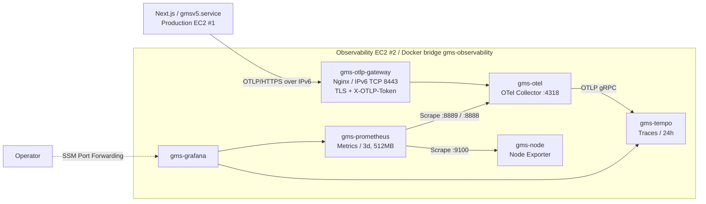

# GMS v5 — Production State（現在の本番状態）

- **基準日:** 2026-11-14（JST）
- **文書種別:** Current State Summary（一次証跡への索引。本書自体は証跡ではない）
- **Owner:** Infrastructure / SRE
- **対象:** Production EC2 #1（Application）とObservability EC2 #2（監視基盤）
- **入口:** [Infrastructure README](./README.md)、[文書全体の案内](../README.md)

> **Evidence policy:** 本書は、日付付きAs-Built記録、Gitで追跡しているTerraform・Workflow定義、GitHub Actionsの読み取り結果を要約したものである。本書の作成にあたり、AWS・EC2・本番DB・systemd・Secretへの照会や変更は行っていない。本書と一次証跡が食い違う場合は**一次証跡を正**とし、本書を修正する。

## 1. 要約

| 領域 | 現在の状態 | 区分 |
|---|---|---|
| Application Release | `364d0b7`（Build ARM64 Release #11） | 実測 |
| Server Traces / Metrics | 本番で有効。実リクエストのTraceとMetricsを確認済み | 実測 |
| 監視基盤 | OTLP Gateway、OTel Collector、Tempo、Prometheus、Grafanaが稼働。Prometheus Targets 4/4 UP | 実測 |
| Browser RUM | コードはあるが本番では無効 | 実測（無効であること） |
| Logs集中管理、Edge監視、Alerting、SLO、自動復旧 | 未完成 | 未実装 |
| 監視InfrastructureのTerraform再現性 | 部分的。EC2・Security Group・IAMまで。Tempo・Gatewayなどホスト上の構成は手動 | 宣言＋手動 |

Phase 1が確認したのは、本番Applicationの計装・送信・保存・検索ができることである。本番Observabilityの運用成熟（検知・通知・復旧）を確立したものではない（[Observability As-Built §12](./observability-as-built-2026-11-13.md#12-production-phase-1-acceptance)）。

## 2. 証跡の区分

本書の各項目は次のいずれかに分類する。区分を混ぜて「実装済み」と読まないこと。

| 区分 | 意味 |
|---|---|
| **実測** | 日付付きAs-Built記録に、コマンド出力・画面・リクエスト結果として残っているもの |
| **報告** | OperatorまたはProduct Ownerの報告。照合ログは未提示 |
| **宣言** | Gitで追跡しているTerraform・Workflowに書かれている内容。AWS実環境との一致は別途確認が要る |
| **継承** | 過去のAs-Builtから引き継いだ情報。以後、再検証していない |
| **手動** | ホスト上またはAWS Consoleで構築され、リポジトリに定義が無いもの |
| **未実装** | 設計はあるが構築していないもの |
| **未確認** | 構築済みだが、検証結果または証跡が記録されていないもの |

## 3. 最新の実測結果

### 3.1 Application Release

| 項目 | 内容 | 区分・根拠 |
|---|---|---|
| 現行Release | `364d0b7ebd4868f6d54b271ce9144b001bd380ca` | 実測：[Observability As-Built §12](./observability-as-built-2026-11-13.md#12-production-phase-1-acceptance) |
| Build | [Build ARM64 Release #11 / Run 43435258778](https://github.com/1716964609/GMSv5/actions/runs/43435258778)：Success。Head SHAは現行Releaseと一致、Branchは`feat/gmsv5-otel`、起動は2026-11-13 22:37 JST | 実測：GitHub Actionsの読み取り（2026-11-14） |
| Artifact SHA256 | 検証済み | 報告：Operator（照合値・照合ログはリポジトリに未記録） |
| 稼働環境 | Production ARM64 EC2上のNext.js Standalone。Telemetry有効で起動、HTTP Readinessは200 | 実測：As-Built §12 |
| 直前のRelease | `9783463`。Rollback用に保持 | 実測：As-Built §12 |
| Applicationの差分 | `9783463`から`364d0b7`までのApplication変更はObservability計装（Commit `75d5b17`）のみ。DB Migrationなし | [Release Readiness](../development/observability/application-release-readiness-2026-11-13.md) |

`364d0b7`は`feat/gmsv5-otel`上のCommitである。本書作成時点のローカルGit参照では、`main`（`c7b75e0`）には計装コードも、後述のSecurity Group規則・IAM Policyも入っていない。

### 3.2 Telemetry経路（Production → Observability）

| 項目 | 内容 | 根拠 |
|---|---|---|
| 受信口 | `gms-otlp-gateway`（`nginx:1.30.6-alpine-slim`）がIPv6 TCP 8443で待ち受け、`http://gms-otel:4318`へ中継 | As-Built §11.3 |
| TLS | Private CAで署名したServer証明書。SANはIPv6アドレス。CAは発行時365日、Server証明書は発行時90日 | As-Built §11.3 |
| 認証 | Header `X-OTLP-Token`。Tokenなしは401、Tokenありは200 | As-Built §11.3 |
| 受付Path | `POST /v1/traces`、`POST /v1/metrics` | As-Built §11.3 |
| Network | Observability SG `sg-07daa1cdcf79d6c93`に、Production EC2のIPv6 `/128`からのTCP 8443を許可（Rule `sgr-0d1314a10664f19e6`）。Terraform applyは「1 added, 0 changed, 0 destroyed」 | As-Built §11.4 |
| Token配布 | SSM Parameter Store SecureString。Production EC2からIPv6 Endpoint経由の取得を確認 | As-Built §12 |
| CA配布 | 公開CA証明書を`/etc/ssl/certs/gmsv5-otel-ca.pem`に配置（`/etc/gmsv5`が`0700`で実行ユーザーから読めなかったため移動） | As-Built §12 |
| Collectorのポート | 4317 / 4318はEC2ホストへ公開していない。Tempoのポートも公開していない | As-Built §11.1、§11.2 |

### 3.3 Distributed Tracing

本番の実リクエストがGrafanaで確認できた（As-Built §12）。

| 観測 | 値 |
|---|---|
| Translation Request全体 | 約6.87秒 |
| DeepL（`gms.deepl.translate`） | 約3.22秒 |
| OpenAI Post-edit（`gms.openai.post_edit`） | 約3.64秒 |
| SQLite読み取りSpan | 約1.84ミリ秒 |

これは1回の観測値であり、Baseline・p95・SLOではない。計測条件（用語数、文章長、同時負荷）は記録されていない。

### 3.4 Application Metrics

- Prometheus Target Health：**4/4 UP**（As-Built §12）。As-Built §4.2に記録されたJobは`prometheus`、`otel-collector`、`otel-application-metrics`、`observability-host`の4件で、Scrape間隔は30秒。
- 確認済みのMetric Family：HTTP Server Request Duration、Translation Durationと選択Term数、DeepL / OpenAIのExternal Request Duration、SQLite Operation Duration、SQLiteのDB / WAL / SHMファイルサイズとFilesystem空き容量、Node.js Event Loop Delay（p50 / p99 / max）、Process Memory、V8 Heap、Uptime。
- Application関連の名前フィルターに一致したMetric名は32種類。

4つのTargetはすべてObservability EC2内のものである。Production EC2のHost Metrics（CPU・Memory・Disk）は収集していない（§6）。

### 3.5 Observability EC2のコンポーネントと資源

EC2 #2：`i-021170e56849c597b`、`t4g.small`、Amazon Linux 2023 ARM64、Root EBS 10 GiB gp3のみ（As-Built §2）。

| Container | Image | Memory上限 | 使用量（2026-11-14） |
|---|---|---:|---:|
| `gms-otlp-gateway` | `nginx:1.30.6-alpine-slim` | 128 MiB | 2.81 MiB |
| `gms-otel` | `otel/opentelemetry-collector:0.165.0` | 192 MiB | 24.99 MiB |
| `gms-tempo` | `grafana/tempo:3.1.1` | 384 MiB | 28.18 MiB |
| `gms-prometheus` | `prom/prometheus:v3.16.0` | 640 MiB | 43.88 MiB |
| `gms-grafana` | `grafana/grafana:13.3.1` | 512 MiB | 358.1 MiB |
| `gms-node` | `prom/node-exporter:v1.12.1` | 128 MiB | 7.438 MiB（2026-11-13の値。11-14の記録なし） |

- Root Filesystem：41%使用、空き5.9 GiB。System MemAvailable：約1.0 GiB。Swapなし（As-Built §12）。
- 保存期間の設定値：Prometheusは3日または512MB、Tempoは24時間（As-Built §4.2、§11.1）。どちらもRoot Filesystem全体の使用量を厳密に制限するものではない。
- Metrics・Traces・Grafanaの状態はすべて同じRoot EBS上にある。Root EBSは`delete_on_termination = true`で、Backupの記録はない。

いずれも一時点の値であり、容量予測や長期安定性の検証ではない。

### 3.6 再検証していない継承情報

次の構成は2026-10-26および2026-11-08のAs-Builtから引き継いでおり、2026-11-14の検証対象には含まれていない。

| 領域 | 内容 | 出典 |
|---|---|---|
| 公開Ingress | DreamHost DNS → CloudFront `E1EF0DWDYA2XH8` → HTTPS / IPv6 → Nginx 443 → Next.js `127.0.0.1:3000` | [As-Built 2026-10-26](./production-as-built-2026-10-26.md) §2〜§4 |
| Origin保護 | CloudFront Origin-Facing IPv6 Prefix ListによるSG制限と、Nginxの`X-GMSV5-Origin-Auth`照合 | As-Built 2026-10-26 §3.3、§4.5 |
| DeepL Egress | 専用CloudFront `E3L3D4LI8CKI2M` と CloudFront Function / KeyValueStore | As-Built 2026-10-26 §4.4 |
| TLS | Viewer側はACM、Origin側はLet's Encrypt（HTTP-01、`certbot-renew.timer`） | As-Built 2026-10-26 §5 |
| Runtime | Node.js 26、`gmsv5.service`、実行ユーザー`gmsv5`、`/opt/gmsv5/releases/<sha>`、systemd Drop-inによる切替 | As-Built 2026-10-26 §6 |
| Persistence | SQLite `/mnt/gms-data/gmsv5.sqlite`、独立した暗号化EBS gp3 | As-Built 2026-10-26 §8 |
| 認証 | Amazon Cognito Classic Hosted UI、PKCE S256 | As-Built 2026-10-26 §7 |
| Baseline 1.2 | CR-01 / CR-02の本番反映、Product Ownerの本番確認、性能受入は未完了 | [As-Built 2026-11-08](./production-as-built-2026-11-08.md) |

## 4. Terraformの管理範囲（宣言）

ここに挙げるのは、Gitで追跡しているTerraformに**宣言されている**資源である。宣言はAWS実環境の監査結果ではない。本書の作成時に`terraform plan`は実行していないため、差分が無いことは確認していない。

### 4.1 `infra/terraform/v5/` — Production

| File | 宣言している資源 |
|---|---|
| `main.tf` | Security Group `gmsv5-app-sg`（Egressのみ）、ENI（IPv6 ×1）、IAM Role `gmsv5-ec2-role`と`AmazonSSMManagedInstanceCore`、Instance Profile、EC2 `t4g.small`（Persistent Spot / 中断時Stop、Root gp3 16 GiB暗号化、`ignore_changes = [ami]`）、Data用EBS gp3 10 GiB暗号化（`prevent_destroy`）、Volume Attachment `/dev/sdf` |
| `ssm-bootstrap.sh` | User Data。SSM AgentのDualstack Endpoint設定のみ |
| `releases.tf` | Release用S3 BucketとPublic Access Block、`releases/*`への`s3:GetObject` |
| `deepl-proxy.tf`、`deepl-proxy-auth.js` | DeepL専用CloudFront Distribution、CloudFront Function、KeyValueStore、`/gmsv5/deepl/proxy-token`の読み取り許可 |
| `cognito.tf` | User Pool、App Client（Callback / Logout URL）、User Pool Domain |
| `cognito-secret.tf` | SSM SecureString `/gmsv5/cognito/client-secret`とその読み取り許可 |
| `ssm-otlp-read.tf` | `/gmsv5/prod/observability/otlp-token`への`ssm:GetParameter`（Commit `364d0b7`） |

### 4.2 `infra/terraform/observability/` — Observability EC2

| File | 宣言している資源 |
|---|---|
| `main.tf` | Security Group（Egress IPv6 `::/0`）、Ingress規則 TCP 8443（Production EC2のIPv6 `/128`から、Commit `10d3e51`）、IAM Role `gmsv5-observability-role`と`AmazonSSMManagedInstanceCore`、Instance Profile、EC2 `t4g.small`（Persistent Spot / 中断時Stop、Public IPv4なし、IPv6 ×1、Root gp3 10 GiB暗号化・`delete_on_termination = true`、IMDSv2必須、`prevent_destroy`、`ignore_changes = [ami]`） |
| `user-data.sh` | User Data。SSM AgentのDualstack Endpoint設定のみ |

### 4.3 Terraformの運用上の事実

- 2つのディレクトリは独立したRoot Moduleで、Stateも別である。
- どちらにも`backend`の宣言が無く、Stateはローカルファイルである。`*.tfstate*`と`*.tfplan`はGit管理外で、共有・Lockの仕組みは無い。
- `cognito-secret.tf`はClient Secretを資源の値として扱うため、StateにSecretが含まれる。Stateをリポジトリや文書に入れてはならない。
- Subnet ID、Production EC2のIPv6アドレスはリテラルで書かれている。2つのStackの間にRemote Stateなどの参照は無い。
- `infra/terraform/observability/`はCommit `c7b75e0`からGitで追跡している。Ingress規則（`10d3e51`）とToken読み取りPolicy（`364d0b7`）は`feat/gmsv5-otel`上にあり、本書作成時点のローカルGit参照では`main`に入っていない。
- applyの証跡があるのはObservability SGのIngress規則のみ（As-Built §11.4）。`ssm-otlp-read.tf`はapply出力の記録が無いが、Production EC2からのToken取得成功がAs-Built §12に記録されている。

## 5. Terraform外：手動構築・リポジトリ未収録

次のものは、追跡しているTerraform・User Dataに宣言が無い。Collector・Prometheus・Tempo・Grafana・Nginx・systemdの設定ファイルはリポジトリに1つも含まれていない。

### 5.1 Observability EC2 #2

| 対象 | 記録されている内容 | 出典 |
|---|---|---|
| Docker EngineとNetwork | Docker bridge `gms-observability` | As-Built §3、§4 |
| 6つのContainer | §3.5の表のとおり。当初の4つは再起動Policy `unless-stopped` | As-Built §4、§11 |
| Collector設定 | `/opt/gmsv5-observability/otel/config.yaml`（変更前のBackup `config.yaml.bak-20261113`） | As-Built §11.2 |
| Tempo設定とデータ | `/opt/gmsv5-observability/tempo/tempo.yaml`、`/opt/gmsv5-observability/tempo-data` | As-Built §11.1 |
| OTLP Gateway | `/opt/gmsv5-observability/otlp-gateway/`。稼働中のNginx設定にTokenが含まれる | As-Built §11.3 |
| Private CAとServer証明書 | 発行・更新・Rotationは手動 | As-Built §11.3 |
| Prometheus設定 | Scrape 4 Job、保存期間3日 / 512MB。設定ファイルのPathは記録なし | As-Built §4.2 |
| Grafana | Data Source（Prometheus、Tempo）、Dashboard「GMS v5 — Observability Infrastructure」、Admin Passwordは`/opt/gmsv5-observability/grafana.env` | As-Built §4.3、§11.1 |
| Docker Volume | `gms-prometheus-data`、`gms-grafana-data`（Root EBS上） | As-Built §4 |

### 5.2 Production EC2 #1

| 対象 | 記録されている内容 | 出典 |
|---|---|---|
| Nginx | `gmsv5-local.conf`、`gmsv5-acme-http.conf`、`gmsv5-https.conf`、Origin認証Header | As-Built 2026-10-26 §5.1、§4.5 |
| Origin証明書 | Certbot、`certbot-renew.timer`、Nginx再読込Hook | As-Built 2026-10-26 §5.2、§5.3 |
| Runtime | Node.js 26、実行ユーザー`gmsv5`、`gmsv5.service`とDrop-in | As-Built 2026-10-26 §6.1 |
| 環境変数 | `/etc/gmsv5/gmsv5.env`（`root:root 600`）。Telemetry関連の記載内容はリポジトリに記録しない | As-Built 2026-10-26 §6.2 |
| Release配置 | `/opt/gmsv5/releases/<sha>`。S3への配置とSSM経由の切替は手動 | As-Built 2026-10-26 §6.4 |
| Data Volume | `/mnt/gms-data`へのMount。TerraformはVolumeとAttachmentまで | As-Built 2026-10-26 §8.1 |
| Telemetry用CA | `/etc/ssl/certs/gmsv5-otel-ca.pem` | Observability As-Built §12 |

### 5.3 AWS側

| 対象 | 状態 |
|---|---|
| 公開CloudFront `E1EF0DWDYA2XH8`、ACM証明書 | 既存Distributionを再利用。Terraformに宣言なし |
| DreamHost DNS | AWS外。Terraformに宣言なし |
| Production SGのInbound規則（TCP 80、TCP 443） | As-Built 2026-10-26 §3.3に記録。Terraformに宣言なし |
| SSM Parameter `/gmsv5/deepl/proxy-token`、`/gmsv5/prod/observability/otlp-token` | 読み取りPolicyのみ宣言。Parameter自体の宣言なし |
| CloudFront KeyValueStoreの`shared-token` | Store自体は宣言。値の投入は宣言なし |
| EBS Snapshot | 2026-11-08に取得の報告あり。定期取得の定義なし |
| VPC、Subnet | 既存のものをIDで参照。管理対象外 |

### 5.4 再現性の評価

`infra/terraform/observability/`を別環境へ適用して得られるのは、SSM AgentをDualstackに設定したAmazon Linux 2023のEC2、Security Group、IAM Roleまでである。Docker、6つのContainer、各設定、証明書、Token、DashboardはAs-Builtの記述から手作業で再構築することになる。その手順は検証されていない。

Production側も同様で、TerraformはEC2・ENI・EBS・IAM・S3・DeepL用CloudFront・Cognitoまでを宣言し、Nginx、証明書、systemd、環境変数、公開CloudFrontは含まない。

## 6. 未実装・未完成

| 領域 | 状態 | 出典 |
|---|---|---|
| Browser RUM、Web Vitals | コードとServer側の受信処理はある。本番では無効（As-Built §12）。Build Workflowに`NEXT_PUBLIC_GMS_RUM_ENABLED`が無いため、本番ArtifactのBrowser側は送信しない。Sampling / Privacy方針（OD-10）は未承認 | As-Built §12、[Telemetry Schema](../development/observability/application-instrumentation.md) |
| Logs集中管理 | Lokiなどは未導入。ApplicationとNginxのLogは各ホスト上のみ | As-Built §8、§12 |
| Edge監視 | CloudFront Server-Timing、Nginx Timing Log、DNS / HTTPSのSynthetic Probeは未実装 | As-Built §8、§12 |
| Alerting | Alertmanager、Alert Rule、通知先は未設定 | As-Built §8、§12 |
| SLI / SLO | 候補のみ。目標値とError Budgetは未定義 | As-Built §12、[As-To-Be §8](../architecture-as-to-be-add-observability.md) |
| 自動復旧 | Spot中断後の復旧、ENI / EBSの再接続、監視基盤の再構築は自動化していない | As-Built §2.1、§11.6、§12 |
| 証明書とSecretのRotation | Gateway証明書の更新、Token Rotationは手動。Server証明書は発行時90日で、発行が2026-11-13前後なら2027年2月中旬に期限を迎える（正確な期限は証明書で確認すること）。失効するとTelemetryの送信が止まる | As-Built §11.3、§11.6 |
| Production Host監視 | EC2 #1のNode Exporterなどは未導入 | As-Built §8、§12 |
| 監視データのBackup | Prometheus、Tempo、GrafanaのBackupと復元手順は無い | As-Built §7、§11.1 |
| 監視基盤自身の監視 | 別経路からの死活監視は無い | As-Built §7 |
| 完全自動CD | Buildは`workflow_dispatch`の手動起動。S3配置、EC2切替は手動 | [Architecture §10](../architecture.md) |
| 監視基盤のIaC化 | §5.1のとおり | 本書§5 |

## 7. 構築済みだが未確認・証跡未提示

| 項目 | 状況 |
|---|---|
| 監視基盤停止時のProduction継続 | ローカルではCollector停止時もApplicationが継続することを確認済み（[検証記録](../development/observability/application-instrumentation-verification-2026-11-13.md) §3.5）。本番での試験記録は無い |
| 本番Traceの機密情報確認 | ローカルおよびSREのローカル経路では一致0件。本番で保存されたTraceに原文・訳文・用語・Keyが無いことを確認した記録はAs-Built §12に無い |
| Collector側の多層Redaction | 推奨事項（Release Readiness Gate G6）。As-Built §11.2のPipelineは`memory_limiter`と`batch`のみを記載している |
| 計測オーバーヘッド | Telemetry有効化前後の応答時間・CPU・Memoryの比較は記録が無い |
| Sampling Rate | 本番の設定値は記録が無い。Applicationの既定は`parentbased_always_on` |
| Tempoの長期容量 | 長時間運用、Disk枯渇時の挙動は未試験（As-Built §11.6） |
| Spot中断時の挙動 | 両EC2とも中断時Stopの設定。実際の中断と再開は未経験（As-Built §2） |
| Grafana Dashboardの保存 | Save後の永続化は独立に確認していない（As-Built §4.3） |
| Terraformと実環境の差分 | 両Stackとも`terraform plan`による無差分確認の記録が無い |
| `364d0b7`切替の実行記録 | Readiness 200と起動成功は記録済み。SSM Command ID、systemdの最終出力、切替先Pathは未記録 |
| 2026-11-08から持ち越し | 本番Migration v2の適用ログ、Rollback / 復元試験、正式な性能受入（[As-Built 2026-11-08](./production-as-built-2026-11-08.md) §4〜§7） |

## 8. 計画文書と実際の構成の差異

[Application Release Readiness（2026-11-13）](../development/observability/application-release-readiness-2026-11-13.md)は、SRE側の実設定が決まる前に書かれた。実際の構成は次の点で異なる。本番の設定は右列を正とする。

| 項目 | Release Readinessの記載 | 実際（Observability As-Built §11〜§12） |
|---|---|---|
| 認証Header | 例として`authorization=Bearer%20<token>` | `X-OTLP-Token` |
| TLS終端と認証 | Collectorが8443で受信する想定 | Nginx Gatewayが8443でTLS終端と認証を行い、Collectorの4318へ中継 |
| CAの配置 | `/etc/gmsv5/otel-collector-ca.pem`（`root:gmsv5 0640`） | `/etc/ssl/certs/gmsv5-otel-ca.pem` |
| TokenのParameter名 | 例として`/gmsv5/otel/collector-token` | Terraformの読み取り許可は`/gmsv5/prod/observability/otlp-token` |
| Trace Backend | 本番に無い（Gate G4未充足） | Tempoを導入済み |

Application側の実装はHeader名に依存しない。`OTEL_EXPORTER_OTLP_HEADERS`などの環境変数に書かれたHeaderをそのまま送る。

## 9. Rollback資産

| 資産 | 状態 |
|---|---|
| 直前のRelease `9783463` | Rollback用に保持（As-Built §12） |
| Telemetryのみの無効化 | `GMS_OTEL_ENABLED`を外して再起動する。手順は[Release Readiness §8.2](../development/observability/application-release-readiness-2026-11-13.md)。本番での実施記録は無い |
| DB | `9783463`と`364d0b7`の間にSchema変更は無い。旧Releaseへ戻す際のDB復元は不要 |
| EBS Snapshot、SQLite Backup | 2026-11-08の報告分（[As-Built 2026-11-08 §5](./production-as-built-2026-11-08.md)）。以後の取得記録は無い |

## 10. 本書の更新方法

1. 新しい実測結果は、まず日付付きAs-Built記録に証跡として書く。
2. 本書の該当行を、その記録へのリンク付きで更新する。区分（§2）を必ず付ける。
3. 古い記録は削除しない。置き換えられた記述には「Superseded」と後継の場所を書く。
4. 計画や希望は本書に書かない。[As-To-Be](../architecture-as-to-be-add-observability.md)に書く。
5. Secret、Token、証明書の秘密鍵、`gmsv5.env`の内容は書かない。Parameter名とFile Pathまでとする。
